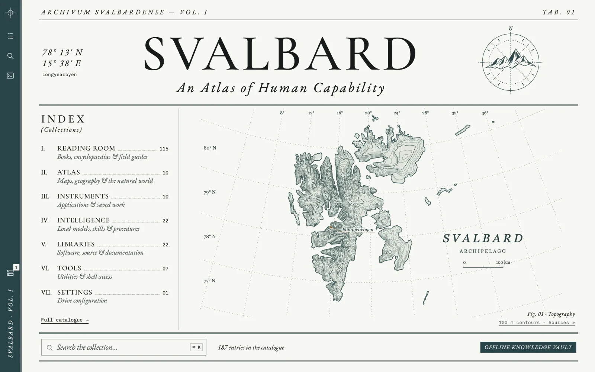
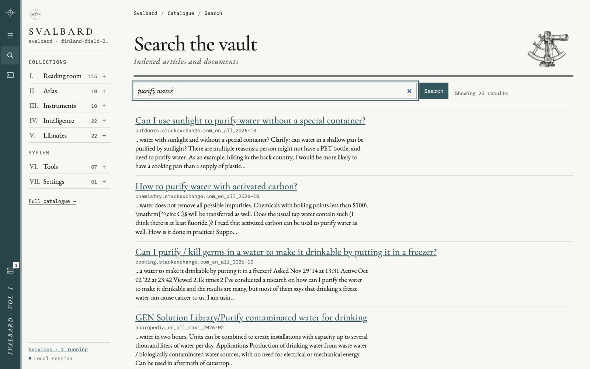
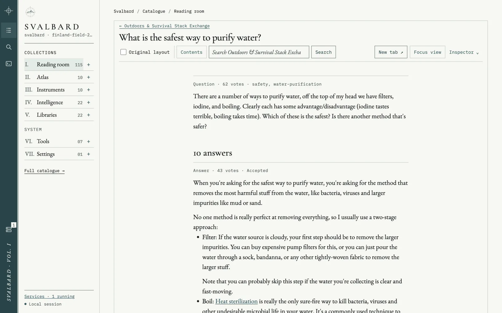
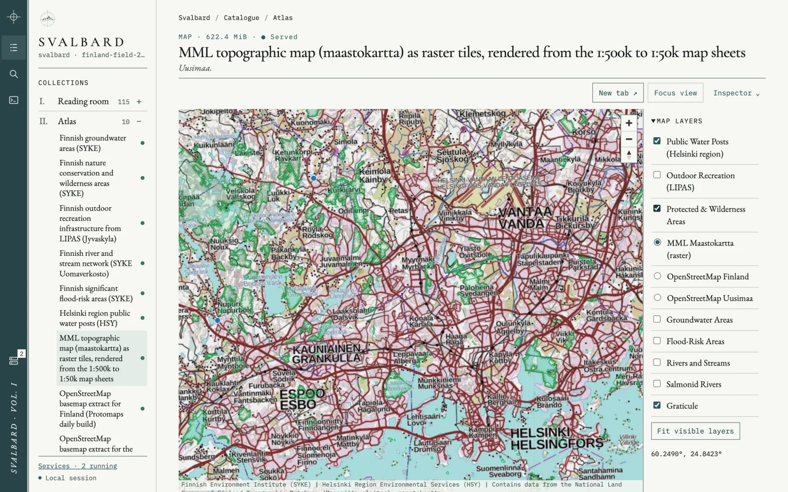
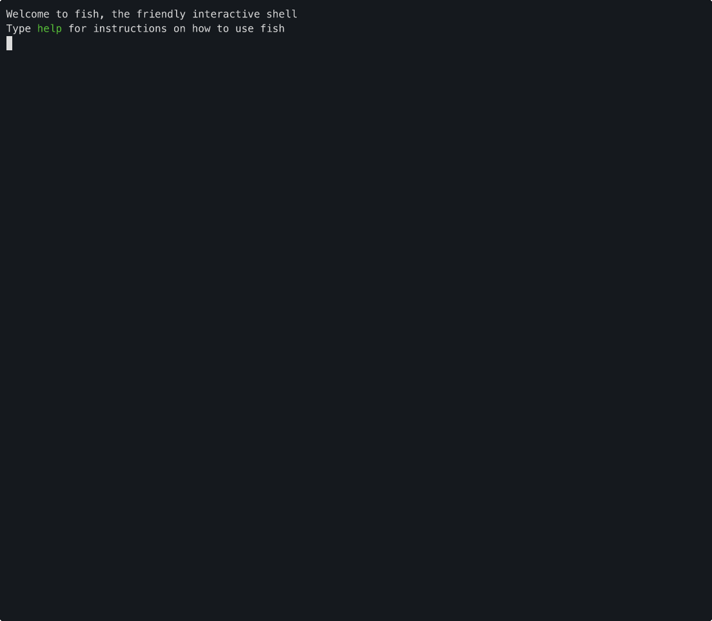

  

# Svalbard

**An offline library, atlas and local AI assistant on one USB drive.**

Svalbard fills a drive with what you would want at hand when the internet is gone: encyclopaedias, medical and repair references, survival manuals, maps, textbooks, programming docs, tools, and a local language model that can search all of it for you. You build the drive while you're online. After that, plug it into a Mac or Linux computer and everything works without a connection.

> **Alpha (v0.8.0).** Svalbard is under active development. Presets, datasets and curation still change, so expect rough edges.

  

Double-click **Svalbard.app** on the drive and the atlas opens in your browser. Everything on the drive is filed in seven collections: the **Reading room**, the **Atlas**, **Instruments**, **Intelligence**, **Libraries**, **Tools** and **Settings**. Readers, maps and models start on demand when you open them.

## What you can do with it

- **Read.** Wikipedia, WikiMed, iFixit, Stack Exchange, Project Gutenberg, army field manuals, Khan Academy and hundreds more, in a reading view built for long pages.
- **Search everything at once.** One search covers the indexed articles and every page of the drive's PDFs, and opens each result at the right page.
- **Find your way.** Topographic maps and OpenStreetMap basemaps with overlays such as public water posts, protected areas, rivers and flood-risk zones. Pan, zoom and toggle layers with no connection.
- **Ask.** A local model searches the archives, reads the pages it finds and names them in its answer.
- **Make things.** The assistant writes calculators, charts, maps, CAD parts and ESP32 firmware into the drive's `workspace/` folder, using JavaScript libraries and toolchains already on the drive.
- **Use the tools.** CyberChef, draw.io, JSCAD, miniPaint, SQLiteViz, DuckDB, a terminal coding agent and a notebook wiki, all running from the stick.
- **Share it.** Serve the drive over the local network so phones and other computers nearby can read it too.
- **Bring your own.** Add your own PDFs (car manuals, house papers, course notes) and they're indexed alongside everything else.

<table>
  <tr>
    <td width="50%"></td>
    <td width="50%"></td>
  </tr>
  <tr>
    <td><em>One search across Stack Exchange, Appropedia, Wikipedia and PDF field manuals.</em></td>
    <td><em>Results open in a calm reading view, with the archive's own search beside it.</em></td>
  </tr>
</table>

  
   <em>The Atlas: the National Land Survey topographic map around Helsinki, with HSY's public water posts and SYKE's protected areas switched on.</em>

## What goes on a drive

Each item on a drive comes from a **recipe**: a short YAML file that says where to get something, how to build it and how to check it. The catalog has over 300 of them.

| Kind | Examples |
|---|---|
| **Reference archives** (189) | Wikipedia in several sizes and languages, WikiMed, WikEM, MedlinePlus, iFixit, Appropedia, CD3WD, Survivor Library, Low-tech Magazine, Project Gutenberg, 39 Stack Exchange sites, LibreTexts, Khan Academy, PhET simulations, TED talk collections, army and NASA manuals, 27 DevDocs sets, the Arch and Gentoo wikis |
| **Maps** (14) | OpenStreetMap basemaps, Natural Earth, the National Land Survey of Finland topographic map, and Finnish overlays for water posts, protected areas, groundwater, rivers, salmon streams, flood risk and outdoor recreation |
| **Local models** (20) | Qwen, Gemma, Inkling and MiniCPM from 0.8B to 35B parameters, grouped to fit 8, 16, 24 or 64 GB of memory, plus embedding models for semantic search |
| **Apps** (9) | Open WebUI, the pi, OpenCode, Goose and omp agents, the SilverBullet wiki, Ghidra, hashcat and the atlas launcher |
| **Tools** (60) | Kiwix, llama.cpp, ripgrep, DuckDB, SQLite, jq, CyberChef, draw.io, JSCAD, miniPaint, a full offline PlatformIO and ESP-IDF toolchain for ESP32, and a security kit with nmap, nuclei, ffuf, sqlmap and friends |
| **Datasets** (6) | Fimea's Finnish medicine registry, MITRE ATT&CK, Exploit-DB, SecLists |
| **Libraries and skills** | Pinned Chart.js, D3, Three.js, JSCAD and MapLibre bundles, and tested procedures the assistant follows for dashboards, maps, diagrams, CAD, slides, spreadsheets, PDFs, Word files, research and firmware |
| **Your own** | Collections of your PDFs and EPUBs, from links, files or whole folders |

You don't pick from 300 items by hand. **Presets** bundle them by drive size, from a 2 GB bug-out kit to a 2 TB everything-drive, in a region-neutral `default` line and a `finland` line with Finnish-language sources and Finnish maps. Behind the presets, **packs** group recipes by what they make possible: survival and medical, homesteading, engineering, communications, computing, sciences, cybersecurity, ESP32 development and local AI sized to your computer's memory. Start from a preset, then add or remove whatever you like.

## Ask the drive

The assistant runs on your own computer and answers from what is on the drive. It searches the archives and your documents, reads the pages it finds and names them. Check those pages before you act on an answer: a small local model can misread one.

> Car won't start. Old Toyota, petrol engine, the starter just clicks.

> What should I put on a mild burn?

> When should I plant potatoes in southern Finland, and how deep?

> What tyre pressure does the manual for my 2012 Corolla give for a full load?

The last question needs your car's manual on the drive: add it as one of [your own documents](#your-own-documents). The first-aid material is reference, not medical advice.

Here a local Qwen3.5 4B model was asked how paper is made and how CARDIAC, a computer made of cardboard, works. It searched Wikiciv and Permacomputing, read both articles, and saved an interactive page that cites them.

<table>
  <tr>
    <td width="50%"></td>
    <td width="50%"></td>
  </tr>
</table>

## Make something

The assistant can also write things and save them in the drive's `workspace/` folder.

> My cabin has a 200 W solar panel and a 100 Ah 12 V battery. Make me a page where I enter what I plug in and for how many hours a day, and it tells me whether the battery lasts the weekend. Take the numbers from the solar pages on the drive.

> Write a JSCAD model of a wall bracket for a 25 mm pipe, 4 mm thick, with two screw holes, so I can export an STL.

> Write ESP32 firmware that reads a soil-moisture sensor on pin 34 every ten minutes and switches the pump relay on pin 26 when the soil is dry. Make it a PlatformIO project.

The calculator is one HTML file that opens in any browser. JSCAD runs from the drive. The firmware builds offline with the PlatformIO toolchain in the `esp32-dev` pack (`./run embedded`); flashing needs the board plugged in.

With the AI clients come **skills**: short, tested procedures the assistant finds with `skill_search` and follows step by step. `svalbard-drive html pack` bundles a page and its libraries into one file that opens offline by double-click.

## Get started

### Install

Download the host binary for your Mac or Linux computer from [Releases](https://github.com/pkronstrom/svalbard/releases), extract it, and put `svalbard` on your path. The macOS binaries are not signed yet: if macOS refuses to open one you downloaded in a browser, run `xattr -d com.apple.quarantine svalbard` once. To build from a checkout with Go installed, run `make build` and use `bin/svalbard`. Recipes that build tools, including the optional Open WebUI install, use Docker during preparation.

### Prepare the drive

1. **Choose a destination.** Run `svalbard init` to open the guided setup. Pick a folder or mounted drive and the platforms you'll use it on. A USB stick works best formatted as exFAT with small (4 KB) clusters; `init` warns when a stick uses large ones.
2. **Choose the contents.** Start with a preset for your drive's size, review it, then add or remove items. To ask questions, add Open WebUI and a model that fits your computer's memory; Qwen3.5 4B runs on an 8 GB machine.
3. **Apply while online.** Let the downloads and indexing finish. The drive keeps both your selections and a record of what was installed, so you can reopen it later to update or change its contents.

### Use it offline

- **Atlas:** double-click **Svalbard.app** on macOS or **Svalbard.desktop** on Linux. A tray icon lets you start and stop services, and unmount the drive safely when you're done. [Launcher guide](docs/web-launcher.md)
- **Terminal:** run `./run` in the drive folder for a keyboard-driven menu with the same library, search, maps, chat and tools.
- **Phone or tablet:** use the share action to serve the drive on your local network, or open the ZIM files directly in a Kiwix app.

For browser chat, choose **Open WebUI** under **Intelligence**. The drive starts the model and its vault tools locally and opens the chat. Small models answer better when you ask them to search first and read the pages they found before they answer.

## Go further

### Your own documents

List your own PDFs in a collection file under `~/.config/svalbard/recipes/`: links, single files or whole folders. Add the collection like any recipe. Svalbard copies the documents into the drive's `books/` folder and indexes every page, so search and the assistant can find, read and cite them. The drive keeps a copy of the collection file, so you can update it from another computer. [Document collections](docs/usage.md#your-own-documents)

### Custom presets

To repeat a setup, copy a built-in preset with `svalbard preset copy default-32 my-field-kit`, edit the YAML under `~/.config/svalbard/presets/`, and pick it in the wizard. [Presets and imports](docs/usage.md)

### Bring your own agent

Give your agent the drive path, a storage budget and the subjects you need, and let it drive the `svalbard` CLI: `plan` and `status` both speak `--json`. On a prepared drive, clients such as OpenCode and Goose can use Svalbard's MCP tools to search and read the archives. [Command reference and vault layout](docs/usage.md)

## Where this is going

The goal is a drive you can hand to someone, or keep in a drawer for years, that just works: every pack usable end to end from the stick, simple to update from the catalog when you're back online, and easy to add to or trim later. Still planned: routing and turn-by-turn directions on the offline maps, and changing a drive's contents from the atlas itself. Windows is not supported yet.

## License

Svalbard is licensed under [GPL-3.0](LICENSE). The archives, tools and models you choose keep their own licenses. Map data in the screenshots © National Land Survey of Finland, Helsinki Region Environmental Services (HSY) and Finnish Environment Institute (SYKE), CC BY 4.0.
