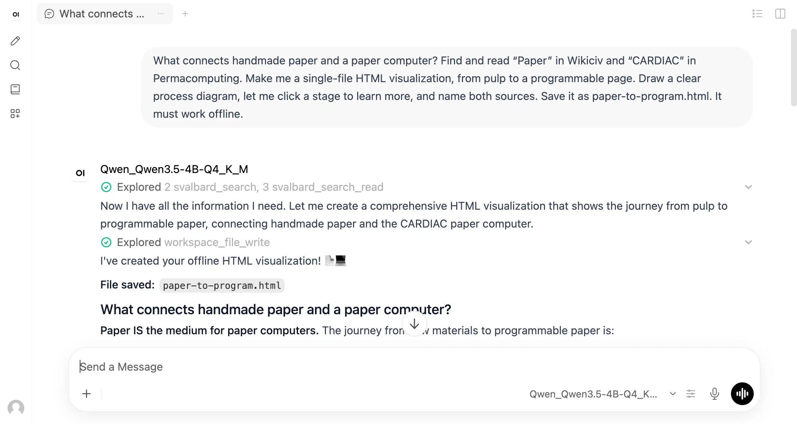
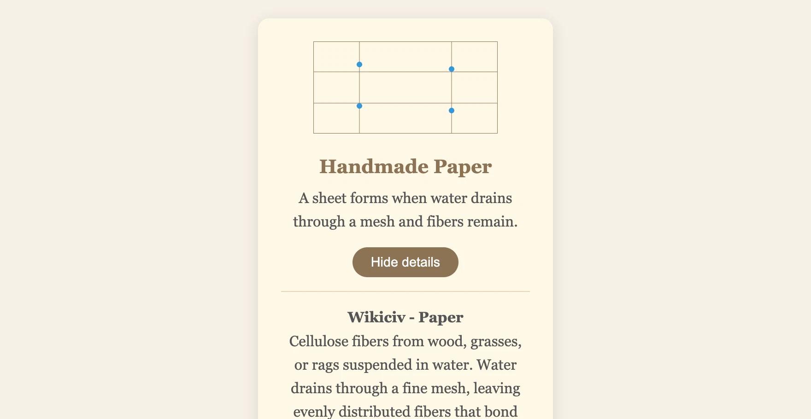
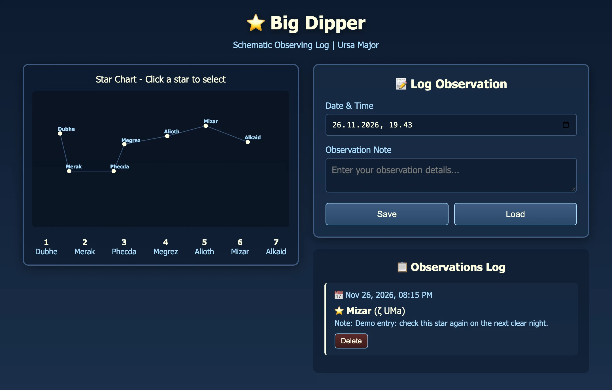
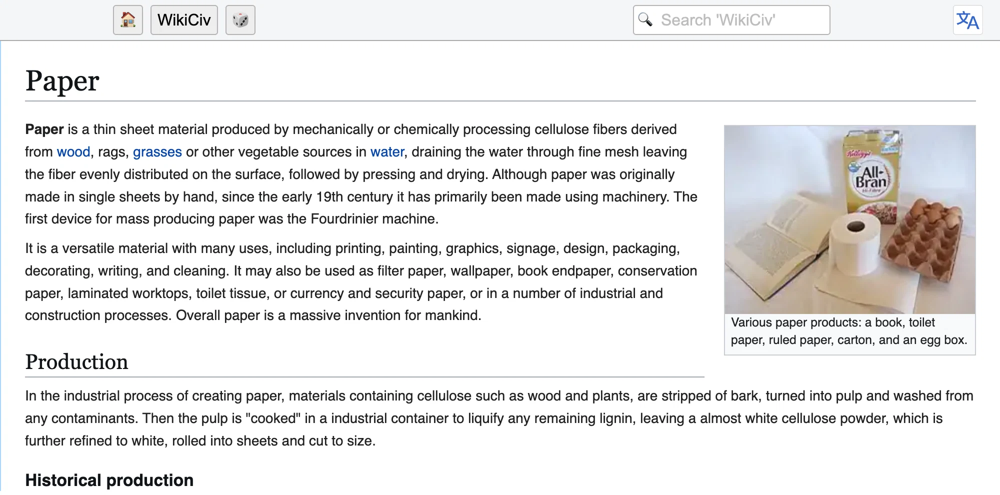
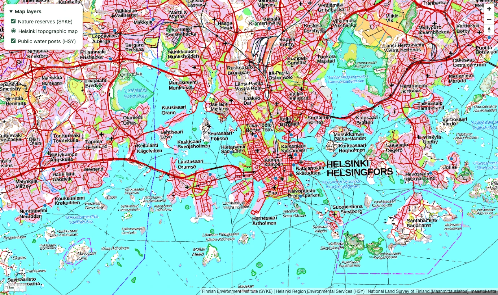

<p align="center">
  
</p>

# Svalbard

**Bring a library, a local model, and a place to save what you make.** Svalbard packs reference material and tools into a folder you can carry on a USB drive. Ask an assistant to read across your archives and turn what it finds into something you can open again tomorrow: a diagram, a field guide, or a small browser app.

Prepare the vault while you have internet access. At your destination, open the drive menu on a Mac or Linux computer. You can use the library and maps on their own, or start a local model in **Open WebUI**.

## What would you make with your vault?

### Turn two sources into one interactive page

> Find information on handmade paper and paper computers. Read *Paper* in Wikiciv and *CARDIAC* in Permacomputing. Make me a single-file HTML visualization that goes from pulp to a programmable page. Let me click through it, name the sources, and save it on the drive.

A local Qwen3.5 4B model searched both ZIM archives, read the articles, and used the workspace file tool to write HTML. We checked its first draft against the articles, then asked for two illustrated cards with a source summary behind each button. The saved page opens directly in a browser.





Try the same pattern with your own topics: **“Read X and Y from this drive, show me how they relate, and save it as one HTML file I can use offline.”** Specify what you want to *do* with the result, such as switch views, compare two methods, or record a measurement.

### Build a tool for a night outside

> Make me an offline observing log. Draw a schematic of the Big Dipper, let me select a star and save a dated observation, and remember my notes when I reopen the page. Put everything in one HTML file.

This example uses the model as a tool builder. The chart is a schematic for choosing a star. The log stores observations in the browser on the computer you use.



The chat and generated-page screenshots were captured on an Apple Silicon Mac with a folder on its internal SSD. For this workflow, use the **Open WebUI** recipe from [Svalbard’s main branch](https://github.com/pkronstrom/svalbard/tree/main). Enable its file tools so the assistant can write to the vault’s `workspace/` folder.

## Explore the drive yourself

### Read the original in Kiwix

Choose **Library**, open an installed archive, and search for the article title. Here’s *Paper*, one of the two sources in the visualization. You can follow its links, inspect the diagrams, and check which details the assistant added.



### Stack map layers for a field trip

Open **Maps**, choose a basemap, and switch the overlays on or off. Around Helsinki harbour you can see where HSY marks public water posts and where SYKE marks protected areas, while keeping the coastline and streets in view. Pan and zoom work offline. **Turn-by-turn directions and route calculation are still planned.**



This capture used three local PMTiles extracts. The basemap came from National Land Survey of Finland sheet L41R. The national topographic tile recipe currently has an unavailable endpoint, so reproducing this particular view requires a separately prepared sheet. Map data © National Land Survey of Finland, Helsinki Region Environmental Services (HSY), and Finnish Environment Institute (SYKE), CC BY 4.0. [Topographic sheet](https://kartat.kapsi.fi/files/maastokarttarasteri_100k_jhs180/kaikki/etrs89/png/L4/L41/) · [Water-post source](recipes/maps/hsy-vesipostit.yaml) · [Protected-areas source](recipes/maps/luonnonsuojelualueet.yaml)

## Install

Download the host binary for your Mac or Linux computer, extract it, and put `svalbard` on your path. To build from a checkout with Go installed, run `make build` and use `bin/svalbard`. Standard downloads use the host binary directly. Recipes that build tools, including the optional Open WebUI install, use Docker during preparation. [Release downloads](https://github.com/pkronstrom/svalbard/releases) · [Usage guide](docs/usage.md)

### Prepare the drive

1. **Choose a destination.** Run `svalbard init` to open the guided setup. Pick a folder or mounted drive and the platforms you’ll use it on.
2. **Choose the contents.** Start with a capacity preset, review its contents, then add or remove items. For the visualization above, include Wikiciv, Permacomputing, Open WebUI and Qwen3.5 4B. Keep the suggested dependencies and enable keyword indexing.
3. **Apply while online.** Let the downloads and selected indexing finish. The vault keeps both your selections and a record of what was installed. Reopen it later to change its contents.


### Use the drive offline

Open the vault folder in a terminal and run `./run` to launch its keyboard-driven menu. **Library** opens installed archives through Kiwix. **Search** looks across indexed articles. **Maps** opens installed maps. On a phone or tablet, a compatible reader such as Kiwix can open the ZIM files directly.

For browser chat, choose **Open WebUI** under **Local AI** and select your installed model if prompted. The drive starts the model and its vault tools locally and opens the chat in your browser. Ask for article titles and have the model read the matches before it summarizes them.

```text
Browser ── Open WebUI ──┬── local model (Qwen in the examples)
                        └── Svalbard search and read tools ── ZIM archives
```

### Bring your own agent

Give your agent the vault path, storage budget and subjects you need. Ask it to check the installed binary’s available commands, show the plan, and report which downloads completed. For interactive research on a prepared drive, supported clients such as OpenCode and Goose can use Svalbard’s Model Context Protocol (MCP) tools to look up sources. [Command reference and vault layout](docs/usage.md)

### Custom presets

To repeat a setup, copy a built-in preset with `svalbard preset copy default-32 my-field-kit`. Edit the YAML under `~/.config/svalbard/presets/`, then select the named preset in the wizard. You can also import your own files into the vault. [Presets and imports](docs/usage.md)

## License

Svalbard is licensed under [GPL-3.0](LICENSE). The archives, tools and models you choose retain their own licenses.
