# mermaid 12.3.0 reference

This is the project's own documentation, joined at the version on this drive. Here nothing is installed or downloaded: import the package by name in a module script and pack the page with `svalbard-drive html pack`. Code blocks marked `not-for-this-stick` and lines starting "Not for this drive:" show package managers, CDN links or downloads; this drive does not use them.

## README

<p align="center">
Not for this drive: 
</p>
<h1 align="center">
Mermaid
</h1>
<p align="center">
Generate diagrams from Markdown-like text.
<p>
<p align="center">
Not for this drive:   <a href="https://www.npmjs.com/package/mermaid"></a>
<p>

<p align="center">
<a href="https://mermaid.ai/live/"><b>Live Editor!</b></a>
</p>
<p align="center">
Not for this drive:  <a href="https://mermaid.ai/open-source/">📖 Documentation</a> | <a href="https://mermaid.ai/open-source/intro/">🚀 Getting Started</a> | <a href="https://www.jsdelivr.com/package/npm/mermaid">🌐 CDN</a> | <a href="https://discord.gg/sKeNQX4Wtj" title="Discord invite">🙌 Join Us</a>
</p>
<p align="center">
<a href="./README.zh-CN.md">简体中文</a>
</p>
<p align="center">
Try Live Editor previews of future releases: <a href="https://develop.git.mermaid.live/" title="Try the mermaid version from the develop branch.">Develop</a> | <a href="https://next.git.mermaid.live/" title="Try the mermaid version from the next branch.">Next</a>
</p>

<br>
<br>

Not for this drive: [](https://www.npmjs.com/package/mermaid)
[](https://github.com/mermaid-js/mermaid/actions/workflows/build.yml)
Not for this drive: [](https://bundlephobia.com/package/mermaid)
[](https://app.codecov.io/github/mermaid-js/mermaid/tree/develop)
Not for this drive: [](https://www.jsdelivr.com/package/npm/mermaid)
Not for this drive: [](https://www.npmjs.com/package/mermaid)
[](https://discord.gg/sKeNQX4Wtj)
[](https://twitter.com/mermaidjs_)
[](https://argos-ci.com?utm_source=mermaid&utm_campaign=oss)
[](https://securityscorecards.dev/viewer/?uri=github.com/mermaid-js/mermaid)


:trophy: **Mermaid was nominated and won the [JS Open Source Awards (2019)](https://osawards.com/javascript/2019) in the category "The most exciting use of technology"!!!**

**Thanks to all involved, people committing pull requests, people answering questions! 🙏**

Not for this drive: <a href="https://mermaid.js.org/landing/"></a>

## README: Table of content

<details>
<summary>Expand contents</summary>

- [About](#about)
- [Examples](#examples)
- [Release](#release)
- [Related projects](#related-projects)
- [Contributors](#contributors---)
- [Security and safe diagrams](#security-and-safe-diagrams)
- [Reporting vulnerabilities](#reporting-vulnerabilities)
- [Appreciation](#appreciation)

</details>

## README: About


Mermaid is a JavaScript-based diagramming and charting tool that uses Markdown-inspired text definitions and a renderer to create and modify complex diagrams. The main purpose of Mermaid is to help documentation catch up with development.

> Doc-Rot is a Catch-22 that Mermaid helps to solve.

Diagramming and documentation costs precious developer time and gets outdated quickly.
But not having diagrams or docs ruins productivity and hurts organizational learning.<br/>
Mermaid addresses this problem by enabling users to create easily modifiable diagrams. It can also be made part of production scripts (and other pieces of code).<br/>
<br/>

Mermaid allows even non-programmers to easily create detailed diagrams through the [Mermaid Live Editor](https://mermaid.live/).<br/>
For video tutorials, visit our [Tutorials](https://mermaid.js.org/ecosystem/tutorials.html) page.
Use Mermaid with your favorite applications, check out the list of [Integrations and Usages of Mermaid](https://mermaid.js.org/ecosystem/integrations-community.html).

You can also use Mermaid within [GitHub](https://github.blog/2022-02-14-include-diagrams-markdown-files-mermaid/) as well many of your other favorite applications—check out the list of [Integrations and Usages of Mermaid](https://mermaid.js.org/ecosystem/integrations-community.html).

For a more detailed introduction to Mermaid and some of its more basic uses, look to the [Beginner's Guide](https://mermaid.js.org/intro/getting-started.html), [Usage](https://mermaid.js.org/config/usage.html) and [Tutorials](https://mermaid.js.org/ecosystem/tutorials.html).

Our PR Visual Regression Testing is powered by [Argos](https://argos-ci.com/?utm_source=mermaid&utm_campaign=oss) with their generous Open Source plan. It makes the process of reviewing PRs with visual changes a breeze.

[](https://argos-ci.com?utm_source=mermaid&utm_campaign=oss)

In our release process we rely heavily on visual regression tests using [applitools](https://applitools.com/). Applitools is a great service which has been easy to use and integrate with our tests.

<a href="https://applitools.com/">
<svg width="170" height="32" viewBox="0 0 170 32" fill="none" xmlns="http://www.w3.org/2000/svg"><mask id="a" maskUnits="userSpaceOnUse" x="27" y="0" width="143" height="32"><path fill-rule="evenodd" clip-rule="evenodd" d="M27.732.227h141.391v31.19H27.733V.227z" fill="#fff"></path></mask><g mask="url(#a)"><path fill-rule="evenodd" clip-rule="evenodd" d="M153.851 22.562l1.971-3.298c1.291 1.219 3.837 2.402 5.988 2.402 1.971 0 2.903-.753 2.903-1.829 0-2.832-10.253-.502-10.253-7.313 0-2.904 2.51-5.45 7.099-5.45 2.904 0 5.234 1.004 6.955 2.367l-1.829 3.226c-1.039-1.075-3.011-2.008-5.126-2.008-1.65 0-2.725.717-2.725 1.685 0 2.546 10.289.395 10.289 7.386 0 3.19-2.724 5.52-7.528 5.52-3.012 0-5.916-1.003-7.744-2.688zm-5.7 2.259h4.553V.908h-4.553v23.913zm-6.273-8.676c0-2.689-1.578-5.02-4.446-5.02-2.832 0-4.409 2.331-4.409 5.02 0 2.724 1.577 5.055 4.409 5.055 2.868 0 4.446-2.33 4.446-5.055zm-13.588 0c0-4.912 3.442-9.07 9.142-9.07 5.736 0 9.178 4.158 9.178 9.07 0 4.911-3.442 9.106-9.178 9.106-5.7 0-9.142-4.195-9.142-9.106zm-5.628 0c0-2.689-1.577-5.02-4.445-5.02-2.832 0-4.41 2.331-4.41 5.02 0 2.724 1.578 5.055 4.41 5.055 2.868 0 4.445-2.33 4.445-5.055zm-13.587 0c0-4.912 3.441-9.07 9.142-9.07 5.736 0 9.178 4.158 9.178 9.07 0 4.911-3.442 9.106-9.178 9.106-5.701 0-9.142-4.195-9.142-9.106zm-8.425 4.338v-8.999h-2.868v-3.98h2.868V2.773h4.553v4.733h3.514v3.979h-3.514v7.78c0 1.111.574 1.936 1.578 1.936.681 0 1.326-.251 1.577-.538l.968 3.478c-.681.609-1.9 1.11-3.8 1.11-3.191 0-4.876-1.648-4.876-4.767zm-8.962 4.338h4.553V7.505h-4.553V24.82zm-.43-21.905a2.685 2.685 0 012.688-2.69c1.506 0 2.725 1.184 2.725 2.69a2.724 2.724 0 01-2.725 2.724c-1.47 0-2.688-1.219-2.688-2.724zM84.482 24.82h4.553V.908h-4.553v23.913zm-6.165-8.676c0-2.976-1.793-5.02-4.41-5.02-1.47 0-3.119.825-3.908 1.973v6.094c.753 1.111 2.438 2.008 3.908 2.008 2.617 0 4.41-2.044 4.41-5.055zm-8.318 6.453v8.82h-4.553V7.504H70v2.187c1.327-1.685 3.227-2.618 5.342-2.618 4.446 0 7.672 3.299 7.672 9.07 0 5.773-3.226 9.107-7.672 9.107-2.043 0-3.907-.86-5.342-2.653zm-10.718-6.453c0-2.976-1.793-5.02-4.41-5.02-1.47 0-3.119.825-3.908 1.973v6.094c.753 1.111 2.438 2.008 3.908 2.008 2.617 0 4.41-2.044 4.41-5.055zm-8.318 6.453v8.82H46.41V7.504h4.553v2.187c1.327-1.685 3.227-2.618 5.342-2.618 4.446 0 7.672 3.299 7.672 9.07 0 5.773-3.226 9.107-7.672 9.107-2.043 0-3.908-.86-5.342-2.653zm-11.758-1.936V18.51c-.753-1.004-2.187-1.542-3.657-1.542-1.793 0-3.263.968-3.263 2.617 0 1.65 1.47 2.582 3.263 2.582 1.47 0 2.904-.502 3.657-1.506zm0 4.159v-1.829c-1.183 1.434-3.227 2.259-5.485 2.259-2.761 0-5.988-1.864-5.988-5.736 0-4.087 3.227-5.593 5.988-5.593 2.33 0 4.337.753 5.485 2.115V13.85c0-1.756-1.506-2.904-3.8-2.904-1.829 0-3.55.717-4.984 2.044L28.63 9.8c2.115-1.901 4.84-2.726 7.564-2.726 3.98 0 7.6 1.578 7.6 6.561v11.186h-4.588z" fill="#00A298"></path></g><path fill-rule="evenodd" clip-rule="evenodd" d="M14.934 16.177c0 1.287-.136 2.541-.391 3.752-1.666-1.039-3.87-2.288-6.777-3.752 2.907-1.465 5.11-2.714 6.777-3.753.255 1.211.39 2.466.39 3.753m4.6-7.666V4.486a78.064 78.064 0 01-4.336 3.567c-1.551-2.367-3.533-4.038-6.14-5.207C11.1 4.658 12.504 6.7 13.564 9.262 5.35 15.155 0 16.177 0 16.177s5.35 1.021 13.564 6.915c-1.06 2.563-2.463 4.603-4.507 6.415 2.607-1.169 4.589-2.84 6.14-5.207a77.978 77.978 0 014.336 3.568v-4.025s-.492-.82-2.846-2.492c.6-1.611.93-3.354.93-5.174a14.8 14.8 0 00-.93-5.174c2.354-1.673 2.846-2.492 2.846-2.492" fill="#00A298"></path></svg>
</a>


## README: Features

- **20+ Diagram Types** – Flowchart, Sequence, Class, State, ER, Gantt, Pie, Git Graph, Mindmap, Timeline, Sankey, and more
- **Markdown-Inspired Syntax** – Write diagrams as text, no drag-and-drop required
- **No Design Tool Needed** – Generate professional diagrams straight from code
- **Live Editor** – Prototype instantly at [mermaid.live](https://mermaid.live)
- **Version-Control Friendly** – Diagrams live as text, so diffs and reviews just work
- **Native GitHub Rendering** – Mermaid code blocks render directly in Markdown on GitHub
- **Highly Customizable** – Themes, colors, fonts, and layout directions
- **Security First** – Built-in sanitization plus a sandboxed rendering mode
- **Lightweight** – Small footprint, no heavy dependencies
- **Active Community** – Frequent releases and thousands of contributors
- **Open Source** – MIT licensed

## README: Examples

**The following are some examples of the diagrams, charts and graphs that can be made using Mermaid. Click here to jump into the [text syntax](https://mermaid.js.org/intro/syntax-reference.html).**


### Flowchart [<a href="https://mermaid.js.org/syntax/flowchart.html">docs</a> - <a href="https://mermaid.live/edit#pako:eNpNkMtqwzAQRX9FzKqFJK7t1km8KDQP6KJQSLOLvZhIY1tgS0GWmgbb_165IaFaiXvOFTPqgGtBkEJR6zOv0Fj2scsU8-ft8I5G5Gw6fe339GN7tnrYaafE45WvRsLW3Ya4bKVWwzVe_xU-FfVsc9hR62rLwvw_2591z7Y3FuUwgYZMg1L4ObrRzMBW1FAGqb8KKtCLGWRq8Ko7CbS0FdJqA2mBdUsTQGf110VxSK1xdJM2EkuDzd2qNQrypQ7s5TQuXcrW-ie5VoUsx9yZ2seVtac2DYIRz0ppK3eccd0ErRTjD1XfyyRIomSBUUzJPMaXOBb8GC4XRfQcFmL-FEYIwzD8AggvcHE">live editor</a>]

```
flowchart LR

A[Hard] -->|Text| B(Round)
B --> C{Decision}
C -->|One| D[Result 1]
C -->|Two| E[Result 2]
```

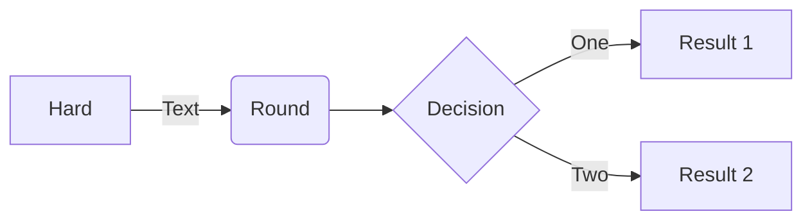

### Sequence diagram [<a href="https://mermaid.js.org/syntax/sequenceDiagram.html">docs</a> - <a href="https://mermaid.live/edit#pako:eNo9kMluwjAQhl_F-AykQMuSA1WrbuLQQ3v1ZbAnsVXHkzrjVhHi3etQwKfRv4w-z0FqMihL2eF3wqDxyUEdoVHhwTuNk-12RzaU4g29JzHMY2HpV0BE0VO6V8ETtdkGz1Zb1F8qiPyG5LX84mrLAmpwoWNh-5a0pWCiAxUwGBXeiVHEU4oq8V_6AHYUwAu2lLLTjVQ4bc1rT2yleI0IfJG320faZ9ABbk-Jz3hZnFxBduR9L2oiM5Jj2WBswJn8-cMArSRbbFDJMo8GK0ielVThmKOpNcD4bBxTlGUFvsOxhMT02QctS44JL6HzAS-iJzCYOwfJfTscunYd542aQuXqQU_RZ9kyt11ZFIM9rR3btJ9qaorOGQuR7c9mWSznyzXMF7hcLeBusTB6P9usq_ntrDKrm9kc5PF4_AMJE56Z">live editor</a>]

```
sequenceDiagram
Alice->>John: Hello John, how are you?
loop HealthCheck
    John->>John: Fight against hypochondria
end
Note right of John: Rational thoughts!
John-->>Alice: Great!
John->>Bob: How about you?
Bob-->>John: Jolly good!
```

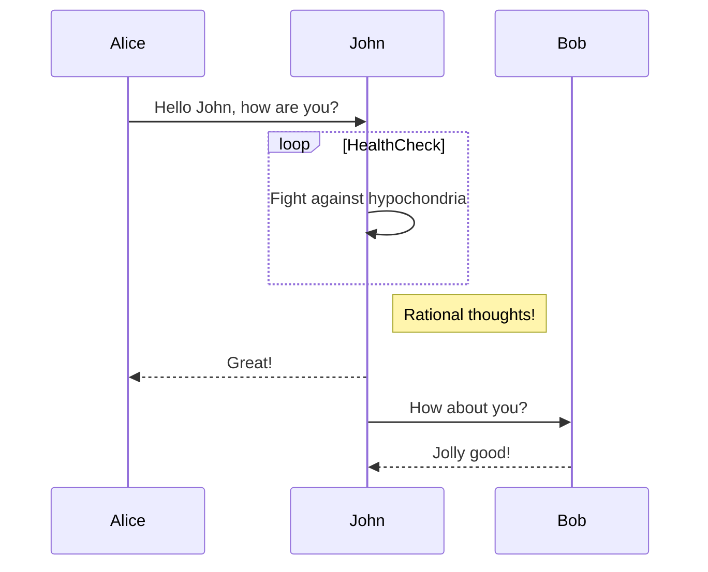

### Gantt chart [<a href="https://mermaid.js.org/syntax/gantt.html">docs</a> - <a href="https://mermaid.live/edit#pako:eNp90cGOgyAQBuBXIZxtFbG29bbZ3fsmvXKZylhJEAyOTZrGd1_sto3xsHMBhu-HBO689hp5xS_giJQbsCbjHTv9jcp9-q63SKhZpb3DhMXSOIiE5ZkoNpnYZGXynh6U-4jBK7JnVfBYJo9QvgjtEya1cj8QwFq0TMz4lZqxTBg0hOF5m1jifI2Lf7Bc490CyxUu1rhc4GLGPOEdhg6Mjq92V44xxanFDhWv4lRjA6MlxZWbIh17DYTf2pAPvGrADphwGMmfbq7mFYURX-jLwCVA91bWg8YYunO69Y8vMgPFI2vvGnOZ-2Owsd0S9UOVpvP29mKoHc_b2nfpYHQLgdrrsUzLvDxALrHcS9hJqeuzOB6avBCN3mciBz5N0y_wxZ0J">live editor</a>]

```
gantt
    section Section
    Completed :done,    des1, 2014-01-06,2014-01-08
    Active        :active,  des2, 2014-01-07, 3d
    Parallel 1   :         des3, after des1, 1d
    Parallel 2   :         des4, after des1, 1d
    Parallel 3   :         des5, after des3, 1d
    Parallel 4   :         des6, after des4, 1d
```

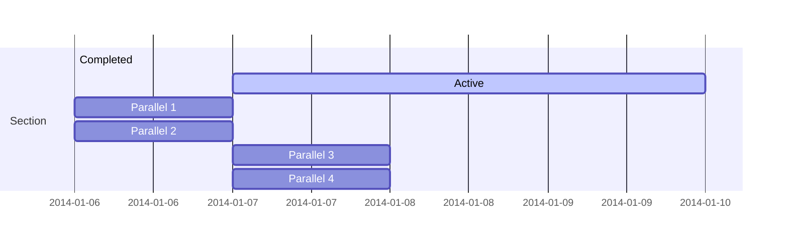

### Class diagram [<a href="https://mermaid.js.org/syntax/classDiagram.html">docs</a> - <a href="https://mermaid.live/edit#pako:eNpdkTFPwzAQhf-K5QlQ2zQJJG1UBaGWDYmBgYEwXO1LYuTEwXYqlZL_jt02asXm--690zvfgTLFkWaUSTBmI6DS0BTt2lfzkKx-p1PytEO9f1FtdaQkI2ulZNGuVqK1qEtgmOfk7BitSzKdOhg59XuNGgk0RDxed-_IOr6uf8cZ6UhTZ8bvHqS5ub1mr9svZPbjk6DEBlu7AQuXyBkx4gcvDk9cUMJq0XT_YaW0kNK5j-ufAoRzcihaQvLcoN4Jv50vvVxw_xrnD3RCG9QNCO4-8OgpqK1dpoJm7smxhF7agp6kfcfB4jMXVmmalW4tnFDorXrbt4xmVvc4is53GKFUwNF5DtTuO3-sShjrJjLVlqLyvNfS4drazmRB4NuzSti6386YagIjeA3a1rtlEiRRsoAoxiSN4SGOOduGy0UZ3YclT-dhBHQYhj8dc6_I">live editor</a>]

```
classDiagram
Class01 <|-- AveryLongClass : Cool
<<Interface>> Class01
Class09 --> C2 : Where am I?
Class09 --* C3
Class09 --|> Class07
Class07 : equals()
Class07 : Object[] elementData
Class01 : size()
Class01 : int chimp
Class01 : int gorilla
class Class10 {
  <<service>>
  int id
  size()
}

```

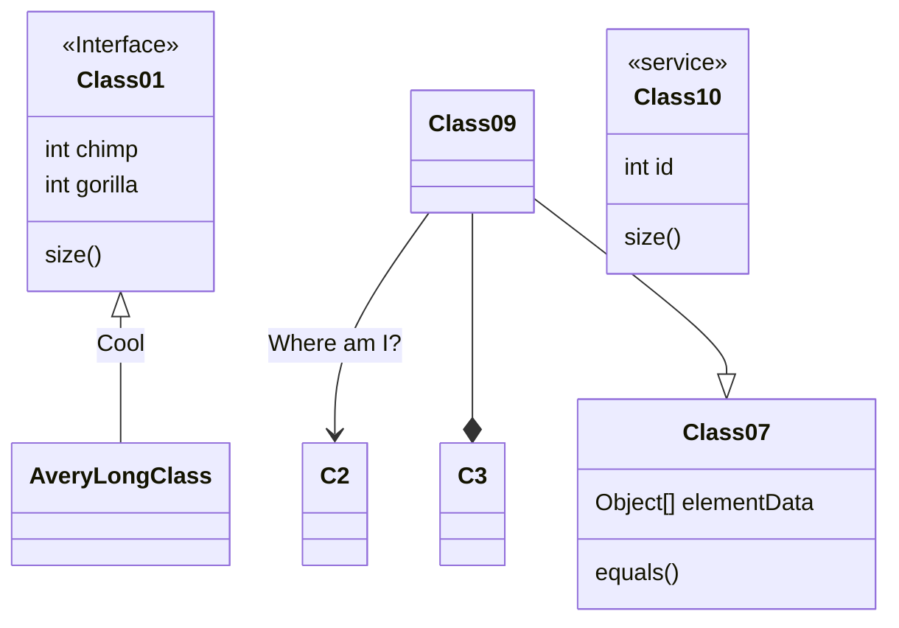

### State diagram [<a href="https://mermaid.js.org/syntax/stateDiagram.html">docs</a> - <a href="https://mermaid.live/edit#pako:eNpdkEFvgzAMhf8K8nEqpYSNthx22Xbcqcexg0sCiZQQlDhIFeK_L8A6TfXp6fOz9ewJGssFVOAJSbwr7ByadGR1n8T6evpO0vQ1uZDSekOrXGFsPqJPO6q-2-imH8f_0TeHXm50lfelsAMjnEHFY6xpMdRAUhhRQxUlFy0GTTXU_RytYeAx-AdXZB1ULWovdoCB7OXWN1CRC-Ju-r3uz6UtchGHJqDbsPygU57iysb2reoWHpyOWBINvsqypb3vFMlw3TfWZF5xiY7keC6zkpUnZIUojwW-FAVvrvn51LLnvOXHQ84Q5nn-AVtLcwk">live editor</a>]

```
stateDiagram-v2
[*] --> Still
Still --> [*]
Still --> Moving
Moving --> Still
Moving --> Crash
Crash --> [*]
```

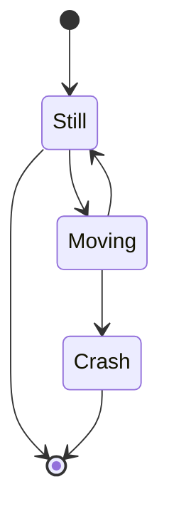

### Pie chart [<a href="https://mermaid.js.org/syntax/pie.html">docs</a> - <a href="https://mermaid.live/edit#pako:eNo9jsFugzAMhl8F-VzBgEEh13Uv0F1zcYkTIpEEBadShXj3BU3dzf_n77e8wxQUgYDVkvQSbsFsEgpRtEN_5i_kvzx05XiC-xvUHVzAUXRoVe7v0heFBJ7JkQSRR0Ua08ISpD-ymlaFTN_KcoggNC4bXQATh5-Xn0BwTPSWbhZNRPdvLQEV5dIO_FrPZ43dOJ-cgtfWnDzFJeOZed1EVZ3r0lie06Ocgqs2q2aMPD_HvuqbfsCmpf7aYte2anrU46Cbz1qr60fdIBzH8QvW9lkl">live editor</a>]

```
pie
"Dogs" : 386
"Cats" : 85.9
"Rats" : 15
```

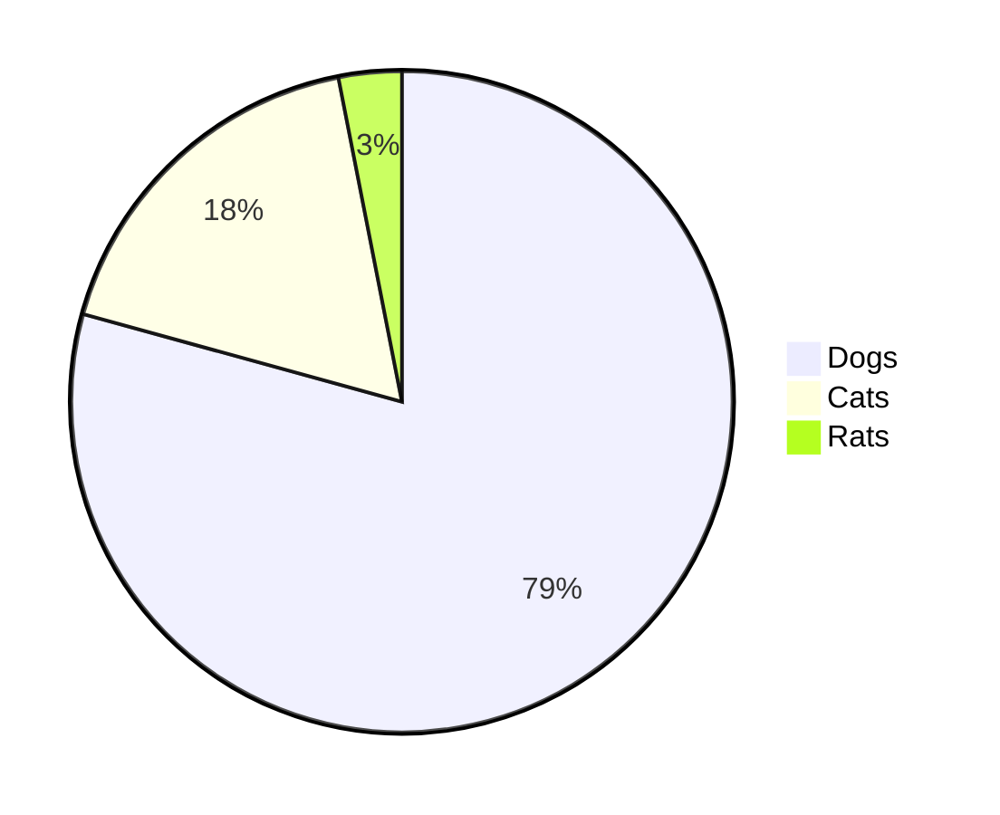

### Git graph [experimental - <a href="https://mermaid.live/edit#pako:eNqNkMFugzAMhl8F-VyVAR1tOW_aA-zKxSSGRCMJCk6lCvHuNZPKZdM0n-zf3_8r8QIqaIIGMqnB8kfEybQ--y4VnLP8-9RF9Mpkmm40hmlnDKmvkPiH_kfS7nFo_VN0FAf6XwocQGgxa_nGsm1bYEOOWmik1dRjGrmF1q-Cpkkj07u2HCI0PY4zHQATh8-7V9BwTPSE3iwOEd1OjQE1iWkBvk_bzQY7s0Sq4Hs7bHqKo8iGeZqbPN_WR7mpSd1RHpvPVhuMbG7XOq_L-oJlRfW5wteq0qorrpe-PBW9Pr8UJcK6rg-BLYPQ">live editor</a>]

```
gitGraph
  commit
  commit
  branch develop
  checkout develop
  commit
  commit
  checkout main
  merge develop
  commit
  commit
```

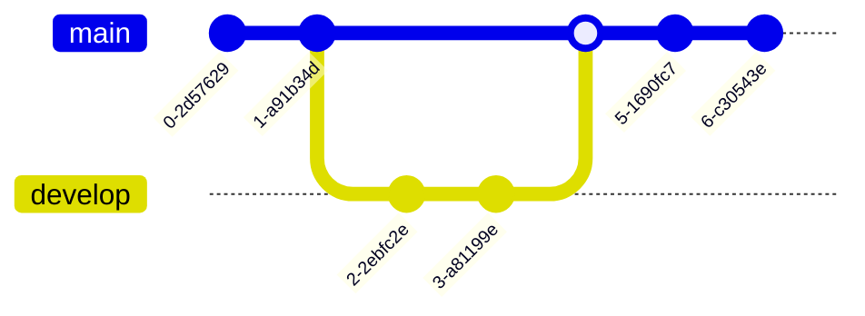

### Bar chart (using gantt chart) [<a href="https://mermaid.js.org/syntax/gantt.html">docs</a> - <a href="https://mermaid.live/edit#pako:eNptkU1vhCAQhv8KIenNugiI4rkf6bmXpvEyFVxJFDYyNt1u9r8X63Z7WQ9m5pknLzieaBeMpQ3dg0dsPUkPOhwteXZIXmJcbCT3xMAxkuh8Z8kIEclyMIB209fqKcwTICFvG4IvFy_oLrZ-g9F26ILfQgvNFN94VaRXQ1iWqpumZBcu1J8p1E1TXDx59eQNr5LyEqjJn6hv5QnGNlxevZJmdLLpy5xJSzut45biYCfb0iaVxvawjNjS1p-TCguG16PvaIPzYjO67e3BwX6GiTY9jPFKH43DMF_hGMDY1J4oHg-_f8hFTJFd8L3br3yZx4QHxENsdrt1nO8dDstH3oVpF50ZYMbhU6ud4qoGLqyqBJRCmO6j0HXPZdGbihUc6Pmc0QP49xD-b5X69ZQv2gjO81IwzWqhC1lKrjJ6pA3nVS7SMiVjrKirWlYp5fs3osgrWeo00lorLWvOzz8JVbXm">live editor</a>]

```
gantt
    title Git Issues - days since last update
    dateFormat  X
    axisFormat %s

    section Issue19062
    71   : 0, 71
    section Issue19401
    36   : 0, 36
    section Issue193
    34   : 0, 34
    section Issue7441
    9    : 0, 9
    section Issue1300
    5    : 0, 5
```

```mermaid
gantt
    title Git Issues - days since last update
    dateFormat  X
    axisFormat %s

    section Issue19062
    71   : 0, 71
    section Issue19401
    36   : 0, 36
    section Issue193
    34   : 0, 34
    section Issue7441
    9    : 0, 9
    section Issue1300
    5    : 0, 5
```

### User Journey diagram [<a href="https://mermaid.js.org/syntax/userJourney.html">docs</a> - <a href="https://mermaid.live/edit#pako:eNplkMFuwjAQRH9l5TMiTVIC-FqqnjhxzWWJN4khsSN7XRSh_HsdKBVt97R6Mzsj-yoqq0hIAXCywRkaSwNxWHNHsB_hYt1ZmwYUfiueKtbWwIcFtjf5zgH2eCZgQgkrCXt64GgMg2fUzkvIn5Xd_V5COtMFvCH_62ht_5yk7MU8sn61HDTfxD8VYiF6cj1qFd94nWkpuKWYKWRcFdUYOi5FaaZoDYNCpnel2Toha-w8LQQGtofRVEKyC_Qw7TQ2DvsfV2dRUTy6Ch6H-UMb7TlGVtbUupl5cF3ELfPgZZLM8rLR3IbjsrJ94rVq0XH7uS2SIis2mOVUrHNc5bmqjul2U2evaa3WL2mGYpqmL2BGiho">live editor</a>]

```
  journey
    title My working day
    section Go to work
      Make tea: 5: Me
      Go upstairs: 3: Me
      Do work: 1: Me, Cat
    section Go home
      Go downstairs: 5: Me
      Sit down: 3: Me
```

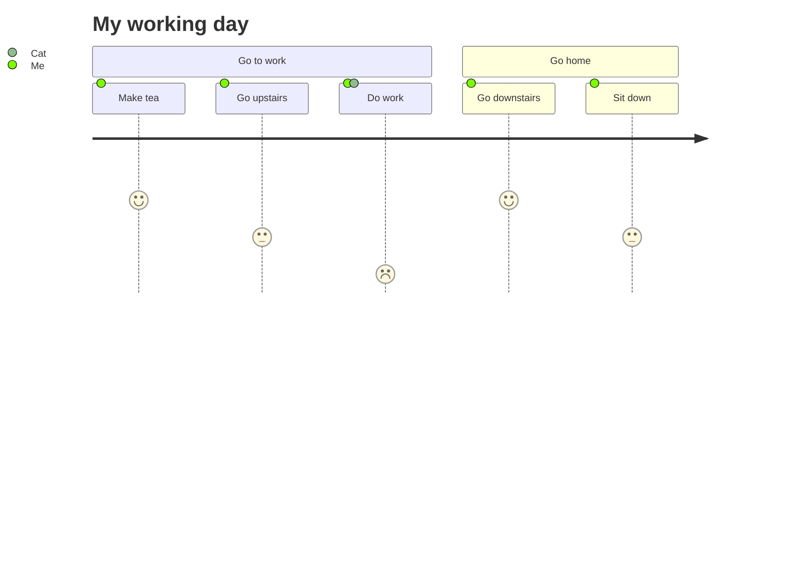

### C4 diagram [<a href="https://mermaid.js.org/syntax/c4.html">docs</a>]

```
C4Context
title System Context diagram for Internet Banking System

Person(customerA, "Banking Customer A", "A customer of the bank, with personal bank accounts.")
Person(customerB, "Banking Customer B")
Person_Ext(customerC, "Banking Customer C")
System(SystemAA, "Internet Banking System", "Allows customers to view information about their bank accounts, and make payments.")

Person(customerD, "Banking Customer D", "A customer of the bank, <br/> with personal bank accounts.")

Enterprise_Boundary(b1, "BankBoundary") {

  SystemDb_Ext(SystemE, "Mainframe Banking System", "Stores all of the core banking information about customers, accounts, transactions, etc.")

  System_Boundary(b2, "BankBoundary2") {
    System(SystemA, "Banking System A")
    System(SystemB, "Banking System B", "A system of the bank, with personal bank accounts.")
  }

  System_Ext(SystemC, "E-mail system", "The internal Microsoft Exchange e-mail system.")
  SystemDb(SystemD, "Banking System D Database", "A system of the bank, with personal bank accounts.")

  Boundary(b3, "BankBoundary3", "boundary") {
    SystemQueue(SystemF, "Banking System F Queue", "A system of the bank, with personal bank accounts.")
    SystemQueue_Ext(SystemG, "Banking System G Queue", "A system of the bank, with personal bank accounts.")
  }
}

BiRel(customerA, SystemAA, "Uses")
BiRel(SystemAA, SystemE, "Uses")
Rel(SystemAA, SystemC, "Sends e-mails", "SMTP")
Rel(SystemC, customerA, "Sends e-mails to")
```

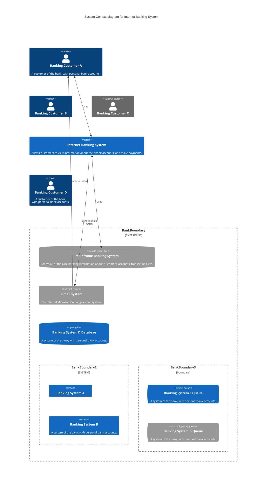

## README: Release

For those who have the permission to do so:

Update version number in `package.json`.

```not-for-this-stick
npm publish
```

The above command generates files into the `dist` folder and publishes them to <https://www.npmjs.com>.

## README: Related projects

- [Command Line Interface](https://github.com/mermaid-js/mermaid-cli)
- [Live Editor](https://github.com/mermaid-js/mermaid-live-editor)
- [HTTP Server](https://github.com/TomWright/mermaid-server)

## README: Contributors [](https://github.com/mermaid-js/mermaid/issues?q=is%3Aissue+is%3Aopen+label%3A%22Good+first+issue%21%22) [](https://github.com/mermaid-js/mermaid/graphs/contributors) [](https://github.com/mermaid-js/mermaid/graphs/contributors)

Mermaid is a growing community and is always accepting new contributors. There's a lot of different ways to help out and we're always looking for extra hands! Look at [this issue](https://github.com/mermaid-js/mermaid/issues/866) if you want to know where to start helping out.

Detailed information about how to contribute can be found in the [contribution guide](https://mermaid.js.org/community/contributing.html)

## README: Security and safe diagrams

For public sites, it can be precarious to retrieve text from users on the internet, storing that content for presentation in a browser at a later stage. The reason is that the user content can contain embedded malicious scripts that will run when the data is presented. For Mermaid this is a risk, specially as mermaid diagrams contain many characters that are used in html which makes the standard sanitation unusable as it also breaks the diagrams. We still make an effort to sanitize the incoming code and keep refining the process but it is hard to guarantee that there are no loop holes.

As an extra level of security for sites with external users we are happy to introduce a new security level in which the diagram is rendered in a sandboxed iframe preventing javascript in the code from being executed. This is a great step forward for better security.

_Unfortunately you cannot have a cake and eat it at the same time which in this case means that some of the interactive functionality gets blocked along with the possible malicious code._

## README: Reporting vulnerabilities

To report a vulnerability, please e-mail <security@mermaid.live> with a description of the issue, the steps you took to create the issue, affected versions, and if known, mitigations for the issue.

## README: Appreciation

A quick note from Knut Sveidqvist:

> _Many thanks to the [d3](https://d3js.org/) and [dagre-d3](https://github.com/cpettitt/dagre-d3) projects for providing the graphical layout and drawing libraries!_
>
> _Thanks also to the [js-sequence-diagram](https://bramp.github.io/js-sequence-diagrams) project for usage of the grammar for the sequence diagrams. Thanks to Jessica Peter for inspiration and starting point for gantt rendering._
>
> _Thank you to [Tyler Long](https://github.com/tylerlong) who has been a collaborator since April 2017._
>
> _Thank you to the ever-growing list of [contributors](https://github.com/mermaid-js/mermaid/graphs/contributors) that brought the project this far!_

---

_Mermaid was created by Knut Sveidqvist for easier documentation._


## theming

> **Warning**
>
> ## THIS IS AN AUTOGENERATED FILE. DO NOT EDIT.
>
> ## Please edit the corresponding file in [/packages/mermaid/src/docs/config/theming.md](../../packages/mermaid/src/docs/config/theming.md).

## theming: Theme Configuration

Dynamic and integrated theme configuration was introduced in Mermaid version 8.7.0.

Themes can now be customized at the site-wide level, or on individual Mermaid diagrams. For site-wide theme customization, the `initialize` call is used. For diagram specific customization, frontmatter config is used.

## theming: Available Themes

1. [**redux-color**](https://github.com/mermaid-js/mermaid/blob/develop/packages/mermaid/src/themes/theme-redux-color.js) - The default theme for the diagram types listed under [Per-diagram defaults](#per-diagram-defaults). It pairs the `redux` geometry and typography with a categorical colour palette, so entities, actors, branches, classes, subgraph containers and chart series each get their own colour.

2. [**redux-dark-color**](https://github.com/mermaid-js/mermaid/blob/develop/packages/mermaid/src/themes/theme-redux-dark-color.js) - The dark counterpart of `redux-color`.

3. [**redux**](https://github.com/mermaid-js/mermaid/blob/develop/packages/mermaid/src/themes/theme-redux.js) - The same geometry and typography as `redux-color`, but monochrome. Use this when you want the colour to carry meaning you assign yourself rather than being cycled per item.

4. [**redux-dark**](https://github.com/mermaid-js/mermaid/blob/develop/packages/mermaid/src/themes/theme-redux-dark.js) - The dark counterpart of `redux`.

5. [**default**](https://github.com/mermaid-js/mermaid/blob/develop/packages/mermaid/src/themes/theme-default.js) - The long-standing Mermaid look, and still the default for every diagram type not listed under [Per-diagram defaults](#per-diagram-defaults).

6. [**neutral**](https://github.com/mermaid-js/mermaid/blob/develop/packages/mermaid/src/themes/theme-neutral.js) - This theme is great for black-and-white documents that will be printed.

7. [**dark**](https://github.com/mermaid-js/mermaid/blob/develop/packages/mermaid/src/themes/theme-dark.js) - This theme goes well with dark-colored elements or dark-mode. To use the dark theme (which changes the theme of the schema itself) with dark-mode (which sets the background), set `darkMode` to `true` in your config.

8. [**forest**](https://github.com/mermaid-js/mermaid/blob/develop/packages/mermaid/src/themes/theme-forest.js) - This theme contains shades of green.

9. [**neo**](https://github.com/mermaid-js/mermaid/blob/develop/packages/mermaid/src/themes/theme-neo.js) - A flatter, softer look, intended to be paired with `look: neo`.

10. [**neo-dark**](https://github.com/mermaid-js/mermaid/blob/develop/packages/mermaid/src/themes/theme-neo-dark.js) - The dark counterpart of `neo`.

11. [**base**](https://github.com/mermaid-js/mermaid/blob/develop/packages/mermaid/src/themes/theme-base.js) - This is the only theme that can be modified. Use this theme as the base for customizations.

## theming: Per-diagram defaults

Not every diagram type defaults to the same theme and look. Since v12.0.0
these do, to the `redux-color` theme and the `neo` look. The name on the left is the **config key** — what you write to
scope a setting to that diagram, which is not always the keyword the diagram starts with:

| Config key    | Diagram              |
| ------------- | -------------------- |
| `agentflow`   | `agentflow-beta`     |
| `flowchart`   | `flowchart`          |
| `swimlane`    | `swimlane-beta`      |
| `class`       | `classDiagram`       |
| `er`          | `erDiagram`          |
| `requirement` | `requirementDiagram` |
| `sequence`    | `sequenceDiagram`    |
| `state`       | `stateDiagram`       |
| `usecase`     | `usecase-beta`       |
| `venn`        | `venn-beta`          |

Every other diagram type defaults to the `default` theme and the `classic` look.

`layout` works the same way. Only `swimlane` overrides it, to `swimlane`; everything else
uses the global default, `dagre`.

These are only defaults, and the most specific thing you say wins. Highest priority first:

1. The diagram's own frontmatter or `%%{init}%%` directive.
2. What you passed to `mermaid.initialize()`.
3. The diagram type's default, above.
4. The global default (`theme: default`, `look: classic`, `layout: dagre`).

A layout that is not registered in the running build falls back to `dagre`, with a warning
in the console. `elk` ships as a separate package you register yourself, and `cose-bilkent`
is only bundled into builds that include the large features, so naming either as a default
does not require every build to carry it.

Within each of the first two you can also scope a value to one diagram type, and the
scoped value wins over the global one you set alongside it. `theme`, `look` and `layout`
can all be set this way:

```javascript
mermaid.initialize({
  look: 'classic', // everything is classic...
  flowchart: { look: 'handDrawn' }, // ...except flowcharts
  er: { theme: 'neutral' },
});
```

The same works in frontmatter, for one diagram:

```yaml
---
config:
  flowchart:
    look: handDrawn
---
```

### Going back to the previous appearance

The nine types above changed appearance when these became their defaults. To draw one the
way Mermaid drew it before, name the previous theme and look in its front matter:

```yaml
---
config:
  theme: default
  look: classic
---
```

For every diagram on a page, pass the same two keys to `mermaid.initialize()`:

```javascript
mermaid.initialize({ theme: 'default', look: 'classic' });
```

## theming: Site-wide Theme

To customize themes site-wide, call the `initialize` method on the `mermaid`.

Example of `initialize` call setting `theme` to `base`:

```javascript
mermaid.initialize({
  securityLevel: 'loose',
  theme: 'base',
});
```

## theming: Diagram-specific Themes

To customize the theme of an individual diagram, use frontmatter config.

Example of frontmatter config setting the `theme` to `forest`:

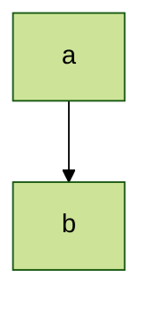


> **Reminder**: the only theme that can be customized is the `base` theme. The following section covers how to use `themeVariables` for customizations.

## theming: Customizing Themes with `themeVariables`

To make a custom theme, modify `themeVariables` via frontmatter config.

You will need to use the [base](#available-themes) theme as it is the only modifiable theme.

| Parameter      | Description                        | Type   | Properties                                                                          |
| -------------- | ---------------------------------- | ------ | ----------------------------------------------------------------------------------- |
| themeVariables | Modifiable with frontmatter config | Object | `primaryColor`, `primaryTextColor`, `lineColor` ([see full list](#theme-variables)) |

Example of modifying `themeVariables` using frontmatter config:

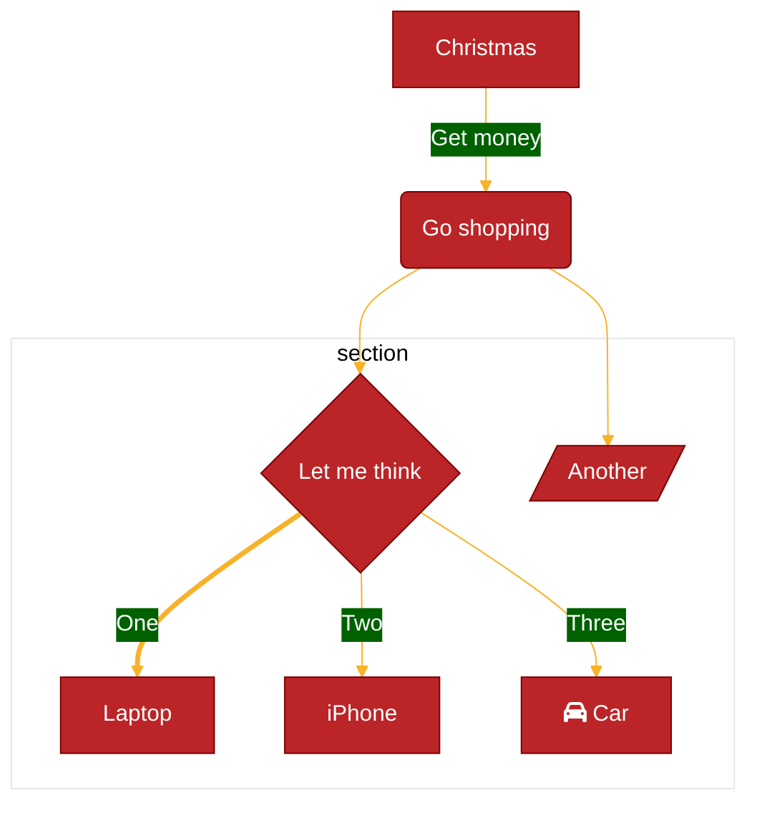


## theming: Color and Color Calculation

To ensure diagram readability, the default value of certain variables is calculated or derived from other variables. For example, `primaryBorderColor` is derived from the `primaryColor` variable. So if the `primaryColor` variable is customized, Mermaid will adjust `primaryBorderColor` automatically. Adjustments can mean a color inversion, a hue change, a darkening/lightening by 10%, etc.

The theming engine will only recognize hex colors and not color names. So, the value `#ff0000` will work, but `red` will not.

## theming: Theme Variables

| Variable             | Default value                      | Description                                                                                                                      |
| -------------------- | ---------------------------------- | -------------------------------------------------------------------------------------------------------------------------------- |
| darkMode             | false                              | Affects how derived colors are calculated. Set value to `true` for dark mode.                                                    |
| background           | #f4f4f4                            | Used to calculate color for items that should either be background colored or contrasting to the background                      |
| fontFamily           | trebuchet ms, verdana, arial       | Font family for diagram text                                                                                                     |
| fontSize             | 16px                               | Font size in pixels                                                                                                              |
| primaryColor         | #fff4dd                            | Color to be used as background in nodes, other colors will be derived from this                                                  |
| primaryTextColor     | calculated from darkMode #ddd/#333 | Color to be used as text color in nodes using `primaryColor`                                                                     |
| secondaryColor       | calculated from primaryColor       |                                                                                                                                  |
| primaryBorderColor   | calculated from primaryColor       | Color to be used as border in nodes using `primaryColor`                                                                         |
| secondaryBorderColor | calculated from secondaryColor     | Color to be used as border in nodes using `secondaryColor`                                                                       |
| secondaryTextColor   | calculated from secondaryColor     | Color to be used as text color in nodes using `secondaryColor`                                                                   |
| tertiaryColor        | calculated from primaryColor       |                                                                                                                                  |
| tertiaryBorderColor  | calculated from tertiaryColor      | Color to be used as border in nodes using `tertiaryColor`                                                                        |
| tertiaryTextColor    | calculated from tertiaryColor      | Color to be used as text color in nodes using `tertiaryColor`                                                                    |
| noteBkgColor         | #fff5ad                            | Color used as background in notes                                                                                                |
| noteTextColor        | #333                               | Text color in note rectangles                                                                                                    |
| noteBorderColor      | calculated from noteBkgColor       | Border color in note rectangles                                                                                                  |
| lineColor            | calculated from background         |                                                                                                                                  |
| textColor            | calculated from primaryTextColor   | Text in diagram over the background for instance text on labels and on signals in sequence diagram or the title in Gantt diagram |
| mainBkg              | calculated from primaryColor       | Background in flowchart objects like rects/circles, class diagram classes, sequence diagram etc                                  |
| errorBkgColor        | tertiaryColor                      | Color for syntax error message                                                                                                   |
| errorTextColor       | tertiaryTextColor                  | Color for syntax error message                                                                                                   |

## theming: Flowchart Variables

| Variable            | Default value                  | Description                 |
| ------------------- | ------------------------------ | --------------------------- |
| nodeBorder          | primaryBorderColor             | Node Border Color           |
| clusterBkg          | tertiaryColor                  | Background in subgraphs     |
| clusterBorder       | tertiaryBorderColor            | Cluster Border Color        |
| defaultLinkColor    | lineColor                      | Link Color                  |
| titleColor          | tertiaryTextColor              | Title Color                 |
| edgeLabelBackground | calculated from secondaryColor |                             |
| nodeTextColor       | primaryTextColor               | Color for text inside Nodes |

## theming: Sequence Diagram Variables

| Variable              | Default value                  | Description                 |
| --------------------- | ------------------------------ | --------------------------- |
| actorBkg              | mainBkg                        | Actor Background Color      |
| actorBorder           | primaryBorderColor             | Actor Border Color          |
| actorTextColor        | primaryTextColor               | Actor Text Color            |
| actorLineColor        | actorBorder                    | Actor Line Color            |
| signalColor           | textColor                      | Signal Color                |
| signalTextColor       | textColor                      | Signal Text Color           |
| labelBoxBkgColor      | actorBkg                       | Label Box Background Color  |
| labelBoxBorderColor   | actorBorder                    | Label Box Border Color      |
| labelTextColor        | actorTextColor                 | Label Text Color            |
| loopTextColor         | actorTextColor                 | Loop Text Color             |
| activationBorderColor | calculated from secondaryColor | Activation Border Color     |
| activationBkgColor    | secondaryColor                 | Activation Background Color |
| sequenceNumberColor   | calculated from lineColor      | Sequence Number Color       |

## theming: Pie Diagram Variables

| Variable            | Default value                  | Description                                |
| ------------------- | ------------------------------ | ------------------------------------------ |
| pie1                | primaryColor                   | Fill for 1st section in pie diagram        |
| pie2                | secondaryColor                 | Fill for 2nd section in pie diagram        |
| pie3                | calculated from tertiary       | Fill for 3rd section in pie diagram        |
| pie4                | calculated from primaryColor   | Fill for 4th section in pie diagram        |
| pie5                | calculated from secondaryColor | Fill for 5th section in pie diagram        |
| pie6                | calculated from tertiaryColor  | Fill for 6th section in pie diagram        |
| pie7                | calculated from primaryColor   | Fill for 7th section in pie diagram        |
| pie8                | calculated from primaryColor   | Fill for 8th section in pie diagram        |
| pie9                | calculated from primaryColor   | Fill for 9th section in pie diagram        |
| pie10               | calculated from primaryColor   | Fill for 10th section in pie diagram       |
| pie11               | calculated from primaryColor   | Fill for 11th section in pie diagram       |
| pie12               | calculated from primaryColor   | Fill for 12th section in pie diagram       |
| pieTitleTextSize    | 25px                           | Title text size                            |
| pieTitleTextColor   | taskTextDarkColor              | Title text color                           |
| pieSectionTextSize  | 17px                           | Text size of individual section labels     |
| pieSectionTextColor | textColor                      | Text color of individual section labels    |
| pieLegendTextSize   | 17px                           | Text size of labels in diagram legend      |
| pieLegendTextColor  | taskTextDarkColor              | Text color of labels in diagram legend     |
| pieStrokeColor      | black                          | Border color of individual pie sections    |
| pieStrokeWidth      | 2px                            | Border width of individual pie sections    |
| pieOuterStrokeWidth | 2px                            | Border width of pie diagram's outer circle |
| pieOuterStrokeColor | black                          | Border color of pie diagram's outer circle |
| pieOpacity          | 0.7                            | Opacity of individual pie sections         |

## theming: State Colors

| Variable      | Default value    | Description                                  |
| ------------- | ---------------- | -------------------------------------------- |
| labelColor    | primaryTextColor |                                              |
| altBackground | tertiaryColor    | Used for background in deep composite states |

## theming: Class Colors

| Variable  | Default value | Description                     |
| --------- | ------------- | ------------------------------- |
| classText | textColor     | Color of Text in class diagrams |

## theming: User Journey Colors

| Variable  | Default value                  | Description                             |
| --------- | ------------------------------ | --------------------------------------- |
| fillType0 | primaryColor                   | Fill for 1st section in journey diagram |
| fillType1 | secondaryColor                 | Fill for 2nd section in journey diagram |
| fillType2 | calculated from primaryColor   | Fill for 3rd section in journey diagram |
| fillType3 | calculated from secondaryColor | Fill for 4th section in journey diagram |
| fillType4 | calculated from primaryColor   | Fill for 5th section in journey diagram |
| fillType5 | calculated from secondaryColor | Fill for 6th section in journey diagram |
| fillType6 | calculated from primaryColor   | Fill for 7th section in journey diagram |
| fillType7 | calculated from secondaryColor | Fill for 8th section in journey diagram |


## usage

> **Warning**
>
> ## THIS IS AN AUTOGENERATED FILE. DO NOT EDIT.
>
> ## Please edit the corresponding file in [/packages/mermaid/src/docs/config/usage.md](../../packages/mermaid/src/docs/config/usage.md).

## usage: Usage

Mermaid is a JavaScript tool that makes use of a Markdown based syntax to render customizable diagrams, charts and visualizations.

Diagrams can be re-rendered/modified by modifying their descriptions.

### CDN

Not for this drive: <https://www.jsdelivr.com/package/npm/mermaid>

Please note that you can switch versions through the dropdown box at the top right.

## usage: Using mermaid

For the majority of users, Using the [Live Editor](https://mermaid.live/) would be sufficient, however you may also opt to deploy mermaid as a dependency or using the [Mermaid API](./setup/README.md).

We have compiled some Video [Tutorials](../ecosystem/tutorials.md) on how to use the Mermaid Live Editor.

### Installing and Hosting Mermaid on a Webpage

Not for this drive: **Using the npm package:**

Requirements:

- Node.js >= 22.12.0

### Supported browsers and runtimes

Mermaid v12.0.0+'s published bundles target ES2024 and are aimed to support Safari 17.4 or later.

We run linting for Chromium 121 and Firefox 123 support as well, but unlike Safari 17.4, we don't commit to supporting these outdated versions.

Older browsers may work too, or you may need to polyfill/transpile mermaid to support them.

```not-for-this-stick
# NPM
npm install mermaid
# Yarn
yarn add mermaid
# PNPM
pnpm add mermaid
```

**Hosting mermaid on a web page:**

> Note: This topic is explored in greater depth in the [User Guide for Beginners](../intro/getting-started.md)

The easiest way to integrate mermaid on a web page requires two elements:

- A graph definition, inside `<pre>` tags labeled `class=mermaid`.

Example:

```html
<pre class="mermaid">
    graph LR
    A --- B
    B-->C[fa:fa-ban forbidden]
    B-->D(fa:fa-spinner);
</pre>
```

- The mermaid js script. Added using a `script` tag as an ESM import.

Example:

```html

```

**Following these directions, mermaid starts at page load and (when the page has loaded) it will locate the graph definitions inside the `pre` tags with `class="mermaid"` and return diagrams in SVG form, following given definitions.**

### Fonts

Mermaid currently uses a few different default `fontFamily` settings, based on
the diagram type and the given theme.

The current preferred fonts are:

- Recursive Variable (open-source font, since v11.15.0)
- Open Sans (open-source font)
- Arial ([Restrictive License](https://en.wikipedia.org/wiki/TrueType_core_fonts_for_the_Web))
- Trebuchet MS ([Restrictive License](https://en.wikipedia.org/wiki/TrueType_core_fonts_for_the_Web))

For a consistent look, we recommend you supply these as web fonts, when possible,
e.g. like:

```not-for-this-stick
<link rel="stylesheet" href="https://cdn.jsdelivr.net/npm/@fontsource/open-sans@5/400.css" />
<link rel="stylesheet" href="https://cdn.jsdelivr.net/npm/@fontsource/open-sans@5/400-italic.css" />
<link
  rel="stylesheet"
  href="https://cdn.jsdelivr.net/npm/@fontsource-variable/recursive@5/index.css"
/>
```

## usage: Simple full example:

```not-for-this-stick
<!doctype html>
<head>
  <link rel="stylesheet" href="https://cdn.jsdelivr.net/npm/@fontsource/open-sans@5/400.css" />
  <link
    rel="stylesheet"
    href="https://cdn.jsdelivr.net/npm/@fontsource/open-sans@5/400-italic.css"
  />
  <link
    rel="stylesheet"
    href="https://cdn.jsdelivr.net/npm/@fontsource-variable/recursive@5/index.css"
  />
</head>
<html lang="en">
  <body>
    <pre class="mermaid">
  graph LR
      A --- B
      B-->C[fa:fa-ban forbidden]
      B-->D(fa:fa-spinner);
    </pre>
    
  </body>
</html>
```

## usage: Notes:

An id attribute is also added to mermaid tags without one.

Mermaid can load multiple diagrams, in the same page.

> Try it out, save this code as HTML and load it using any browser.
> (Except Internet Explorer, please don't use Internet Explorer.)

## usage: Tiny Mermaid

We offer a smaller version of Mermaid that's approximately half the size of the full library. This tiny version doesn't include Mindmap Diagrams, Architecture Diagrams, KaTeX rendering, lazy loading, or the ELK layout engine.

If you need a more lightweight version without these features, you can use [Mermaid Tiny](https://github.com/mermaid-js/mermaid/tree/develop/packages/tiny).

### ELK and the tiny build

The tiny build has never included ELK, and still doesn't — it is a large dependency and staying small is the point of that build. Diagrams that ask for an ELK layout here fall back to Dagre and still render; nothing breaks, they are simply laid out by Dagre.

What changed in v12.0.0 is the main package, not this one: ELK used to be an opt-in `@mermaid-js/layout-elk` install, and is now bundled with `mermaid` and used by default. So **if you want a Mermaid without ELK, the tiny build is the way to get one** — it is no longer simply a matter of not installing the layout package.

If you want the tiny build _and_ ELK, register `@mermaid-js/layout-elk` alongside it. That package continues to be published for exactly this case:

```html


```

Registering the package also makes the named ELK algorithms available — `elk.stress`, `elk.force`, `elk.mrtree`, `elk.sporeOverlap`, `elk.box` and `elk.rectpacking`. On a normal `mermaid` build you do not need this package at all: registering it is harmless but redundant, since the same layouts are already built in.

## usage: Enabling Click Event and Tags in Nodes

A `securityLevel` configuration has to first be cleared. `securityLevel` sets the level of trust for the parsed diagrams and limits click functionality. It is a security measure, aimed at preventing malicious use.

**It is the site owner's responsibility to discriminate between trustworthy and untrustworthy user-bases and we encourage the use of discretion.**

## usage: securityLevel

| Parameter     | Description                       | Type   | Required | Values                                     |
| ------------- | --------------------------------- | ------ | -------- | ------------------------------------------ |
| securityLevel | Level of trust for parsed diagram | String | Optional | 'sandbox', 'strict', 'loose', 'antiscript' |

Values:

- **strict**: (**default**) HTML tags in the text are encoded and click functionality is disabled.
- **antiscript**: HTML tags in text are allowed (only script elements are removed) and click functionality is enabled.
- **loose**: HTML tags in text are allowed and click functionality is enabled.
- **sandbox**: With this security level, all rendering takes place in a sandboxed iframe. This prevents any JavaScript from running in the context. This may hinder interactive functionality of the diagram, like scripts, popups in the sequence diagram, links to other tabs or targets, etc.

> **Note**
> With the default `securityLevel` (`strict`), tags in flowcharts are encoded as tags and clicking is disabled.

**If you are taking responsibility for the diagram source security you can set the `securityLevel` to a value of your choosing. This allows clicks and tags are allowed.**

**To change `securityLevel`, you have to call `mermaid.initialize`:**

```javascript
mermaid.initialize({
  securityLevel: 'loose',
});
```

### Labels out of bounds

If you use dynamically loaded fonts that are loaded through CSS, such as fonts, mermaid should wait for the whole page to load (dom + assets, particularly the fonts file).

```javascript
$(document).ready(function () {
  mermaid.initialize();
});
```

Not doing so will most likely result in mermaid rendering graphs that have labels out of bounds. The default integration in mermaid uses the window\.load event to start rendering.

If your page has other fonts in its body those might be used instead of the mermaid font. Specifying the font in your styling is a workaround for this.

```css
pre.mermaid {
  font-family: 'trebuchet ms', verdana, arial;
}
```

### Using `mermaid.run`

mermaid.run was added in v10 and is the preferred way of handling more complex integration.
By default, `mermaid.run` will be called when the document is ready, rendering all elements with `class="mermaid"`.

You can customize that behavior by calling `await mermaid.run(<config>)`.

`mermaid.initialize({startOnLoad: false})` will prevent `mermaid.run` from being called automatically after load.

Render all elements with querySelector ".someOtherClass"

```js
mermaid.initialize({ startOnLoad: false });
await mermaid.run({
  querySelector: '.someOtherClass',
});
```

Render all elements passed as an array

```js
mermaid.initialize({ startOnLoad: false });
await mermaid.run({
  nodes: [document.getElementById('someId'), document.getElementById('anotherId')],
});
await mermaid.run({
  nodes: document.querySelectorAll('.yetAnotherClass'),
});
```

Render all `.mermaid` elements while suppressing any error

```js
mermaid.initialize({ startOnLoad: false });
await mermaid.run({
  suppressErrors: true,
});
```

### Calling `mermaid.init` - Deprecated

> **Warning**
> mermaid.init is deprecated in v10 and will be removed in a future release. Please use mermaid.run instead.

By default, `mermaid.init` will be called when the document is ready, finding all elements with
`class="mermaid"`. If you are adding content after mermaid is loaded, or otherwise need
finer-grained control of this behavior, you can call `init` yourself with:

- a configuration object
- some nodes, as
  - a node
  - an array-like of nodes
  - or W3C selector that will find your nodes

Example:

```javascript
mermaid.init({ noteMargin: 10 }, '.someOtherClass');
```

Or with no config object, and a jQuery selection:

```javascript
mermaid.init(undefined, $('#someId .yetAnotherClass'));
```

## usage: Usage with webpack

mermaid fully supports webpack. Here is a [working demo](https://github.com/mermaidjs/mermaid-webpack-demo).

## usage: API usage

The main idea of the API is to be able to call a render function with the graph definition as a string. The render function will render the graph and call a callback with the resulting SVG code. With this approach it is up to the site creator to fetch the graph definition from the site (perhaps from a textarea), render it and place the graph somewhere in the site.

The example below shows an example of how this could be used. The example just logs the resulting SVG to the JavaScript console.

```html

```

To determine the type of diagram present in a given text, you can utilize the `mermaid.detectType` function, as demonstrated in the example below.

```html

```

### Binding events

Sometimes the generated graph also has defined interactions like tooltip and click events. When using the API one must
add those events after the graph has been inserted into the DOM.

The example code below is an extract of what mermaid does when using the API. The example shows how it is possible to
bind events to an SVG when using the API for rendering.

```javascript
// Example of using the bindFunctions
const drawDiagram = async function () {
  element = document.querySelector('#graphDiv');
  const graphDefinition = 'graph TB\na-->b';
  const { svg, bindFunctions } = await mermaid.render('graphDiv', graphDefinition);
  element.innerHTML = svg;
  // This can also be written as `bindFunctions?.(element);` using the `?` shorthand.
  if (bindFunctions) {
    bindFunctions(element);
  }
};
```

1. The graph is generated using the render call.
2. After generation the render function calls the provided callback function, in this case it's called insertSvg.
3. The callback function is called with two parameters, the SVG code of the generated graph and a function. This function binds events to the SVG **after** it is inserted into the DOM.
4. Insert the SVG code into the DOM for presentation.
5. Call the binding function that binds the events.

## usage: Example of a marked renderer

This is the renderer used for transforming the documentation from Markdown to html with mermaid diagrams in the html.

```javascript
const renderer = new marked.Renderer();
renderer.code = function (code, language) {
  if (code.match(/^sequenceDiagram/) || code.match(/^graph/)) {
    return '<pre class="mermaid">' + code + '</pre>';
  } else {
    return '<pre><code>' + code + '</code></pre>';
  }
};
```

Another example in CoffeeScript that also includes the mermaid script tag in the generated markup.

```coffee
marked = require 'marked'

module.exports = (options) ->
  hasMermaid = false
  renderer = new marked.Renderer()
  renderer.defaultCode = renderer.code
  renderer.code = (code, language) ->
    if language is 'mermaid'
      html = ''
      if not hasMermaid
        hasMermaid = true
        html += ''
      html + '<pre class="mermaid">'+code+'</pre>'
    else
      @defaultCode(code, language)

  renderer
```

## usage: Advanced usage

### Syntax validation without rendering

The `mermaid.parse(text, parseOptions)` function validates graph definitions without rendering a graph.

The function `mermaid.parse(text, parseOptions)`, takes a text string as an argument and returns `{ diagramType: string }` if the definition follows mermaid's syntax.

If the definition is invalid, the function returns `false` if `parseOptions.suppressErrors` is set to `true`. Otherwise, it throws an error.

The parseError function will be called when the parse function throws an error. It will not be called if `parseOptions.suppressErrors` is set to `true`.

It is possible to override this function in order to handle the error in an application-specific way.

The code-example below in meta code illustrates how this could work:

```javascript
mermaid.parseError = function (err, hash) {
  displayErrorInGui(err);
};

const textFieldUpdated = async function () {
  const textStr = getTextFromFormField('code');

  if (await mermaid.parse(textStr)) {
    reRender(textStr);
  }
};

bindEventHandler('change', 'code', textFieldUpdated);
```

## usage: Configuration

You can pass the required configuration to the `mermaid.initialize` call. This is the preferred way of configuring mermaid.
The list of configuration objects are described [in the mermaidAPI documentation](./setup/README.md).

```html

```

> **Note**
> This is the preferred way of configuring mermaid.

### The following methods are deprecated and are kept only for backwards compatibility.

## usage: Using the mermaid object

It is possible to set some configuration via the mermaid object. The two parameters that are supported using this
approach are:

- mermaid.startOnLoad
- mermaid.htmlLabels

```javascript
mermaid.startOnLoad = true;
```

> **Warning**
> This way of setting the configuration is deprecated. Instead the preferred way is to use the initialize method. This functionality is only kept for backwards compatibility.


## syntax-reference

> **Warning**
>
> ## THIS IS AN AUTOGENERATED FILE. DO NOT EDIT.
>
> ## Please edit the corresponding file in [/packages/mermaid/src/docs/intro/syntax-reference.md](../../packages/mermaid/src/docs/intro/syntax-reference.md).

## syntax-reference: Diagram Syntax

Mermaid's syntax is used to create diagrams. You'll find that it is not too tricky and can be learned in a day. The next sections dive deep into the syntax of each diagram type.

Syntax, together with Deployment and Configuration constitute the whole of Mermaid.

Diagram Examples can be found in the [Mermaid Live Editor](https://mermaid.live), it is also a great practice area.

## syntax-reference: Syntax Structure

One would notice that all **Diagrams definitions begin** with a declaration of the **diagram type**, followed by the definitions of the diagram and its contents. This declaration notifies the parser which kind of diagram the code is supposed to generate. The only exception to this a [Frontmatter](#frontmatter-for-diagram-code) configuration.

Line comments can ignore anything on the line after '%% '.

Unknown words and misspellings will break a diagram, while parameters silently fail.

**Example** : The code below is for an Entity Relationship Diagram, specified by the `erDiagram` declaration. What follows is the definition of the different `Entities` represented in it.

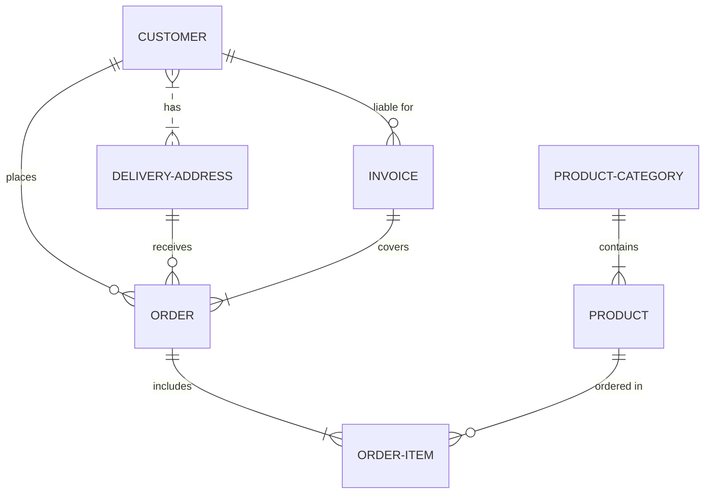


The [Getting Started](./getting-started.md) section can also provide some practical examples of mermaid syntax.

## syntax-reference: Diagram Breaking

One should **beware the use of some words or symbols** that can break diagrams. These words or symbols are few and often only affect specific types of diagrams. The table below will continuously be updated.

| Diagram Breakers                                                                  | Reason                                                                  | Solution                                          |
| --------------------------------------------------------------------------------- | ----------------------------------------------------------------------- | ------------------------------------------------- |
| **Comments**                                                                      |                                                                         |                                                   |
| [`%%{``}%%`](https://github.com/mermaid-js/mermaid/issues/1968)                   | Similar to [Directives](../config/directives.md) confuses the renderer. | In comments using `%%`, avoid using "{}".         |
| **Flow-Charts**                                                                   |                                                                         |                                                   |
| 'end'                                                                             | The word "End" can cause Flowcharts and Sequence diagrams to break      | Wrap them in quotation marks to prevent breakage. |
| [Nodes inside Nodes](../syntax/flowchart.md#special-characters-that-break-syntax) | Mermaid gets confused with nested shapes                                | wrap them in quotation marks to prevent breaking  |

## syntax-reference: Mermaid Live Editor

Now, that you've seen what you should not add to your diagrams, you can play around with them in the [Mermaid Live Editor](https://mermaid.live).

## syntax-reference: Configuration

Configuration is the third part of Mermaid, after deployment and syntax. It deals with the different ways that Mermaid can be customized across different deployments.

If you are interested in altering and customizing your Mermaid Diagrams, you will find the methods and values available for [Configuration](../config/setup/README.md) here. It includes themes.
This section will introduce the different methods of configuring the behaviors and appearances of Mermaid Diagrams.
The following are the most commonly used methods, and they are all tied to Mermaid [Deployment](./getting-started.md) methods.

### Configuration Section in the [Live Editor](https://mermaid.live).

Here you can edit certain values to change the behavior and appearance of the diagram.

Each of these techniques are functionally equivalent, but better for different deployments.

### [The initialize() call](./getting-started.md#_4-calling-the-mermaid-javascript-api)

Used when Mermaid is called via an API, or through a `<script>` tag.

### Frontmatter for diagram code

Frontmatter is the term for adding YAML metadata at the start of code. This allows for reconfiguration of a diagram before it is rendered. You can pass metadata Frontmatter with your definition by adding `---` to the lines before and after the definition. This 'triple dash' MUST be the only character on the first line.

Frontmatter uses YAML syntax. It requires any indentation to be consistent and settings are case sensitive. Mermaid will silently ignore misspelling, but badly formed parameters will break the diagram.

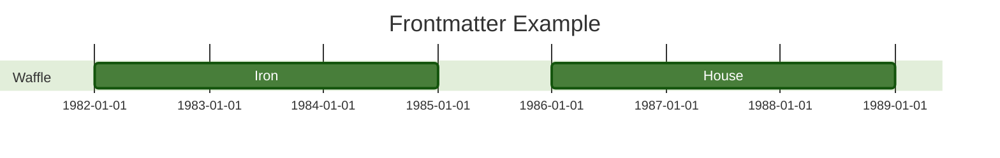


### [Directives](../config/directives.md)

Allows for the limited reconfiguration of a diagram just before it is rendered. It can alter the font style, color and other aesthetic aspects of the diagram. You can pass a directive alongside your definition inside `%%{ }%%`. It can be done either above or below your diagram definition.

### [Theme Manipulation](../config/theming.md)

An application of using Directives to change [Themes](../config/theming.md). `Theme` is a value within Mermaid's configuration that dictates the color scheme for diagrams.

### Layout and look

We've restructured how Mermaid renders diagrams, enabling new features like selecting layout and look. **Currently, this is supported for flowchart, state, class, entity relationship, requirement, use case, and agentflow diagrams**, with plans to extend support to all diagram types. Mindmaps are the exception: they keep their own `cose-bilkent` layout unless a layout is explicitly set (the tiny build, which ships neither ELK nor cose-bilkent, falls back to Dagre).

### Selecting Diagram Looks

Mermaid offers a variety of styles or “looks” for your diagrams, allowing you to tailor the visual appearance to match your specific needs or preferences.

**Available Looks:**

- Neo Look: A flatter, softer style with rounded corners and subtle shadows, designed to pair with the `redux-color` theme family. It is the default for the diagram types listed under [Per-diagram defaults](../config/theming.md#per-diagram-defaults).
- Hand-Drawn Look: For a more personal, creative touch, the hand-drawn look brings a sketch-like quality to your diagrams. This style is perfect for informal settings or when you want to add a bit of personality to your diagrams.
- Classic Look: If you prefer the traditional Mermaid style, the classic look maintains the original appearance that many users are familiar with. It’s great for consistency across projects or when you want to keep the familiar aesthetic. It is the default for every other diagram type.

Note that the `neo` look paints node strokes with a gradient when the active theme sets `useGradient`, which `base` does by default. Setting a custom `nodeBorder` on `base` turns the gradient off so your colour is what shows; set `useGradient: true` alongside it if you want to keep the gradient.

**How to Select a Look:**

You can select a look by adding the look parameter in the metadata section of your Mermaid diagram code. Here’s an example:

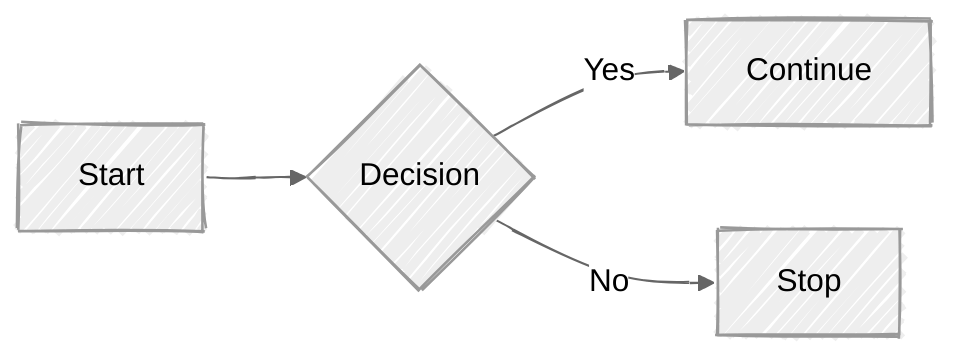

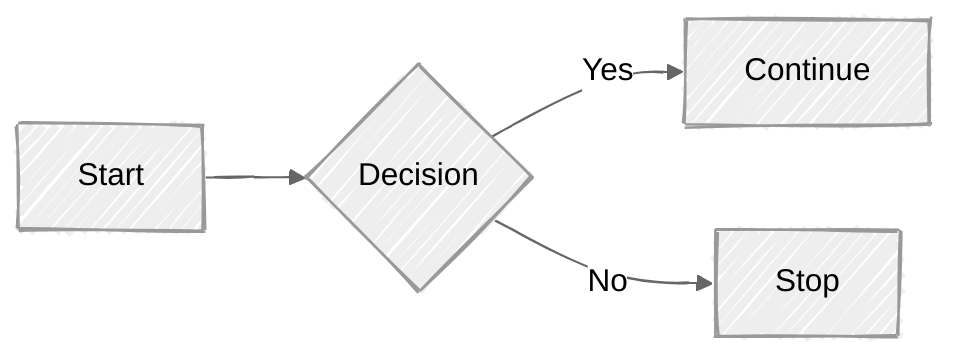

#### Selecting Layout Algorithms

In addition to customizing the look of your diagrams, Mermaid Chart now allows you to choose different layout algorithms to better organize and present your diagrams, especially when dealing with more complex structures. The layout algorithm dictates how nodes and edges are arranged on the page.

#### Supported Layout Algorithms:

- ELK (default): The ELK (Eclipse Layout Kernel) layout offers more sophisticated layout capabilities, especially for large or intricate diagrams, producing a more optimized arrangement with fewer overlaps. It is bundled with Mermaid and needs no setup.
- Dagre: The classic layout algorithm used by Mermaid for a long time. It provides a good balance of simplicity and visual clarity, and remains available with `layout: dagre`.

> **Note**
> The `mermaid` **tiny** build omits ELK to stay small. Diagrams asking for an
> ELK layout there fall back to Dagre.

#### How to Select a Layout Algorithm:

You can specify the layout algorithm directly in the metadata section of your Mermaid diagram code. Here’s an example:

```mermaid
---
config:
  layout: elk
  look: handDrawn
  theme: dark
---
flowchart TB
  A[Start] --> B{Decision}
  B -->|Yes| C[Continue]
  B -->|No| D[Stop]
```

```mermaid-example
---
config:
  layout: elk
  look: handDrawn
  theme: dark
---
flowchart TB
  A[Start] --> B{Decision}
  B -->|Yes| C[Continue]
  B -->|No| D[Stop]
```

In this example, the `layout: elk` line configures the diagram to use the ELK layout algorithm, along with the hand drawn look and forest theme.

#### Customizing ELK Layout:

When using the ELK layout, you can further refine the diagram’s configuration, such as how nodes are placed and whether parallel edges should be combined:

- To combine parallel edges, use mergeEdges: true | false.
- To configure node placement, use nodePlacementStrategy with the following options:
  - SIMPLE
  - NETWORK_SIMPLEX
  - LINEAR_SEGMENTS
  - BRANDES_KOEPF (default)
- To configure Brandes-Koepf node placement alignment, use nodePlacementAlignment with the following options:
  - NONE
  - LEFTUP
  - LEFTDOWN
  - RIGHTUP
  - RIGHTDOWN
  - BALANCED
- When nodePlacementAlignment is not set, the alignment comes from the `elk.preset` option: BALANCED for the `default` preset, and NONE for the named non-default presets `legacy`, `modelOrder` and `depthFirst`. Use `preset: depthFirst` to get the former default layout, or set nodePlacementAlignment explicitly to override the preset.

**Example configuration:**

```
---
config:
  layout: elk
  elk:
    mergeEdges: true
    nodePlacementStrategy: LINEAR_SEGMENTS
    nodePlacementAlignment: NONE
---
flowchart LR
  A[Start] --> B{Choose Path}
  B -->|Option 1| C[Path 1]
  B -->|Option 2| D[Path 2]

```

#### Using Dagre Layout with Classic Look:

Another example:

```
---
config:
  layout: dagre
  look: classic
  theme: default
---

flowchart LR
A[Start] --> B{Choose Path}
B -->|Option 1| C[Path 1]
B -->|Option 2| D[Path 2]

```

These options give you the flexibility to create diagrams that not only look great but are also arranged to best suit your data’s structure and flow.

When integrating Mermaid, you can include look and layout configuration with the initialize call:

```js
mermaid.initialize({ look: 'handDrawn', layout: 'elk' });
```

ELK ships with Mermaid, so no separate package or registration is needed — the
`@mermaid-js/layout-elk` dependency and its `registerLayoutLoaders` call can be
removed. That package is still published for builds that omit ELK, which today
means the **tiny** build.


## agentflow

> **Warning**
>
> ## THIS IS AN AUTOGENERATED FILE. DO NOT EDIT.
>
> ## Please edit the corresponding file in [/packages/mermaid/src/docs/syntax/agentflow.md](../../packages/mermaid/src/docs/syntax/agentflow.md).

## agentflow: Agentflow (v12.0.0+)

> **Warning**
> Agentflow is in beta. Diagrams start with the `agentflow-beta` keyword, and the syntax may still change in a backwards-incompatible way before it is declared stable.

> An agentflow diagram describes an agentic workflow: the agents that do the work, the flows they run, the tasks and tools inside those flows, and how control and data move between them.

## agentflow: Introduction

A flowchart tells you what happens next. An agentflow tells you _who_ is doing it, _with which tool_, and _what contract_ holds at each step. It keeps the familiar flowchart feel — nodes, arrows, containers — but adds a small vocabulary aimed at describing systems built out of language-model agents:

- **Containers** (`flow … end`) group work and nest to any depth.
- **Shapes** carry meaning: a `task` is not a `tool` is not a `decision`.
- **Edges** carry meaning: sequence, reference, and failure are three different arrows.
- **Metadata** (`@{ … }`) attaches the non-visual detail — the model, the instruction, the parameter and return types, the connector a tool is bound to.

## agentflow: Basic example

```mermaid
agentflow-beta TB
  flow reviewer["Review Agent"]
    changes["Gather changes"]@{ shape: input }
    analyse["Analyse diff"]@{ shape: task }
    lint["run_linter"]@{ shape: tool }
    ok["Clean?"]@{ shape: decision }

    changes --> analyse --> lint --> ok
  end
```

```mermaid-example
agentflow-beta TB
  flow reviewer["Review Agent"]
    changes["Gather changes"]@{ shape: input }
    analyse["Analyse diff"]@{ shape: task }
    lint["run_linter"]@{ shape: tool }
    ok["Clean?"]@{ shape: decision }

    changes --> analyse --> lint --> ok
  end
```

## agentflow: Default theme, look and layout (v12.0.0+)

Agentflow diagrams use the `redux-color` theme and the `neo` look by default, and are laid out by [ELK](https://www.eclipse.org/elk/) rather than Dagre. Not every
diagram type does — see [Per-diagram defaults](../config/theming.md#per-diagram-defaults) for
the list and for the order in which Mermaid decides.

The same diagram, drawn both ways:

### With the defaults

```mermaid
agentflow-beta TB
  brief["Release brief"]@{ shape: input }
  flow writer["Drafting Agent"]
    draft["Draft the notes"]@{ shape: task }
    lookup["changelog_search"]@{ shape: tool }
    guide["Tone of voice"]@{ shape: refdoc }
    draft --> lookup
    draft -.- guide
  end
  flow reviewer["Review Agent"]
    check["Check the claims"]@{ shape: task }
    ok["Accurate?"]@{ shape: decision }
    check --> ok
  end
  publish["Publish"]@{ shape: action }
  brief --> writer
  writer --> reviewer
  ok --> publish
```

```mermaid-example
agentflow-beta TB
  brief["Release brief"]@{ shape: input }
  flow writer["Drafting Agent"]
    draft["Draft the notes"]@{ shape: task }
    lookup["changelog_search"]@{ shape: tool }
    guide["Tone of voice"]@{ shape: refdoc }
    draft --> lookup
    draft -.- guide
  end
  flow reviewer["Review Agent"]
    check["Check the claims"]@{ shape: task }
    ok["Accurate?"]@{ shape: decision }
    check --> ok
  end
  publish["Publish"]@{ shape: action }
  brief --> writer
  writer --> reviewer
  ok --> publish
```

### The previous appearance

Both are only defaults, so anything you set yourself wins. Naming the previous theme and look
in a diagram's front matter draws it the way Mermaid did before:

```mermaid
---
config:
  theme: default
  look: classic
  layout: dagre
---
agentflow-beta TB
  brief["Release brief"]@{ shape: input }
  flow writer["Drafting Agent"]
    draft["Draft the notes"]@{ shape: task }
    lookup["changelog_search"]@{ shape: tool }
    guide["Tone of voice"]@{ shape: refdoc }
    draft --> lookup
    draft -.- guide
  end
  flow reviewer["Review Agent"]
    check["Check the claims"]@{ shape: task }
    ok["Accurate?"]@{ shape: decision }
    check --> ok
  end
  publish["Publish"]@{ shape: action }
  brief --> writer
  writer --> reviewer
  ok --> publish
```

```mermaid-example
---
config:
  theme: default
  look: classic
  layout: dagre
---
agentflow-beta TB
  brief["Release brief"]@{ shape: input }
  flow writer["Drafting Agent"]
    draft["Draft the notes"]@{ shape: task }
    lookup["changelog_search"]@{ shape: tool }
    guide["Tone of voice"]@{ shape: refdoc }
    draft --> lookup
    draft -.- guide
  end
  flow reviewer["Review Agent"]
    check["Check the claims"]@{ shape: task }
    ok["Accurate?"]@{ shape: decision }
    check --> ok
  end
  publish["Publish"]@{ shape: action }
  brief --> writer
  writer --> reviewer
  ok --> publish
```

Passing the same three keys to `mermaid.initialize()` does it for every diagram on the page,
and scoping the theme and look to one diagram type — `mermaid.initialize({ layout: 'dagre', agentflow: { theme: 'default', look: 'classic' } })` —
does it for that type alone. `layout` is a top-level option, so it applies to every diagram.

## agentflow: Declaring a diagram

Every diagram starts with the `agentflow-beta` keyword, optionally followed by a direction — `TB`, `TD`, `BT`, `LR`, or `RL`.

```txt
agentflow-beta LR
```

## agentflow: Nodes and shapes

Nodes are declared exactly as in a flowchart: an id, optionally followed by a label in brackets.

```txt
research["Research the topic"]
```

The shape is chosen with the `shape` key in an `@{ … }` block. Agentflow provides domain-facing aliases on top of the standard Mermaid shape names:

| Alias      | Meaning                                                  | Underlying shape |
| ---------- | -------------------------------------------------------- | ---------------- |
| `task`     | A unit of work an agent performs                         | `roundedRect`    |
| `tool`     | A callable capability — a function, an API, a subroutine | `subroutine`     |
| `input`    | Data entering the workflow                               | `lean-right`     |
| `decision` | A branch point                                           | `diamond`        |
| `refdoc`   | Reference material an agent consults                     | `lin-doc`        |
| `action`   | A side-effecting step — sending, writing, publishing     | `hexagon`        |

Any canonical Mermaid shape name also works, so the aliases are a convenience rather than a restriction.

```mermaid
agentflow-beta LR
  brief["Brief"]@{ shape: input }
  draft["Draft copy"]@{ shape: task }
  spellcheck["spell_check"]@{ shape: tool }
  guide["Style guide"]@{ shape: refdoc }
  publish["Publish"]@{ shape: action }

  brief --> draft --> spellcheck --> publish
  draft -.- guide
```

```mermaid-example
agentflow-beta LR
  brief["Brief"]@{ shape: input }
  draft["Draft copy"]@{ shape: task }
  spellcheck["spell_check"]@{ shape: tool }
  guide["Style guide"]@{ shape: refdoc }
  publish["Publish"]@{ shape: action }

  brief --> draft --> spellcheck --> publish
  draft -.- guide
```

## agentflow: Edges

Agentflow uses three edge operators, each with a distinct meaning:

| Operator | Semantic    | Reads as                                          |
| -------- | ----------- | ------------------------------------------------- |
| `-->`    | `sequence`  | Control or data flows from source to target       |
| `-.-`    | `reference` | The source consults the target; no control passes |
| `--x`    | `failure`   | The failure path out of the source                |

Labels are written in the middle of the arrow, as in a flowchart:

```mermaid
agentflow-beta TB
  check["Tests pass?"]@{ shape: decision }
  ship["Ship it"]@{ shape: action }
  fix["Fix the build"]@{ shape: task }
  logs["Build logs"]@{ shape: refdoc }

  check -- yes --> ship
  check -- no --> fix
  fix --x check
  fix -.- logs
```

```mermaid-example
agentflow-beta TB
  check["Tests pass?"]@{ shape: decision }
  ship["Ship it"]@{ shape: action }
  fix["Fix the build"]@{ shape: task }
  logs["Build logs"]@{ shape: refdoc }

  check -- yes --> ship
  check -- no --> fix
  fix --x check
  fix -.- logs
```

Chained edges work too: `a --> b --> c`.

## agentflow: Containers

A `flow … end` block groups nodes into a container. Containers nest, and a node referenced inside a container belongs to it.

```mermaid
agentflow-beta TB
  flow team["Content Team"]
    flow researcher["Researcher"]
      gather["Gather sources"]@{ shape: task }
    end

    flow writer["Writer"]
      compose["Compose draft"]@{ shape: task }
    end

    researcher --> writer
  end
```

```mermaid-example
agentflow-beta TB
  flow team["Content Team"]
    flow researcher["Researcher"]
      gather["Gather sources"]@{ shape: task }
    end

    flow writer["Writer"]
      compose["Compose draft"]@{ shape: task }
    end

    researcher --> writer
  end
```

### The `global` block

Sometimes a node is shared by several flows and should not be pulled into whichever one happens to mention it first. Declare it inside a `global … end` block and it stays at the top level no matter where it is referenced:

```mermaid
agentflow-beta TB
  global
    corpus["Shared corpus"]@{ shape: refdoc }
  end

  flow summariser["Summariser"]
    summarise["Summarise"]@{ shape: task }
    summarise -.- corpus
  end

  flow indexer["Indexer"]
    index["Build index"]@{ shape: task }
    index -.- corpus
  end
```

```mermaid-example
agentflow-beta TB
  global
    corpus["Shared corpus"]@{ shape: refdoc }
  end

  flow summariser["Summariser"]
    summarise["Summarise"]@{ shape: task }
    summarise -.- corpus
  end

  flow indexer["Indexer"]
    index["Build index"]@{ shape: task }
    index -.- corpus
  end
```

`global` takes no id, label, or metadata, renders nothing itself, and may appear anywhere in the diagram — including nested inside a flow, as an escape hatch.

### Collapsing a container

`@{ view: collapsed }` folds a container down to a single summary node while keeping its edges. Edges that crossed the boundary terminate at the collapsed node instead of disappearing.

```mermaid
agentflow-beta TB
  flow intake["Intake"]
    receive["Receive request"]@{ shape: input }
  end

  flow processing["Processing"]
    validate["Validate"]@{ shape: task }
    enrich["Enrich"]@{ shape: task }
    validate --> enrich
  end
  processing@{ view: "collapsed" }

  flow output["Output"]
    publish["Publish"]@{ shape: action }
  end

  receive --> validate
  enrich --> publish
```

```mermaid-example
agentflow-beta TB
  flow intake["Intake"]
    receive["Receive request"]@{ shape: input }
  end

  flow processing["Processing"]
    validate["Validate"]@{ shape: task }
    enrich["Enrich"]@{ shape: task }
    validate --> enrich
  end
  processing@{ view: "collapsed" }

  flow output["Output"]
    publish["Publish"]@{ shape: action }
  end

  receive --> validate
  enrich --> publish
```

## agentflow: Metadata

Any node, edge, or container can carry an `@{ … }` block. The contents are YAML, so both the single-line form and a multi-line block work:

```txt
researcher@{ model: "claude-sonnet-4-20250514", instruction: "Research and cite sources." }
```

```txt
fetch@{
  shape: tool
  params: "city :: String"
  returns: "Report"
  retry: 2
}
```

Mermaid itself acts on a small, fixed set of keys:

| Key                             | Applies to | Effect                                                 |
| ------------------------------- | ---------- | ------------------------------------------------------ |
| `shape`                         | nodes      | Selects the node shape (see the table above)           |
| `label`, `labelType`            | nodes      | Overrides the node's label and how it is parsed        |
| `view`                          | containers | `collapsed` folds the container down to a summary node |
| `algorithm`                     | containers | Per-container ELK algorithm                            |
| `curve`, `animate`, `animation` | edges      | Edge interpolation and animation                       |

Everything else is carried through untouched and surfaced to consumers, so the vocabulary below is a convention rather than a closed list — an unknown key is preserved, never rejected.

The one exception is prototype-shaped keys: `__proto__`, `constructor`, and `prototype` are stripped from parsed metadata, at every level of nesting. They are dropped rather than carried so that a consumer merging `node.metadata` into its own object cannot be made to pollute a prototype.

| Key            | Applies to        | Purpose                                        |
| -------------- | ----------------- | ---------------------------------------------- |
| `description`  | anything          | Free-text description                          |
| `instruction`  | agents, flows     | The system prompt or standing instruction      |
| `model`        | agents, flows     | The model the agent runs on                    |
| `params`       | tools, containers | Input contract, e.g. `"city :: String"`        |
| `returns`      | tools, containers | Output contract                                |
| `value`        | input nodes       | A concrete value                               |
| `example`      | input nodes       | An example value                               |
| `connectorRef` | tools, actions    | The connector capability this node is bound to |

## agentflow: Connectors

A connector describes an external system a tool talks to. Declare it with the `connector` keyword and configure it with metadata; tools then point at one of its capabilities with `connectorRef`.

```mermaid
agentflow-beta LR
  connector github["GitHub API"]
  github@{ protocol: "http", endpoint: "https://api.github.com" }

  title["Issue title"]@{ shape: input }
  create["create_issue"]@{ shape: tool, connectorRef: "github.create_issue" }

  title --> create
```

```mermaid-example
agentflow-beta LR
  connector github["GitHub API"]
  github@{ protocol: "http", endpoint: "https://api.github.com" }

  title["Issue title"]@{ shape: input }
  create["create_issue"]@{ shape: tool, connectorRef: "github.create_issue" }

  title --> create
```

A `connectorRef` value may be a bare node id, a dotted `connector.capability` form, or a URL. The dotted and URL forms are treated as opaque.

## agentflow: A worked example

```mermaid
agentflow-beta TB
  connector llm["LLM API"]
  llm@{ protocol: "http", endpoint: "https://api.example.com/chat" }

  flow coffee_team["Coffee Team"]
    city["city"]@{ shape: input, value: "Stockholm" }

    flow researcher["Researcher"]
      research["research_location"]@{ shape: tool, params: "city :: String", returns: "Report" }
      write["write_copy"]@{ shape: tool, connectorRef: "llm.chat", returns: "CoffeeCopy" }
      city --> research --> write
    end
    researcher@{ instruction: "Research the city and draft English coffee copy citing sources." }

    flow designer["Designer"]
      render["generate_html"]@{ shape: tool, connectorRef: "llm.chat", returns: "String" }
      brand["Nordic Brand Guide"]@{ shape: refdoc }
      render -.- brand
    end

    researcher --> designer
  end
```

```mermaid-example
agentflow-beta TB
  connector llm["LLM API"]
  llm@{ protocol: "http", endpoint: "https://api.example.com/chat" }

  flow coffee_team["Coffee Team"]
    city["city"]@{ shape: input, value: "Stockholm" }

    flow researcher["Researcher"]
      research["research_location"]@{ shape: tool, params: "city :: String", returns: "Report" }
      write["write_copy"]@{ shape: tool, connectorRef: "llm.chat", returns: "CoffeeCopy" }
      city --> research --> write
    end
    researcher@{ instruction: "Research the city and draft English coffee copy citing sources." }

    flow designer["Designer"]
      render["generate_html"]@{ shape: tool, connectorRef: "llm.chat", returns: "String" }
      brand["Nordic Brand Guide"]@{ shape: refdoc }
      render -.- brand
    end

    researcher --> designer
  end
```

## agentflow: Configuration

Agentflow has its own config namespace, so it can be tuned without moving flowcharts on the same page.

| Option           | Description                                      | Default |
| ---------------- | ------------------------------------------------ | ------- |
| `titleTopMargin` | Margin above the diagram title                   | `25`    |
| `diagramPadding` | Padding around the diagram as a whole, in pixels | `8`     |
| `nodeSpacing`    | Spacing between nodes on the same level          | `50`    |
| `rankSpacing`    | Spacing between nodes on different levels        | `50`    |
| `useMaxWidth`    | Scale the diagram to the available width         | `true`  |

```mermaid
---
config:
  agentflow:
    nodeSpacing: 70
    rankSpacing: 70
---
agentflow-beta TB
  a["A"] --> b["B"]
```

```mermaid-example
---
config:
  agentflow:
    nodeSpacing: 70
    rankSpacing: 70
---
agentflow-beta TB
  a["A"] --> b["B"]
```

### Theme variables

Containers are themed with `flowContainerStroke`, defined by every theme mermaid
registers; it falls back to `secondaryBorderColor` when unset. Everything else on an
agentflow diagram uses the standard node, edge, and cluster theme variables.

### Layout

Agentflow renders through the unified renderer, so it works with any registered layout engine. ELK is the default, and an individual container can also select its own ELK algorithm:

```mermaid
---
config:
  layout: elk
---
agentflow-beta TB
  flow tools["Tools"]
    a["a"]@{ shape: tool }
    b["b"]@{ shape: tool }
  end
  tools@{ algorithm: "elk.rectpacking" }
```

```mermaid-example
---
config:
  layout: elk
---
agentflow-beta TB
  flow tools["Tools"]
    a["a"]@{ shape: tool }
    b["b"]@{ shape: tool }
  end
  tools@{ algorithm: "elk.rectpacking" }
```

## agentflow: For tool builders

Two accessors on the diagram DB are meant for programs rather than people:

- **`getSemanticModel()`** returns the diagram with presentation-only controls (`view`, `class`, `style`, `icon`, `img`, `w`, `h`) stripped, so downstream consumers get a stable semantic view that does not shift when someone restyles the diagram.
- **`getDiagnostics()`** returns structured warnings — unresolved references, misapplied metadata keys, containment violations, unsatisfied capability requirements — each with a source position. Diagnostics are warnings; they never block a render.


## architecture

> **Warning**
>
> ## THIS IS AN AUTOGENERATED FILE. DO NOT EDIT.
>
> ## Please edit the corresponding file in [/packages/mermaid/src/docs/syntax/architecture.md](../../packages/mermaid/src/docs/syntax/architecture.md).

## architecture: Architecture Diagrams Documentation (v11.1.0+)

> **Warning**
> Architecture diagrams are in beta. Diagrams start with the `architecture-beta` keyword, and the syntax may still change in a backwards-incompatible way before it is declared stable.

> In the context of mermaid-js, the architecture diagram is used to show the relationship between services and resources commonly found within the Cloud or CI/CD deployments. In an architecture diagram, services (nodes) are connected by edges. Related services can be placed within groups to better illustrate how they are organized.

## architecture: Example

```mermaid
architecture-beta
    group api(cloud)[API]

    service db(database)[Database] in api
    service disk1(disk)[Storage] in api
    service disk2(disk)[Storage] in api
    service server(server)[Server] in api

    db:L -- R:server
    disk1:T -- B:server
    disk2:T -- B:db
```

```mermaid-example
architecture-beta
    group api(cloud)[API]

    service db(database)[Database] in api
    service disk1(disk)[Storage] in api
    service disk2(disk)[Storage] in api
    service server(server)[Server] in api

    db:L -- R:server
    disk1:T -- B:server
    disk2:T -- B:db
```

## architecture: Syntax

The building blocks of an architecture are `groups`, `services`, `edges`, and `junctions`.

For supporting components, icons are declared by surrounding the icon name with `()`, while labels are declared by surrounding the text with `[]`.

To begin an architecture diagram, use the keyword `architecture-beta`, followed by your groups, services, edges, and junctions. While each of the 3 building blocks can be declared in any order, care must be taken to ensure the identifier was previously declared by another component.

### Groups

The syntax for declaring a group is:

```
group {group id}({icon name})[{title}] (in {parent id})?
```

Put together:

```
group public_api(cloud)[Public API]
```

creates a group identified as `public_api`, uses the icon `cloud`, and has the label `Public API`.

Additionally, groups can be placed within a group using the optional `in` keyword

```
group private_api(cloud)[Private API] in public_api
```

### Services

The syntax for declaring a service is:

```
service {service id}({icon name})[{title}] (in {parent id})?
```

Put together:

```
service database1(database)[My Database]
```

creates the service identified as `database1`, using the icon `database`, with the label `My Database`.

If the service belongs to a group, it can be placed inside it through the optional `in` keyword

```
service database1(database)[My Database] in private_api
```

### Edges

The syntax for declaring an edge is:

```
{serviceId}{{group}}?:{T|B|L|R} {<}?--{>}? {T|B|L|R}:{serviceId}{{group}}?
```

#### Edge Direction

The side of the service the edge comes out of is specified by adding a colon (`:`) to the side of the service connecting to the arrow and adding `L|R|T|B`

For example:

```
db:R -- L:server
```

creates an edge between the services `db` and `server`, with the edge coming out of the right of `db` and the left of `server`.

```
db:T -- L:server
```

creates a 90 degree edge between the services `db` and `server`, with the edge coming out of the top of `db` and the left of `server`.

#### Arrows

Arrows can be added to each side of an edge by adding `<` before the direction on the left, and/or `>` after the direction on the right.

For example:

```
subnet:R --> L:gateway
```

creates an edge with the arrow going into the `gateway` service

#### Edges out of Groups

To have an edge go from a group to another group or service within another group, the `{group}` modifier can be added after the `serviceId`.

For example:

```
service server[Server] in groupOne
service subnet[Subnet] in groupTwo

server{group}:B --> T:subnet{group}
```

creates an edge going out of `groupOne`, adjacent to `server`, and into `groupTwo`, adjacent to `subnet`.

It's important to note that `groupId`s cannot be used for specifying edges and the `{group}` modifier can only be used for services within a group.

### Aligning siblings (v11.16.0+)

When several services share similar edge topology (for example, three databases all connecting `R --> L:mcp`), the layout heuristic may collapse them onto the same coordinate so that two render on top of each other. The `align` directive declares that a set of services share a row (same y) or a column (same x), and forces them to spread along that axis.

```
align row {idA} {idB} {idC} ...
align column {idA} {idB} ...
```

Members must already be declared as services or junctions, and at least two members are required. Each `align` directive lives on its own line.

Pick the axis based on how the listed members are connected:

- Use **`align column`** when the members connect to a common downstream node _via the same horizontal port pair_ (e.g. all use `R --> L:mcp`). They naturally form a vertical stack to one side, with parallel arrows reaching the downstream node.
- Use **`align row`** when the members connect to a common downstream node _via the same vertical port pair_ (e.g. all use `B --> T:proc`). They naturally form a horizontal row above the downstream node.

Three databases all feeding `mcp` via right-to-left edges → stack them in a column:

```mermaid
architecture-beta
    group api(cloud)[API]
    service db1(database)[DB1] in api
    service db2(database)[DB2] in api
    service db3(database)[DB3] in api
    service mcp(server)[MCP] in api
    db1:R --> L:mcp
    db2:R --> L:mcp
    db3:R --> L:mcp
    align column db1 db2 db3
```

```mermaid-example
architecture-beta
    group api(cloud)[API]
    service db1(database)[DB1] in api
    service db2(database)[DB2] in api
    service db3(database)[DB3] in api
    service mcp(server)[MCP] in api
    db1:R --> L:mcp
    db2:R --> L:mcp
    db3:R --> L:mcp
    align column db1 db2 db3
```

Three sources all feeding `proc` via top-to-bottom edges → arrange them in a row:

```mermaid
architecture-beta
    service src1(server)[Source 1]
    service src2(server)[Source 2]
    service src3(server)[Source 3]
    service proc(server)[Processor]
    src1:B --> T:proc
    src2:B --> T:proc
    src3:B --> T:proc
    align row src1 src2 src3
```

```mermaid-example
architecture-beta
    service src1(server)[Source 1]
    service src2(server)[Source 2]
    service src3(server)[Source 3]
    service proc(server)[Processor]
    src1:B --> T:proc
    src2:B --> T:proc
    src3:B --> T:proc
    align row src1 src2 src3
```

The order of members in the `align` directive determines their order along the axis. The gap between aligned members is controlled by `idealEdgeLengthMultiplier`.

> **Note:** the declared order must not contradict the directions of edges between the listed members. For example, if the diagram contains `a:L --> R:b` (which places `a` to the right of `b`), then `align row a b` will conflict with that edge direction and the layout engine will fail to render. Use `align row b a` instead, or remove the conflicting edge.

#### Grid layouts (combining `row` and `column`)

`align row` only pins the y-coordinate of its members. To produce a clean grid where columns also align across tiers, pair each `align row` with one or more `align column` directives. The columns can span as many rows as you like — chain every node that should share an x-coordinate, even across groups.

```mermaid
architecture-beta
    group sources(cloud)[Sources]
        service src_a(server)[Source A] in sources
        service src_b(server)[Source B] in sources
        service src_c(server)[Source C] in sources

    group storage(database)[Storage]
        service db_one(database)[DB One] in storage
        service db_two(database)[DB Two] in storage
        service db_three(database)[DB Three] in storage

    group output(disk)[Output]
        service brief(disk)[Brief] in output
        service analyst(server)[Analyst] in output
        service delivery(cloud)[Delivery] in output

    src_a:B --> T:db_one
    src_b:B --> T:db_two
    src_c:B --> T:db_three
    db_two:B --> T:brief
    brief:R --> L:analyst
    analyst:R --> L:delivery

    align row src_a src_b src_c
    align row db_one db_two db_three
    align row brief analyst delivery

    align column src_a db_one
    align column src_b db_two brief
    align column src_c db_three
```

```mermaid-example
architecture-beta
    group sources(cloud)[Sources]
        service src_a(server)[Source A] in sources
        service src_b(server)[Source B] in sources
        service src_c(server)[Source C] in sources

    group storage(database)[Storage]
        service db_one(database)[DB One] in storage
        service db_two(database)[DB Two] in storage
        service db_three(database)[DB Three] in storage

    group output(disk)[Output]
        service brief(disk)[Brief] in output
        service analyst(server)[Analyst] in output
        service delivery(cloud)[Delivery] in output

    src_a:B --> T:db_one
    src_b:B --> T:db_two
    src_c:B --> T:db_three
    db_two:B --> T:brief
    brief:R --> L:analyst
    analyst:R --> L:delivery

    align row src_a src_b src_c
    align row db_one db_two db_three
    align row brief analyst delivery

    align column src_a db_one
    align column src_b db_two brief
    align column src_c db_three
```

The result is three left-to-right tiers stacked vertically with a straight spine through the middle column. Edges between aligned nodes render as straight horizontal or vertical lines; cross-axis edges (e.g. `db_one:R --> T:hub`) get a single 90° elbow.

> **Tip:** if a long single-word label is too wide to fit on one line at small `iconSize` values, increase `iconSize` (or use a shorter title) to keep it on one line.

### Junctions

Junctions are a special type of node which acts as a potential 4-way split between edges.

The syntax for declaring a junction is:

```
junction {junction id} (in {parent id})?
```

```mermaid
architecture-beta
    service left_disk(disk)[Disk]
    service top_disk(disk)[Disk]
    service bottom_disk(disk)[Disk]
    service top_gateway(internet)[Gateway]
    service bottom_gateway(internet)[Gateway]
    junction junctionCenter
    junction junctionRight

    left_disk:R -- L:junctionCenter
    top_disk:B -- T:junctionCenter
    bottom_disk:T -- B:junctionCenter
    junctionCenter:R -- L:junctionRight
    top_gateway:B -- T:junctionRight
    bottom_gateway:T -- B:junctionRight
```

```mermaid-example
architecture-beta
    service left_disk(disk)[Disk]
    service top_disk(disk)[Disk]
    service bottom_disk(disk)[Disk]
    service top_gateway(internet)[Gateway]
    service bottom_gateway(internet)[Gateway]
    junction junctionCenter
    junction junctionRight

    left_disk:R -- L:junctionCenter
    top_disk:B -- T:junctionCenter
    bottom_disk:T -- B:junctionCenter
    junctionCenter:R -- L:junctionRight
    top_gateway:B -- T:junctionRight
    bottom_gateway:T -- B:junctionRight
```

## architecture: Configuration

### `randomize` (v11.14.0+)

By default, architecture diagrams start nodes at deterministic seed positions (`randomize: false`). Setting `randomize` to `true` randomizes initial node positions before running the layout algorithm, which may produce varied but potentially better-spaced layouts on each render.

> Note: `randomize: false` alone is not enough to guarantee identical renders — the underlying fcose layout still calls `Math.random()` during its constraint solver. Use the `seed` option (described below) to lock the layout fully.

Via frontmatter:

```
---
config:
  architecture:
    randomize: true
---
architecture-beta
    group api(cloud)[API]
    service db(database)[Database] in api
    service server(server)[Server] in api
    db:R --> L:server
```

Via `mermaid.initialize()`:

```javascript
mermaid.initialize({
  architecture: {
    randomize: true,
  },
});
```

| Option      | Type    | Default | Description                                                            |
| ----------- | ------- | ------- | ---------------------------------------------------------------------- |
| `randomize` | boolean | `false` | Whether to randomize initial node positions before running the layout. |

### Layout tuning (v11.15.0+)

The following options pass through to the underlying [fcose](https://github.com/iVis-at-Bilkent/cytoscape.js-fcose) layout so you can adjust spacing and density without changing your diagram source:

| Option                      | Type   | Default | Description                                                                                                                                                                                                                                      |
| --------------------------- | ------ | ------- | ------------------------------------------------------------------------------------------------------------------------------------------------------------------------------------------------------------------------------------------------ |
| `nodeSeparation`            | number | `75`    | Minimum separation, in pixels, between sibling nodes in the same group. Pass-through to fcose.                                                                                                                                                   |
| `idealEdgeLengthMultiplier` | number | `1.5`   | Multiplier applied to `iconSize` to compute the ideal length of edges between nodes within the same group. Increase for breathing room, decrease to pack tighter. Cross-group edges are not affected.                                            |
| `edgeElasticity`            | number | `0.45`  | Spring elasticity (0–1) on same-group edges. Higher pulls connected nodes closer; lower lets them spread out. Cross-group edges are not affected.                                                                                                |
| `numIter`                   | number | `2500`  | Maximum fcose iterations. Increase for higher-quality layouts on large diagrams at the cost of render time.                                                                                                                                      |
| `seed`                      | number | `1`     | Deterministic seed for fcose. Defaults to `1` so the same diagram always renders with the same layout. Set to `0` to opt out and use native (non-deterministic) `Math.random`. Any other number selects a different reproducible layout variant. |

Example — bumping `idealEdgeLengthMultiplier` stretches the spacing between connected nodes in a chain:

```
---
config:
  architecture:
    idealEdgeLengthMultiplier: 3
---
architecture-beta
    service a(server)[A]
    service b(server)[B]
    service c(server)[C]
    a:R --> L:b
    b:R --> L:c
```

> **Note:** these knobs tune fcose's force-directed layout; they do not change which nodes the layout heuristic considers adjacent. If two siblings render on top of each other because they share the same logical position in the spatial map (a known limitation tracked in [#6120](https://github.com/mermaid-js/mermaid/issues/6120)), no combination of these knobs will move them apart — see the upcoming `align row|column` directive instead.

## architecture: Icons

By default, architecture diagram supports the following icons: `cloud`, `database`, `disk`, `internet`, `server`.
Users can use any of the 200,000+ icons available in iconify.design, or add other custom icons, by [registering an icon pack](../config/icons.md).

After the icons are installed, they can be used in the architecture diagram by using the format "name:icon-name", where name is the value used when registering the icon pack.

```mermaid
architecture-beta
    group api(logos:aws-lambda)[API]

    service db(logos:aws-aurora)[Database] in api
    service disk1(logos:aws-glacier)[Storage] in api
    service disk2(logos:aws-s3)[Storage] in api
    service server(logos:aws-ec2)[Server] in api

    db:L -- R:server
    disk1:T -- B:server
    disk2:T -- B:db
```

```mermaid-example
architecture-beta
    group api(logos:aws-lambda)[API]

    service db(logos:aws-aurora)[Database] in api
    service disk1(logos:aws-glacier)[Storage] in api
    service disk2(logos:aws-s3)[Storage] in api
    service server(logos:aws-ec2)[Server] in api

    db:L -- R:server
    disk1:T -- B:server
    disk2:T -- B:db
```


## block

> **Warning**
>
> ## THIS IS AN AUTOGENERATED FILE. DO NOT EDIT.
>
> ## Please edit the corresponding file in [/packages/mermaid/src/docs/syntax/block.md](../../packages/mermaid/src/docs/syntax/block.md).

## block: Block Diagrams Documentation

## block: Introduction to Block Diagrams

```mermaid
block
columns 1
  db(("DB"))
  blockArrowId6<["&nbsp;&nbsp;&nbsp;"]>(down)
  block:ID
    A
    B["A wide one in the middle"]
    C
  end
  space
  D
  ID --> D
  C --> D
  style B fill:#969,stroke:#333,stroke-width:4px
```

```mermaid-example
block
columns 1
  db(("DB"))
  blockArrowId6<["&nbsp;&nbsp;&nbsp;"]>(down)
  block:ID
    A
    B["A wide one in the middle"]
    C
  end
  space
  D
  ID --> D
  C --> D
  style B fill:#969,stroke:#333,stroke-width:4px
```

### Definition and Purpose

Block diagrams are an intuitive and efficient way to represent complex systems, processes, or architectures visually. They are composed of blocks and connectors, where blocks represent the fundamental components or functions, and connectors show the relationship or flow between these components. This method of diagramming is essential in various fields such as engineering, software development, and process management.

The primary purpose of block diagrams is to provide a high-level view of a system, allowing for easy understanding and analysis without delving into the intricate details of each component. This makes them particularly useful for simplifying complex systems and for explaining the overall structure and interaction of components within a system.

Many people use mermaid flowcharts for this purpose. A side-effect of this is that the automatic layout sometimes move shapes to positions that the diagram maker does not want. Block diagrams use a different approach. In this diagram we give the author full control over where the shapes are positioned.

### General Use Cases

Block diagrams have a wide range of applications across various industries and disciplines. Some of the key use cases include:

- **Software Architecture**: In software development, block diagrams can be used to illustrate the architecture of a software application. This includes showing how different modules or services interact, data flow, and high-level component interaction.

- **Network Diagrams**: Block diagrams are ideal for representing network architectures in IT and telecommunications. They can depict how different network devices and services are interconnected, including routers, switches, firewalls, and the flow of data across the network.

- **Process Flowcharts**: In business and manufacturing, block diagrams can be employed to create process flowcharts. These flowcharts represent various stages of a business or manufacturing process, helping to visualize the sequence of steps, decision points, and the flow of control.

- **Electrical Systems**: Engineers use block diagrams to represent electrical systems and circuitry. They can illustrate the high-level structure of an electrical system, the interaction between different electrical components, and the flow of electrical currents.

- **Educational Purposes**: Block diagrams are also extensively used in educational materials to explain complex concepts and systems in a simplified manner. They help in breaking down and visualizing scientific theories, engineering principles, and technological systems.

These examples demonstrate the versatility of block diagrams in providing clear and concise representations of complex systems. Their simplicity and clarity make them a valuable tool for professionals across various fields to communicate complex ideas effectively.

In the following sections, we will delve into the specifics of creating and manipulating block diagrams using Mermaid, covering everything from basic syntax to advanced configurations and styling.

Creating block diagrams with Mermaid is straightforward and accessible. This section introduces the basic syntax and structure needed to start building simple diagrams. Understanding these foundational concepts is key to efficiently utilizing Mermaid for more complex diagramming tasks.

### Simple Block Diagrams

#### Basic Structure

At its core, a block diagram consists of blocks representing different entities or components. In Mermaid, these blocks are easily created using simple text labels. The most basic form of a block diagram can be a series of blocks without any connectors.

**Example - Simple Block Diagram**:
To create a simple block diagram with three blocks labeled 'a', 'b', and 'c', the syntax is as follows:

```mermaid
block
  a b c
```

```mermaid-example
block
  a b c
```

This example will produce a horizontal sequence of three blocks. Each block is automatically spaced and aligned for optimal readability.

### Defining the number of columns to use

#### Column Usage

While simple block diagrams are linear and straightforward, more complex systems may require a structured layout. Mermaid allows for the organization of blocks into multiple columns, facilitating the creation of more intricate and detailed diagrams.

**Example - Multi-Column Diagram:**
In scenarios where you need to distribute blocks across multiple columns, you can specify the number of columns and arrange the blocks accordingly. Here's how to create a block diagram with three columns and four blocks, where the fourth block appears in a second row:

```mermaid
block
  columns 3
  a b c d
```

```mermaid-example
block
  columns 3
  a b c d
```

This syntax instructs Mermaid to arrange the blocks 'a', 'b', 'c', and 'd' across three columns, wrapping to the next row as needed. This feature is particularly useful for representing layered or multi-tiered systems, such as network layers or hierarchical structures.

These basic building blocks of Mermaid's block diagrams provide a foundation for more complex diagramming. The simplicity of the syntax allows for quick creation and iteration of diagrams, making it an efficient tool for visualizing ideas and concepts. In the next section, we'll explore advanced block configuration options, including setting block widths and creating composite blocks.

## block: 3. Advanced Block Configuration

Building upon the basics, this section delves into more advanced features of block diagramming in Mermaid. These features allow for greater flexibility and complexity in diagram design, accommodating a wider range of use cases and scenarios.

### Setting Block Width

#### Spanning Multiple Columns

In more complex diagrams, you may need blocks that span multiple columns to emphasize certain components or to represent larger entities. Mermaid allows for the adjustment of block widths to cover multiple columns, enhancing the diagram's readability and structure.

**Example - Block Spanning Multiple Columns**:
To create a block diagram where one block spans across two columns, you can specify the desired width for each block:

```mermaid
block
  columns 3
  a["A label"] b:2 c:2 d
```

```mermaid-example
block
  columns 3
  a["A label"] b:2 c:2 d
```

In this example, the block labeled "A labels" spans one column, while blocks 'b', 'c' span 2 columns, and 'd' is again allocated its own column. This flexibility in block sizing is crucial for accurately representing systems with components of varying significance or size.

### Creating Composite Blocks

#### Nested Blocks

Composite blocks, or blocks within blocks, are an advanced feature in Mermaid's block diagram syntax. They allow for the representation of nested or hierarchical systems, where one component encompasses several subcomponents.

**Example - Composite Blocks:**
Creating a composite block involves defining a parent block and then nesting other blocks within it. Here's how to define a composite block with nested elements:

```mermaid
block
    block
      D
    end
    A["A: I am a wide one"]
```

```mermaid-example
block
    block
      D
    end
    A["A: I am a wide one"]
```

In this syntax, 'D' is a nested block within a larger parent block. This feature is particularly useful for depicting complex structures, such as a server with multiple services or a department within a larger organizational framework.

### Column Width Dynamics

#### Adjusting Widths

Mermaid also allows for dynamic adjustment of column widths based on the content of the blocks. The width of the columns is determined by the widest block in the column, ensuring that the diagram remains balanced and readable.

**Example - Dynamic Column Widths:**
In diagrams with varying block sizes, Mermaid automatically adjusts the column widths to fit the largest block in each column. Here's an example:

```mermaid
block
  columns 3
  a:3
  block:group1:2
    columns 2
    h i j k
  end
  g
  block:group2:3
    %% columns auto (default)
    l m n o p q r
  end
```

```mermaid-example
block
  columns 3
  a:3
  block:group1:2
    columns 2
    h i j k
  end
  g
  block:group2:3
    %% columns auto (default)
    l m n o p q r
  end
```

This example demonstrates how Mermaid dynamically adjusts the width of the columns to accommodate the widest block, in this case, 'a' and the composite block 'e'. This dynamic adjustment is essential for creating visually balanced and easy-to-understand diagrams.

**Merging Blocks Horizontally:**
In scenarios where you need to stack blocks horizontally, you can use column width to accomplish the task. Blocks can be arranged vertically by putting them in a single column. Here is how you can create a block diagram in which 4 blocks are stacked on top of each other:

```mermaid
block
  block
    columns 1
    a["A label"] b c d
  end
```

```mermaid-example
block
  block
    columns 1
    a["A label"] b c d
  end
```

In this example, the width of the merged block dynamically adjusts to the width of the largest child block.

With these advanced configuration options, Mermaid's block diagrams can be tailored to represent a wide array of complex systems and structures. The flexibility offered by these features enables users to create diagrams that are both informative and visually appealing. In the following sections, we will explore further capabilities, including different block shapes and linking options.

## block: 4. Block Varieties and Shapes

Mermaid's block diagrams are not limited to standard rectangular shapes. A variety of block shapes are available, allowing for a more nuanced and tailored representation of different types of information or entities. This section outlines the different block shapes you can use in Mermaid and their specific applications.

### Standard and Special Block Shapes

Mermaid supports a range of block shapes to suit different diagramming needs, from basic geometric shapes to more specialized forms.

#### Example - Round Edged Block

To create a block with round edges, which can be used to represent a softer or more flexible component:

```mermaid
block
    id1("This is the text in the box")
```

```mermaid-example
block
    id1("This is the text in the box")
```

#### Example - Stadium-Shaped Block

A stadium-shaped block, resembling an elongated circle, can be used for components that are process-oriented:

```mermaid
block
    id1(["This is the text in the box"])
```

```mermaid-example
block
    id1(["This is the text in the box"])
```

#### Example - Subroutine Shape

For representing subroutines or contained processes, a block with double vertical lines is useful:

```mermaid
block
    id1[["This is the text in the box"]]
```

```mermaid-example
block
    id1[["This is the text in the box"]]
```

#### Example - Cylindrical Shape

The cylindrical shape is ideal for representing databases or storage components:

```mermaid
block
    id1[("Database")]
```

```mermaid-example
block
    id1[("Database")]
```

#### Example - Circle Shape

A circle can be used for centralized or pivotal components:

```mermaid
block
    id1(("This is the text in the circle"))
```

```mermaid-example
block
    id1(("This is the text in the circle"))
```

#### Example - Asymmetric, Rhombus, and Hexagon Shapes

For decision points, use a rhombus, and for unique or specialized processes, asymmetric and hexagon shapes can be utilized:

**Asymmetric**

```mermaid
block
  id1>"This is the text in the box"]
```

```mermaid-example
block
  id1>"This is the text in the box"]
```

**Rhombus**

```mermaid
block
    id1{"This is the text in the box"}
```

```mermaid-example
block
    id1{"This is the text in the box"}
```

**Hexagon**

```mermaid
block
    id1{{"This is the text in the box"}}
```

```mermaid-example
block
    id1{{"This is the text in the box"}}
```

#### Example - Parallelogram and Trapezoid Shapes

Parallelogram and trapezoid shapes are perfect for inputs/outputs and transitional processes:

```mermaid
block
  id1[/"This is the text in the box"/]
  id2[\"This is the text in the box"\]
  A[/"Christmas"\]
  B[\"Go shopping"/]
```

```mermaid-example
block
  id1[/"This is the text in the box"/]
  id2[\"This is the text in the box"\]
  A[/"Christmas"\]
  B[\"Go shopping"/]
```

#### Example - Double Circle

For highlighting critical or high-priority components, a double circle can be effective:

```mermaid
block
    id1((("This is the text in the circle")))
```

```mermaid-example
block
    id1((("This is the text in the circle")))
```

### Block Arrows and Space Blocks

Mermaid also offers unique shapes like block arrows and space blocks for directional flow and spacing.

#### Example - Block Arrows

Block arrows can visually indicate direction or flow within a process:

```mermaid
block
  blockArrowId<["Label"]>(right)
  blockArrowId2<["Label"]>(left)
  blockArrowId3<["Label"]>(up)
  blockArrowId4<["Label"]>(down)
  blockArrowId5<["Label"]>(x)
  blockArrowId6<["Label"]>(y)
  blockArrowId7<["Label"]>(x, down)
```

```mermaid-example
block
  blockArrowId<["Label"]>(right)
  blockArrowId2<["Label"]>(left)
  blockArrowId3<["Label"]>(up)
  blockArrowId4<["Label"]>(down)
  blockArrowId5<["Label"]>(x)
  blockArrowId6<["Label"]>(y)
  blockArrowId7<["Label"]>(x, down)
```

#### Example - Space Blocks

Space blocks can be used to create intentional empty spaces in the diagram, which is useful for layout and readability:

```mermaid
block
  columns 3
  a space b
  c   d   e
```

```mermaid-example
block
  columns 3
  a space b
  c   d   e
```

or

```mermaid
block
  ida space:3 idb idc
```

```mermaid-example
block
  ida space:3 idb idc
```

Note that you can set how many columns the space block occupied using the number notation `space:num` where num is a number indicating the num columns width. You can also use `space` which defaults to one column.

The variety of shapes and special blocks in Mermaid enhances the expressive power of block diagrams, allowing for more accurate and context-specific representations. These options give users the flexibility to create diagrams that are both informative and visually appealing. In the next sections, we will explore the ways to connect these blocks and customize their appearance.

### Standard and Special Block Shapes

Discuss the various shapes available for blocks, including standard shapes and special forms like block arrows and space blocks.

## block: 5. Connecting Blocks with Edges

One of the key features of block diagrams in Mermaid is the ability to connect blocks using various types of edges or links. This section explores the different ways blocks can be interconnected to represent relationships and flows between components.

### Basic Linking and Arrow Types

The most fundamental aspect of connecting blocks is the use of arrows or links. These connectors depict the relationships or the flow of information between the blocks. Mermaid offers a range of arrow types to suit different diagramming needs.

**Example - Basic Links**

A simple link with an arrow can be created to show direction or flow from one block to another:

```mermaid
block
  A space B
  A-->B
```

```mermaid-example
block
  A space B
  A-->B
```

This example illustrates a direct connection from block 'A' to block 'B', using a straightforward arrow.

This syntax creates a line connecting 'A' and 'B', implying a relationship or connection without indicating a specific direction.

### Text on Links

In addition to connecting blocks, it's often necessary to describe or label the relationship. Mermaid allows for the inclusion of text on links, providing context to the connections.

Example - Text with Links
To add text to a link, the syntax includes the text within the link definition:

```mermaid
block
  A space:2 B
  A-- "X" -->B
```

```mermaid-example
block
  A space:2 B
  A-- "X" -->B
```

This example show how to add descriptive text to the links, enhancing the information conveyed by the diagram.

Example - Edges and Styles:

```mermaid
block
columns 1
  db(("DB"))
  blockArrowId6<["&nbsp;&nbsp;&nbsp;"]>(down)
  block:ID
    A
    B["A wide one in the middle"]
    C
  end
  space
  D
  ID --> D
  C --> D
  style B fill:#939,stroke:#333,stroke-width:4px
```

```mermaid-example
block
columns 1
  db(("DB"))
  blockArrowId6<["&nbsp;&nbsp;&nbsp;"]>(down)
  block:ID
    A
    B["A wide one in the middle"]
    C
  end
  space
  D
  ID --> D
  C --> D
  style B fill:#939,stroke:#333,stroke-width:4px
```

## block: 6. Styling and Customization

Beyond the structure and layout of block diagrams, Mermaid offers extensive styling options. These customization features allow for the creation of more visually distinctive and informative diagrams. This section covers how to apply individual styles to blocks and how to use classes for consistent styling across multiple elements.

### Individual Block Styling

Mermaid enables detailed styling of individual blocks, allowing you to apply various CSS properties such as color, stroke, and border thickness. This feature is especially useful for highlighting specific parts of a diagram or for adhering to certain visual themes.

#### Example - Styling a Single Block

To apply custom styles to a block, you can use the `style` keyword followed by the block identifier and the desired CSS properties:

```mermaid
block
  id1 space id2
  id1("Start")-->id2("Stop")
  style id1 fill:#636,stroke:#333,stroke-width:4px
  style id2 fill:#bbf,stroke:#f66,stroke-width:2px,color:#fff,stroke-dasharray: 5 5
```

```mermaid-example
block
  id1 space id2
  id1("Start")-->id2("Stop")
  style id1 fill:#636,stroke:#333,stroke-width:4px
  style id2 fill:#bbf,stroke:#f66,stroke-width:2px,color:#fff,stroke-dasharray: 5 5
```

### Class Styling

Mermaid enables applying styling to classes, which could make styling easier if you want to apply a certain set of styles to multiple elements, as you could just link those elements to a class.

#### Example - Styling a Single Class

```mermaid
block
  A space B
  A-->B
  classDef blue fill:#6e6ce6,stroke:#333,stroke-width:4px;
  class A blue
  style B fill:#bbf,stroke:#f66,stroke-width:2px,color:#fff,stroke-dasharray: 5 5
```

```mermaid-example
block
  A space B
  A-->B
  classDef blue fill:#6e6ce6,stroke:#333,stroke-width:4px;
  class A blue
  style B fill:#bbf,stroke:#f66,stroke-width:2px,color:#fff,stroke-dasharray: 5 5
```

In this example, a class named 'blue' is defined and applied to block 'A', while block 'B' receives individual styling. This demonstrates the flexibility of Mermaid in applying both shared and unique styles within the same diagram.

The ability to style blocks individually or through classes provides a powerful tool for enhancing the visual impact and clarity of block diagrams. Whether emphasizing certain elements or maintaining a cohesive design across the diagram, these styling capabilities are central to effective diagramming. The next sections will present practical examples and use cases, followed by tips for troubleshooting common issues.

### 7. Practical Examples and Use Cases

The versatility of Mermaid's block diagrams becomes evident when applied to real-world scenarios. This section provides practical examples demonstrating the application of various features discussed in previous sections. These examples showcase how block diagrams can be used to represent complex systems and processes in an accessible and informative manner.

### Detailed Examples Illustrating Various Features

Combining the elements of structure, linking, and styling, we can create comprehensive diagrams that serve specific purposes in different contexts.

#### Example - System Architecture

Illustrating a simple software system architecture with interconnected components:

```mermaid
block
  columns 3
  Frontend blockArrowId6<[" "]>(right) Backend
  space:2 down<[" "]>(down)
  Disk left<[" "]>(left) Database[("Database")]

  classDef front fill:#696,stroke:#333;
  classDef back fill:#969,stroke:#333;
  class Frontend front
  class Backend,Database back
```

```mermaid-example
block
  columns 3
  Frontend blockArrowId6<[" "]>(right) Backend
  space:2 down<[" "]>(down)
  Disk left<[" "]>(left) Database[("Database")]

  classDef front fill:#696,stroke:#333;
  classDef back fill:#969,stroke:#333;
  class Frontend front
  class Backend,Database back
```

This example shows a basic architecture with a frontend, backend, and database. The blocks are styled to differentiate between types of components.

#### Example - Business Process Flow

Representing a business process flow with decision points and multiple stages:

```mermaid
block
  columns 3
  Start(("Start")) space:2
  down<[" "]>(down) space:2
  Decision{{"Make Decision"}} right<["Yes"]>(right) Process1["Process A"]
  downAgain<["No"]>(down) space r3<["Done"]>(down)
  Process2["Process B"] r2<["Done"]>(right) End(("End"))

  style Start fill:#969;
  style End fill:#696;
```

```mermaid-example
block
  columns 3
  Start(("Start")) space:2
  down<[" "]>(down) space:2
  Decision{{"Make Decision"}} right<["Yes"]>(right) Process1["Process A"]
  downAgain<["No"]>(down) space r3<["Done"]>(down)
  Process2["Process B"] r2<["Done"]>(right) End(("End"))

  style Start fill:#969;
  style End fill:#696;
```

These practical examples and scenarios underscore the utility of Mermaid block diagrams in simplifying and effectively communicating complex information across various domains.

The next section, 'Troubleshooting and Common Issues', will provide insights into resolving common challenges encountered when working with Mermaid block diagrams, ensuring a smooth diagramming experience.

## block: 8. Troubleshooting and Common Issues

Working with Mermaid block diagrams can sometimes present challenges, especially as the complexity of the diagrams increases. This section aims to provide guidance on resolving common issues and offers tips for managing more intricate diagram structures.

### Common Syntax Errors

Understanding and avoiding common syntax errors is key to a smooth experience with Mermaid diagrams.

#### Example - Incorrect Linking

A common mistake is incorrect linking syntax, which can lead to unexpected results or broken diagrams:

```
block
  A - B
```

**Correction**:
Ensure that links between blocks are correctly specified with arrows (--> or ---) to define the direction and type of connection. Also remember that one of the fundamentals for block diagram is to give the author full control of where the boxes are positioned so in the example you need to add a space between the boxes:

```mermaid
block
  A space B
  A --> B
```

```mermaid-example
block
  A space B
  A --> B
```

#### Example - Misplaced Styling

Applying styles in the wrong context or with incorrect syntax can lead to blocks not being styled as intended:

```mermaid
  block
    A
    style A fill#969;
```

```mermaid-example
  block
    A
    style A fill#969;
```

**Correction:**
Correct the syntax by ensuring proper separation of style properties with commas and using the correct CSS property format:

```mermaid
block
  A
  style A fill:#969,stroke:#333;

```

```mermaid-example
block
  A
  style A fill:#969,stroke:#333;

```

### Tips for Complex Diagram Structures

Managing complexity in Mermaid diagrams involves planning and employing best practices.

#### Modular Design

Break down complex diagrams into smaller, more manageable components. This approach not only makes the diagram easier to understand but also simplifies the creation and maintenance process.

#### Consistent Styling

Use classes to maintain consistent styling across similar elements. This not only saves time but also ensures a cohesive and professional appearance.

#### Comments and Documentation

Use comments with `%%` within the Mermaid syntax to document the purpose of various parts of the diagram. This practice is invaluable for maintaining clarity, especially when working in teams or returning to a diagram after some time.

With these troubleshooting tips and best practices, you can effectively manage and resolve common issues in Mermaid block diagrams. The final section, 'Conclusion', will summarize the key points covered in this documentation and invite user feedback for continuous improvement.


## c4

> **Warning**
>
> ## THIS IS AN AUTOGENERATED FILE. DO NOT EDIT.
>
> ## Please edit the corresponding file in [/packages/mermaid/src/docs/syntax/c4.md](../../packages/mermaid/src/docs/syntax/c4.md).

## c4: C4 Diagrams

Mermaid's C4 diagram syntax is compatible with plantUML. See example below:

```mermaid
    C4Context
      title System Context diagram for Internet Banking System
      Enterprise_Boundary(b0, "BankBoundary0") {
        Person(customerA, "Banking Customer A", "A customer of the bank, with personal bank accounts.")
        Person(customerB, "Banking Customer B")
        Person_Ext(customerC, "Banking Customer C", "desc")

        Person(customerD, "Banking Customer D", "A customer of the bank, <br/> with personal bank accounts.")

        System(SystemAA, "Internet Banking System", "Allows customers to view information about their bank accounts, and make payments.")

        Enterprise_Boundary(b1, "BankBoundary") {

          SystemDb_Ext(SystemE, "Mainframe Banking System", "Stores all of the core banking information about customers, accounts, transactions, etc.")

          System_Boundary(b2, "BankBoundary2") {
            System(SystemA, "Banking System A")
            System(SystemB, "Banking System B", "A system of the bank, with personal bank accounts. next line.")
          }

          System_Ext(SystemC, "E-mail system", "The internal Microsoft Exchange e-mail system.")
          SystemDb(SystemD, "Banking System D Database", "A system of the bank, with personal bank accounts.")

          Boundary(b3, "BankBoundary3", "boundary") {
            SystemQueue(SystemF, "Banking System F Queue", "A system of the bank.")
            SystemQueue_Ext(SystemG, "Banking System G Queue", "A system of the bank, with personal bank accounts.")
          }
        }
      }

      BiRel(customerA, SystemAA, "Uses")
      BiRel(SystemAA, SystemE, "Uses")
      Rel(SystemAA, SystemC, "Sends e-mails", "SMTP")
      Rel(SystemC, customerA, "Sends e-mails to")

      UpdateElementStyle(customerA, $fontColor="red", $bgColor="grey", $borderColor="red")
      UpdateRelStyle(customerA, SystemAA, $textColor="blue", $lineColor="blue", $offsetX="5")
      UpdateRelStyle(SystemAA, SystemE, $textColor="blue", $lineColor="blue", $offsetY="-10")
      UpdateRelStyle(SystemAA, SystemC, $textColor="blue", $lineColor="blue", $offsetY="-40", $offsetX="-50")
      UpdateRelStyle(SystemC, customerA, $textColor="red", $lineColor="red", $offsetX="-50", $offsetY="20")

      UpdateLayoutConfig($c4ShapeInRow="3", $c4BoundaryInRow="1")


```

```mermaid-example
    C4Context
      title System Context diagram for Internet Banking System
      Enterprise_Boundary(b0, "BankBoundary0") {
        Person(customerA, "Banking Customer A", "A customer of the bank, with personal bank accounts.")
        Person(customerB, "Banking Customer B")
        Person_Ext(customerC, "Banking Customer C", "desc")

        Person(customerD, "Banking Customer D", "A customer of the bank, <br/> with personal bank accounts.")

        System(SystemAA, "Internet Banking System", "Allows customers to view information about their bank accounts, and make payments.")

        Enterprise_Boundary(b1, "BankBoundary") {

          SystemDb_Ext(SystemE, "Mainframe Banking System", "Stores all of the core banking information about customers, accounts, transactions, etc.")

          System_Boundary(b2, "BankBoundary2") {
            System(SystemA, "Banking System A")
            System(SystemB, "Banking System B", "A system of the bank, with personal bank accounts. next line.")
          }

          System_Ext(SystemC, "E-mail system", "The internal Microsoft Exchange e-mail system.")
          SystemDb(SystemD, "Banking System D Database", "A system of the bank, with personal bank accounts.")

          Boundary(b3, "BankBoundary3", "boundary") {
            SystemQueue(SystemF, "Banking System F Queue", "A system of the bank.")
            SystemQueue_Ext(SystemG, "Banking System G Queue", "A system of the bank, with personal bank accounts.")
          }
        }
      }

      BiRel(customerA, SystemAA, "Uses")
      BiRel(SystemAA, SystemE, "Uses")
      Rel(SystemAA, SystemC, "Sends e-mails", "SMTP")
      Rel(SystemC, customerA, "Sends e-mails to")

      UpdateElementStyle(customerA, $fontColor="red", $bgColor="grey", $borderColor="red")
      UpdateRelStyle(customerA, SystemAA, $textColor="blue", $lineColor="blue", $offsetX="5")
      UpdateRelStyle(SystemAA, SystemE, $textColor="blue", $lineColor="blue", $offsetY="-10")
      UpdateRelStyle(SystemAA, SystemC, $textColor="blue", $lineColor="blue", $offsetY="-40", $offsetX="-50")
      UpdateRelStyle(SystemC, customerA, $textColor="red", $lineColor="red", $offsetX="-50", $offsetY="20")

      UpdateLayoutConfig($c4ShapeInRow="3", $c4BoundaryInRow="1")


```

The colours in this example are a demonstration of custom styling, not the defaults. `UpdateElementStyle` turns "Banking Customer A" red, and the `UpdateRelStyle` statements beside it recolour four relationships - three blue, including the one leaving "Banking Customer A", and the one arriving from the e-mail system red. Remove those statements and every element and relationship renders in the standard C4 palette.

For an example, see the source code demos/index.html

5 types of C4 charts are supported.

- System Context (C4Context)
- Container diagram (C4Container)
- Component diagram (C4Component)
- Dynamic diagram (C4Dynamic)
- Deployment diagram (C4Deployment)

Please refer to the linked document [C4-PlantUML syntax](https://github.com/plantuml-stdlib/C4-PlantUML/blob/master/README.md) for how to write the C4 diagram.

C4 diagram is fixed style, such as css color, so different css is not provided under different skins.
updateElementStyle and UpdateElementStyle are written in the diagram last part. updateElementStyle is inconsistent with the original definition and updates the style of the relationship, including the offset of the text label relative to the original position.

The layout does not use a fully automated layout algorithm. The position of shapes is adjusted by changing the order in which statements are written. So there is no plan to support the following Layout statements.
The number of shapes per row and the number of boundaries can be adjusted using UpdateLayoutConfig.

- Layout
  - Lay_U, Lay_Up
  - Lay_D, Lay_Down
  - Lay_L, Lay_Left
  - Lay_R, Lay_Right

The following unfinished features are not supported in the short term.

- [ ] sprite

- [ ] tags

- [ ] link

- [ ] Legend

- [x] System Context
  - [x] Person(alias, label, ?descr, ?sprite, ?tags, $link)
  - [x] Person_Ext
  - [x] System(alias, label, ?descr, ?sprite, ?tags, $link)
  - [x] SystemDb
  - [x] SystemQueue
  - [x] System_Ext
  - [x] SystemDb_Ext
  - [x] SystemQueue_Ext
  - [x] Boundary(alias, label, ?type, ?tags, $link)
  - [x] Enterprise_Boundary(alias, label, ?tags, $link)
  - [x] System_Boundary

- [x] Container diagram
  - [x] Container(alias, label, ?techn, ?descr, ?sprite, ?tags, $link)
  - [x] ContainerDb
  - [x] ContainerQueue
  - [x] Container_Ext
  - [x] ContainerDb_Ext
  - [x] ContainerQueue_Ext
  - [x] Container_Boundary(alias, label, ?tags, $link)

- [x] Component diagram
  - [x] Component(alias, label, ?techn, ?descr, ?sprite, ?tags, $link)
  - [x] ComponentDb
  - [x] ComponentQueue
  - [x] Component_Ext
  - [x] ComponentDb_Ext
  - [x] ComponentQueue_Ext

- [x] Dynamic diagram
  - [x] RelIndex(index, from, to, label, ?tags, $link)

- [x] Deployment diagram
  - [x] Deployment_Node(alias, label, ?type, ?descr, ?sprite, ?tags, $link)
  - [x] Node(alias, label, ?type, ?descr, ?sprite, ?tags, $link): short name of Deployment_Node()
  - [x] Node_L(alias, label, ?type, ?descr, ?sprite, ?tags, $link): left aligned Node()
  - [x] Node_R(alias, label, ?type, ?descr, ?sprite, ?tags, $link): right aligned Node()

- [x] Relationship Types
  - [x] Rel(from, to, label, ?techn, ?descr, ?sprite, ?tags, $link)
  - [x] BiRel (bidirectional relationship)
  - [x] Rel_U, Rel_Up
  - [x] Rel_D, Rel_Down
  - [x] Rel_L, Rel_Left
  - [x] Rel_R, Rel_Right
  - [x] Rel_Back
  - [x] RelIndex \* Compatible with C4-PlantUML syntax, but ignores the index parameter. The sequence number is determined by the order in which the rel statements are written.

- [ ] Custom tags/stereotypes support and skin param updates
  - [ ] AddElementTag(tagStereo, ?bgColor, ?fontColor, ?borderColor, ?shadowing, ?shape, ?sprite, ?techn, ?legendText, ?legendSprite): Introduces a new element tag. The styles of the tagged elements are updated and the tag is displayed in the calculated legend.
  - [ ] AddRelTag(tagStereo, ?textColor, ?lineColor, ?lineStyle, ?sprite, ?techn, ?legendText, ?legendSprite): Introduces a new Relationship tag. The styles of the tagged relationships are updated and the tag is displayed in the calculated legend.
  - [x] UpdateElementStyle(elementName, ?bgColor, ?fontColor, ?borderColor, ?shadowing, ?shape, ?sprite, ?techn, ?legendText, ?legendSprite): This call updates the default style of the elements (component, ...) and creates no additional legend entry.
  - [x] UpdateRelStyle(from, to, ?textColor, ?lineColor, ?offsetX, ?offsetY): This call updates the default relationship colors and creates no additional legend entry. Two new parameters, offsetX and offsetY, are added to set the offset of the original position of the text.
  - [ ] RoundedBoxShape(): This call returns the name of the rounded box shape and can be used as ?shape argument.
  - [ ] EightSidedShape(): This call returns the name of the eight sided shape and can be used as ?shape argument.
  - [ ] DashedLine(): This call returns the name of the dashed line and can be used as ?lineStyle argument.
  - [ ] DottedLine(): This call returns the name of the dotted line and can be used as ?lineStyle argument.
  - [ ] BoldLine(): This call returns the name of the bold line and can be used as ?lineStyle argument.
  - [x] UpdateLayoutConfig(?c4ShapeInRow, ?c4BoundaryInRow): New. This call updates the default c4ShapeInRow(4) and c4BoundaryInRow(2).

There are two ways to assign parameters with question marks. One uses the non-named parameter assignment method in the order of the parameters, and the other uses the named parameter assignment method, where the name must start with a $ symbol.

Example: UpdateRelStyle(from, to, ?textColor, ?lineColor, ?offsetX, ?offsetY)

```
UpdateRelStyle(customerA, bankA, "red", "blue", "-40", "60")
UpdateRelStyle(customerA, bankA, $offsetX="-40", $offsetY="60", $lineColor="blue", $textColor="red")
UpdateRelStyle(customerA, bankA, $offsetY="60")

```

## c4: Element text wrapping

Since v11.17.1, C4 diagrams wrap by default and can be disabled by either setting wrap or c4.wrap to false. Before v11.17.1, wrapping was disabled by default, and could be enabled by setting wrap to true (but not c4.wrap).

Example below illustrates disabling of default wrapping by use of c4.wrap.

```yaml
---
config:
  c4:
    wrap: false
---
```

## c4: C4 System Context Diagram (C4Context)

```mermaid
    C4Context
      title System Context diagram for Internet Banking System
      Enterprise_Boundary(b0, "BankBoundary0") {
        Person(customerA, "Banking Customer A", "A customer of the bank, with personal bank accounts.")
        Person(customerB, "Banking Customer B")
        Person_Ext(customerC, "Banking Customer C", "desc")

        Person(customerD, "Banking Customer D", "A customer of the bank, <br/> with personal bank accounts.")

        System(SystemAA, "Internet Banking System", "Allows customers to view information about their bank accounts, and make payments.")

        Enterprise_Boundary(b1, "BankBoundary") {

          SystemDb_Ext(SystemE, "Mainframe Banking System", "Stores all of the core banking information about customers, accounts, transactions, etc.")

          System_Boundary(b2, "BankBoundary2") {
            System(SystemA, "Banking System A")
            System(SystemB, "Banking System B", "A system of the bank, with personal bank accounts. next line.")
          }

          System_Ext(SystemC, "E-mail system", "The internal Microsoft Exchange e-mail system.")
          SystemDb(SystemD, "Banking System D Database", "A system of the bank, with personal bank accounts.")

          Boundary(b3, "BankBoundary3", "boundary") {
            SystemQueue(SystemF, "Banking System F Queue", "A system of the bank.")
            SystemQueue_Ext(SystemG, "Banking System G Queue", "A system of the bank, with personal bank accounts.")
          }
        }
      }

      BiRel(customerA, SystemAA, "Uses")
      BiRel(SystemAA, SystemE, "Uses")
      Rel(SystemAA, SystemC, "Sends e-mails", "SMTP")
      Rel(SystemC, customerA, "Sends e-mails to")

      UpdateElementStyle(customerA, $fontColor="red", $bgColor="grey", $borderColor="red")
      UpdateRelStyle(customerA, SystemAA, $textColor="blue", $lineColor="blue", $offsetX="5")
      UpdateRelStyle(SystemAA, SystemE, $textColor="blue", $lineColor="blue", $offsetY="-10")
      UpdateRelStyle(SystemAA, SystemC, $textColor="blue", $lineColor="blue", $offsetY="-40", $offsetX="-50")
      UpdateRelStyle(SystemC, customerA, $textColor="red", $lineColor="red", $offsetX="-50", $offsetY="20")

      UpdateLayoutConfig($c4ShapeInRow="3", $c4BoundaryInRow="1")

```

```mermaid-example
    C4Context
      title System Context diagram for Internet Banking System
      Enterprise_Boundary(b0, "BankBoundary0") {
        Person(customerA, "Banking Customer A", "A customer of the bank, with personal bank accounts.")
        Person(customerB, "Banking Customer B")
        Person_Ext(customerC, "Banking Customer C", "desc")

        Person(customerD, "Banking Customer D", "A customer of the bank, <br/> with personal bank accounts.")

        System(SystemAA, "Internet Banking System", "Allows customers to view information about their bank accounts, and make payments.")

        Enterprise_Boundary(b1, "BankBoundary") {

          SystemDb_Ext(SystemE, "Mainframe Banking System", "Stores all of the core banking information about customers, accounts, transactions, etc.")

          System_Boundary(b2, "BankBoundary2") {
            System(SystemA, "Banking System A")
            System(SystemB, "Banking System B", "A system of the bank, with personal bank accounts. next line.")
          }

          System_Ext(SystemC, "E-mail system", "The internal Microsoft Exchange e-mail system.")
          SystemDb(SystemD, "Banking System D Database", "A system of the bank, with personal bank accounts.")

          Boundary(b3, "BankBoundary3", "boundary") {
            SystemQueue(SystemF, "Banking System F Queue", "A system of the bank.")
            SystemQueue_Ext(SystemG, "Banking System G Queue", "A system of the bank, with personal bank accounts.")
          }
        }
      }

      BiRel(customerA, SystemAA, "Uses")
      BiRel(SystemAA, SystemE, "Uses")
      Rel(SystemAA, SystemC, "Sends e-mails", "SMTP")
      Rel(SystemC, customerA, "Sends e-mails to")

      UpdateElementStyle(customerA, $fontColor="red", $bgColor="grey", $borderColor="red")
      UpdateRelStyle(customerA, SystemAA, $textColor="blue", $lineColor="blue", $offsetX="5")
      UpdateRelStyle(SystemAA, SystemE, $textColor="blue", $lineColor="blue", $offsetY="-10")
      UpdateRelStyle(SystemAA, SystemC, $textColor="blue", $lineColor="blue", $offsetY="-40", $offsetX="-50")
      UpdateRelStyle(SystemC, customerA, $textColor="red", $lineColor="red", $offsetX="-50", $offsetY="20")

      UpdateLayoutConfig($c4ShapeInRow="3", $c4BoundaryInRow="1")

```

As above, "Banking Customer A" is red because the example restyles it with `UpdateElementStyle`, not because that is the default appearance of a `Person`.

## c4: C4 Container diagram (C4Container)

```mermaid
    C4Container
    title Container diagram for Internet Banking System

    System_Ext(email_system, "E-Mail System", "The internal Microsoft Exchange system", $tags="v1.0")
    Person(customer, Customer, "A customer of the bank, with personal bank accounts", $tags="v1.0")

    Container_Boundary(c1, "Internet Banking") {
        Container(spa, "Single-Page App", "JavaScript, Angular", "Provides all the Internet banking functionality to customers via their web browser")
        Container_Ext(mobile_app, "Mobile App", "C#, Xamarin", "Provides a limited subset of the Internet banking functionality to customers via their mobile device")
        Container(web_app, "Web Application", "Java, Spring MVC", "Delivers the static content and the Internet banking SPA")
        ContainerDb(database, "Database", "SQL Database", "Stores user registration information, hashed auth credentials, access logs, etc.")
        ContainerDb_Ext(backend_api, "API Application", "Java, Docker Container", "Provides Internet banking functionality via API")

    }

    System_Ext(banking_system, "Mainframe Banking System", "Stores all of the core banking information about customers, accounts, transactions, etc.")

    Rel(customer, web_app, "Uses", "HTTPS")
    UpdateRelStyle(customer, web_app, $offsetY="60", $offsetX="90")
    Rel(customer, spa, "Uses", "HTTPS")
    UpdateRelStyle(customer, spa, $offsetY="-40")
    Rel(customer, mobile_app, "Uses")
    UpdateRelStyle(customer, mobile_app, $offsetY="-30")

    Rel(web_app, spa, "Delivers")
    UpdateRelStyle(web_app, spa, $offsetX="130")
    Rel(spa, backend_api, "Uses", "async, JSON/HTTPS")
    Rel(mobile_app, backend_api, "Uses", "async, JSON/HTTPS")
    Rel_Back(database, backend_api, "Reads from and writes to", "sync, JDBC")

    Rel(email_system, customer, "Sends e-mails to")
    UpdateRelStyle(email_system, customer, $offsetX="-45")
    Rel(backend_api, email_system, "Sends e-mails using", "sync, SMTP")
    UpdateRelStyle(backend_api, email_system, $offsetY="-60")
    Rel(backend_api, banking_system, "Uses", "sync/async, XML/HTTPS")
    UpdateRelStyle(backend_api, banking_system, $offsetY="-50", $offsetX="-140")

```

```mermaid-example
    C4Container
    title Container diagram for Internet Banking System

    System_Ext(email_system, "E-Mail System", "The internal Microsoft Exchange system", $tags="v1.0")
    Person(customer, Customer, "A customer of the bank, with personal bank accounts", $tags="v1.0")

    Container_Boundary(c1, "Internet Banking") {
        Container(spa, "Single-Page App", "JavaScript, Angular", "Provides all the Internet banking functionality to customers via their web browser")
        Container_Ext(mobile_app, "Mobile App", "C#, Xamarin", "Provides a limited subset of the Internet banking functionality to customers via their mobile device")
        Container(web_app, "Web Application", "Java, Spring MVC", "Delivers the static content and the Internet banking SPA")
        ContainerDb(database, "Database", "SQL Database", "Stores user registration information, hashed auth credentials, access logs, etc.")
        ContainerDb_Ext(backend_api, "API Application", "Java, Docker Container", "Provides Internet banking functionality via API")

    }

    System_Ext(banking_system, "Mainframe Banking System", "Stores all of the core banking information about customers, accounts, transactions, etc.")

    Rel(customer, web_app, "Uses", "HTTPS")
    UpdateRelStyle(customer, web_app, $offsetY="60", $offsetX="90")
    Rel(customer, spa, "Uses", "HTTPS")
    UpdateRelStyle(customer, spa, $offsetY="-40")
    Rel(customer, mobile_app, "Uses")
    UpdateRelStyle(customer, mobile_app, $offsetY="-30")

    Rel(web_app, spa, "Delivers")
    UpdateRelStyle(web_app, spa, $offsetX="130")
    Rel(spa, backend_api, "Uses", "async, JSON/HTTPS")
    Rel(mobile_app, backend_api, "Uses", "async, JSON/HTTPS")
    Rel_Back(database, backend_api, "Reads from and writes to", "sync, JDBC")

    Rel(email_system, customer, "Sends e-mails to")
    UpdateRelStyle(email_system, customer, $offsetX="-45")
    Rel(backend_api, email_system, "Sends e-mails using", "sync, SMTP")
    UpdateRelStyle(backend_api, email_system, $offsetY="-60")
    Rel(backend_api, banking_system, "Uses", "sync/async, XML/HTTPS")
    UpdateRelStyle(backend_api, banking_system, $offsetY="-50", $offsetX="-140")

```

## c4: C4 Component diagram (C4Component)

```mermaid
    C4Component
    title Component diagram for Internet Banking System - API Application

    Container(spa, "Single Page Application", "javascript and angular", "Provides all the internet banking functionality to customers via their web browser.")
    Container(ma, "Mobile App", "Xamarin", "Provides a limited subset to the internet banking functionality to customers via their mobile device.")
    ContainerDb(db, "Database", "Relational Database Schema", "Stores user registration information, hashed authentication credentials, access logs, etc.")
    System_Ext(mbs, "Mainframe Banking System", "Stores all of the core banking information about customers, accounts, transactions, etc.")

    Container_Boundary(api, "API Application") {
        Component(sign, "Sign In Controller", "MVC Rest Controller", "Allows users to sign in to the internet banking system")
        Component(accounts, "Accounts Summary Controller", "MVC Rest Controller", "Provides customers with a summary of their bank accounts")
        Component(security, "Security Component", "Spring Bean", "Provides functionality related to singing in, changing passwords, etc.")
        Component(mbsfacade, "Mainframe Banking System Facade", "Spring Bean", "A facade onto the mainframe banking system.")

        Rel(sign, security, "Uses")
        Rel(accounts, mbsfacade, "Uses")
        Rel(security, db, "Read & write to", "JDBC")
        Rel(mbsfacade, mbs, "Uses", "XML/HTTPS")
    }

    Rel_Back(spa, sign, "Uses", "JSON/HTTPS")
    Rel(spa, accounts, "Uses", "JSON/HTTPS")

    Rel(ma, sign, "Uses", "JSON/HTTPS")
    Rel(ma, accounts, "Uses", "JSON/HTTPS")

    UpdateRelStyle(spa, sign, $offsetY="-40")
    UpdateRelStyle(spa, accounts, $offsetX="40", $offsetY="40")

    UpdateRelStyle(ma, sign, $offsetX="-90", $offsetY="40")
    UpdateRelStyle(ma, accounts, $offsetY="-40")

        UpdateRelStyle(sign, security, $offsetX="-160", $offsetY="10")
        UpdateRelStyle(accounts, mbsfacade, $offsetX="140", $offsetY="10")
        UpdateRelStyle(security, db, $offsetY="-40")
        UpdateRelStyle(mbsfacade, mbs, $offsetY="-40")

```

```mermaid-example
    C4Component
    title Component diagram for Internet Banking System - API Application

    Container(spa, "Single Page Application", "javascript and angular", "Provides all the internet banking functionality to customers via their web browser.")
    Container(ma, "Mobile App", "Xamarin", "Provides a limited subset to the internet banking functionality to customers via their mobile device.")
    ContainerDb(db, "Database", "Relational Database Schema", "Stores user registration information, hashed authentication credentials, access logs, etc.")
    System_Ext(mbs, "Mainframe Banking System", "Stores all of the core banking information about customers, accounts, transactions, etc.")

    Container_Boundary(api, "API Application") {
        Component(sign, "Sign In Controller", "MVC Rest Controller", "Allows users to sign in to the internet banking system")
        Component(accounts, "Accounts Summary Controller", "MVC Rest Controller", "Provides customers with a summary of their bank accounts")
        Component(security, "Security Component", "Spring Bean", "Provides functionality related to singing in, changing passwords, etc.")
        Component(mbsfacade, "Mainframe Banking System Facade", "Spring Bean", "A facade onto the mainframe banking system.")

        Rel(sign, security, "Uses")
        Rel(accounts, mbsfacade, "Uses")
        Rel(security, db, "Read & write to", "JDBC")
        Rel(mbsfacade, mbs, "Uses", "XML/HTTPS")
    }

    Rel_Back(spa, sign, "Uses", "JSON/HTTPS")
    Rel(spa, accounts, "Uses", "JSON/HTTPS")

    Rel(ma, sign, "Uses", "JSON/HTTPS")
    Rel(ma, accounts, "Uses", "JSON/HTTPS")

    UpdateRelStyle(spa, sign, $offsetY="-40")
    UpdateRelStyle(spa, accounts, $offsetX="40", $offsetY="40")

    UpdateRelStyle(ma, sign, $offsetX="-90", $offsetY="40")
    UpdateRelStyle(ma, accounts, $offsetY="-40")

        UpdateRelStyle(sign, security, $offsetX="-160", $offsetY="10")
        UpdateRelStyle(accounts, mbsfacade, $offsetX="140", $offsetY="10")
        UpdateRelStyle(security, db, $offsetY="-40")
        UpdateRelStyle(mbsfacade, mbs, $offsetY="-40")

```

## c4: C4 Dynamic diagram (C4Dynamic)

```mermaid
    C4Dynamic
    title Dynamic diagram for Internet Banking System - API Application

    ContainerDb(c4, "Database", "Relational Database Schema", "Stores user registration information, hashed authentication credentials, access logs, etc.")
    Container(c1, "Single-Page Application", "JavaScript and Angular", "Provides all of the Internet banking functionality to customers via their web browser.")
    Container_Boundary(b, "API Application") {
      Component(c3, "Security Component", "Spring Bean", "Provides functionality Related to signing in, changing passwords, etc.")
      Component(c2, "Sign In Controller", "Spring MVC Rest Controller", "Allows users to sign in to the Internet Banking System.")
    }
    Rel(c1, c2, "Submits credentials to", "JSON/HTTPS")
    Rel(c2, c3, "Calls isAuthenticated() on")
    Rel(c3, c4, "select * from users where username = ?", "JDBC")

    UpdateRelStyle(c1, c2, $textColor="red", $offsetY="-40")
    UpdateRelStyle(c2, c3, $textColor="red", $offsetX="-40", $offsetY="60")
    UpdateRelStyle(c3, c4, $textColor="red", $offsetY="-40", $offsetX="10")

```

```mermaid-example
    C4Dynamic
    title Dynamic diagram for Internet Banking System - API Application

    ContainerDb(c4, "Database", "Relational Database Schema", "Stores user registration information, hashed authentication credentials, access logs, etc.")
    Container(c1, "Single-Page Application", "JavaScript and Angular", "Provides all of the Internet banking functionality to customers via their web browser.")
    Container_Boundary(b, "API Application") {
      Component(c3, "Security Component", "Spring Bean", "Provides functionality Related to signing in, changing passwords, etc.")
      Component(c2, "Sign In Controller", "Spring MVC Rest Controller", "Allows users to sign in to the Internet Banking System.")
    }
    Rel(c1, c2, "Submits credentials to", "JSON/HTTPS")
    Rel(c2, c3, "Calls isAuthenticated() on")
    Rel(c3, c4, "select * from users where username = ?", "JDBC")

    UpdateRelStyle(c1, c2, $textColor="red", $offsetY="-40")
    UpdateRelStyle(c2, c3, $textColor="red", $offsetX="-40", $offsetY="60")
    UpdateRelStyle(c3, c4, $textColor="red", $offsetY="-40", $offsetX="10")

```

## c4: C4 Deployment diagram (C4Deployment)

```mermaid
    C4Deployment
    title Deployment Diagram for Internet Banking System - Live

    Deployment_Node(mob, "Customer's mobile device", "Apple IOS or Android"){
        Container(mobile, "Mobile App", "Xamarin", "Provides a limited subset of the Internet Banking functionality to customers via their mobile device.")
    }

    Deployment_Node(comp, "Customer's computer", "Microsoft Windows or Apple macOS"){
        Deployment_Node(browser, "Web Browser", "Google Chrome, Mozilla Firefox,<br/> Apple Safari or Microsoft Edge"){
            Container(spa, "Single Page Application", "JavaScript and Angular", "Provides all of the Internet Banking functionality to customers via their web browser.")
        }
    }

    Deployment_Node(plc, "Big Bank plc", "Big Bank plc data center"){
        Deployment_Node(dn, "bigbank-api*** x8", "Ubuntu 16.04 LTS"){
            Deployment_Node(apache, "Apache Tomcat", "Apache Tomcat 8.x"){
                Container(api, "API Application", "Java and Spring MVC", "Provides Internet Banking functionality via a JSON/HTTPS API.")
            }
        }
        Deployment_Node(bb2, "bigbank-web*** x4", "Ubuntu 16.04 LTS"){
            Deployment_Node(apache2, "Apache Tomcat", "Apache Tomcat 8.x"){
                Container(web, "Web Application", "Java and Spring MVC", "Delivers the static content and the Internet Banking single page application.")
            }
        }
        Deployment_Node(bigbankdb01, "bigbank-db01", "Ubuntu 16.04 LTS"){
            Deployment_Node(oracle, "Oracle - Primary", "Oracle 12c"){
                ContainerDb(db, "Database", "Relational Database Schema", "Stores user registration information, hashed authentication credentials, access logs, etc.")
            }
        }
        Deployment_Node(bigbankdb02, "bigbank-db02", "Ubuntu 16.04 LTS") {
            Deployment_Node(oracle2, "Oracle - Secondary", "Oracle 12c") {
                ContainerDb(db2, "Database", "Relational Database Schema", "Stores user registration information, hashed authentication credentials, access logs, etc.")
            }
        }
    }

    Rel(mobile, api, "Makes API calls to", "json/HTTPS")
    Rel(spa, api, "Makes API calls to", "json/HTTPS")
    Rel_U(web, spa, "Delivers to the customer's web browser")
    Rel(api, db, "Reads from and writes to", "JDBC")
    Rel(api, db2, "Reads from and writes to", "JDBC")
    Rel_R(db, db2, "Replicates data to")

    UpdateRelStyle(spa, api, $offsetY="-40")
    UpdateRelStyle(web, spa, $offsetY="-40")
    UpdateRelStyle(api, db, $offsetY="-20", $offsetX="5")
    UpdateRelStyle(api, db2, $offsetX="-40", $offsetY="-20")
    UpdateRelStyle(db, db2, $offsetY="-10")

```

```mermaid-example
    C4Deployment
    title Deployment Diagram for Internet Banking System - Live

    Deployment_Node(mob, "Customer's mobile device", "Apple IOS or Android"){
        Container(mobile, "Mobile App", "Xamarin", "Provides a limited subset of the Internet Banking functionality to customers via their mobile device.")
    }

    Deployment_Node(comp, "Customer's computer", "Microsoft Windows or Apple macOS"){
        Deployment_Node(browser, "Web Browser", "Google Chrome, Mozilla Firefox,<br/> Apple Safari or Microsoft Edge"){
            Container(spa, "Single Page Application", "JavaScript and Angular", "Provides all of the Internet Banking functionality to customers via their web browser.")
        }
    }

    Deployment_Node(plc, "Big Bank plc", "Big Bank plc data center"){
        Deployment_Node(dn, "bigbank-api*** x8", "Ubuntu 16.04 LTS"){
            Deployment_Node(apache, "Apache Tomcat", "Apache Tomcat 8.x"){
                Container(api, "API Application", "Java and Spring MVC", "Provides Internet Banking functionality via a JSON/HTTPS API.")
            }
        }
        Deployment_Node(bb2, "bigbank-web*** x4", "Ubuntu 16.04 LTS"){
            Deployment_Node(apache2, "Apache Tomcat", "Apache Tomcat 8.x"){
                Container(web, "Web Application", "Java and Spring MVC", "Delivers the static content and the Internet Banking single page application.")
            }
        }
        Deployment_Node(bigbankdb01, "bigbank-db01", "Ubuntu 16.04 LTS"){
            Deployment_Node(oracle, "Oracle - Primary", "Oracle 12c"){
                ContainerDb(db, "Database", "Relational Database Schema", "Stores user registration information, hashed authentication credentials, access logs, etc.")
            }
        }
        Deployment_Node(bigbankdb02, "bigbank-db02", "Ubuntu 16.04 LTS") {
            Deployment_Node(oracle2, "Oracle - Secondary", "Oracle 12c") {
                ContainerDb(db2, "Database", "Relational Database Schema", "Stores user registration information, hashed authentication credentials, access logs, etc.")
            }
        }
    }

    Rel(mobile, api, "Makes API calls to", "json/HTTPS")
    Rel(spa, api, "Makes API calls to", "json/HTTPS")
    Rel_U(web, spa, "Delivers to the customer's web browser")
    Rel(api, db, "Reads from and writes to", "JDBC")
    Rel(api, db2, "Reads from and writes to", "JDBC")
    Rel_R(db, db2, "Replicates data to")

    UpdateRelStyle(spa, api, $offsetY="-40")
    UpdateRelStyle(web, spa, $offsetY="-40")
    UpdateRelStyle(api, db, $offsetY="-20", $offsetX="5")
    UpdateRelStyle(api, db2, $offsetX="-40", $offsetY="-20")
    UpdateRelStyle(db, db2, $offsetY="-10")

```


## classDiagram

> **Warning**
>
> ## THIS IS AN AUTOGENERATED FILE. DO NOT EDIT.
>
> ## Please edit the corresponding file in [/packages/mermaid/src/docs/syntax/classDiagram.md](../../packages/mermaid/src/docs/syntax/classDiagram.md).

## classDiagram: Class diagrams

> "In software engineering, a class diagram in the Unified Modeling Language (UML) is a type of static structure diagram that describes the structure of a system by showing the system's classes, their attributes, operations (or methods), and the relationships among objects."
>
> -Wikipedia

The class diagram is the main building block of object-oriented modeling. It is used for general conceptual modeling of the structure of the application, and for detailed modeling to translate the models into programming code. Class diagrams can also be used for data modeling. The classes in a class diagram represent both the main elements, interactions in the application, and the classes to be programmed.

Mermaid can render class diagrams.

```mermaid
---
title: Animal example
---
classDiagram
    note "From Duck till Zebra"
    Animal <|-- Duck
    note for Duck "can fly<br>can swim<br>can dive<br>can help in debugging"
    Animal <|-- Fish
    Animal <|-- Zebra
    Animal : +int age
    Animal : +String gender
    Animal: +isMammal()
    Animal: +mate()
    class Duck{
        +String beakColor
        +swim()
        +quack()
    }
    class Fish{
        -int sizeInFeet
        -canEat()
    }
    class Zebra{
        +bool is_wild
        +run()
    }
```

```mermaid-example
---
title: Animal example
---
classDiagram
    note "From Duck till Zebra"
    Animal <|-- Duck
    note for Duck "can fly<br>can swim<br>can dive<br>can help in debugging"
    Animal <|-- Fish
    Animal <|-- Zebra
    Animal : +int age
    Animal : +String gender
    Animal: +isMammal()
    Animal: +mate()
    class Duck{
        +String beakColor
        +swim()
        +quack()
    }
    class Fish{
        -int sizeInFeet
        -canEat()
    }
    class Zebra{
        +bool is_wild
        +run()
    }
```

## classDiagram: Default theme, look and layout (v12.0.0+)

Class diagrams use the `redux-color` theme and the `neo` look by default, and are laid out by [ELK](https://www.eclipse.org/elk/) rather than Dagre. Not every diagram type
does — see [Per-diagram defaults](../config/theming.md#per-diagram-defaults) for the list and
for the order in which Mermaid decides.

The same diagram, drawn both ways:

### With the defaults

```mermaid
classDiagram
  class Customer {
    +String name
    +String email
  }
  class Order {
    +String id
    +Date placedAt
    +total() Money
  }
  class LineItem {
    +int quantity
  }
  class Payment {
    <<interface>>
    +authorise() bool
  }
  Customer "1" --> "*" Order : places
  Order "1" *-- "*" LineItem : contains
  Order --> Payment : settled by
```

```mermaid-example
classDiagram
  class Customer {
    +String name
    +String email
  }
  class Order {
    +String id
    +Date placedAt
    +total() Money
  }
  class LineItem {
    +int quantity
  }
  class Payment {
    <<interface>>
    +authorise() bool
  }
  Customer "1" --> "*" Order : places
  Order "1" *-- "*" LineItem : contains
  Order --> Payment : settled by
```

### The previous appearance

Both are only defaults, so anything you set yourself wins. Naming the previous theme and look
in a diagram's front matter draws it the way Mermaid did before:

```mermaid
---
config:
  theme: default
  look: classic
  layout: dagre
---
classDiagram
  class Customer {
    +String name
    +String email
  }
  class Order {
    +String id
    +Date placedAt
    +total() Money
  }
  class LineItem {
    +int quantity
  }
  class Payment {
    <<interface>>
    +authorise() bool
  }
  Customer "1" --> "*" Order : places
  Order "1" *-- "*" LineItem : contains
  Order --> Payment : settled by
```

```mermaid-example
---
config:
  theme: default
  look: classic
  layout: dagre
---
classDiagram
  class Customer {
    +String name
    +String email
  }
  class Order {
    +String id
    +Date placedAt
    +total() Money
  }
  class LineItem {
    +int quantity
  }
  class Payment {
    <<interface>>
    +authorise() bool
  }
  Customer "1" --> "*" Order : places
  Order "1" *-- "*" LineItem : contains
  Order --> Payment : settled by
```

Passing the same three keys to `mermaid.initialize()` does it for every diagram on the page,
and scoping the theme and look to one diagram type — `mermaid.initialize({ layout: 'dagre', class: { theme: 'default', look: 'classic' } })` —
does it for that type alone. `layout` is a top-level option, so it applies to every diagram.

## classDiagram: Syntax

### Class

UML provides mechanisms to represent class members, such as attributes and methods, and additional information about them.
A single instance of a class in the diagram contains three compartments:

- The top compartment contains the name of the class. It is printed in bold and centered, and the first letter is capitalized. It may also contain optional annotation text describing the nature of the class.
- The middle compartment contains the attributes of the class. They are left-aligned and the first letter is lowercase.
- The bottom compartment contains the operations the class can execute. They are also left-aligned and the first letter is lowercase.

```mermaid
---
title: Bank example
---
classDiagram
    class BankAccount
    BankAccount : +String owner
    BankAccount : +Bigdecimal balance
    BankAccount : +deposit(amount)
    BankAccount : +withdrawal(amount)

```

```mermaid-example
---
title: Bank example
---
classDiagram
    class BankAccount
    BankAccount : +String owner
    BankAccount : +Bigdecimal balance
    BankAccount : +deposit(amount)
    BankAccount : +withdrawal(amount)

```

## classDiagram: Define a class

There are two ways to define a class:

- Explicitly using keyword **class** like `class Animal` which would define the Animal class.
- Via a **relationship** which defines two classes at a time along with their relationship. For instance, `Vehicle <|-- Car`.

```mermaid
classDiagram
    class Animal
    Vehicle <|-- Car
```

```mermaid-example
classDiagram
    class Animal
    Vehicle <|-- Car
```

Naming convention: a class name should be composed only of alphanumeric characters (including unicode), underscores, and dashes (-).

### Class labels

In case you need to provide a label for a class, you can use the following syntax:

```mermaid
classDiagram
    class Animal["Animal with a label"]
    class Car["Car with *! symbols"]
    Animal --> Car
```

```mermaid-example
classDiagram
    class Animal["Animal with a label"]
    class Car["Car with *! symbols"]
    Animal --> Car
```

You can also use backticks to escape special characters in the label:

```mermaid
classDiagram
    class `Animal Class!`
    class `Car Class`
    `Animal Class!` --> `Car Class`
```

```mermaid-example
classDiagram
    class `Animal Class!`
    class `Car Class`
    `Animal Class!` --> `Car Class`
```

## classDiagram: Defining Members of a class

UML provides mechanisms to represent class members such as attributes and methods, as well as additional information about them.

Mermaid distinguishes between attributes and functions/methods based on if the **parenthesis** `()` are present or not. The ones with `()` are treated as functions/methods, and all others as attributes.

There are two ways to define the members of a class, and regardless of whichever syntax is used to define the members, the output will still be same. The two different ways are :

- Associate a member of a class using **:** (colon) followed by member name, useful to define one member at a time. For example:

```mermaid
classDiagram
class BankAccount
BankAccount : +String owner
BankAccount : +BigDecimal balance
BankAccount : +deposit(amount)
BankAccount : +withdrawal(amount)
```

```mermaid-example
classDiagram
class BankAccount
BankAccount : +String owner
BankAccount : +BigDecimal balance
BankAccount : +deposit(amount)
BankAccount : +withdrawal(amount)
```

- Associate members of a class using **{}** brackets, where members are grouped within curly brackets. Suitable for defining multiple members at once. For example:

```mermaid
classDiagram
class BankAccount{
    +String owner
    +BigDecimal balance
    +deposit(amount)
    +withdrawal(amount)
}
```

```mermaid-example
classDiagram
class BankAccount{
    +String owner
    +BigDecimal balance
    +deposit(amount)
    +withdrawal(amount)
}
```

#### Return Type

Optionally you can end a method/function definition with the data type that will be returned (note: there must be a space between the final `)` and the return type). An example:

```mermaid
classDiagram
class BankAccount{
    +String owner
    +BigDecimal balance
    +deposit(amount) bool
    +withdrawal(amount) int
}
```

```mermaid-example
classDiagram
class BankAccount{
    +String owner
    +BigDecimal balance
    +deposit(amount) bool
    +withdrawal(amount) int
}
```

#### Generic Types

Generics can be represented as part of a class definition, and for class members/return types. In order to denote an item as generic, you enclose that type within `~` (**tilde**). **Nested** type declarations such as `List<List<int>>` are supported, though generics that include a comma are currently not supported. (such as `List<List<K, V>>`)

> _note_ when a generic is used within a class definition, the generic type is NOT considered part of the class name. i.e.: for any syntax which required you to reference the class name, you need to drop the type part of the definition. This also means that mermaid does not currently support having two classes with the same name, but different generic types.

```mermaid
classDiagram
class Square~Shape~{
    int id
    List~int~ position
    setPoints(List~int~ points)
    getPoints() List~int~
}

Square : -List~string~ messages
Square : +setMessages(List~string~ messages)
Square : +getMessages() List~string~
Square : +getDistanceMatrix() List~List~int~~
```

```mermaid-example
classDiagram
class Square~Shape~{
    int id
    List~int~ position
    setPoints(List~int~ points)
    getPoints() List~int~
}

Square : -List~string~ messages
Square : +setMessages(List~string~ messages)
Square : +getMessages() List~string~
Square : +getDistanceMatrix() List~List~int~~
```

#### Visibility

To describe the visibility (or encapsulation) of an attribute or method/function that is a part of a class (i.e. a class member), optional notation may be placed before that members' name:

- `+` Public
- `-` Private
- `#` Protected
- `~` Package/Internal

> _note_ you can also include additional _classifiers_ to a method definition by adding the following notation to the _end_ of the method, i.e.: after the `()` or after the return type:
>
> - `*` Abstract e.g.: `someAbstractMethod()*` or `someAbstractMethod() int*`
> - `$` Static e.g.: `someStaticMethod()$` or `someStaticMethod() String$`

> _note_ you can also include additional _classifiers_ to a field definition by adding the following notation to the very end:
>
> - `$` Static e.g.: `String someField$`

## classDiagram: Defining Relationship

A relationship is a general term covering the specific types of logical connections found on class and object diagrams.

```
[classA][Arrow][ClassB]
```

There are eight different types of relations defined for classes under UML which are currently supported:

| Type    | Description   |
| ------- | ------------- |
| `<\|--` | Inheritance   |
| `*--`   | Composition   |
| `o--`   | Aggregation   |
| `-->`   | Association   |
| `--`    | Link (Solid)  |
| `..>`   | Dependency    |
| `..\|>` | Realization   |
| `..`    | Link (Dashed) |

```mermaid
classDiagram
classA <|-- classB
classC *-- classD
classE o-- classF
classG <-- classH
classI -- classJ
classK <.. classL
classM <|.. classN
classO .. classP

```

```mermaid-example
classDiagram
classA <|-- classB
classC *-- classD
classE o-- classF
classG <-- classH
classI -- classJ
classK <.. classL
classM <|.. classN
classO .. classP

```

We can use the labels to describe the nature of the relation between two classes. Also, arrowheads can be used in the opposite direction as well:

```mermaid
classDiagram
classA --|> classB : Inheritance
classC --* classD : Composition
classE --o classF : Aggregation
classG --> classH : Association
classI -- classJ : Link(Solid)
classK ..> classL : Dependency
classM ..|> classN : Realization
classO .. classP : Link(Dashed)

```

```mermaid-example
classDiagram
classA --|> classB : Inheritance
classC --* classD : Composition
classE --o classF : Aggregation
classG --> classH : Association
classI -- classJ : Link(Solid)
classK ..> classL : Dependency
classM ..|> classN : Realization
classO .. classP : Link(Dashed)

```

### Labels on Relations

It is possible to add label text to a relation:

```
[classA][Arrow][ClassB]:LabelText
```

```mermaid
classDiagram
classA <|-- classB : implements
classC *-- classD : composition
classE o-- classF : aggregation
```

```mermaid-example
classDiagram
classA <|-- classB : implements
classC *-- classD : composition
classE o-- classF : aggregation
```

### Two-way relations

Relations can logically represent an N:M association:

```mermaid
classDiagram
    Animal <|--|> Zebra
```

```mermaid-example
classDiagram
    Animal <|--|> Zebra
```

Here is the syntax:

```
[Relation Type][Link][Relation Type]
```

Where `Relation Type` can be one of:

| Type  | Description |
| ----- | ----------- |
| `<\|` | Inheritance |
| `\*`  | Composition |
| `o`   | Aggregation |
| `>`   | Association |
| `<`   | Association |
| `\|>` | Realization |

And `Link` can be one of:

| Type | Description |
| ---- | ----------- |
| --   | Solid       |
| ..   | Dashed      |

### Lollipop Interfaces

Classes can also be given a special relation type that defines a lollipop interface on the class. A lollipop interface is defined using the following syntax:

- `bar ()-- foo`
- `foo --() bar`

The interface (bar) with the lollipop connects to the class (foo).

Note: Each interface that is defined is unique and is meant to not be shared between classes / have multiple edges connecting to it.

```mermaid
classDiagram
  bar ()-- foo
```

```mermaid-example
classDiagram
  bar ()-- foo
```

```mermaid
classDiagram
  class Class01 {
    int amount
    draw()
  }
  Class01 --() bar
  Class02 --() bar

  foo ()-- Class01
```

```mermaid-example
classDiagram
  class Class01 {
    int amount
    draw()
  }
  Class01 --() bar
  Class02 --() bar

  foo ()-- Class01
```

## classDiagram: Define Namespace

A namespace groups classes.

```mermaid
classDiagram
namespace BaseShapes {
    class Triangle
    class Rectangle {
      double width
      double height
    }
}
```

```mermaid-example
classDiagram
namespace BaseShapes {
    class Triangle
    class Rectangle {
      double width
      double height
    }
}
```

### Namespace Labels (v11.15.0+)

A namespace can be given a display label using square bracket syntax, similar to class labels:

```mermaid
classDiagram
    namespace Auth["Authentication Service"] {
        class UserService {
            +login()
            +logout()
        }
    }
```

```mermaid-example
classDiagram
    namespace Auth["Authentication Service"] {
        class UserService {
            +login()
            +logout()
        }
    }
```

The label replaces the namespace name in the rendered diagram, while the name is still used internally for relationships and nesting.

### Nested Namespaces (v11.15.0+)

Namespaces can be nested to represent hierarchical groupings. There are two ways to define nested namespaces:

**Dot notation** creates intermediate namespaces automatically:

```mermaid
classDiagram
    namespace Company.Engineering.Backend {
        class Developer {
            +writeCode()
        }
    }
    namespace Company.Engineering.Frontend {
        class Designer {
            +createMockup()
        }
    }
    namespace Company.Engineering {
        class TechLead {
            +planSprint()
        }
    }
    TechLead --> Developer : leads
    TechLead --> Designer : leads
```

```mermaid-example
classDiagram
    namespace Company.Engineering.Backend {
        class Developer {
            +writeCode()
        }
    }
    namespace Company.Engineering.Frontend {
        class Designer {
            +createMockup()
        }
    }
    namespace Company.Engineering {
        class TechLead {
            +planSprint()
        }
    }
    TechLead --> Developer : leads
    TechLead --> Designer : leads
```

**Syntactic nesting** places namespace blocks inside other namespace blocks:

```mermaid
classDiagram
    namespace Platform {
        namespace Auth {
            class UserService {
                +login()
                +logout()
            }
        }
        namespace Data {
            class Repository {
                +find()
                +save()
            }
        }
        class Gateway {
            +route()
        }
    }
    Gateway --> UserService : delegates
    Gateway --> Repository : delegates
```

```mermaid-example
classDiagram
    namespace Platform {
        namespace Auth {
            class UserService {
                +login()
                +logout()
            }
        }
        namespace Data {
            class Repository {
                +find()
                +save()
            }
        }
        class Gateway {
            +route()
        }
    }
    Gateway --> UserService : delegates
    Gateway --> Repository : delegates
```

Both approaches can be combined. Dot notation like `namespace A.B.C` will automatically create namespaces `A` and `A.B` as parents if they don't already exist.

#### Compact rendering (`hierarchicalNamespaces: false`)

By default (`hierarchicalNamespaces: true`), each segment of a dotted or syntactically-nested namespace name renders as its own cluster, producing a nested layout.

Setting `hierarchicalNamespaces: false` in the class diagram config switches to **compact mode**: only namespaces the user explicitly declares are drawn — each as a single flat box labelled with its fully-qualified name. Auto-created intermediate ancestors are skipped, and classes inside them are moved to their nearest declared namespace.

```mermaid
---
config:
  class:
    hierarchicalNamespaces: false
---
classDiagram
    namespace Company.Engineering.Backend {
        class Developer {
            +writeCode()
        }
    }
    namespace Company.Engineering.Frontend {
        class Designer {
            +createMockup()
        }
    }
    namespace Company {
        class CEO {
            +makeDecisions()
        }
    }
    CEO --> Developer : oversees
    CEO --> Designer : oversees
```

```mermaid-example
---
config:
  class:
    hierarchicalNamespaces: false
---
classDiagram
    namespace Company.Engineering.Backend {
        class Developer {
            +writeCode()
        }
    }
    namespace Company.Engineering.Frontend {
        class Designer {
            +createMockup()
        }
    }
    namespace Company {
        class CEO {
            +makeDecisions()
        }
    }
    CEO --> Developer : oversees
    CEO --> Designer : oversees
```

## classDiagram: Cardinality / Multiplicity on relations

Multiplicity or cardinality in class diagrams indicates the number of instances of one class that can be linked to an instance of the other class. For example, each company will have one or more employees (not zero), and each employee currently works for zero or one companies.

Multiplicity notations are placed near the end of an association.

The different cardinality options are :

- `1` Only 1
- `0..1` Zero or One
- `1..*` One or more
- `*` Many
- `n` n (where n>1)
- `0..n` zero to n (where n>1)
- `1..n` one to n (where n>1)

Cardinality can be easily defined by placing the text option within quotes `"` before or after a given arrow. For example:

```
[classA] "cardinality1" [Arrow] "cardinality2" [ClassB]:LabelText
```

```mermaid
classDiagram
    Customer "1" --> "*" Ticket
    Student "1" --> "1..*" Course
    Galaxy --> "many" Star : Contains
```

```mermaid-example
classDiagram
    Customer "1" --> "*" Ticket
    Student "1" --> "1..*" Course
    Galaxy --> "many" Star : Contains
```

## classDiagram: Annotations on classes

It is possible to annotate classes with markers to provide additional metadata about the class. This can give a clearer indication about its nature. Some common annotations include:

- `<<Interface>>` To represent an Interface class
- `<<Abstract>>` To represent an abstract class
- `<<Service>>` To represent a service class
- `<<Enumeration>>` To represent an enum

Annotations are defined within the opening `<<` and closing `>>`. There are three ways to add an annotation to a class, and in all cases the output will be the same:

- **Inline** with the class definition:

```mermaid
classDiagram
  class Shape <<interface>>
```

```mermaid-example
classDiagram
  class Shape <<interface>>
```

- In a **_separate line_** after a class is defined:

```mermaid
classDiagram
class Shape
<<interface>> Shape
Shape : noOfVertices
Shape : draw()
```

```mermaid-example
classDiagram
class Shape
<<interface>> Shape
Shape : noOfVertices
Shape : draw()
```

- In a **_nested structure_** along with the class definition:

```mermaid
classDiagram
class Shape{
    <<interface>>
    noOfVertices
    draw()
}
class Color{
    <<enumeration>>
    RED
    BLUE
    GREEN
    WHITE
    BLACK
}

```

```mermaid-example
classDiagram
class Shape{
    <<interface>>
    noOfVertices
    draw()
}
class Color{
    <<enumeration>>
    RED
    BLUE
    GREEN
    WHITE
    BLACK
}

```

## classDiagram: Comments

Comments can be entered within a class diagram, which will be ignored by the parser. Comments need to be on their own line, and must be prefaced with `%%` (double percent signs). Any text until the next newline will be treated as a comment, including any class diagram syntax.

```mermaid
classDiagram
%% This whole line is a comment classDiagram class Shape <<interface>>
class Shape{
    <<interface>>
    noOfVertices
    draw()
}
```

```mermaid-example
classDiagram
%% This whole line is a comment classDiagram class Shape <<interface>>
class Shape{
    <<interface>>
    noOfVertices
    draw()
}
```

## classDiagram: Setting the direction of the diagram

With class diagrams you can use the direction statement to set the direction in which the diagram will render:

```mermaid
classDiagram
  direction RL
  class Student {
    -idCard : IdCard
  }
  class IdCard{
    -id : int
    -name : string
  }
  class Bike{
    -id : int
    -name : string
  }
  Student "1" --o "1" IdCard : carries
  Student "1" --o "1" Bike : rides
```

```mermaid-example
classDiagram
  direction RL
  class Student {
    -idCard : IdCard
  }
  class IdCard{
    -id : int
    -name : string
  }
  class Bike{
    -id : int
    -name : string
  }
  Student "1" --o "1" IdCard : carries
  Student "1" --o "1" Bike : rides
```

## classDiagram: Interaction

It is possible to bind a click event to a node. The click can lead to either a javascript callback or to a link which will be opened in a new browser tab. **Note**: This functionality is disabled when using `securityLevel='strict'` and enabled when using `securityLevel='loose'`.

You would define these actions on a separate line after all classes have been declared.

```
action className "reference" "tooltip"
click className call callback() "tooltip"
click className href "url" "tooltip"
```

- _action_ is either `link` or `callback`, depending on which type of interaction you want to have called
- _className_ is the id of the node that the action will be associated with
- _reference_ is either the url link, or the function name for callback.
- (_optional_) tooltip is a string to be displayed when hovering over element (note: The styles of the tooltip are set by the class .mermaidTooltip.)
- note: callback function will be called with the nodeId as parameter.

## classDiagram: Notes

It is possible to add notes on the diagram using `note "line1\nline2"`. A note can be added for a specific class using `note for <CLASS NAME> "line1\nline2"`.

### Examples

```mermaid
classDiagram
    note "This is a general note"
    note for MyClass "This is a note for a class"
    class MyClass{
    }
```

```mermaid-example
classDiagram
    note "This is a general note"
    note for MyClass "This is a note for a class"
    class MyClass{
    }
```

_URL Link:_

```mermaid
classDiagram
class Shape
link Shape "https://www.github.com" "This is a tooltip for a link"
class Shape2
click Shape2 href "https://www.github.com" "This is a tooltip for a link"
```

```mermaid-example
classDiagram
class Shape
link Shape "https://www.github.com" "This is a tooltip for a link"
class Shape2
click Shape2 href "https://www.github.com" "This is a tooltip for a link"
```

_Callback:_

```mermaid
classDiagram
class Shape
callback Shape "callbackFunction" "This is a tooltip for a callback"
class Shape2
click Shape2 call callbackFunction() "This is a tooltip for a callback"
```

```mermaid-example
classDiagram
class Shape
callback Shape "callbackFunction" "This is a tooltip for a callback"
class Shape2
click Shape2 call callbackFunction() "This is a tooltip for a callback"
```

```html

```

```mermaid
classDiagram
    class Class01
    class Class02
    callback Class01 "callbackFunction" "Callback tooltip"
    link Class02 "https://www.github.com" "This is a link"
    class Class03
    class Class04
    click Class03 call callbackFunction() "Callback tooltip"
    click Class04 href "https://www.github.com" "This is a link"
```

```mermaid-example
classDiagram
    class Class01
    class Class02
    callback Class01 "callbackFunction" "Callback tooltip"
    link Class02 "https://www.github.com" "This is a link"
    class Class03
    class Class04
    click Class03 call callbackFunction() "Callback tooltip"
    click Class04 href "https://www.github.com" "This is a link"
```

> **Success** The tooltip functionality and the ability to link to urls are available from version 0.5.2.

Beginner's tip—a full example using interactive links in an HTML page:

```html
<body>
  <pre class="mermaid">
    classDiagram
    Animal <|-- Duck
    Animal <|-- Fish
    Animal <|-- Zebra
    Animal : +int age
    Animal : +String gender
    Animal: +isMammal()
    Animal: +mate()
    class Duck{
      +String beakColor
      +swim()
      +quack()
      }
    class Fish{
      -int sizeInFeet
      -canEat()
      }
    class Zebra{
      +bool is_wild
      +run()
      }

      callback Duck "callback" "Tooltip"
      link Zebra "https://www.github.com" "This is a link"
  </pre>

  
</body>
```

## classDiagram: Styling

### Styling a node

It is possible to apply specific styles such as a thicker border or a different background color to an individual node using the `style` keyword.

Note that notes and namespaces cannot be styled individually but do support themes.

```mermaid
classDiagram
  class Animal
  class Mineral
  style Animal fill:#f9f,stroke:#333,stroke-width:4px
  style Mineral fill:#bbf,stroke:#f66,stroke-width:2px,color:#fff,stroke-dasharray: 5 5
```

```mermaid-example
classDiagram
  class Animal
  class Mineral
  style Animal fill:#f9f,stroke:#333,stroke-width:4px
  style Mineral fill:#bbf,stroke:#f66,stroke-width:2px,color:#fff,stroke-dasharray: 5 5
```

#### Classes

More convenient than defining the style every time is to define a class of styles and attach this class to the nodes that
should have a different look.

A class definition looks like the example below:

```
classDef className fill:#f9f,stroke:#333,stroke-width:4px;
```

Also, it is possible to define style to multiple classes in one statement:

```
classDef firstClassName,secondClassName font-size:12pt;
```

Attachment of a class to a node is done as per below:

```
cssClass "nodeId1" className;
```

It is also possible to attach a class to a list of nodes in one statement:

```
cssClass "nodeId1,nodeId2" className;
```

A shorter form of adding a class is to attach the classname to the node using the `:::` operator:

```mermaid
classDiagram
    class Animal:::someclass
    classDef someclass fill:#f96
```

```mermaid-example
classDiagram
    class Animal:::someclass
    classDef someclass fill:#f96
```

Or:

```mermaid
classDiagram
    class Animal:::someclass {
        -int sizeInFeet
        -canEat()
    }
    classDef someclass fill:#f96
```

```mermaid-example
classDiagram
    class Animal:::someclass {
        -int sizeInFeet
        -canEat()
    }
    classDef someclass fill:#f96
```

### Default class

If a class is named default it will be applied to all nodes. Specific styles and classes should be defined afterwards to override the applied default styling.

```
classDef default fill:#f9f,stroke:#333,stroke-width:4px;
```

```mermaid
classDiagram
  class Animal:::pink
  class Mineral

  classDef default fill:#f96,color:red
  classDef pink color:#f9f
```

```mermaid-example
classDiagram
  class Animal:::pink
  class Mineral

  classDef default fill:#f96,color:red
  classDef pink color:#f9f
```

### CSS Classes

It is also possible to predefine classes in CSS styles that can be applied from the graph definition as in the example
below:

**Example style**

```html

```

**Example definition**

```mermaid
classDiagram
    class Animal:::styleClass
```

```mermaid-example
classDiagram
    class Animal:::styleClass
```

> cssClasses cannot be added using this shorthand method at the same time as a relation statement.

## classDiagram: Configuration

### Members Box

It is possible to hide the empty members box of a class node.

This is done by changing the **hideEmptyMembersBox** value of the class diagram configuration. For more information on how to edit the Mermaid configuration see the [configuration page.](https://mermaid.js.org/config/configuration.html)

### Possible configuration parameters:

| Parameter           | Description                                                  | Default value |
| ------------------- | ------------------------------------------------------------ | ------------- |
| hideEmptyMembersBox | Hides the empty members box of a class node when set to true | false         |

```mermaid
---
  config:
    class:
      hideEmptyMembersBox: true
---
classDiagram
  class Duck
```

```mermaid-example
---
  config:
    class:
      hideEmptyMembersBox: true
---
classDiagram
  class Duck
```


## cynefin

> **Warning**
>
> ## THIS IS AN AUTOGENERATED FILE. DO NOT EDIT.
>
> ## Please edit the corresponding file in [/packages/mermaid/src/docs/syntax/cynefin.md](../../packages/mermaid/src/docs/syntax/cynefin.md).

## cynefin: Cynefin Framework Diagram (v11.16.0+)

> **Warning**
> Cynefin diagrams are in beta. Diagrams start with the `cynefin-beta` keyword, and the syntax may still change in a backwards-incompatible way before it is declared stable.

> The Cynefin framework is a sense-making framework created by [Dave Snowden](https://en.wikipedia.org/wiki/Dave_Snowden) that categorizes problems into five complexity domains. It helps teams match their response to the nature of the situation they are facing. The name is Welsh for "place" or "habitat".

You can read more at [The Cynefin Co](https://thecynefin.co/about-us/about-cynefin-framework).

## cynefin: Introduction

The Cynefin framework divides the world into five domains, each with its own decision-making approach:

- **Clear** (formerly Obvious/Simple): Cause and effect are obvious. Sense → Categorise → Respond. Apply **best practices**.
- **Complicated**: Cause and effect require analysis or expertise. Sense → Analyse → Respond. Apply **good practices**.
- **Complex**: Cause and effect can only be deduced in retrospect. Probe → Sense → Respond. Apply **emergent practices**.
- **Chaotic**: No perceivable cause and effect. Act → Sense → Respond. Apply **novel practices**.
- **Confusion** (or Disorder): You do not know which domain you are in. The goal is to move items out of this state into one of the other four.

The signature visual feature is the wavy, organic boundary between the ordered (Clear, Complicated) and unordered (Complex, Chaotic) halves, and the "cliff" between Clear and Chaotic representing the risk of complacency leading to crisis.

## cynefin: Syntax

A Cynefin diagram is declared with `cynefin-beta` followed by domain blocks and optional transitions.

```md
cynefin-beta
title Optional Diagram Title

complex
"Item label"
"Another item"

complicated
"Expert analysis needed"

clear
"Known procedure"

chaotic
"Crisis response"

confusion
"Item of unknown domain"

complex --> complicated : "Pattern identified"
clear --> chaotic : "Complacency"
```

### Keywords

| Keyword        | Meaning                                                                |
| -------------- | ---------------------------------------------------------------------- |
| `cynefin-beta` | Diagram type declaration (required, first line after any front matter) |
| `title`        | Optional diagram title                                                 |
| `complex`      | Opens the Complex domain block                                         |
| `complicated`  | Opens the Complicated domain block                                     |
| `clear`        | Opens the Clear domain block                                           |
| `chaotic`      | Opens the Chaotic domain block                                         |
| `confusion`    | Opens the Confusion / Disorder domain block                            |
| `-->`          | Declares a transition from one domain to another                       |

### Items

Items are quoted string labels placed on their own lines inside a domain block. Each item renders as a text badge within the domain region.

```
complex
  "Investigate root cause"
  "Run chaos experiment"
```

Keep per-domain item lists short — the quadrants have fixed layout and long lists can visually overflow their boxes. The confusion ellipse caps at three items and shows a `+N more` badge; the four quadrant domains do not clip, so prefer a handful of items each.

### Transitions

Transitions represent movement of items between domains over time. They are declared at the top level using `-->` between two domain names, with an optional label.

```
complex --> complicated : "Pattern identified"
clear --> chaotic : "Complacency"
chaotic --> complex : "Stabilized"
```

Common transitions:

- **Complex → Complicated**: An emerging pattern has become understood and can now be analyzed.
- **Chaotic → Complex**: A crisis has been stabilized enough to begin probing.
- **Clear → Chaotic**: Complacency or over-constraint has led to collapse (the "cliff").
- **Complicated → Clear**: Analysis has codified a solution into a standard practice.

## cynefin: Examples

### Basic example

```mermaid
cynefin-beta
  title Incident Response

  complex
    "Investigate root cause"
    "Run chaos experiment"

  complicated
    "Analyze performance data"
    "Expert review needed"

  clear
    "Restart service"
    "Apply known fix"

  chaotic
    "Page on-call immediately"

  confusion
    "Unknown failure mode"
```

```mermaid-example
cynefin-beta
  title Incident Response

  complex
    "Investigate root cause"
    "Run chaos experiment"

  complicated
    "Analyze performance data"
    "Expert review needed"

  clear
    "Restart service"
    "Apply known fix"

  chaotic
    "Page on-call immediately"

  confusion
    "Unknown failure mode"
```

### With transitions

```mermaid
cynefin-beta
  title Strategy Categorization

  complex
    "Market research"

  complicated
    "Competitive analysis"

  clear
    "Standard pricing"

  chaotic
    "Crisis management"

  complex --> complicated : "Pattern identified"
  complicated --> clear : "Best practice codified"
  clear --> chaotic : "Complacency"
  chaotic --> complex : "Stabilized"
```

```mermaid-example
cynefin-beta
  title Strategy Categorization

  complex
    "Market research"

  complicated
    "Competitive analysis"

  clear
    "Standard pricing"

  chaotic
    "Crisis management"

  complex --> complicated : "Pattern identified"
  complicated --> clear : "Best practice codified"
  clear --> chaotic : "Complacency"
  chaotic --> complex : "Stabilized"
```

### Empty framework

The domains themselves render even with no items, useful as a teaching or worksheet template.

```mermaid
cynefin-beta
  title Cynefin Framework

  complex
  complicated
  clear
  chaotic
```

```mermaid-example
cynefin-beta
  title Cynefin Framework

  complex
  complicated
  clear
  chaotic
```

## cynefin: Configuration

Cynefin diagrams accept the following configuration under the `cynefin` key in the mermaid config:

| Option                   | Type    | Default | Description                                                                                                                                                                                                                  |
| ------------------------ | ------- | ------- | ---------------------------------------------------------------------------------------------------------------------------------------------------------------------------------------------------------------------------- |
| `width`                  | number  | `800`   | Width of the diagram in pixels                                                                                                                                                                                               |
| `height`                 | number  | `600`   | Height of the diagram in pixels                                                                                                                                                                                              |
| `padding`                | number  | `40`    | Padding around the diagram                                                                                                                                                                                                   |
| `showDomainDescriptions` | boolean | `true`  | Show decision model and practice type subtitles per domain                                                                                                                                                                   |
| `boundaryAmplitude`      | number  | `8`     | Waviness amplitude of domain boundaries in pixels (set to `0` for straight lines)                                                                                                                                            |
| `seed`                   | number  | `0`     | Deterministic seed for boundary waviness. `0` (default) hashes the diagram's SVG id so each diagram looks unique. Set any non-zero number to lock the waviness across renders — required for stable visual regression tests. |

Example:

```
---
config:
  cynefin:
    width: 1000
    showDomainDescriptions: false
---
cynefin-beta
  complex
    "Adaptive work"
```

## cynefin: Theming

Cynefin diagrams use the following theme variables, which can be overridden via `themeVariables.cynefin`:

| Variable         | Description                                      |
| ---------------- | ------------------------------------------------ |
| `complexBg`      | Background color for the Complex domain          |
| `complicatedBg`  | Background color for the Complicated domain      |
| `clearBg`        | Background color for the Clear domain            |
| `chaoticBg`      | Background color for the Chaotic domain          |
| `confusionBg`    | Background color for the Confusion center region |
| `boundaryColor`  | Color of the wavy domain boundaries              |
| `boundaryWidth`  | Stroke width of the boundaries                   |
| `cliffColor`     | Color of the Clear/Chaotic cliff                 |
| `cliffWidth`     | Stroke width of the cliff                        |
| `arrowColor`     | Color of transition arrows                       |
| `arrowWidth`     | Stroke width of transition arrows                |
| `labelColor`     | Color of domain name labels                      |
| `textColor`      | Color of item and subtitle text                  |
| `domainFontSize` | Font size of domain name labels                  |
| `itemFontSize`   | Font size of item badges and subtitles           |

## cynefin: Notes

- Domain names are fixed keywords. Only `complex`, `complicated`, `clear`, `chaotic`, and `confusion` are recognized.
- Domains can be declared in any order; their position in the diagram is always the same (Complex top-left, Complicated top-right, Chaotic bottom-left, Clear bottom-right, Confusion center).
- The `confusion` domain has a compact center ellipse. Up to 3 items are shown inside it; if more are provided a `+N more` overflow badge is displayed. In practice, the confusion domain should contain very few items — its purpose is to surface unknowns so they can be moved to one of the four main domains.
- Self-loop transitions (e.g. `complex --> complex`) are silently ignored. Transitions must connect two different domains.
- Handdrawn mode is not currently supported.
- The wavy boundary rendering is deterministic: the same input always produces the same diagram, so diffs are stable across builds.

## cynefin: Accessibility

Cynefin diagrams support the standard mermaid accessibility directives:

```
cynefin-beta
  accTitle: Cynefin framework for software delivery decisions
  accDescr: A Cynefin map categorizing software tasks by complexity domain

  complex
    "New feature discovery"
```


## entityRelationshipDiagram

> **Warning**
>
> ## THIS IS AN AUTOGENERATED FILE. DO NOT EDIT.
>
> ## Please edit the corresponding file in [/packages/mermaid/src/docs/syntax/entityRelationshipDiagram.md](../../packages/mermaid/src/docs/syntax/entityRelationshipDiagram.md).

## entityRelationshipDiagram: Entity Relationship Diagrams

> An entity–relationship model (or ER model) describes interrelated things of interest in a specific domain of knowledge. A basic ER model is composed of entity types (which classify the things of interest) and specifies relationships that can exist between entities (instances of those entity types) [Wikipedia](https://en.wikipedia.org/wiki/Entity%E2%80%93relationship_model).

Note that practitioners of ER modelling almost always refer to _entity types_ simply as _entities_. For example the `CUSTOMER` entity _type_ would be referred to simply as the `CUSTOMER` entity. This is so common it would be inadvisable to do anything else, but technically an entity is an abstract _instance_ of an entity type, and this is what an ER diagram shows - abstract instances, and the relationships between them. This is why entities are always named using singular nouns.

Mermaid can render ER diagrams

```mermaid
---
title: Order example
---
erDiagram
    CUSTOMER ||--o{ ORDER : places
    ORDER ||--|{ LINE-ITEM : contains
    CUSTOMER }|..|{ DELIVERY-ADDRESS : uses
```

```mermaid-example
---
title: Order example
---
erDiagram
    CUSTOMER ||--o{ ORDER : places
    ORDER ||--|{ LINE-ITEM : contains
    CUSTOMER }|..|{ DELIVERY-ADDRESS : uses
```

Entity names are often capitalised, although there is no accepted standard on this, and it is not required in Mermaid.

Relationships between entities are represented by lines with end markers representing cardinality. Mermaid uses the most popular crow's foot notation. The crow's foot intuitively conveys the possibility of many instances of the entity that it connects to.

ER diagrams can be used for various purposes, ranging from abstract logical models devoid of any implementation details, through to physical models of relational database tables. It can be useful to include attribute definitions on ER diagrams to aid comprehension of the purpose and meaning of entities. These do not necessarily need to be exhaustive; often a small subset of attributes is enough. Mermaid allows them to be defined in terms of their _type_ and _name_.

```mermaid
erDiagram
    CUSTOMER ||--o{ ORDER : places
    CUSTOMER {
        string name
        string custNumber
        string sector
    }
    ORDER ||--|{ LINE-ITEM : contains
    ORDER {
        int orderNumber
        string deliveryAddress
    }
    LINE-ITEM {
        string productCode
        int quantity
        float pricePerUnit
    }
```

```mermaid-example
erDiagram
    CUSTOMER ||--o{ ORDER : places
    CUSTOMER {
        string name
        string custNumber
        string sector
    }
    ORDER ||--|{ LINE-ITEM : contains
    ORDER {
        int orderNumber
        string deliveryAddress
    }
    LINE-ITEM {
        string productCode
        int quantity
        float pricePerUnit
    }
```

When including attributes on ER diagrams, you must decide whether to include foreign keys as attributes. This probably depends on how closely you are trying to represent relational table structures. If your diagram is a _logical_ model which is not meant to imply a relational implementation, then it is better to leave these out because the associative relationships already convey the way that entities are associated. For example, a JSON data structure can implement a one-to-many relationship without the need for foreign key properties, using arrays. Similarly an object-oriented programming language may use pointers or references to collections. Even for models that are intended for relational implementation, you might decide that inclusion of foreign key attributes duplicates information already portrayed by the relationships, and does not add meaning to entities. Ultimately, it's your choice.

## entityRelationshipDiagram: Default theme, look and layout (v12.0.0+)

Entity relationship diagrams use the `redux-color` theme and the `neo` look by default, and are laid out by [ELK](https://www.eclipse.org/elk/) rather than Dagre. Not every diagram type
does — see [Per-diagram defaults](../config/theming.md#per-diagram-defaults) for the list and
for the order in which Mermaid decides.

The same diagram, drawn both ways:

### With the defaults

```mermaid
erDiagram
  CUSTOMER ||--o{ ORDER : places
  ORDER ||--|{ LINE_ITEM : contains
  PRODUCT ||--o{ LINE_ITEM : "appears in"
  CUSTOMER {
    string name
    string email
  }
  ORDER {
    int id
    date placedAt
  }
  LINE_ITEM {
    int quantity
    float price
  }
  PRODUCT {
    string sku
    string title
  }
```

```mermaid-example
erDiagram
  CUSTOMER ||--o{ ORDER : places
  ORDER ||--|{ LINE_ITEM : contains
  PRODUCT ||--o{ LINE_ITEM : "appears in"
  CUSTOMER {
    string name
    string email
  }
  ORDER {
    int id
    date placedAt
  }
  LINE_ITEM {
    int quantity
    float price
  }
  PRODUCT {
    string sku
    string title
  }
```

### The previous appearance

Both are only defaults, so anything you set yourself wins. Naming the previous theme and look
in a diagram's front matter draws it the way Mermaid did before:

```mermaid
---
config:
  theme: default
  look: classic
  layout: dagre
---
erDiagram
  CUSTOMER ||--o{ ORDER : places
  ORDER ||--|{ LINE_ITEM : contains
  PRODUCT ||--o{ LINE_ITEM : "appears in"
  CUSTOMER {
    string name
    string email
  }
  ORDER {
    int id
    date placedAt
  }
  LINE_ITEM {
    int quantity
    float price
  }
  PRODUCT {
    string sku
    string title
  }
```

```mermaid-example
---
config:
  theme: default
  look: classic
  layout: dagre
---
erDiagram
  CUSTOMER ||--o{ ORDER : places
  ORDER ||--|{ LINE_ITEM : contains
  PRODUCT ||--o{ LINE_ITEM : "appears in"
  CUSTOMER {
    string name
    string email
  }
  ORDER {
    int id
    date placedAt
  }
  LINE_ITEM {
    int quantity
    float price
  }
  PRODUCT {
    string sku
    string title
  }
```

Passing the same three keys to `mermaid.initialize()` does it for every diagram on the page,
and scoping the theme and look to one diagram type — `mermaid.initialize({ layout: 'dagre', er: { theme: 'default', look: 'classic' } })` —
does it for that type alone. `layout` is a top-level option, so it applies to every diagram.

## entityRelationshipDiagram: Syntax

### Entities and Relationships

Mermaid syntax for ER diagrams is compatible with PlantUML, with an extension to label the relationship. Each statement consists of the following parts:

```
    <first-entity> [<relationship> <second-entity> : <relationship-label>]
```

Where:

- `first-entity` is the name of an entity. Names support any unicode characters and can include spaces if surrounded by double quotes (e.g. "name with space").
- `relationship` describes the way that both entities inter-relate. See below.
- `second-entity` is the name of the other entity.
- `relationship-label` describes the relationship from the perspective of the first entity.

For example:

```
    PROPERTY ||--|{ ROOM : contains
```

This statement can be read as _a property contains one or more rooms, and a room is part of one and only one property_. You can see that the label here is from the first entity's perspective: a property contains a room, but a room does not contain a property. When considered from the perspective of the second entity, the equivalent label is usually very easy to infer. (Some ER diagrams label relationships from both perspectives, but this is not supported here, and is usually superfluous).

Only the `first-entity` part of a statement is mandatory. This makes it possible to show an entity with no relationships, which can be useful during iterative construction of diagrams. If any other parts of a statement are specified, then all parts are mandatory.

#### Unicode text

Entity names, relationships, and attributes all support unicode text.

```mermaid
erDiagram
    "This ❤ Unicode"
```

```mermaid-example
erDiagram
    "This ❤ Unicode"
```

#### Markdown formatting

Markdown formatting and text is also supported.

```mermaid
erDiagram
    "This **is** _Markdown_"
```

```mermaid-example
erDiagram
    "This **is** _Markdown_"
```

### Relationship Syntax

The `relationship` part of each statement can be broken down into three sub-components:

- the cardinality of the first entity with respect to the second
- whether the relationship confers identity on a 'child' entity
- the cardinality of the second entity with respect to the first

Cardinality is a property that describes how many elements of another entity can be related to the entity in question. In the above example a `PROPERTY` can have one or more `ROOM` instances associated to it, whereas a `ROOM` can only be associated with one `PROPERTY`. In each cardinality marker there are two characters. The outermost character represents a maximum value, and the innermost character represents a minimum value. The table below summarises possible cardinalities.

| Value (left) | Value (right) | Meaning                       |
| :----------: | :-----------: | ----------------------------- |
|    `\|o`     |     `o\|`     | Zero or one                   |
|    `\|\|`    |    `\|\|`     | Exactly one                   |
|     `}o`     |     `o{`      | Zero or more (no upper limit) |
|    `}\|`     |     `\|{`     | One or more (no upper limit)  |

**Aliases**

| Value (left) | Value (right) | Alias for    |
| :----------: | :-----------: | ------------ |
| one or zero  |  one or zero  | Zero or one  |
| zero or one  |  zero or one  | Zero or one  |
| one or more  |  one or more  | One or more  |
| one or many  |  one or many  | One or more  |
|   many(1)    |    many(1)    | One or more  |
|      1+      |      1+       | One or more  |
| zero or more | zero or more  | Zero or more |
| zero or many | zero or many  | Zero or more |
|   many(0)    |    many(0)    | Zero or more |
|      0+      |      0+       | Zero or more |
|   only one   |   only one    | Exactly one  |
|      1       |       1       | Exactly one  |

### Identification

Relationships may be classified as either _identifying_ or _non-identifying_ and these are rendered with either solid or dashed lines respectively. This is relevant when one of the entities in question cannot have independent existence without the other. For example a firm that insures people to drive cars might need to store data on `NAMED-DRIVER`s. In modelling this we might start out by observing that a `CAR` can be driven by many `PERSON` instances, and a `PERSON` can drive many `CAR`s - both entities can exist without the other, so this is a non-identifying relationship that we might specify in Mermaid as: `PERSON }|..|{ CAR : "driver"`. Note the two dots in the middle of the relationship that will result in a dashed line being drawn between the two entities. But when this many-to-many relationship is resolved into two one-to-many relationships, we observe that a `NAMED-DRIVER` cannot exist without both a `PERSON` and a `CAR` - the relationships become identifying and would be specified using hyphens, which translate to a solid line:

| Value |     Alias for     |
| :---: | :---------------: |
|  --   |   _identifying_   |
|  ..   | _non-identifying_ |

**Aliases**

|     Value     |     Alias for     |
| :-----------: | :---------------: |
|      to       |   _identifying_   |
| optionally to | _non-identifying_ |

```mermaid
erDiagram
    CAR ||--o{ NAMED-DRIVER : allows
    PERSON }o..o{ NAMED-DRIVER : is
```

```mermaid-example
erDiagram
    CAR ||--o{ NAMED-DRIVER : allows
    PERSON }o..o{ NAMED-DRIVER : is
```

```mermaid
erDiagram
    CAR 1 to zero or more NAMED-DRIVER : allows
    PERSON many(0) optionally to 0+ NAMED-DRIVER : is
```

```mermaid-example
erDiagram
    CAR 1 to zero or more NAMED-DRIVER : allows
    PERSON many(0) optionally to 0+ NAMED-DRIVER : is
```

### Attributes

Attributes can be defined for entities by specifying the entity name followed by a block containing multiple `type name` pairs, where a block is delimited by an opening `{` and a closing `}`. The attributes are rendered inside the entity boxes. For example:

```mermaid
erDiagram
    CAR ||--o{ NAMED-DRIVER : allows
    CAR {
        string registrationNumber
        string make
        string model
    }
    PERSON ||--o{ NAMED-DRIVER : is
    PERSON {
        string firstName
        string lastName
        int age
    }
```

```mermaid-example
erDiagram
    CAR ||--o{ NAMED-DRIVER : allows
    CAR {
        string registrationNumber
        string make
        string model
    }
    PERSON ||--o{ NAMED-DRIVER : is
    PERSON {
        string firstName
        string lastName
        int age
    }
```

The `type` values must begin with an alphabetic character and may contain digits, hyphens, underscores, parentheses and square brackets. The `name` values follow a similar format to `type`, but may start with an asterisk as another option to indicate an attribute is a primary key. Other than that, there are no restrictions, and there is no implicit set of valid data types.

#### Optional attribute types (v11.16.0+)

Attribute `type` values may end with `?` to indicate an optional or nullable type.

```mermaid
erDiagram
    PERSON {
        string firstName
        string? middleName
        string lastName
    }
```

```mermaid-example
erDiagram
    PERSON {
        string firstName
        string? middleName
        string lastName
    }
```

### Entity Name Aliases

An alias can be added to an entity using square brackets. If provided, the alias will be showed in the diagram instead of the entity name. Alias names follow all of the same rules as entity names.

```mermaid
erDiagram
    p[Person] {
        string firstName
        string lastName
    }
    a["Customer Account"] {
        string email
    }
    p ||--o| a : has
```

```mermaid-example
erDiagram
    p[Person] {
        string firstName
        string lastName
    }
    a["Customer Account"] {
        string email
    }
    p ||--o| a : has
```

#### Attribute Keys and Comments

Attributes may also have a `key` or comment defined. Keys can be `PK`, `FK` or `UK`, for Primary Key, Foreign Key or Unique Key (markdown formatting and unicode is not supported for keys). To specify multiple key constraints on a single attribute, separate them with a comma (e.g., `PK, FK`). A `comment` is defined by double quotes at the end of an attribute. Comments themselves cannot have double-quote characters in them.

```mermaid
erDiagram
    CAR ||--o{ NAMED-DRIVER : allows
    CAR {
        string registrationNumber PK
        string make
        string model
        string[] parts
    }
    PERSON ||--o{ NAMED-DRIVER : is
    PERSON {
        string driversLicense PK "The license #"
        string(99) firstName "Only 99 characters are allowed"
        string lastName
        string phone UK
        int age
    }
    NAMED-DRIVER {
        string carRegistrationNumber PK, FK
        string driverLicence PK, FK
    }
    MANUFACTURER only one to zero or more CAR : makes
```

```mermaid-example
erDiagram
    CAR ||--o{ NAMED-DRIVER : allows
    CAR {
        string registrationNumber PK
        string make
        string model
        string[] parts
    }
    PERSON ||--o{ NAMED-DRIVER : is
    PERSON {
        string driversLicense PK "The license #"
        string(99) firstName "Only 99 characters are allowed"
        string lastName
        string phone UK
        int age
    }
    NAMED-DRIVER {
        string carRegistrationNumber PK, FK
        string driverLicence PK, FK
    }
    MANUFACTURER only one to zero or more CAR : makes
```

### Direction

The direction statement declares the direction of the diagram.

This declares that the diagram is oriented from top to bottom (`TB`). This can be reversed to be oriented from bottom to top (`BT`).

```mermaid
erDiagram
    direction TB
    CUSTOMER ||--o{ ORDER : places
    CUSTOMER {
        string name
        string custNumber
        string sector
    }
    ORDER ||--|{ LINE-ITEM : contains
    ORDER {
        int orderNumber
        string deliveryAddress
    }
    LINE-ITEM {
        string productCode
        int quantity
        float pricePerUnit
    }
```

```mermaid-example
erDiagram
    direction TB
    CUSTOMER ||--o{ ORDER : places
    CUSTOMER {
        string name
        string custNumber
        string sector
    }
    ORDER ||--|{ LINE-ITEM : contains
    ORDER {
        int orderNumber
        string deliveryAddress
    }
    LINE-ITEM {
        string productCode
        int quantity
        float pricePerUnit
    }
```

This declares that the diagram is oriented from left to right (`LR`). This can be reversed to be oriented from right to left (`RL`).

```mermaid
erDiagram
    direction LR
    CUSTOMER ||--o{ ORDER : places
    CUSTOMER {
        string name
        string custNumber
        string sector
    }
    ORDER ||--|{ LINE-ITEM : contains
    ORDER {
        int orderNumber
        string deliveryAddress
    }
    LINE-ITEM {
        string productCode
        int quantity
        float pricePerUnit
    }
```

```mermaid-example
erDiagram
    direction LR
    CUSTOMER ||--o{ ORDER : places
    CUSTOMER {
        string name
        string custNumber
        string sector
    }
    ORDER ||--|{ LINE-ITEM : contains
    ORDER {
        int orderNumber
        string deliveryAddress
    }
    LINE-ITEM {
        string productCode
        int quantity
        float pricePerUnit
    }
```

Possible diagram orientations are:

- TB - Top to bottom
- BT - Bottom to top
- RL - Right to left
- LR - Left to right

### Subgraphs (v11.17.0+)

Subgraphs allow grouping entities into logical sections within an ER diagram. They are useful for organizing
complex diagrams and improving readability.

Subgraphs can contain entities, relationships, and even other subgraphs (nested subgraphs).

```
subgraph title
    graph definition
end
```

An example below:

```mermaid
erDiagram
    subgraph title1
        CUSTOMER
        CUSTOMER {
            string name
            string custNumber
            string sector
        }
    end
    subgraph title2
        CAR ||--o{ NAMED-DRIVER : allows
        subgraph title3
            PERSON
            PERSON {
                string firstName
                string lastName
                int age
            }
        end
    end
```

```mermaid-example
erDiagram
    subgraph title1
        CUSTOMER
        CUSTOMER {
            string name
            string custNumber
            string sector
        }
    end
    subgraph title2
        CAR ||--o{ NAMED-DRIVER : allows
        subgraph title3
            PERSON
            PERSON {
                string firstName
                string lastName
                int age
            }
        end
    end
```

A subgraph always has an `id`, and optionally a `title`.

If the subgraph name is a single word, it is used as both id and title:

```mermaid
erDiagram
    subgraph title1
        CUSTOMER
    end
```

```mermaid-example
erDiagram
    subgraph title1
        CUSTOMER
    end
```

If the subgraph identifier contains more than one word, it must be written in `quotes`. In this case, the quoted value is used both as the id and the title.

```mermaid
erDiagram
    subgraph "Customer Domain"
        CUSTOMER
    end
```

```mermaid-example
erDiagram
    subgraph "Customer Domain"
        CUSTOMER
    end
```

You can also set an explicit id for the subgraph.

```mermaid
erDiagram
    subgraph id1 [title 1]
        CUSTOMER
    end
```

```mermaid-example
erDiagram
    subgraph id1 [title 1]
        CUSTOMER
    end
```

> **Note**
> Subgraphs are always referenced by their id, never by their title.
>
> This is important when defining relationships involving subgraphs.
>
> **If a subgraph id contains spaces, it must be referenced using quotes:**
>
> `"Customer Domain" ||--o{ ORDER : contains`

#### Relationships involving subgraphs

It is also possible to define relationships to and from subgraphs.

```mermaid
erDiagram
    subgraph title1
        A1 ||--|| A2 : links
    end

    subgraph title2
        B1 ||--|| B2 : links
    end

    subgraph title3
        C1 ||--|| C2 : links
    end

    title1 ||--|| title2 : links
    title2 ||--|| title3 : links
    title2 ||--|| C2 : links
```

```mermaid-example
erDiagram
    subgraph title1
        A1 ||--|| A2 : links
    end

    subgraph title2
        B1 ||--|| B2 : links
    end

    subgraph title3
        C1 ||--|| C2 : links
    end

    title1 ||--|| title2 : links
    title2 ||--|| title3 : links
    title2 ||--|| C2 : links
```

#### Direction in subgraphs

A subgraph can define its own layout direction.

```mermaid
erDiagram
    direction LR
    subgraph TOP
        direction TB
        subgraph B1
            direction RL
            I1 ||--|| F1 : links
        end
        subgraph B2
            direction BT
            I2 ||--|| F2 : links
        end
    end
    A ||--|| TOP : links
    TOP ||--|| B : links
    B1 ||--|| B2 : links
```

```mermaid-example
erDiagram
    direction LR
    subgraph TOP
        direction TB
        subgraph B1
            direction RL
            I1 ||--|| F1 : links
        end
        subgraph B2
            direction BT
            I2 ||--|| F2 : links
        end
    end
    A ||--|| TOP : links
    TOP ||--|| B : links
    B1 ||--|| B2 : links
```

### Styling a node

It is possible to apply specific styles such as a thicker border or a different background color to a node.

```mermaid
erDiagram
    id1||--||id2 : label
    style id1 fill:#f9f,stroke:#333,stroke-width:4px
    style id2 fill:#bbf,stroke:#f66,stroke-width:2px,color:#fff,stroke-dasharray: 5 5
```

```mermaid-example
erDiagram
    id1||--||id2 : label
    style id1 fill:#f9f,stroke:#333,stroke-width:4px
    style id2 fill:#bbf,stroke:#f66,stroke-width:2px,color:#fff,stroke-dasharray: 5 5
```

It is also possible to attach styles to a list of nodes in one statement:

```
    style nodeId1,nodeId2 styleList
```

#### Classes

More convenient than defining the style every time is to define a class of styles and attach this class to the nodes that
should have a different look.

A class definition looks like the example below:

```
    classDef className fill:#f9f,stroke:#333,stroke-width:4px
```

It is also possible to define multiple classes in one statement:

```
    classDef firstClassName,secondClassName font-size:12pt
```

Attachment of a class to a node is done as per below:

```
    class nodeId1 className
```

It is also possible to attach a class to a list of nodes in one statement:

```
    class nodeId1,nodeId2 className
```

Multiple classes can be attached at the same time as well:

```
    class nodeId1,nodeId2 className1,className2
```

A shorter form of adding a class is to attach the classname to the node using the `:::`operator as per below:

```mermaid
erDiagram
    direction TB
    CAR:::someclass {
        string registrationNumber
        string make
        string model
    }
    PERSON:::someclass {
        string firstName
        string lastName
        int age
    }
    HOUSE:::someclass

    classDef someclass fill:#f96
```

```mermaid-example
erDiagram
    direction TB
    CAR:::someclass {
        string registrationNumber
        string make
        string model
    }
    PERSON:::someclass {
        string firstName
        string lastName
        int age
    }
    HOUSE:::someclass

    classDef someclass fill:#f96
```

This form can be used when declaring relationships between entities:

```mermaid
erDiagram
    CAR {
        string registrationNumber
        string make
        string model
    }
    PERSON {
        string firstName
        string lastName
        int age
    }
    PERSON:::foo ||--|| CAR : owns
    PERSON o{--|| HOUSE:::bar : has

    classDef foo stroke:#f00
    classDef bar stroke:#0f0
    classDef foobar stroke:#00f
```

```mermaid-example
erDiagram
    CAR {
        string registrationNumber
        string make
        string model
    }
    PERSON {
        string firstName
        string lastName
        int age
    }
    PERSON:::foo ||--|| CAR : owns
    PERSON o{--|| HOUSE:::bar : has

    classDef foo stroke:#f00
    classDef bar stroke:#0f0
    classDef foobar stroke:#00f
```

Similar to the class statement, the shorthand syntax can also apply multiple classes at once:

```
    nodeId:::className1,className2
```

### Default class

If a class is named default it will be assigned to all classes without specific class definitions.

```
    classDef default fill:#f9f,stroke:#333,stroke-width:4px;
```

> **Note:** Custom styles from style or other class statements take priority and will overwrite the default styles. (e.g. The `default` class gives nodes a background color of pink but the `blue` class will give that node a background color of blue if applied.)

```mermaid
erDiagram
    CAR {
        string registrationNumber
        string make
        string model
    }
    PERSON {
        string firstName
        string lastName
        int age
    }
    PERSON:::foo ||--|| CAR : owns
    PERSON o{--|| HOUSE:::bar : has

    classDef default fill:#f9f,stroke-width:4px
    classDef foo stroke:#f00
    classDef bar stroke:#0f0
    classDef foobar stroke:#00f
```

```mermaid-example
erDiagram
    CAR {
        string registrationNumber
        string make
        string model
    }
    PERSON {
        string firstName
        string lastName
        int age
    }
    PERSON:::foo ||--|| CAR : owns
    PERSON o{--|| HOUSE:::bar : has

    classDef default fill:#f9f,stroke-width:4px
    classDef foo stroke:#f00
    classDef bar stroke:#0f0
    classDef foobar stroke:#00f
```

## entityRelationshipDiagram: Configuration

### Layout

The layout of the diagram is handled by [`render()`](../config/setup/mermaid/interfaces/Mermaid.md#render). The default layout is the ELK (Eclipse Layout Kernel) layout, which suits larger and more-complex diagrams. For more information, see [Customizing ELK Layout](../intro/syntax-reference.md#customizing-elk-layout).

To use the classic Dagre layout instead, set it in your YAML frontmatter's `config`:

```yaml
---
config:
  layout: dagre
---
```

Your Mermaid code should be similar to the following:

```mermaid
---
title: Order example
config:
    layout: dagre
---
erDiagram
    CUSTOMER ||--o{ ORDER : places
    ORDER ||--|{ LINE-ITEM : contains
    CUSTOMER }|..|{ DELIVERY-ADDRESS : uses
```

```mermaid-example
---
title: Order example
config:
    layout: dagre
---
erDiagram
    CUSTOMER ||--o{ ORDER : places
    ORDER ||--|{ LINE-ITEM : contains
    CUSTOMER }|..|{ DELIVERY-ADDRESS : uses
```


## eventmodeling

> **Warning**
>
> ## THIS IS AN AUTOGENERATED FILE. DO NOT EDIT.
>
> ## Please edit the corresponding file in [/packages/mermaid/src/docs/syntax/eventmodeling.md](../../packages/mermaid/src/docs/syntax/eventmodeling.md).

## eventmodeling: Event Modeling Diagram (v11.15.0+)

## eventmodeling: Introduction

> **Event Modeling** (EM) is a method of describing systems using an example of how information has changed within them over time. Event Modeling specifically omits transient details and looks at what the information flow is and what the user sees at any particular point in time.

You can read more at [Event Modeling web page](https://eventmodeling.org/).

Event Modeling diagram is composed of a few main entities:

- Trigger - UI and Processor
- Command
- View / Read Model
- Event

Entities are organized in swimlanes forming a timeline usually based on the following patterns:

- State View
- State Change
- Translation
- Automation

You can find more details in the [cheat sheet](https://eventmodeling.org/posts/event-modeling-cheatsheet/).

The purpose of the Domain Specific Language (DSL) supporting the drawing of the Event Modeling diagram is the rapid creation. Relations among the entities are inferred by default, so the distraction while you design is limited. Further detail to the entities can be added gradually.

The grammar for the DSL is also maintained in a [separate project](https://github.com/lgazo/event-modeling-dsl) with the intention to provide also different types of output, VS Code (and potentially other) IDEs, etc.

## eventmodeling: Basic Syntax

The DSL supports two types of syntaxes - compact and relaxed one. Both will be mentioned in the examples and both can be used interchangeably.

### Timeline

The timeline is the key part of the diagram and it is composed of **Time Frame** definitions. Speedy Time Frame typing is the key of the compact notation. For compact notation you type the `tf` token. For the relaxed notation you type `timeframe` token.

```md
eventmodeling

tf 01 ui CartUI
tf 02 cmd AddItem
tf 03 evt ItemAdded
```

rendering to

```mermaid
eventmodeling

tf 01 ui CartUI
tf 02 cmd AddItem
tf 03 evt ItemAdded
```

```mermaid-example
eventmodeling

tf 01 ui CartUI
tf 02 cmd AddItem
tf 03 evt ItemAdded
```

Each Time Frame is referenced by a **unique number** in order to distinguish one from another and also to be able to reference it when needed. Depending on the complexity of the diagram it should be enough to have just two digit number or more. Imagine you are typing a BASIC program on your ZX Spectrum always starting with a two digit number, but the order of the numbers does not matter, just the uniqueness in the whole timeline.

Reusing a number for another Time Frame or Reset Frame produces an error. Give each frame its own number before referring to it with `->>`.

The Time Frame also contains an **Entity Identifier**, e.g. in case of `01` Time Frame it is `CartUI`. One Entity Identifier can be used multiple times in the timeline for example when you want to express invocations of the same event in different points in time.

Relaxed notation would look like this:

```md
eventmodeling

timeframe 01 ui CartUI
timeframe 02 command AddItem
timeframe 03 event ItemAdded
```

### Inline data

It is possible to provide data examples for individual Time Frames. An Inline Data is wrapped in curly brackets on the same line as the Time Frame.

Compact version:

```mermaid
eventmodeling

tf 01 ui CartUI
tf 02 cmd AddItem { description: string }
tf 03 evt ItemAdded { description: string }
```

```mermaid-example
eventmodeling

tf 01 ui CartUI
tf 02 cmd AddItem { description: string }
tf 03 evt ItemAdded { description: string }
```

Relaxed version:

```mermaid
eventmodeling

timeframe 01 ui CartUI
timeframe 02 command AddItem { description: string }
timeframe 03 event ItemAdded { description: string }
```

```mermaid-example
eventmodeling

timeframe 01 ui CartUI
timeframe 02 command AddItem { description: string }
timeframe 03 event ItemAdded { description: string }
```

### Data block

If you need to provide more complex data description, you can define the **Data Block** separately. Data Block is referenced from a Time Frame by providing the identifier inside of double-square brackets `[[identifier]]`, similar to wiki links convention in Markdown.

In case the same entity is repeated you need to uniquely identify the data blocks, therefore the Data Block identifier is suffixed with a number.

Compact version:

```mermaid
eventmodeling

tf 01 ui CartUI
tf 02 cmd AddItem [[AddItem01]]
tf 03 evt ItemAdded [[ItemAdded]]
tf 04 cmd AddItem [[AddItem02]]
tf 05 evt ItemAdded [[ItemAdded]]

data AddItem01 {
  description: 'john'
  image: 'avatar_john'
  price: 20.4
}

data AddItem02 {
  description: 'jack'
  image: 'avatar_jack'
  price: 12.5
}

data ItemAdded {
  description: string
  image: string
  price: number
}
```

```mermaid-example
eventmodeling

tf 01 ui CartUI
tf 02 cmd AddItem [[AddItem01]]
tf 03 evt ItemAdded [[ItemAdded]]
tf 04 cmd AddItem [[AddItem02]]
tf 05 evt ItemAdded [[ItemAdded]]

data AddItem01 {
  description: 'john'
  image: 'avatar_john'
  price: 20.4
}

data AddItem02 {
  description: 'jack'
  image: 'avatar_jack'
  price: 12.5
}

data ItemAdded {
  description: string
  image: string
  price: number
}
```

Relaxed version:

```mermaid
eventmodeling

timeframe 01 ui CartUI
timeframe 02 command AddItem [[AddItem01]]
timeframe 03 event ItemAdded [[ItemAdded]]
timeframe 04 command AddItem [[AddItem02]]
timeframe 05 event ItemAdded [[ItemAdded]]

data AddItem01 {
  description: 'john'
  image: 'avatar_john'
  price: 20.4
}

data AddItem02 {
  description: 'jack'
  image: 'avatar_jack'
  price: 12.5
}

data ItemAdded {
  description: string
  image: string
  price: number
}
```

```mermaid-example
eventmodeling

timeframe 01 ui CartUI
timeframe 02 command AddItem [[AddItem01]]
timeframe 03 event ItemAdded [[ItemAdded]]
timeframe 04 command AddItem [[AddItem02]]
timeframe 05 event ItemAdded [[ItemAdded]]

data AddItem01 {
  description: 'john'
  image: 'avatar_john'
  price: 20.4
}

data AddItem02 {
  description: 'jack'
  image: 'avatar_jack'
  price: 12.5
}

data ItemAdded {
  description: string
  image: string
  price: number
}
```

### Resetting the flow

By default the diagram builds the relations based on the inference. But modeling a more complex business flow requires to break such inference from time to time. For that you can use a different type of Time Frame called **Reset Frame**. It is represented by a `rf` / `resetframe` token.

A reset frame stops the inferred relation from the preceding frame. You can still connect it to a specific earlier frame with `->>`.

Compact version:

```mermaid
eventmodeling

tf 01 ui CartUI
tf 02 cmd AddItem
tf 03 evt ItemAdded

rf 04 evt External.InventoryChanged
tf 05 pcr InventoryProcessor
tf 06 cmd ChangeInventory
tf 07 evt Cart.InventoryChanged
```

```mermaid-example
eventmodeling

tf 01 ui CartUI
tf 02 cmd AddItem
tf 03 evt ItemAdded

rf 04 evt External.InventoryChanged
tf 05 pcr InventoryProcessor
tf 06 cmd ChangeInventory
tf 07 evt Cart.InventoryChanged
```

Relaxed version:

```mermaid
eventmodeling

timeframe 01 ui CartUI
timeframe 02 command AddItem
timeframe 03 event ItemAdded

resetframe 04 event External.InventoryChanged
timeframe 05 processor InventoryProcessor
timeframe 06 command ChangeInventory
timeframe 07 event Cart.InventoryChanged
```

```mermaid-example
eventmodeling

timeframe 01 ui CartUI
timeframe 02 command AddItem
timeframe 03 event ItemAdded

resetframe 04 event External.InventoryChanged
timeframe 05 processor InventoryProcessor
timeframe 06 command ChangeInventory
timeframe 07 event Cart.InventoryChanged
```

For example, this read model receives input from `ItemAdded` without inferring a relation from `OtherUI`:

```mermaid
eventmodeling

tf 01 evt ItemAdded
tf 02 ui OtherUI
rf 03 rmo CartItems ->> 01
```

```mermaid-example
eventmodeling

tf 01 evt ItemAdded
tf 02 ui OtherUI
rf 03 rmo CartItems ->> 01
```

### Multiple relations

There are situations where you need to specify multiple relations for an entity. For example when a **Read Model** is built of multiple **Events**. You can use `->>` token for that.

```mermaid
eventmodeling

rf 02 evt CartCreated
rf 03 evt ItemAdded
rf 04 evt ItemRemoved
rf 05 evt CartCleared
tf 01 rmo CartUI ->> 02 ->> 03 ->> 04 ->> 05
```

```mermaid-example
eventmodeling

rf 02 evt CartCreated
rf 03 evt ItemAdded
rf 04 evt ItemRemoved
rf 05 evt CartCleared
tf 01 rmo CartUI ->> 02 ->> 03 ->> 04 ->> 05
```

## eventmodeling: Event Modeling patterns

This chapter briefly summarizes each Event Modeling pattern.

### State Change

```mermaid
eventmodeling

tf 01 ui CartUI
tf 02 cmd AddItem
tf 03 evt ItemAdded
```

```mermaid-example
eventmodeling

tf 01 ui CartUI
tf 02 cmd AddItem
tf 03 evt ItemAdded
```

### State View

```mermaid
eventmodeling

tf 03 evt ItemAdded
tf 02 rmo CartItems
tf 04 ui CartUI
```

```mermaid-example
eventmodeling

tf 03 evt ItemAdded
tf 02 rmo CartItems
tf 04 ui CartUI
```

### Translation

```mermaid
eventmodeling

tf 03 evt External.InventoryChanged
tf 02 pcr InventoryProcessor
tf 04 cmd ChangeInventory
tf 05 evt Cart.InventoryChanged
```

```mermaid-example
eventmodeling

tf 03 evt External.InventoryChanged
tf 02 pcr InventoryProcessor
tf 04 cmd ChangeInventory
tf 05 evt Cart.InventoryChanged
```

## eventmodeling: Details of the Syntax

### Entity types

Entity type is determined by the third column in the Time Frame grammar.

Compact version:

```md
tf 01 pcr InventoryProcessor
```

Relaxed version:

```md
timeframe 01 processor InventoryProcessor
```

Entities are assigned to default swimlanes unless a **Namespace** is specified in the Entity Identifier.

There are the following types available:

- `ui`: UI - belongs to UI/Automation swimlane
- `pcr` / `processor`: Processor - belongs to UI/Automation swimlane
- `cmd` / `command`: Command - belongs to Command/Read Model swimlane
- `rmo` / `readmodel`: Read Model - belongs to Command/Read Model swimlane
- `evt` / `event`: Event - belongs to Events swimlane

### Swimlanes and Namespaces

There are three basic **Swimlanes** inferred from the Entity Type.

- UI/Automation
- Command/Read Model
- Events

As your diagram grows and you explore the depths of a particular software system, you want to categorize your Entities as well. In order to do that, you can use **Namespace** identifier as part of the Entity Identifier.

```md
Inventory.InventoryChanged
```

**Namespace** is the first part before the `.` of the Entity Identifier. Each combination of the Namespace and Entity type forms new Swimlane. The order how they are specified in the text definition specifies the order of the Swimlanes in the diagram.

```mermaid
eventmodeling

rf 01 evt Inventory.InventoryChanged
rf 02 evt External.InventoryChanged
```

```mermaid-example
eventmodeling

rf 01 evt Inventory.InventoryChanged
rf 02 evt External.InventoryChanged
```

### Data block data types

A **Data** is always wrapped in curly brackets. It can be prepended by a data type in backticks. The pattern applies for **Inline Data** as well as for **Data Block**.

```md
tf 01 rmo UserAdded `json`{ "name": "foo" }
```

or for Data Block

```md
data UserAdded01 `json`{
"name": "foo"
}
```

> **Warning**
> There is no special treatment in the diagram renderer at the moment for a specific data type.

Supported types are:

- `json`
- `jsobj`
- `figma`
- `salt`
- `uri`
- `md`
- `html`
- `text`


## flowchart

> **Warning**
>
> ## THIS IS AN AUTOGENERATED FILE. DO NOT EDIT.
>
> ## Please edit the corresponding file in [/packages/mermaid/src/docs/syntax/flowchart.md](../../packages/mermaid/src/docs/syntax/flowchart.md).

## flowchart: Flowcharts - Basic Syntax

Flowcharts are composed of **nodes** (geometric shapes) and **edges** (arrows or lines). The Mermaid code defines how nodes and edges are made and accommodates different arrow types, multi-directional arrows, and any linking to and from subgraphs.

> **Warning**
> If you are using the word "end" in a Flowchart node, capitalize the entire word or any of the letters (e.g., "End" or "END"), or apply this [workaround](https://github.com/mermaid-js/mermaid/issues/1444#issuecomment-639528897). Typing "end" in all lowercase letters will break the Flowchart.

> **Warning**
> If you are using the letter "o" or "x" as the first letter in a connecting Flowchart node, add a space before the letter or capitalize the letter (e.g., "dev--- ops", "dev---Ops").
>
> Typing "A---oB" will create a [circle edge](#circle-edge-example).
>
> Typing "A---xB" will create a [cross edge](#cross-edge-example).

### A node (default)

```mermaid
---
title: Node
---
flowchart LR
    id
```

```mermaid-example
---
title: Node
---
flowchart LR
    id
```

> **Note**
> The id is what is displayed in the box.

> **💡 Tip**
> Instead of `flowchart` one can also use `graph`.

### A node with text

It is also possible to set text in the box that differs from the id. If this is done several times, it is the last text
found for the node that will be used. Also if you define edges for the node later on, you can omit text definitions. The
one previously defined will be used when rendering the box.

```mermaid
---
title: Node with text
---
flowchart LR
    id1[This is the text in the box]
```

```mermaid-example
---
title: Node with text
---
flowchart LR
    id1[This is the text in the box]
```

#### Unicode text

Use `"` to enclose the unicode text.

```mermaid
flowchart LR
    id["This ❤ Unicode"]
```

```mermaid-example
flowchart LR
    id["This ❤ Unicode"]
```

#### Markdown formatting

Use double quotes and backticks "\` text \`" to enclose the markdown text.

```mermaid
---
config:
  htmlLabels: false
---
flowchart LR
    markdown["`This **is** _Markdown_`"]
    newLines["`Line1
    Line 2
    Line 3`"]
    markdown --> newLines
```

```mermaid-example
---
config:
  htmlLabels: false
---
flowchart LR
    markdown["`This **is** _Markdown_`"]
    newLines["`Line1
    Line 2
    Line 3`"]
    markdown --> newLines
```

### Direction

This statement declares the direction of the Flowchart.

This declares the flowchart is oriented from top to bottom (`TD` or `TB`).

```mermaid
flowchart TD
    Start --> Stop
```

```mermaid-example
flowchart TD
    Start --> Stop
```

This declares the flowchart is oriented from left to right (`LR`).

```mermaid
flowchart LR
    Start --> Stop
```

```mermaid-example
flowchart LR
    Start --> Stop
```

Possible FlowChart orientations are:

- TB - Top to bottom
- TD - Top-down/ same as top to bottom
- BT - Bottom to top
- RL - Right to left
- LR - Left to right

## flowchart: Default theme, look and layout (v12.0.0+)

Flowcharts use the `redux-color` theme and the `neo` look by default, and are laid out by [ELK](https://www.eclipse.org/elk/) rather than Dagre. Not every diagram type
does — see [Per-diagram defaults](../config/theming.md#per-diagram-defaults) for the list and
for the order in which Mermaid decides.

The same diagram, drawn both ways:

### With the defaults

```mermaid
flowchart LR
  subgraph Client
    UI[Web app]
    Cache[(Local cache)]
  end
  subgraph Services
    API[API gateway]
    Auth[Auth service]
    Orders[Order service]
  end
  subgraph Storage
    DB[(Orders DB)]
  end
  UI --> API
  UI --> Cache
  API --> Auth
  API --> Orders
  Orders --> DB
  Auth -. token .-> UI
```

```mermaid-example
flowchart LR
  subgraph Client
    UI[Web app]
    Cache[(Local cache)]
  end
  subgraph Services
    API[API gateway]
    Auth[Auth service]
    Orders[Order service]
  end
  subgraph Storage
    DB[(Orders DB)]
  end
  UI --> API
  UI --> Cache
  API --> Auth
  API --> Orders
  Orders --> DB
  Auth -. token .-> UI
```

### The previous appearance

Both are only defaults, so anything you set yourself wins. Naming the previous theme and look
in a diagram's front matter draws it the way Mermaid did before:

```mermaid
---
config:
  theme: default
  look: classic
  layout: dagre
---
flowchart LR
  subgraph Client
    UI[Web app]
    Cache[(Local cache)]
  end
  subgraph Services
    API[API gateway]
    Auth[Auth service]
    Orders[Order service]
  end
  subgraph Storage
    DB[(Orders DB)]
  end
  UI --> API
  UI --> Cache
  API --> Auth
  API --> Orders
  Orders --> DB
  Auth -. token .-> UI
```

```mermaid-example
---
config:
  theme: default
  look: classic
  layout: dagre
---
flowchart LR
  subgraph Client
    UI[Web app]
    Cache[(Local cache)]
  end
  subgraph Services
    API[API gateway]
    Auth[Auth service]
    Orders[Order service]
  end
  subgraph Storage
    DB[(Orders DB)]
  end
  UI --> API
  UI --> Cache
  API --> Auth
  API --> Orders
  Orders --> DB
  Auth -. token .-> UI
```

Passing the same three keys to `mermaid.initialize()` does it for every diagram on the page,
and scoping the theme and look to one diagram type — `mermaid.initialize({ layout: 'dagre', flowchart: { theme: 'default', look: 'classic' } })` —
does it for that type alone. `layout` is a top-level option, so it applies to every diagram.

## flowchart: Node shapes

### A node with round edges

```mermaid
flowchart LR
    id1(This is the text in the box)
```

```mermaid-example
flowchart LR
    id1(This is the text in the box)
```

### A stadium-shaped node

```mermaid
flowchart LR
    id1([This is the text in the box])
```

```mermaid-example
flowchart LR
    id1([This is the text in the box])
```

### A node in a subroutine shape

```mermaid
flowchart LR
    id1[[This is the text in the box]]
```

```mermaid-example
flowchart LR
    id1[[This is the text in the box]]
```

### A node in a cylindrical shape

```mermaid
flowchart LR
    id1[(Database)]
```

```mermaid-example
flowchart LR
    id1[(Database)]
```

### A node in the form of a circle

```mermaid
flowchart LR
    id1((This is the text in the circle))
```

```mermaid-example
flowchart LR
    id1((This is the text in the circle))
```

### A node in an asymmetric shape

```mermaid
flowchart LR
    id1>This is the text in the box]
```

```mermaid-example
flowchart LR
    id1>This is the text in the box]
```

Currently only the shape above is possible and not its mirror. _This might change with future releases._

### A node (rhombus)

```mermaid
flowchart LR
    id1{This is the text in the box}
```

```mermaid-example
flowchart LR
    id1{This is the text in the box}
```

### A hexagon node

```mermaid
flowchart LR
    id1{{This is the text in the box}}
```

```mermaid-example
flowchart LR
    id1{{This is the text in the box}}
```

### Parallelogram

```mermaid
flowchart TD
    id1[/This is the text in the box/]
```

```mermaid-example
flowchart TD
    id1[/This is the text in the box/]
```

### Parallelogram alt

```mermaid
flowchart TD
    id1[\This is the text in the box\]
```

```mermaid-example
flowchart TD
    id1[\This is the text in the box\]
```

### Trapezoid

```mermaid
flowchart TD
    A[/Christmas\]
```

```mermaid-example
flowchart TD
    A[/Christmas\]
```

### Trapezoid alt

```mermaid
flowchart TD
    B[\Go shopping/]
```

```mermaid-example
flowchart TD
    B[\Go shopping/]
```

### Double circle

```mermaid
flowchart TD
    id1(((This is the text in the circle)))
```

```mermaid-example
flowchart TD
    id1(((This is the text in the circle)))
```

## flowchart: Expanded Node Shapes in Mermaid Flowcharts (v11.3.0+)

Mermaid introduces 30 new shapes to enhance the flexibility and precision of flowchart creation. These new shapes provide more options to represent processes, decisions, events, data storage visually, and other elements within your flowcharts, improving clarity and semantic meaning.

New Syntax for Shape Definition

Mermaid now supports a general syntax for defining shape types to accommodate the growing number of shapes. This syntax allows you to assign specific shapes to nodes using a clear and flexible format:

```
A@{ shape: rect }
```

This syntax creates a node A as a rectangle. It renders in the same way as `A["A"]`, or `A`.

### Complete List of New Shapes

Below is a comprehensive list of the newly introduced shapes and their corresponding semantic meanings, short names, and aliases:

| **Semantic Name**                 | **Shape Name**            | **Short Name** | **Description**                             | **Alias Supported**                                              |
| --------------------------------- | ------------------------- | -------------- | ------------------------------------------- | ---------------------------------------------------------------- |
| Bang                              | Bang                      | `bang`         | Bang                                        | `bang`                                                           |
| Browser                           | Browser                   | `browser`      | Browser window                              |                                                                  |
| Bucket                            | Bucket                    | `bucket`       | Object storage bucket                       |                                                                  |
| Card                              | Notched Rectangle         | `notch-rect`   | Represents a card                           | `card`, `notched-rectangle`                                      |
| Cloud                             | Cloud                     | `cloud`        | cloud                                       | `cloud`                                                          |
| Collate                           | Hourglass                 | `hourglass`    | Represents a collate operation              | `collate`, `hourglass`                                           |
| Com Link                          | Lightning Bolt            | `bolt`         | Communication link                          | `com-link`, `lightning-bolt`                                     |
| Comment                           | Curly Brace               | `brace`        | Adds a comment                              | `brace-l`, `comment`                                             |
| Comment Right                     | Curly Brace               | `brace-r`      | Adds a comment                              |                                                                  |
| Comment with braces on both sides | Curly Braces              | `braces`       | Adds a comment                              |                                                                  |
| Console                           | Console (terminal window) | `console`      | Terminal or console window                  |                                                                  |
| Data Input/Output                 | Lean Right                | `lean-r`       | Represents input or output                  | `in-out`, `lean-right`                                           |
| Data Input/Output                 | Lean Left                 | `lean-l`       | Represents output or input                  | `lean-left`, `out-in`                                            |
| Data Store                        | Data Store                | `datastore`    | Data flow diagram data store                | `data-store`                                                     |
| Database                          | Cylinder                  | `cyl`          | Database storage                            | `cylinder`, `database`, `db`                                     |
| Decision                          | Diamond                   | `diam`         | Decision-making step                        | `decision`, `diamond`, `question`                                |
| Delay                             | Half-Rounded Rectangle    | `delay`        | Represents a delay                          | `half-rounded-rectangle`                                         |
| Direct Access Storage             | Horizontal Cylinder       | `h-cyl`        | Direct access storage                       | `das`, `horizontal-cylinder`                                     |
| Disk Storage                      | Lined Cylinder            | `lin-cyl`      | Disk storage                                | `disk`, `lined-cylinder`                                         |
| Display                           | Curved Trapezoid          | `curv-trap`    | Represents a display                        | `curved-trapezoid`, `display`                                    |
| Divided Process                   | Divided Rectangle         | `div-rect`     | Divided process shape                       | `div-proc`, `divided-process`, `divided-rectangle`               |
| Document                          | Document                  | `doc`          | Represents a document                       | `doc`, `document`                                                |
| Event                             | Rounded Rectangle         | `rounded`      | Represents an event                         | `event`                                                          |
| Extract                           | Triangle                  | `tri`          | Extraction process                          | `extract`, `triangle`                                            |
| Folder                            | Folder                    | `folder`       | Folder or directory                         | `directory`                                                      |
| Fork/Join                         | Filled Rectangle          | `fork`         | Fork or join in process flow                | `join`                                                           |
| Internal Storage                  | Window Pane               | `win-pane`     | Internal storage                            | `internal-storage`, `window-pane`                                |
| Junction                          | Filled Circle             | `f-circ`       | Junction point                              | `filled-circle`, `junction`                                      |
| Lined Document                    | Lined Document            | `lin-doc`      | Lined document                              | `lined-document`                                                 |
| Lined/Shaded Process              | Lined Rectangle           | `lin-rect`     | Lined process shape                         | `lin-proc`, `lined-process`, `lined-rectangle`, `shaded-process` |
| Loop Limit                        | Trapezoidal Pentagon      | `notch-pent`   | Loop limit step                             | `loop-limit`, `notched-pentagon`                                 |
| Manual File                       | Flipped Triangle          | `flip-tri`     | Manual file operation                       | `flipped-triangle`, `manual-file`                                |
| Manual Input                      | Sloped Rectangle          | `sl-rect`      | Manual input step                           | `manual-input`, `sloped-rectangle`                               |
| Manual Operation                  | Trapezoid Base Top        | `trap-t`       | Represents a manual task                    | `inv-trapezoid`, `manual`, `trapezoid-top`                       |
| Multi-Document                    | Stacked Document          | `docs`         | Multiple documents                          | `documents`, `st-doc`, `stacked-document`                        |
| Multi-Process                     | Stacked Rectangle         | `st-rect`      | Multiple processes                          | `processes`, `procs`, `stacked-rectangle`                        |
| Odd                               | Odd                       | `odd`          | Odd shape                                   |                                                                  |
| Paper Tape                        | Flag                      | `flag`         | Paper tape                                  | `paper-tape`                                                     |
| Person                            | Person                    | `person`       | Person (circular head above a rounded body) |                                                                  |
| Prepare Conditional               | Hexagon                   | `hex`          | Preparation or condition step               | `hexagon`, `prepare`                                             |
| Priority Action                   | Trapezoid Base Bottom     | `trap-b`       | Priority action                             | `priority`, `trapezoid`, `trapezoid-bottom`                      |
| Process                           | Rectangle                 | `rect`         | Standard process shape                      | `proc`, `process`, `rectangle`                                   |
| Start                             | Circle                    | `circle`       | Starting point                              | `circ`                                                           |
| Start                             | Small Circle              | `sm-circ`      | Small starting point                        | `small-circle`, `start`                                          |
| Stop                              | Double Circle             | `dbl-circ`     | Represents a stop point                     | `double-circle`                                                  |
| Stop                              | Framed Circle             | `fr-circ`      | Stop point                                  | `framed-circle`, `stop`                                          |
| Stored Data                       | Bow Tie Rectangle         | `bow-rect`     | Stored data                                 | `bow-tie-rectangle`, `stored-data`                               |
| Subprocess                        | Framed Rectangle          | `fr-rect`      | Subprocess                                  | `framed-rectangle`, `subproc`, `subprocess`, `subroutine`        |
| Summary                           | Crossed Circle            | `cross-circ`   | Summary                                     | `crossed-circle`, `summary`                                      |
| Tagged Document                   | Tagged Document           | `tag-doc`      | Tagged document                             | `tag-doc`, `tagged-document`                                     |
| Tagged Process                    | Tagged Rectangle          | `tag-rect`     | Tagged process                              | `tag-proc`, `tagged-process`, `tagged-rectangle`                 |
| Terminal Point                    | Stadium                   | `stadium`      | Terminal point                              | `pill`, `terminal`                                               |
| Text Block                        | Text Block                | `text`         | Text block                                  |                                                                  |

### Example Flowchart with New Shapes

Here’s an example flowchart that utilizes some of the newly introduced shapes:

```mermaid
flowchart RL
    A@{ shape: manual-file, label: "File Handling"}
    B@{ shape: manual-input, label: "User Input"}
    C@{ shape: docs, label: "Multiple Documents"}
    D@{ shape: procs, label: "Process Automation"}
    E@{ shape: paper-tape, label: "Paper Records"}
```

```mermaid-example
flowchart RL
    A@{ shape: manual-file, label: "File Handling"}
    B@{ shape: manual-input, label: "User Input"}
    C@{ shape: docs, label: "Multiple Documents"}
    D@{ shape: procs, label: "Process Automation"}
    E@{ shape: paper-tape, label: "Paper Records"}
```

### Process

```mermaid
flowchart TD
    A@{ shape: rect, label: "This is a process" }
```

```mermaid-example
flowchart TD
    A@{ shape: rect, label: "This is a process" }
```

### Event

```mermaid
flowchart TD
    A@{ shape: rounded, label: "This is an event" }
```

```mermaid-example
flowchart TD
    A@{ shape: rounded, label: "This is an event" }
```

### Terminal Point (Stadium)

```mermaid
flowchart TD
    A@{ shape: stadium, label: "Terminal point" }
```

```mermaid-example
flowchart TD
    A@{ shape: stadium, label: "Terminal point" }
```

### Subprocess

```mermaid
flowchart TD
    A@{ shape: subproc, label: "This is a subprocess" }
```

```mermaid-example
flowchart TD
    A@{ shape: subproc, label: "This is a subprocess" }
```

### Database (Cylinder)

```mermaid
flowchart TD
    A@{ shape: cyl, label: "Database" }
```

```mermaid-example
flowchart TD
    A@{ shape: cyl, label: "Database" }
```

### Start (Circle)

```mermaid
flowchart TD
    A@{ shape: circle, label: "Start" }
```

```mermaid-example
flowchart TD
    A@{ shape: circle, label: "Start" }
```

### Odd

```mermaid
flowchart TD
    A@{ shape: odd, label: "Odd shape" }
```

```mermaid-example
flowchart TD
    A@{ shape: odd, label: "Odd shape" }
```

### Decision (Diamond)

```mermaid
flowchart TD
    A@{ shape: diamond, label: "Decision" }
```

```mermaid-example
flowchart TD
    A@{ shape: diamond, label: "Decision" }
```

### Prepare Conditional (Hexagon)

```mermaid
flowchart TD
    A@{ shape: hex, label: "Prepare conditional" }
```

```mermaid-example
flowchart TD
    A@{ shape: hex, label: "Prepare conditional" }
```

### Data Input/Output (Lean Right)

```mermaid
flowchart TD
    A@{ shape: lean-r, label: "Input/Output" }
```

```mermaid-example
flowchart TD
    A@{ shape: lean-r, label: "Input/Output" }
```

### Data Input/Output (Lean Left)

```mermaid
flowchart TD
    A@{ shape: lean-l, label: "Output/Input" }
```

```mermaid-example
flowchart TD
    A@{ shape: lean-l, label: "Output/Input" }
```

### Datastore (Top and bottom border)

```mermaid
flowchart TD
    A@{ shape: datastore, label: "Datastore" }
```

```mermaid-example
flowchart TD
    A@{ shape: datastore, label: "Datastore" }
```

### Priority Action (Trapezoid Base Bottom)

```mermaid
flowchart TD
    A@{ shape: trap-b, label: "Priority action" }
```

```mermaid-example
flowchart TD
    A@{ shape: trap-b, label: "Priority action" }
```

### Manual Operation (Trapezoid Base Top)

```mermaid
flowchart TD
    A@{ shape: trap-t, label: "Manual operation" }
```

```mermaid-example
flowchart TD
    A@{ shape: trap-t, label: "Manual operation" }
```

### Stop (Double Circle)

```mermaid
flowchart TD
    A@{ shape: dbl-circ, label: "Stop" }
```

```mermaid-example
flowchart TD
    A@{ shape: dbl-circ, label: "Stop" }
```

### Text Block

```mermaid
flowchart TD
    A@{ shape: text, label: "This is a text block" }
```

```mermaid-example
flowchart TD
    A@{ shape: text, label: "This is a text block" }
```

### Card (Notched Rectangle)

```mermaid
flowchart TD
    A@{ shape: notch-rect, label: "Card" }
```

```mermaid-example
flowchart TD
    A@{ shape: notch-rect, label: "Card" }
```

### Lined/Shaded Process

```mermaid
flowchart TD
    A@{ shape: lin-rect, label: "Lined process" }
```

```mermaid-example
flowchart TD
    A@{ shape: lin-rect, label: "Lined process" }
```

### Start (Small Circle)

```mermaid
flowchart TD
    A@{ shape: sm-circ, label: "Small start" }
```

```mermaid-example
flowchart TD
    A@{ shape: sm-circ, label: "Small start" }
```

### Stop (Framed Circle)

```mermaid
flowchart TD
    A@{ shape: framed-circle, label: "Stop" }
```

```mermaid-example
flowchart TD
    A@{ shape: framed-circle, label: "Stop" }
```

### Fork/Join (Long Rectangle)

```mermaid
flowchart TD
    A@{ shape: fork, label: "Fork or Join" }
```

```mermaid-example
flowchart TD
    A@{ shape: fork, label: "Fork or Join" }
```

### Collate (Hourglass)

```mermaid
flowchart TD
    A@{ shape: hourglass, label: "Collate" }
```

```mermaid-example
flowchart TD
    A@{ shape: hourglass, label: "Collate" }
```

### Comment (Curly Brace)

```mermaid
flowchart TD
    A@{ shape: comment, label: "Comment" }
```

```mermaid-example
flowchart TD
    A@{ shape: comment, label: "Comment" }
```

### Comment Right (Curly Brace Right)

```mermaid
flowchart TD
    A@{ shape: brace-r, label: "Comment" }
```

```mermaid-example
flowchart TD
    A@{ shape: brace-r, label: "Comment" }
```

### Comment with braces on both sides

```mermaid
flowchart TD
    A@{ shape: braces, label: "Comment" }
```

```mermaid-example
flowchart TD
    A@{ shape: braces, label: "Comment" }
```

### Com Link (Lightning Bolt)

```mermaid
flowchart TD
    A@{ shape: bolt, label: "Communication link" }
```

```mermaid-example
flowchart TD
    A@{ shape: bolt, label: "Communication link" }
```

### Document

```mermaid
flowchart TD
    A@{ shape: doc, label: "Document" }
```

```mermaid-example
flowchart TD
    A@{ shape: doc, label: "Document" }
```

### Delay (Half-Rounded Rectangle)

```mermaid
flowchart TD
    A@{ shape: delay, label: "Delay" }
```

```mermaid-example
flowchart TD
    A@{ shape: delay, label: "Delay" }
```

### Direct Access Storage (Horizontal Cylinder)

```mermaid
flowchart TD
    A@{ shape: das, label: "Direct access storage" }
```

```mermaid-example
flowchart TD
    A@{ shape: das, label: "Direct access storage" }
```

### Disk Storage (Lined Cylinder)

```mermaid
flowchart TD
    A@{ shape: lin-cyl, label: "Disk storage" }
```

```mermaid-example
flowchart TD
    A@{ shape: lin-cyl, label: "Disk storage" }
```

### Display (Curved Trapezoid)

```mermaid
flowchart TD
    A@{ shape: curv-trap, label: "Display" }
```

```mermaid-example
flowchart TD
    A@{ shape: curv-trap, label: "Display" }
```

### Divided Process (Divided Rectangle)

```mermaid
flowchart TD
    A@{ shape: div-rect, label: "Divided process" }
```

```mermaid-example
flowchart TD
    A@{ shape: div-rect, label: "Divided process" }
```

### Extract (Small Triangle)

```mermaid
flowchart TD
    A@{ shape: tri, label: "Extract" }
```

```mermaid-example
flowchart TD
    A@{ shape: tri, label: "Extract" }
```

### Internal Storage (Window Pane)

```mermaid
flowchart TD
    A@{ shape: win-pane, label: "Internal storage" }
```

```mermaid-example
flowchart TD
    A@{ shape: win-pane, label: "Internal storage" }
```

### Junction (Filled Circle)

```mermaid
flowchart TD
    A@{ shape: f-circ, label: "Junction" }
```

```mermaid-example
flowchart TD
    A@{ shape: f-circ, label: "Junction" }
```

### Lined Document

```mermaid
flowchart TD
    A@{ shape: lin-doc, label: "Lined document" }
```

```mermaid-example
flowchart TD
    A@{ shape: lin-doc, label: "Lined document" }
```

### Loop Limit (Notched Pentagon)

```mermaid
flowchart TD
    A@{ shape: notch-pent, label: "Loop limit" }
```

```mermaid-example
flowchart TD
    A@{ shape: notch-pent, label: "Loop limit" }
```

### Manual File (Flipped Triangle)

```mermaid
flowchart TD
    A@{ shape: flip-tri, label: "Manual file" }
```

```mermaid-example
flowchart TD
    A@{ shape: flip-tri, label: "Manual file" }
```

### Manual Input (Sloped Rectangle)

```mermaid
flowchart TD
    A@{ shape: sl-rect, label: "Manual input" }
```

```mermaid-example
flowchart TD
    A@{ shape: sl-rect, label: "Manual input" }
```

### Multi-Document (Stacked Document)

```mermaid
flowchart TD
    A@{ shape: docs, label: "Multiple documents" }
```

```mermaid-example
flowchart TD
    A@{ shape: docs, label: "Multiple documents" }
```

### Multi-Process (Stacked Rectangle)

```mermaid
flowchart TD
    A@{ shape: processes, label: "Multiple processes" }
```

```mermaid-example
flowchart TD
    A@{ shape: processes, label: "Multiple processes" }
```

### Paper Tape (Flag)

```mermaid
flowchart TD
    A@{ shape: flag, label: "Paper tape" }
```

```mermaid-example
flowchart TD
    A@{ shape: flag, label: "Paper tape" }
```

### Stored Data (Bow Tie Rectangle)

```mermaid
flowchart TD
    A@{ shape: bow-rect, label: "Stored data" }
```

```mermaid-example
flowchart TD
    A@{ shape: bow-rect, label: "Stored data" }
```

### Summary (Crossed Circle)

```mermaid
flowchart TD
    A@{ shape: cross-circ, label: "Summary" }
```

```mermaid-example
flowchart TD
    A@{ shape: cross-circ, label: "Summary" }
```

### Tagged Document

```mermaid
flowchart TD
    A@{ shape: tag-doc, label: "Tagged document" }
```

```mermaid-example
flowchart TD
    A@{ shape: tag-doc, label: "Tagged document" }
```

### Tagged Process (Tagged Rectangle)

```mermaid
flowchart TD
    A@{ shape: tag-rect, label: "Tagged process" }
```

```mermaid-example
flowchart TD
    A@{ shape: tag-rect, label: "Tagged process" }
```

## flowchart: Special shapes in Mermaid Flowcharts (v11.3.0+)

Mermaid also introduces 2 special shapes to enhance your flowcharts: **icon** and **image**. These shapes allow you to include icons and images directly within your flowcharts, providing more visual context and clarity.

### Icon Shape

You can use the `icon` shape to include an icon in your flowchart. To use icons, you need to register the icon pack first. Follow the instructions to [add custom icons](../config/icons.md). The syntax for defining an icon shape is as follows:

```mermaid
flowchart TD
    A@{ icon: "fa:user", form: "square", label: "User Icon", pos: "t", h: 60 }
```

```mermaid-example
flowchart TD
    A@{ icon: "fa:user", form: "square", label: "User Icon", pos: "t", h: 60 }
```

#### Parameters

- **icon**: The name of the icon from the registered icon pack.
- **form**: Specifies the background shape of the icon. If not defined there will be no background to icon. Options include:
  - `square`
  - `circle`
  - `rounded`
- **label**: The text label associated with the icon. This can be any string. If not defined, no label will be displayed.
- **pos**: The position of the label. If not defined label will default to bottom of icon. Possible values are:
  - `t`
  - `b`
- **h**: The height of the icon. If not defined this will default to 48 which is minimum.

### Image Shape

You can use the `image` shape to include an image in your flowchart. The syntax for defining an image shape is as follows:

```
flowchart TD
    A@{ img: "https://example.com/image.png", label: "Image Label", pos: "t", w: 60, h: 60, constraint: "off" }
```

#### Parameters

- **img**: The URL of the image to be displayed.
- **label**: The text label associated with the image. This can be any string. If not defined, no label will be displayed.
- **pos**: The position of the label. If not defined, the label will default to the bottom of the image. Possible values are:
  - `t`
  - `b`
- **w**: The width of the image. If not defined, this will default to the natural width of the image.
- **h**: The height of the image. If not defined, this will default to the natural height of the image.
- **constraint**: Determines if the image should constrain the node size. This setting also ensures the image maintains its original aspect ratio, adjusting the width (`w`) accordingly to the height (`h`). If not defined, this will default to `off` Possible values are:
  - `on`
  - `off`

If you want to resize an image, but keep the same aspect ratio, set `h`, and set `constraint: on` to constrain the aspect ratio. E.g.

```mermaid
flowchart TD
  %% My image with a constrained aspect ratio
  A@{ img: "https://mermaid.js.org/favicon.svg", label: "My example image label", pos: "t", h: 60, constraint: "on" }
```

```mermaid-example
flowchart TD
  %% My image with a constrained aspect ratio
  A@{ img: "https://mermaid.js.org/favicon.svg", label: "My example image label", pos: "t", h: 60, constraint: "on" }
```

## flowchart: Links between nodes

Nodes can be connected with links/edges. It is possible to have different types of links or attach a text string to a link.

### A link with arrow head

```mermaid
flowchart LR
    A-->B
```

```mermaid-example
flowchart LR
    A-->B
```

### An open link

```mermaid
flowchart LR
    A --- B
```

```mermaid-example
flowchart LR
    A --- B
```

### Text on links

```mermaid
flowchart LR
    A-- This is the text! ---B
```

```mermaid-example
flowchart LR
    A-- This is the text! ---B
```

or

```mermaid
flowchart LR
    A---|This is the text|B
```

```mermaid-example
flowchart LR
    A---|This is the text|B
```

### A link with arrow head and text

```mermaid
flowchart LR
    A-->|text|B
```

```mermaid-example
flowchart LR
    A-->|text|B
```

or

```mermaid
flowchart LR
    A-- text -->B
```

```mermaid-example
flowchart LR
    A-- text -->B
```

### Dotted link

```mermaid
flowchart LR
   A-.->B;
```

```mermaid-example
flowchart LR
   A-.->B;
```

### Dotted link with text

```mermaid
flowchart LR
   A-. text .-> B
```

```mermaid-example
flowchart LR
   A-. text .-> B
```

### Thick link

```mermaid
flowchart LR
   A ==> B
```

```mermaid-example
flowchart LR
   A ==> B
```

### Thick link with text

```mermaid
flowchart LR
   A == text ==> B
```

```mermaid-example
flowchart LR
   A == text ==> B
```

### An invisible link

This can be a useful tool in some instances where you want to alter the default positioning of a node.

```mermaid
flowchart LR
    A ~~~ B
```

```mermaid-example
flowchart LR
    A ~~~ B
```

### Chaining of links

It is possible declare many links in the same line as per below:

```mermaid
flowchart LR
   A -- text --> B -- text2 --> C
```

```mermaid-example
flowchart LR
   A -- text --> B -- text2 --> C
```

It is also possible to declare multiple nodes links in the same line as per below:

```mermaid
flowchart LR
   a --> b & c--> d
```

```mermaid-example
flowchart LR
   a --> b & c--> d
```

You can then describe dependencies in a very expressive way. Like the one-liner below:

```mermaid
flowchart TB
    A & B--> C & D
```

```mermaid-example
flowchart TB
    A & B--> C & D
```

If you describe the same diagram using the basic syntax, it will take four lines. A
word of warning, one could go overboard with this making the flowchart harder to read in
markdown form. The Swedish word `lagom` comes to mind. It means, not too much and not too little.
This goes for expressive syntaxes as well.

```mermaid
flowchart TB
    A --> C
    A --> D
    B --> C
    B --> D
```

```mermaid-example
flowchart TB
    A --> C
    A --> D
    B --> C
    B --> D
```

### Attaching an ID to Edges

Mermaid now supports assigning IDs to edges, similar to how IDs and metadata can be attached to nodes. This feature lays the groundwork for more advanced styling, classes, and animation capabilities on edges.

**Syntax:**

To give an edge an ID, prepend the edge syntax with the ID followed by an `@` character. For example:

```mermaid
flowchart LR
  A e1@--> B
```

```mermaid-example
flowchart LR
  A e1@--> B
```

In this example, `e1` is the ID of the edge connecting `A` to `B`. You can then use this ID in later definitions or style statements, just like with nodes.

### Turning an Animation On

Once you have assigned an ID to an edge, you can turn on animations for that edge by defining the edge’s properties:

```mermaid
flowchart LR
  A e1@==> B
  e1@{ animate: true }
```

```mermaid-example
flowchart LR
  A e1@==> B
  e1@{ animate: true }
```

This tells Mermaid that the edge `e1` should be animated.

### Selecting Type of Animation

In the initial version, two animation speeds are supported: `fast` and `slow`. Selecting a specific animation type is a shorthand for enabling animation and setting the animation speed in one go.

**Examples:**

```mermaid
flowchart LR
  A e1@--> B
  e1@{ animation: fast }
```

```mermaid-example
flowchart LR
  A e1@--> B
  e1@{ animation: fast }
```

This is equivalent to `{ animate: true, animation: fast }`.

### Using classDef Statements for Animations

You can also animate edges by assigning a class to them and then defining animation properties in a `classDef` statement. For example:

```mermaid
flowchart LR
  A e1@--> B
  classDef animate stroke-dasharray: 9,5,stroke-dashoffset: 900,animation: dash 25s linear infinite;
  class e1 animate
```

```mermaid-example
flowchart LR
  A e1@--> B
  classDef animate stroke-dasharray: 9,5,stroke-dashoffset: 900,animation: dash 25s linear infinite;
  class e1 animate
```

In this snippet:

- `e1@-->` creates an edge with ID `e1`.
- `classDef animate` defines a class named `animate` with styling and animation properties.
- `class e1 animate` applies the `animate` class to the edge `e1`.

**Note on Escaping Commas:**
When setting the `stroke-dasharray` property, remember to escape commas as `\,` since commas are used as delimiters in Mermaid’s style definitions.

### Step-by-step flow animation (v12.3.0+)

Edges can also play in order, which is handy for showing how a request moves through a system. Give an edge a `step` number and a dot travels along it when that step comes up. The dot visits step 1, then step 2, and so on, and starts again after the last step. Edges that share a step number play at the same time.

```mermaid
flowchart LR
  Client e1@--> API
  API e2@--> Cache
  Cache e3@-->|miss| DB
  DB e4@--> API
  API e5@--> Client
  e1@{ step: 1 }
  e2@{ step: 2 }
  e3@{ step: 3 }
  e4@{ step: 4 }
  e5@{ step: 5 }
```

```mermaid-example
flowchart LR
  Client e1@--> API
  API e2@--> Cache
  Cache e3@-->|miss| DB
  DB e4@--> API
  API e5@--> Client
  e1@{ step: 1 }
  e2@{ step: 2 }
  e3@{ step: 3 }
  e4@{ step: 4 }
  e5@{ step: 5 }
```

- Edges without a `step` are drawn as usual, so a diagram with no `step` looks exactly as before.
- While its dot travels, the edge is highlighted with a thicker stroke in the edge's colour (v12.3.0+). The highlight has the class `edge-step-highlight`, so it can be restyled with `themeCSS`.
- Set `flowchart.stepNumbers: true` (v12.3.0+) to show each edge's step number in a small badge, so the order can be read without watching the animation, in print, or when motion is reduced. It is off by default. The badge sits on the edge clear of labels, nodes, arrowheads and other badges (just beside the edge when it is too short), and is drawn above every edge and moving dot. The badge has the class `edge-step-badge`, so it can be restyled with `themeCSS`. Its size is fixed in diagram units, so when the diagram is scaled down to fit its container (`useMaxWidth`) the badge shrinks with it; set `flowchart.useMaxWidth: false` to keep it full size.
- `step` must be a positive whole number (`1`, `2`, `3`, ...). Other values are ignored.
- Each step lasts one second by default. Set `flowchart.stepDuration` (in seconds, v12.3.0+) to make the flow faster or slower:

```mermaid
---
config:
  flowchart:
    stepDuration: 0.5
---
flowchart LR
  Client e1@--> API
  API e2@--> Client
  e1@{ step: 1 }
  e2@{ step: 2 }
```

```mermaid-example
---
config:
  flowchart:
    stepDuration: 0.5
---
flowchart LR
  Client e1@--> API
  API e2@--> Client
  e1@{ step: 1 }
  e2@{ step: 2 }
```

- When the reader's system asks for reduced motion (`prefers-reduced-motion: reduce`), the dot and the highlight are hidden and the diagram is static.
- `step` can be combined with `animate` or `animation` if you also want the edge's dashes to move.

## flowchart: New arrow types

There are new types of arrows supported:

- circle edge
- cross edge

### Circle edge example

```mermaid
flowchart LR
    A --o B
```

```mermaid-example
flowchart LR
    A --o B
```

### Cross edge example

```mermaid
flowchart LR
    A --x B
```

```mermaid-example
flowchart LR
    A --x B
```

## flowchart: Multi directional arrows

There is the possibility to use multidirectional arrows.

```mermaid
flowchart LR
    A o--o B
    B <--> C
    C x--x D
```

```mermaid-example
flowchart LR
    A o--o B
    B <--> C
    C x--x D
```

### Minimum length of a link

Each node in the flowchart is ultimately assigned to a rank in the rendered
graph, i.e. to a vertical or horizontal level (depending on the flowchart
orientation), based on the nodes to which it is linked. By default, links
can span any number of ranks, but you can ask for any link to be longer
than the others by adding extra dashes in the link definition.

In the following example, two extra dashes are added in the link from node _B_
to node _E_, so that it spans two more ranks than regular links:

```mermaid
flowchart TD
    A[Start] --> B{Is it?}
    B -->|Yes| C[OK]
    C --> D[Rethink]
    D --> B
    B ---->|No| E[End]
```

```mermaid-example
flowchart TD
    A[Start] --> B{Is it?}
    B -->|Yes| C[OK]
    C --> D[Rethink]
    D --> B
    B ---->|No| E[End]
```

> **Note** Links may still be made longer than the requested number of ranks
> by the rendering engine to accommodate other requests.

When the link label is written in the middle of the link, the extra dashes must
be added on the right side of the link. The following example is equivalent to
the previous one:

```mermaid
flowchart TD
    A[Start] --> B{Is it?}
    B -- Yes --> C[OK]
    C --> D[Rethink]
    D --> B
    B -- No ----> E[End]
```

```mermaid-example
flowchart TD
    A[Start] --> B{Is it?}
    B -- Yes --> C[OK]
    C --> D[Rethink]
    D --> B
    B -- No ----> E[End]
```

For dotted or thick links, the characters to add are equals signs or dots,
as summed up in the following table:

| Length            |   1    |    2    |    3     |
| ----------------- | :----: | :-----: | :------: |
| Normal            | `---`  | `----`  | `-----`  |
| Normal with arrow | `-->`  | `--->`  | `---->`  |
| Thick             | `===`  | `====`  | `=====`  |
| Thick with arrow  | `==>`  | `===>`  | `====>`  |
| Dotted            | `-.-`  | `-..-`  | `-...-`  |
| Dotted with arrow | `-.->` | `-..->` | `-...->` |

## flowchart: Special characters that break syntax

It is possible to put text within quotes in order to render more troublesome characters. As in the example below:

```mermaid
flowchart LR
    id1["This is the (text) in the box"]
```

```mermaid-example
flowchart LR
    id1["This is the (text) in the box"]
```

### Entity codes to escape characters

It is possible to escape characters using the syntax exemplified here.

```mermaid
    flowchart LR
        A["A double quote:#quot;"] --> B["A dec char:#9829;"]
```

```mermaid-example
    flowchart LR
        A["A double quote:#quot;"] --> B["A dec char:#9829;"]
```

Numbers given are base 10, so `#` can be encoded as `#35;`. It is also supported to use HTML character names.

## flowchart: Subgraphs

```
subgraph title
    graph definition
end
```

An example below:

```mermaid
flowchart TB
    c1-->a2
    subgraph one
    a1-->a2
    end
    subgraph two
    b1-->b2
    end
    subgraph three
    c1-->c2
    end
```

```mermaid-example
flowchart TB
    c1-->a2
    subgraph one
    a1-->a2
    end
    subgraph two
    b1-->b2
    end
    subgraph three
    c1-->c2
    end
```

You can also set an explicit id for the subgraph.

```mermaid
flowchart TB
    c1-->a2
    subgraph ide1 [one]
    a1-->a2
    end
```

```mermaid-example
flowchart TB
    c1-->a2
    subgraph ide1 [one]
    a1-->a2
    end
```

### flowcharts

With the graphtype flowchart it is also possible to set edges to and from subgraphs as in the flowchart below.

```mermaid
flowchart TB
    c1-->a2
    subgraph one
    a1-->a2
    end
    subgraph two
    b1-->b2
    end
    subgraph three
    c1-->c2
    end
    one --> two
    three --> two
    two --> c2
```

```mermaid-example
flowchart TB
    c1-->a2
    subgraph one
    a1-->a2
    end
    subgraph two
    b1-->b2
    end
    subgraph three
    c1-->c2
    end
    one --> two
    three --> two
    two --> c2
```

### Direction in subgraphs

With the graphtype flowcharts you can use the direction statement to set the direction which the subgraph will render like in this example.

```mermaid
flowchart LR
  subgraph TOP
    direction TB
    subgraph B1
        direction RL
        i1 -->f1
    end
    subgraph B2
        direction BT
        i2 -->f2
    end
  end
  A --> TOP --> B
  B1 --> B2
```

```mermaid-example
flowchart LR
  subgraph TOP
    direction TB
    subgraph B1
        direction RL
        i1 -->f1
    end
    subgraph B2
        direction BT
        i2 -->f2
    end
  end
  A --> TOP --> B
  B1 --> B2
```

#### Limitation

If any of a subgraph's nodes are linked to the outside, subgraph direction will be ignored. Instead the subgraph will inherit the direction of the parent graph:

```mermaid
flowchart LR
    subgraph subgraph1
        direction TB
        top1[top] --> bottom1[bottom]
    end
    subgraph subgraph2
        direction TB
        top2[top] --> bottom2[bottom]
    end
    %% ^ These subgraphs are identical, except for the links to them:

    %% Link *to* subgraph1: subgraph1 direction is maintained
    outside --> subgraph1
    %% Link *within* subgraph2:
    %% subgraph2 inherits the direction of the top-level graph (LR)
    outside ---> top2
```

```mermaid-example
flowchart LR
    subgraph subgraph1
        direction TB
        top1[top] --> bottom1[bottom]
    end
    subgraph subgraph2
        direction TB
        top2[top] --> bottom2[bottom]
    end
    %% ^ These subgraphs are identical, except for the links to them:

    %% Link *to* subgraph1: subgraph1 direction is maintained
    outside --> subgraph1
    %% Link *within* subgraph2:
    %% subgraph2 inherits the direction of the top-level graph (LR)
    outside ---> top2
```

### Collapsible subgraphs (v11.17.0+)

A subgraph can be collapsed into a single compact node by attaching the metadata
`@{ view: collapsed }` to its id. This is useful for hiding the internals of a
group while still showing how it connects to the rest of the diagram.

```mermaid
flowchart TD
    Start --> one
    subgraph one [My Group]
        A --> B
        B --> C
    end
    one --> End
    one@{ view: collapsed }
```

```mermaid-example
flowchart TD
    Start --> one
    subgraph one [My Group]
        A --> B
        B --> C
    end
    one --> End
    one@{ view: collapsed }
```

The metadata is attached with the existing `id@{ ... }` statement syntax, where
`id` is the subgraph id (use `subgraph id [Title]` to give a subgraph an explicit
id). When a subgraph is collapsed:

- Its internal nodes are hidden and it is drawn as a single node carrying the
  subgraph's title.
- Edges that cross the subgraph boundary are **redirected to the collapsed node**.
- Edges that are entirely internal to the collapsed subgraph are dropped (they
  would otherwise become self-loops on the collapsed node).
- For nested subgraphs, a collapse resolves to the **outermost** collapsed
  ancestor, so an edge pointing at a deeply nested node lands on the outermost
  collapsed group.

`view: expanded` is the default and renders the subgraph normally, so omitting the
metadata (or setting `view: expanded`) keeps the existing behavior.

## flowchart: Markdown Strings

The "Markdown Strings" feature enhances flowcharts and mind maps by offering a more versatile string type, which supports text formatting options such as bold and italics, and automatically wraps text within labels.

```mermaid
---
config:
  htmlLabels: false
---
flowchart LR
subgraph "One"
  a("`The **cat**
  in the hat`") -- "edge label" --> b{{"`The **dog** in the hog`"}}
end
subgraph "`**Two**`"
  c("`The **cat**
  in the hat`") -- "`Bold **edge label**`" --> d("The dog in the hog")
end
```

```mermaid-example
---
config:
  htmlLabels: false
---
flowchart LR
subgraph "One"
  a("`The **cat**
  in the hat`") -- "edge label" --> b{{"`The **dog** in the hog`"}}
end
subgraph "`**Two**`"
  c("`The **cat**
  in the hat`") -- "`Bold **edge label**`" --> d("The dog in the hog")
end
```

Formatting:

- For bold text, use double asterisks (`**`) before and after the text.
- For italics, use single asterisks (`*`) before and after the text.
- With traditional strings, you needed to add `<br>` tags for text to wrap in nodes. However, markdown strings automatically wrap text when it becomes too long and allows you to start a new line by simply using a newline character instead of a `<br>` tag.

This feature is applicable to node labels, edge labels, and subgraph labels.

The auto wrapping can be disabled by using

```
---
config:
  markdownAutoWrap: false
---
graph LR
```

## flowchart: Interaction

It is possible to bind a click event to a node, the click can lead to either a javascript callback or to a link which will be opened in a new browser tab.

> **Note**
> This functionality is disabled when using `securityLevel='strict'` and enabled when using `securityLevel='loose'`.

```
click nodeId callback
click nodeId call callback()
```

- nodeId is the id of the node
- callback is the name of a javascript function defined on the page displaying the graph, the function will be called with the nodeId as parameter.

Examples of tooltip usage below:

```html

```

The tooltip text is surrounded in double quotes. The styles of the tooltip are set by the class `.mermaidTooltip`.

```mermaid
flowchart LR
    A-->B
    B-->C
    C-->D
    click A callback "Tooltip for a callback"
    click B "https://www.github.com" "This is a tooltip for a link"
    click C call callback() "Tooltip for a callback"
    click D href "https://www.github.com" "This is a tooltip for a link"
```

```mermaid-example
flowchart LR
    A-->B
    B-->C
    C-->D
    click A callback "Tooltip for a callback"
    click B "https://www.github.com" "This is a tooltip for a link"
    click C call callback() "Tooltip for a callback"
    click D href "https://www.github.com" "This is a tooltip for a link"
```

> **Success** The tooltip functionality and the ability to link to urls are available from version 0.5.2.

?> Due to limitations with how Docsify handles JavaScript callback functions, an alternate working demo for the above code can be viewed at [this jsfiddle](https://jsfiddle.net/yk4h7qou/2/).

Links are opened in the same browser tab/window by default. It is possible to change this by adding a link target to the click definition (`_self`, `_blank`, `_parent` and `_top` are supported):

```mermaid
flowchart LR
    A-->B
    B-->C
    C-->D
    D-->E
    click A "https://www.github.com" _blank
    click B "https://www.github.com" "Open this in a new tab" _blank
    click C href "https://www.github.com" _blank
    click D href "https://www.github.com" "Open this in a new tab" _blank
```

```mermaid-example
flowchart LR
    A-->B
    B-->C
    C-->D
    D-->E
    click A "https://www.github.com" _blank
    click B "https://www.github.com" "Open this in a new tab" _blank
    click C href "https://www.github.com" _blank
    click D href "https://www.github.com" "Open this in a new tab" _blank
```

Beginner's tip—a full example using interactive links in a html context:

```html
<body>
  <pre class="mermaid">
    flowchart LR
        A-->B
        B-->C
        C-->D
        click A callback "Tooltip"
        click B "https://www.github.com" "This is a link"
        click C call callback() "Tooltip"
        click D href "https://www.github.com" "This is a link"
  </pre>

  
</body>
```

### Comments

Comments can be entered within a flow diagram, which will be ignored by the parser. Comments need to be on their own line, and must be prefaced with `%%` (double percent signs). Any text after the start of the comment to the next newline will be treated as a comment, including any flow syntax

```mermaid
flowchart LR
%% this is a comment A -- text --> B{node}
   A -- text --> B -- text2 --> C
```

```mermaid-example
flowchart LR
%% this is a comment A -- text --> B{node}
   A -- text --> B -- text2 --> C
```

## flowchart: Styling and classes

### Styling links

It is possible to style links. For instance, you might want to style a link that is going backwards in the flow. As links
have no ids in the same way as nodes, some other way of deciding what style the links should be attached to is required.
Instead of ids, the order number of when the link was defined in the graph is used, or use default to apply to all links.
In the example below the style defined in the linkStyle statement will belong to the fourth link in the graph:

```
linkStyle 3 stroke:#ff3,stroke-width:4px,color:red;
```

It is also possible to add style to multiple links in a single statement, by separating link numbers with commas:

```
linkStyle 1,2,7 color:blue;
```

### Styling line curves

It is possible to style the type of curve used for lines between items, if the default method does not meet your needs.
Available curve styles include `basis`, `bumpX`, `bumpY`, `cardinal`, `catmullRom`, `linear`, `monotoneX`, `monotoneY`,
`natural`, `step`, `stepAfter`, and `stepBefore`.

For a full list of available curves, including an explanation of custom curves, refer to
the [Shapes](https://d3js.org/d3-shape/curve) documentation in the [d3-shape](https://github.com/d3/d3-shape/) project.

Line styling can be achieved in two ways:

1. Change the curve style of all the lines
2. Change the curve style of a particular line

#### Diagram level curve style

In this example, a left-to-right graph uses the `stepBefore` curve style:

```
---
config:
  flowchart:
    curve: stepBefore
---
graph LR
```

#### Edge level curve style using Edge IDs (v11.10.0+)

You can assign IDs to [edges](#attaching-an-id-to-edges). After assigning an ID you can modify the line style by modifying the edge's `curve` property using the following syntax:

```mermaid
flowchart LR
    A e1@==> B
    A e2@--> C
    e1@{ curve: linear }
    e2@{ curve: natural }
```

```mermaid-example
flowchart LR
    A e1@==> B
    A e2@--> C
    e1@{ curve: linear }
    e2@{ curve: natural }
```

```info
Any edge curve style modified at the edge level overrides the diagram level style.
```

```info
If the same edge is modified multiple times the last modification will be rendered.
```

### Styling a node

It is possible to apply specific styles such as a thicker border or a different background color to a node.

```mermaid
flowchart LR
    id1(Start)-->id2(Stop)
    style id1 fill:#f9f,stroke:#333,stroke-width:4px
    style id2 fill:#bbf,stroke:#f66,stroke-width:2px,color:#fff,stroke-dasharray: 5 5
```

```mermaid-example
flowchart LR
    id1(Start)-->id2(Stop)
    style id1 fill:#f9f,stroke:#333,stroke-width:4px
    style id2 fill:#bbf,stroke:#f66,stroke-width:2px,color:#fff,stroke-dasharray: 5 5
```

#### Classes

More convenient than defining the style every time is to define a class of styles and attach this class to the nodes that
should have a different look.

A class definition looks like the example below:

```
    classDef className fill:#f9f,stroke:#333,stroke-width:4px;
```

Also, it is possible to define style to multiple classes in one statement:

```
    classDef firstClassName,secondClassName font-size:12pt;
```

Attachment of a class to a node is done as per below:

```
    class nodeId1 className;
```

It is also possible to attach a class to a list of nodes in one statement:

```
    class nodeId1,nodeId2 className;
```

A shorter form of adding a class is to attach the classname to the node using the `:::`operator as per below:

```mermaid
flowchart LR
    A:::someclass --> B
    classDef someclass fill:#f96
```

```mermaid-example
flowchart LR
    A:::someclass --> B
    classDef someclass fill:#f96
```

This form can be used when declaring multiple links between nodes:

```mermaid
flowchart LR
    A:::foo & B:::bar --> C:::foobar
    classDef foo stroke:#f00
    classDef bar stroke:#0f0
    classDef foobar stroke:#00f
```

```mermaid-example
flowchart LR
    A:::foo & B:::bar --> C:::foobar
    classDef foo stroke:#f00
    classDef bar stroke:#0f0
    classDef foobar stroke:#00f
```

### CSS classes

> **Note:** Applying styles to Mermaid nodes via external CSS (e.g., `.cssClass > rect { fill: ... }`) does **not** work reliably. Mermaid's internal styles are injected with `!important` and scoped to the SVG element ID, giving them higher specificity than external CSS rules. External CSS will be silently overridden.
>
> The recommended approach is to use the `classDef` syntax shown in the [Classes](#classes) section above, which works correctly and is the intended styling mechanism.
>
> If external CSS is strictly required, every property must use `!important` to override Mermaid's styles — but this is not recommended.

**Working approach — use `classDef` instead:**

```mermaid
flowchart LR
    A:::myStyle --> B
    classDef myStyle fill:#ff0000,stroke:#ffff00,stroke-width:4px
```

```mermaid-example
flowchart LR
    A:::myStyle --> B
    classDef myStyle fill:#ff0000,stroke:#ffff00,stroke-width:4px
```

### Default class

If a class is named default it will be assigned to all classes without specific class definitions.

```
    classDef default fill:#f9f,stroke:#333,stroke-width:4px;
```

## flowchart: Basic support for fontawesome

It is possible to add icons from fontawesome.

The icons are accessed via the syntax fa:#icon class name#.

```mermaid
flowchart TD
    B["fa:fa-twitter for peace"]
    B-->C[fa:fa-ban forbidden]
    B-->D(fa:fa-spinner)
    B-->E(A fa:fa-camera-retro perhaps?)
```

```mermaid-example
flowchart TD
    B["fa:fa-twitter for peace"]
    B-->C[fa:fa-ban forbidden]
    B-->D(fa:fa-spinner)
    B-->E(A fa:fa-camera-retro perhaps?)
```

There are two ways to display these FontAwesome icons:

### Register FontAwesome icon packs (v11.7.0+)

You can register your own FontAwesome icon pack following the ["Registering icon packs" instructions](../config/icons.md).

Supported prefixes: `fa`, `fab`, `fas`, `far`, `fal`, `fad`.

> **Note**
> Note that it will fall back to FontAwesome CSS if FontAwesome packs are not registered.

### Register FontAwesome CSS

Mermaid supports Font Awesome if the CSS is included on the website.
Mermaid does not have any restriction on the version of Font Awesome that can be used.

Please refer the [Official Font Awesome Documentation](https://fontawesome.com/start) on how to include it in your website.

Adding this snippet in the `<head>` would add support for Font Awesome v6.5.1

```html
<link
  href="https://cdnjs.cloudflare.com/ajax/libs/font-awesome/6.5.1/css/all.min.css"
  rel="stylesheet"
/>
```

### Custom icons

It is possible to use custom icons served from Font Awesome as long as the website imports the corresponding kit.

Note that this is currently a paid feature from Font Awesome.

For custom icons, you need to use the `fak` prefix.

**Example**

```
flowchart TD
    B[fa:fa-twitter] %% standard icon
    B-->E(fak:fa-custom-icon-name) %% custom icon
```

And trying to render it

```mermaid
flowchart TD
    B["fa:fa-twitter for peace"]
    B-->C["fab:fa-truck-bold a custom icon"]
```

```mermaid-example
flowchart TD
    B["fa:fa-twitter for peace"]
    B-->C["fab:fa-truck-bold a custom icon"]
```

## flowchart: Graph declarations with spaces between vertices and link and without semicolon

- In graph declarations, the statements also can now end without a semicolon. After release 0.2.16, ending a graph statement with semicolon is just optional. So the below graph declaration is also valid along with the old declarations of the graph.

- A single space is allowed between vertices and the link. However there should not be any space between a vertex and its text and a link and its text. The old syntax of graph declaration will also work and hence this new feature is optional and is introduced to improve readability.

Below is the new declaration of the graph edges which is also valid along with the old declaration of the graph edges.

```mermaid
flowchart LR
    A[Hard edge] -->|Link text| B(Round edge)
    B --> C{Decision}
    C -->|One| D[Result one]
    C -->|Two| E[Result two]
```

```mermaid-example
flowchart LR
    A[Hard edge] -->|Link text| B(Round edge)
    B --> C{Decision}
    C -->|One| D[Result one]
    C -->|Two| E[Result two]
```

## flowchart: Configuration

### Renderer

The layout of the diagram is done with the layout algorithm. The default is
[ELK](https://www.eclipse.org/elk/), which handles larger and more complex
diagrams well and is bundled with Mermaid.

To use the classic Dagre layout instead:

```
config:
  layout: dagre
```

The `flowchart-elk` diagram type still works, but is no longer needed — it
predates `layout` and selected what is now the default.

The `defaultRenderer` option of the `flowchart`, `class` and `state` config
sections was removed in v12. It named a rendering engine at a time when there
was more than one; all of its values had come to mean the same renderer, and
its `elk` value only ever set `layout: elk` on your behalf. Use `layout`
directly.

### Width

It is possible to adjust the width of the rendered flowchart.

This is done by defining **mermaid.flowchartConfig** or by the CLI to use a JSON file with the configuration. How to use the CLI is described in the mermaidCLI page.
mermaid.flowchartConfig can be set to a JSON string with config parameters or the corresponding object.

```javascript
mermaid.flowchartConfig = {
    width: 100%
}
```


## gantt

> **Warning**
>
> ## THIS IS AN AUTOGENERATED FILE. DO NOT EDIT.
>
> ## Please edit the corresponding file in [/packages/mermaid/src/docs/syntax/gantt.md](../../packages/mermaid/src/docs/syntax/gantt.md).

## gantt: Gantt diagrams

> A Gantt chart is a type of bar chart, first developed by Karol Adamiecki in 1896, and independently by Henry Gantt in the 1910s, that illustrates a project schedule and the amount of time it would take for any one project to finish. Gantt charts illustrate number of days between the start and finish dates of the terminal elements and summary elements of a project.

## gantt: A note to users

Gantt Charts will record each scheduled task as one continuous bar that extends from the left to the right. The x axis represents time and the y records the different tasks and the order in which they are to be completed.

It is important to remember that when a date, day, or collection of dates specific to a task are "excluded", the Gantt Chart will accommodate those changes by extending an equal number of days, towards the right, not by creating a gap inside the task.
As shown here 

However, if the excluded dates are between two tasks that are set to start consecutively, the excluded dates will be skipped graphically and left blank, and the following task will begin after the end of the excluded dates.
As shown here 

A Gantt chart is useful for tracking the amount of time it would take before a project is finished, but it can also be used to graphically represent "non-working days", with a few tweaks.

Mermaid can render Gantt diagrams as SVG, PNG or a MarkDown link that can be pasted into docs.

```mermaid
gantt
    title A Gantt Diagram
    dateFormat YYYY-MM-DD
    section Section
        A task          :a1, 2014-01-01, 30d
        Another task    :after a1, 20d
    section Another
        Task in Another :2014-01-12, 12d
        another task    :24d
```

```mermaid-example
gantt
    title A Gantt Diagram
    dateFormat YYYY-MM-DD
    section Section
        A task          :a1, 2014-01-01, 30d
        Another task    :after a1, 20d
    section Another
        Task in Another :2014-01-12, 12d
        another task    :24d
```

## gantt: Syntax

```mermaid
gantt
    dateFormat  YYYY-MM-DD
    title       Adding GANTT diagram functionality to mermaid
    excludes    weekends
    %% (`excludes` accepts specific dates in YYYY-MM-DD format, days of the week ("sunday") or "weekends", but not the word "weekdays".)

    section A section
    Completed task            :done,    des1, 2014-01-06,2014-01-08
    Active task               :active,  des2, 2014-01-09, 3d
    Future task               :         des3, after des2, 5d
    Future task2              :         des4, after des3, 5d

    section Critical tasks
    Completed task in the critical line :crit, done, 2014-01-06,24h
    Implement parser and jison          :crit, done, after des1, 2d
    Create tests for parser             :crit, active, 3d
    Future task in critical line        :crit, 5d
    Create tests for renderer           :2d
    Add to mermaid                      :until isadded
    Functionality added                 :milestone, isadded, 2014-01-25, 0d

    section Documentation
    Describe gantt syntax               :active, a1, after des1, 3d
    Add gantt diagram to demo page      :after a1  , 20h
    Add another diagram to demo page    :doc1, after a1  , 48h

    section Last section
    Describe gantt syntax               :after doc1, 3d
    Add gantt diagram to demo page      :20h
    Add another diagram to demo page    :48h
```

```mermaid-example
gantt
    dateFormat  YYYY-MM-DD
    title       Adding GANTT diagram functionality to mermaid
    excludes    weekends
    %% (`excludes` accepts specific dates in YYYY-MM-DD format, days of the week ("sunday") or "weekends", but not the word "weekdays".)

    section A section
    Completed task            :done,    des1, 2014-01-06,2014-01-08
    Active task               :active,  des2, 2014-01-09, 3d
    Future task               :         des3, after des2, 5d
    Future task2              :         des4, after des3, 5d

    section Critical tasks
    Completed task in the critical line :crit, done, 2014-01-06,24h
    Implement parser and jison          :crit, done, after des1, 2d
    Create tests for parser             :crit, active, 3d
    Future task in critical line        :crit, 5d
    Create tests for renderer           :2d
    Add to mermaid                      :until isadded
    Functionality added                 :milestone, isadded, 2014-01-25, 0d

    section Documentation
    Describe gantt syntax               :active, a1, after des1, 3d
    Add gantt diagram to demo page      :after a1  , 20h
    Add another diagram to demo page    :doc1, after a1  , 48h

    section Last section
    Describe gantt syntax               :after doc1, 3d
    Add gantt diagram to demo page      :20h
    Add another diagram to demo page    :48h
```

Tasks are by default sequential. A task start date defaults to the end date of the preceding task.

A colon, `:`, separates the task title from its metadata.
Metadata items are separated by a comma, `,`. Valid tags are `active`, `done`, `crit`, and `milestone`. Tags are optional, but if used, they must be specified first.
After processing the tags, the remaining metadata items are interpreted as follows:

1. If a single item is specified, it determines when the task ends. It can either be a specific date/time or a duration. If a duration is specified, it is added to the start date of the task to determine the end date of the task, taking into account any exclusions.
2. If two items are specified, the last item is interpreted as in the previous case. The first item can either specify an explicit start date/time (in the format specified by `dateFormat`) or reference another task using `after <otherTaskID> [[otherTaskID2 [otherTaskID3]]...]`. In the latter case, the start date of the task will be set according to the latest end date of any referenced task.
3. If three items are specified, the last two will be interpreted as in the previous case. The first item will denote the ID of the task, which can be referenced using the `later <taskID>` syntax.

| Metadata syntax                                      | Start date                                          | End date                                              | ID       |
| ---------------------------------------------------- | --------------------------------------------------- | ----------------------------------------------------- | -------- |
| `<taskID>, <startDate>, <endDate>`                   | `startdate` as interpreted using `dateformat`       | `endDate` as interpreted using `dateformat`           | `taskID` |
| `<taskID>, <startDate>, <length>`                    | `startdate` as interpreted using `dateformat`       | Start date + `length`                                 | `taskID` |
| `<taskID>, after <otherTaskId>, <endDate>`           | End date of previously specified task `otherTaskID` | `endDate` as interpreted using `dateformat`           | `taskID` |
| `<taskID>, after <otherTaskId>, <length>`            | End date of previously specified task `otherTaskID` | Start date + `length`                                 | `taskID` |
| `<taskID>, <startDate>, until <otherTaskId>`         | `startdate` as interpreted using `dateformat`       | Start date of previously specified task `otherTaskID` | `taskID` |
| `<taskID>, after <otherTaskId>, until <otherTaskId>` | End date of previously specified task `otherTaskID` | Start date of previously specified task `otherTaskID` | `taskID` |
| `<startDate>, <endDate>`                             | `startdate` as interpreted using `dateformat`       | `enddate` as interpreted using `dateformat`           | n/a      |
| `<startDate>, <length>`                              | `startdate` as interpreted using `dateformat`       | Start date + `length`                                 | n/a      |
| `after <otherTaskID>, <endDate>`                     | End date of previously specified task `otherTaskID` | `enddate` as interpreted using `dateformat`           | n/a      |
| `after <otherTaskID>, <length>`                      | End date of previously specified task `otherTaskID` | Start date + `length`                                 | n/a      |
| `<startDate>, until <otherTaskId>`                   | `startdate` as interpreted using `dateformat`       | Start date of previously specified task `otherTaskID` | n/a      |
| `after <otherTaskId>, until <otherTaskId>`           | End date of previously specified task `otherTaskID` | Start date of previously specified task `otherTaskID` | n/a      |
| `<endDate>`                                          | End date of preceding task                          | `enddate` as interpreted using `dateformat`           | n/a      |
| `<length>`                                           | End date of preceding task                          | Start date + `length`                                 | n/a      |
| `until <otherTaskId>`                                | End date of preceding task                          | Start date of previously specified task `otherTaskID` | n/a      |

> **Note**
> Support for keyword `until` was added in (v10.9.0+). This can be used to define a task which is running until some other specific task or milestone starts.

#### Duration format

When specifying a `<length>`, use a number followed by one of these unit suffixes:

| Unit         | Suffix | Example |
| ------------ | ------ | ------- |
| Milliseconds | `ms`   | `500ms` |
| Seconds      | `s`    | `30s`   |
| Minutes      | `m`    | `30m`   |
| Hours        | `h`    | `4h`    |
| Days         | `d`    | `3d`    |
| Weeks        | `w`    | `2w`    |
| Months       | `M`    | `1M`    |
| Years        | `y`    | `1y`    |

Decimal values are also supported (e.g., `1.5d`). Invalid duration tokens (e.g., `3dX`) will be ignored and the task will default to zero duration.

For simplicity, the table does not show the use of multiple tasks listed with the `after` keyword. Here is an example of how to use it and how it's interpreted:

```mermaid
gantt
    apple :a, 2017-07-20, 1w
    banana :crit, b, 2017-07-23, 1d
    cherry :active, c, after b a, 1d
    kiwi   :d, 2017-07-20, until b c
```

```mermaid-example
gantt
    apple :a, 2017-07-20, 1w
    banana :crit, b, 2017-07-23, 1d
    cherry :active, c, after b a, 1d
    kiwi   :d, 2017-07-20, until b c
```

### Title

The `title` is an _optional_ string to be displayed at the top of the Gantt chart to describe the chart as a whole.

### Excludes

The `excludes` is an _optional_ attribute that accepts specific dates in YYYY-MM-DD format, days of the week ("sunday") or "weekends", but not the word "weekdays".
These date will be marked on the graph, and be excluded from the duration calculation of tasks. Meaning that if there are excluded dates during a task interval, the number of 'skipped' days will be added to the end of the task to ensure the duration is as specified in the code.

Multiple `excludes` lines are supported and their tokens are concatenated, so long exclusion lists can be split across grouped lines with comments:

```
gantt
    dateFormat DD-MM-YYYY
    excludes weekends
    %% week 7 is winter break
    excludes 10-02-2025 11-02-2025 12-02-2025 13-02-2025 14-02-2025
    %% workers holiday 1 maj
    excludes 01-05-2025
```

#### Weekend (v\11.0.0+)

When excluding weekends, it is possible to configure the weekends to be either Friday and Saturday or Saturday and Sunday. By default weekends are Saturday and Sunday.
To define the weekend start day, there is an _optional_ attribute `weekend` that can be added in a new line followed by either `friday` or `saturday`.

```mermaid
gantt
    title A Gantt Diagram Excluding Fri - Sat weekends
    dateFormat YYYY-MM-DD
    excludes weekends
    weekend friday
    section Section
        A task          :a1, 2024-01-01, 30d
        Another task    :after a1, 20d
```

```mermaid-example
gantt
    title A Gantt Diagram Excluding Fri - Sat weekends
    dateFormat YYYY-MM-DD
    excludes weekends
    weekend friday
    section Section
        A task          :a1, 2024-01-01, 30d
        Another task    :after a1, 20d
```

### Section statements

You can divide the chart into various sections, for example to separate different parts of a project like development and documentation.

To do so, start a line with the `section` keyword and give it a name. (Note that unlike with the [title for the entire chart](#title), this name is _required_.

### Milestones

You can add milestones to the diagrams. Milestones differ from tasks as they represent a single instant in time and are identified by the keyword `milestone`. Below is an example on how to use milestones. As you may notice, the exact location of the milestone is determined by the initial date for the milestone and the "duration" of the task this way: _initial date_+_duration_/2.

```mermaid
gantt
    dateFormat HH:mm
    axisFormat %H:%M
    Initial milestone : milestone, m1, 17:49, 2m
    Task A : 10m
    Task B : 5m
    Final milestone : milestone, m2, 18:08, 4m
```

```mermaid-example
gantt
    dateFormat HH:mm
    axisFormat %H:%M
    Initial milestone : milestone, m1, 17:49, 2m
    Task A : 10m
    Task B : 5m
    Final milestone : milestone, m2, 18:08, 4m
```

### Vertical Markers

The `vert` keyword lets you add vertical lines to your Gantt chart, making it easy to highlight important dates like deadlines, events, or checkpoints. These markers extend across the entire chart and are positioned based on the date you provide. Unlike milestones, vertical markers don’t take up a row. They’re purely visual reference points that help break up the timeline and make important moments easier to spot.

```mermaid
gantt
    dateFormat HH:mm
    axisFormat %H:%M
    Initial vert : vert, v1, 17:30, 2m
    Task A : 3m
    Task B : 8m
    Final vert : vert, v2, 17:58, 4m
```

```mermaid-example
gantt
    dateFormat HH:mm
    axisFormat %H:%M
    Initial vert : vert, v1, 17:30, 2m
    Task A : 3m
    Task B : 8m
    Final vert : vert, v2, 17:58, 4m
```

## gantt: Setting dates

`dateFormat` defines the format of the date **input** of your gantt elements. How these dates are represented in the rendered chart **output** are defined by `axisFormat`.

### Input date format

The default input date format is `YYYY-MM-DD`. You can define your custom `dateFormat`.

```markdown
dateFormat YYYY-MM-DD
```

The following formatting options are supported:

| Input      | Example        | Description                                            |
| ---------- | -------------- | ------------------------------------------------------ |
| `YYYY`     | 2014           | 4 digit year                                           |
| `YY`       | 14             | 2 digit year                                           |
| `Q`        | 1..4           | Quarter of year. Sets month to first month in quarter. |
| `M MM`     | 1..12          | Month number                                           |
| `MMM MMMM` | January..Dec   | Month name in locale set by `dayjs.locale()`           |
| `D DD`     | 1..31          | Day of month                                           |
| `Do`       | 1st..31st      | Day of month with ordinal                              |
| `DDD DDDD` | 1..365         | Day of year                                            |
| `X`        | 1410715640.579 | Unix timestamp                                         |
| `x`        | 1410715640579  | Unix ms timestamp                                      |
| `H HH`     | 0..23          | 24 hour time                                           |
| `h hh`     | 1..12          | 12 hour time used with `a A`.                          |
| `a A`      | am pm          | Post or ante meridiem                                  |
| `m mm`     | 0..59          | Minutes                                                |
| `s ss`     | 0..59          | Seconds                                                |
| `S`        | 0..9           | Tenths of a second                                     |
| `SS`       | 0..99          | Hundreds of a second                                   |
| `SSS`      | 0..999         | Thousandths of a second                                |
| `Z ZZ`     | +12:00         | Offset from UTC as +-HH:mm, +-HHmm, or Z               |

More info in: <https://day.js.org/docs/en/parse/string-format/>

### Output date format on the axis

The default output date format is `YYYY-MM-DD`. You can define your custom `axisFormat`, like `2020-Q1` for the first quarter of the year 2020.

```markdown
axisFormat %Y-%m-%d
```

The following formatting strings are supported:

| Format | Definition                                                                                 |
| ------ | ------------------------------------------------------------------------------------------ |
| %a     | abbreviated weekday name                                                                   |
| %A     | full weekday name                                                                          |
| %b     | abbreviated month name                                                                     |
| %B     | full month name                                                                            |
| %c     | date and time, as "%a %b %e %H:%M:%S %Y"                                                   |
| %d     | zero-padded day of the month as a decimal number \[01,31]                                  |
| %e     | space-padded day of the month as a decimal number \[ 1,31]; equivalent to %\_d             |
| %H     | hour (24-hour clock) as a decimal number \[00,23]                                          |
| %I     | hour (12-hour clock) as a decimal number \[01,12]                                          |
| %j     | day of the year as a decimal number \[001,366]                                             |
| %m     | month as a decimal number \[01,12]                                                         |
| %M     | minute as a decimal number \[00,59]                                                        |
| %L     | milliseconds as a decimal number \[000, 999]                                               |
| %p     | either AM or PM                                                                            |
| %S     | second as a decimal number \[00,61]                                                        |
| %U     | week number of the year (Sunday as the first day of the week) as a decimal number \[00,53] |
| %w     | weekday as a decimal number \[0(Sunday),6]                                                 |
| %W     | week number of the year (Monday as the first day of the week) as a decimal number \[00,53] |
| %x     | date, as "%m/%d/%Y"                                                                        |
| %X     | time, as "%H:%M:%S"                                                                        |
| %y     | year without century as a decimal number \[00,99]                                          |
| %Y     | year with century as a decimal number                                                      |
| %Z     | time zone offset, such as "-0700"                                                          |
| %%     | a literal "%" character                                                                    |

More info in: <https://github.com/d3/d3-time-format/tree/v4.0.0#locale_format>

### Axis ticks (v10.3.0+)

The default output ticks are auto. You can custom your `tickInterval`, like `1day` or `1week`.

```markdown
tickInterval 1day
```

The pattern is:

```javascript
/^([1-9][0-9]*)(millisecond|second|minute|hour|day|week|month)$/;
```

More info in: <https://github.com/d3/d3-time#interval_every>

Week-based `tickInterval`s start the week on sunday by default. If you wish to specify another weekday on which the `tickInterval` should start, use the `weekday` option:

```mermaid
gantt
  tickInterval 1week
  weekday monday
```

```mermaid-example
gantt
  tickInterval 1week
  weekday monday
```

> **Warning**
> `millisecond` and `second` support was added in v10.3.0

## gantt: Output in compact mode

The compact mode allows you to display multiple tasks in the same row. Compact mode can be enabled for a gantt chart by setting the display mode of the graph via preceding YAML settings.

```mermaid
---
displayMode: compact
---
gantt
    title A Gantt Diagram
    dateFormat  YYYY-MM-DD

    section Section
    A task           :a1, 2014-01-01, 30d
    Another task     :a2, 2014-01-20, 25d
    Another one      :a3, 2014-02-10, 20d
```

```mermaid-example
---
displayMode: compact
---
gantt
    title A Gantt Diagram
    dateFormat  YYYY-MM-DD

    section Section
    A task           :a1, 2014-01-01, 30d
    Another task     :a2, 2014-01-20, 25d
    Another one      :a3, 2014-02-10, 20d
```

## gantt: Comments

Comments can be entered within a gantt chart, which will be ignored by the parser. Comments need to be on their own line and must be prefaced with `%%` (double percent signs). Any text after the start of the comment to the next newline will be treated as a comment, including any diagram syntax.

```mermaid
gantt
    title A Gantt Diagram
    %% This is a comment
    dateFormat YYYY-MM-DD
    section Section
        A task          :a1, 2014-01-01, 30d
        Another task    :after a1, 20d
    section Another
        Task in Another :2014-01-12, 12d
        another task    :24d
```

```mermaid-example
gantt
    title A Gantt Diagram
    %% This is a comment
    dateFormat YYYY-MM-DD
    section Section
        A task          :a1, 2014-01-01, 30d
        Another task    :after a1, 20d
    section Another
        Task in Another :2014-01-12, 12d
        another task    :24d
```

## gantt: Styling

Styling of the Gantt diagram is done by defining a number of CSS classes. During rendering, these classes are extracted from the file located at src/diagrams/gantt/styles.js

### Classes used

| Class                 | Description                                                            |
| --------------------- | ---------------------------------------------------------------------- |
| grid.tick             | Styling for the Grid Lines                                             |
| grid.path             | Styling for the Grid's borders                                         |
| .taskText             | Task Text Styling                                                      |
| .taskTextOutsideRight | Styling for Task Text that exceeds the activity bar towards the right. |
| .taskTextOutsideLeft  | Styling for Task Text that exceeds the activity bar, towards the left. |
| todayMarker           | Toggle and Styling for the "Today Marker"                              |

### Sample stylesheet

```css
.grid .tick {
  stroke: lightgrey;
  opacity: 0.3;
  shape-rendering: crispEdges;
}
.grid path {
  stroke-width: 0;
}

#tag {
  color: white;
  background: #fa283d;
  width: 150px;
  position: absolute;
  display: none;
  padding: 3px 6px;
  margin-left: -80px;
  font-size: 11px;
}

#tag:before {
  border: solid transparent;
  content: ' ';
  height: 0;
  left: 50%;
  margin-left: -5px;
  position: absolute;
  width: 0;
  border-width: 10px;
  border-bottom-color: #fa283d;
  top: -20px;
}
.taskText {
  fill: white;
  text-anchor: middle;
}
.taskTextOutsideRight {
  fill: black;
  text-anchor: start;
}
.taskTextOutsideLeft {
  fill: black;
  text-anchor: end;
}
```

## gantt: Today marker

You can style or hide the marker for the current date. To style it, add a value for the `todayMarker` key.

```
todayMarker stroke-width:5px,stroke:#0f0,opacity:0.5
```

To hide the marker, set `todayMarker` to `off`.

```
todayMarker off
```

## gantt: Configuration

It is possible to adjust the margins for rendering the gantt diagram.

This is done by defining the `ganttConfig` part of the configuration object.
How to use the CLI is described in the [mermaidCLI](../config/mermaidCLI.md) page.

mermaid.ganttConfig can be set to a JSON string with config parameters or the corresponding object.

```javascript
mermaid.ganttConfig = {
  titleTopMargin: 25, // Margin top for the text over the diagram
  barHeight: 20, // The height of the bars in the graph
  barGap: 4, // The margin between the different activities in the gantt diagram
  topPadding: 75, // Margin between title and gantt diagram and between axis and gantt diagram.
  rightPadding: 75, // The space allocated for the section name to the right of the activities
  leftPadding: 75, // The space allocated for the section name to the left of the activities
  gridLineStartPadding: 10, // Vertical starting position of the grid lines
  fontSize: 12, // Font size
  sectionFontSize: 24, // Font size for sections
  numberSectionStyles: 1, // The number of alternating section styles
  axisFormat: '%d/%m', // Date/time format of the axis
  tickInterval: '1week', // Axis ticks
  topAxis: true, // When this flag is set, date labels will be added to the top of the chart
  displayMode: 'compact', // Turns compact mode on
  weekday: 'sunday', // On which day a week-based interval should start
};
```

### Possible configuration params:

| Param           | Description                                                                                                                                | Default value |
| --------------- | ------------------------------------------------------------------------------------------------------------------------------------------ | ------------- |
| mirrorActor     | Turns on/off the rendering of actors below the diagram as well as above it                                                                 | false         |
| bottomMarginAdj | Adjusts how far down the graph ended. Wide borders styles with css could generate unwanted clipping which is why this config param exists. | 1             |

## gantt: Interaction

It is possible to bind a click event to a task. The click can lead to either a javascript callback or to a link which will be opened in the current browser tab. **Note**: This functionality is disabled when using `securityLevel='strict'` and enabled when using `securityLevel='loose'`.

```
click taskId call callback(arguments)
click taskId href URL
```

- taskId is the id of the task
- callback is the name of a javascript function defined on the page displaying the graph, the function will be called with the taskId as the parameter if no other arguments are specified.

Beginner's tip—a full example using interactive links in an HTML context:

```html
<body>
  <pre class="mermaid">
    gantt
      dateFormat  YYYY-MM-DD

      section Clickable
      Visit mermaidjs         :active, cl1, 2014-01-07, 3d
      Print arguments         :cl2, after cl1, 3d
      Print task              :cl3, after cl2, 3d

      click cl1 href "https://mermaidjs.github.io/"
      click cl2 call printArguments("test1", "test2", test3)
      click cl3 call printTask()
  </pre>

  
</body>
```

## gantt: Examples

### Bar chart (using gantt chart)

```mermaid
gantt
    title Git Issues - days since last update
    dateFormat X
    axisFormat %s
    section Issue19062
    71   : 0, 71
    section Issue19401
    36   : 0, 36
    section Issue193
    34   : 0, 34
    section Issue7441
    9    : 0, 9
    section Issue1300
    5    : 0, 5
```

```mermaid-example
gantt
    title Git Issues - days since last update
    dateFormat X
    axisFormat %s
    section Issue19062
    71   : 0, 71
    section Issue19401
    36   : 0, 36
    section Issue193
    34   : 0, 34
    section Issue7441
    9    : 0, 9
    section Issue1300
    5    : 0, 5
```

### Timeline (with comments, CSS, config in frontmatter)

```mermaid
---
    # Frontmatter config, YAML comments
    title: Ignored if specified in chart
    displayMode: compact     #gantt specific setting but works at this level too
    config:
#        theme: forest
#        themeCSS: " #item36 { fill: CadetBlue } "
        themeCSS: " // YAML supports multiline strings using a newline markers: \n
            #item36 { fill: CadetBlue }       \n

            // Custom marker workaround CSS from forum (below)    \n
            rect[id^=workaround] { height: calc(100% - 50px) ; transform: translate(9px, 25px); y: 0; width: 1.5px; stroke: none; fill: red; }   \n
            text[id^=workaround] { fill: red; y: 100%; font-size: 15px;}
        "
        gantt:
            useWidth: 400
            rightPadding: 0
            topAxis: true  #false
            numberSectionStyles: 2
---
gantt
    title Timeline - Gantt Sampler
    dateFormat YYYY
    axisFormat %y
    %% this next line doesn't recognise 'decade' or 'year', but will silently ignore
    tickInterval 1decade

    section Issue19062
    71   :            item71, 1900, 1930
    section Issue19401
    36   :            item36, 1913, 1935
    section Issue1300
    94   :            item94, 1910, 1915
    5    :            item5,  1920, 1925
    0    : milestone, item0,  1918, 1s
    9    : vert,              1906, 1s   %% not yet official
    64   : workaround,        1923, 1s   %% custom CSS object https://github.com/mermaid-js/mermaid/issues/3250
```

```mermaid-example
---
    # Frontmatter config, YAML comments
    title: Ignored if specified in chart
    displayMode: compact     #gantt specific setting but works at this level too
    config:
#        theme: forest
#        themeCSS: " #item36 { fill: CadetBlue } "
        themeCSS: " // YAML supports multiline strings using a newline markers: \n
            #item36 { fill: CadetBlue }       \n

            // Custom marker workaround CSS from forum (below)    \n
            rect[id^=workaround] { height: calc(100% - 50px) ; transform: translate(9px, 25px); y: 0; width: 1.5px; stroke: none; fill: red; }   \n
            text[id^=workaround] { fill: red; y: 100%; font-size: 15px;}
        "
        gantt:
            useWidth: 400
            rightPadding: 0
            topAxis: true  #false
            numberSectionStyles: 2
---
gantt
    title Timeline - Gantt Sampler
    dateFormat YYYY
    axisFormat %y
    %% this next line doesn't recognise 'decade' or 'year', but will silently ignore
    tickInterval 1decade

    section Issue19062
    71   :            item71, 1900, 1930
    section Issue19401
    36   :            item36, 1913, 1935
    section Issue1300
    94   :            item94, 1910, 1915
    5    :            item5,  1920, 1925
    0    : milestone, item0,  1918, 1s
    9    : vert,              1906, 1s   %% not yet official
    64   : workaround,        1923, 1s   %% custom CSS object https://github.com/mermaid-js/mermaid/issues/3250
```


## gitgraph

> **Warning**
>
> ## THIS IS AN AUTOGENERATED FILE. DO NOT EDIT.
>
> ## Please edit the corresponding file in [/packages/mermaid/src/docs/syntax/gitgraph.md](../../packages/mermaid/src/docs/syntax/gitgraph.md).

## gitgraph: GitGraph Diagrams

> A Git Graph is a pictorial representation of git commits and git actions(commands) on various branches.

These kind of diagram are particularly helpful to developers and devops teams to share their Git branching strategies. For example, it makes it easier to visualize how git flow works.

Mermaid can render Git diagrams

```mermaid
---
title: Example Git diagram
---
gitGraph
   commit
   commit
   branch develop
   checkout develop
   commit
   commit
   checkout main
   merge develop
   commit
   commit
```

```mermaid-example
---
title: Example Git diagram
---
gitGraph
   commit
   commit
   branch develop
   checkout develop
   commit
   commit
   checkout main
   merge develop
   commit
   commit
```

In Mermaid, we support the basic git operations like:

- _commit_ : Representing a new commit on the current branch.
- _branch_ : To create & switch to a new branch, setting it as the current branch.
- _checkout_ : To checking out an existing branch and setting it as the current branch.
- _merge_ : To merge an existing branch onto the current branch.

With the help of these key git commands, you will be able to draw a gitgraph in Mermaid very easily and quickly.
Entity names are often capitalized, although there is no accepted standard on this, and it is not required in Mermaid.

**NOTE**: `checkout` and `switch` can be used interchangeably.

## gitgraph: Syntax

Mermaid syntax for a gitgraph is very straight-forward and simple. It follows a declarative-approach, where each commit is drawn on the timeline in the diagram, in order of its occurrences/presence in code. Basically, it follows the insertion order for each command.

First thing you do is to declare your diagram type using the **gitgraph** keyword. This `gitgraph` keyword, tells Mermaid that you wish to draw a gitgraph, and parse the diagram code accordingly.

Each gitgraph, is initialized with **_main_** branch. So unless you create a different branch, by-default the commits will go to the main branch. This is driven with how git works, where in the beginning you always start with the main branch (formerly called as **_master_** branch). And by-default, `main` branch is set as your **_current branch_**.

You make use of **_commit_** keyword to register a commit on the current branch. Let see how this works:

A simple gitgraph showing three commits on the default (**_main_**) branch:

```mermaid
    gitGraph
       commit
       commit
       commit
```

```mermaid-example
    gitGraph
       commit
       commit
       commit
```

If you look closely at the previous example, you can see the default branch `main` along with three commits. Also, notice that by default each commit has been given a unique & random ID. What if you wanted to give your own custom ID to a commit? Yes, it is possible to do that with Mermaid.

### Adding custom commit id

For a given commit you may specify a custom ID at the time of declaring it using the `id` attribute, followed by `:` and your custom value within a `""` quote. For example: `commit id: "your_custom_id"`

Let us see how this works with the help of the following diagram:

```mermaid
    gitGraph
       commit id: "Alpha"
       commit id: "Beta"
       commit id: "Gamma"
```

```mermaid-example
    gitGraph
       commit id: "Alpha"
       commit id: "Beta"
       commit id: "Gamma"
```

In this example, we have given our custom IDs to the commits.

### Modifying commit type

In Mermaid, a commit can be of three type, which render a bit different in the diagram. These types are:

- `NORMAL` : Default commit type. Represented by a solid circle in the diagram
- `REVERSE` : To emphasize a commit as a reverse commit. Represented by a crossed solid circle in the diagram.
- `HIGHLIGHT` : To highlight a particular commit in the diagram. Represented by a filled rectangle in the diagram.

For a given commit you may specify its type at the time of declaring it using the `type` attribute, followed by `:` and the required type option discussed above. For example: `commit type: HIGHLIGHT`

NOTE: If no commit type is specified, `NORMAL` is picked as default.

Let us see how these different commit type look with the help of the following diagram:

```mermaid
    gitGraph
       commit id: "Normal"
       commit
       commit id: "Reverse" type: REVERSE
       commit
       commit id: "Highlight" type: HIGHLIGHT
       commit
```

```mermaid-example
    gitGraph
       commit id: "Normal"
       commit
       commit id: "Reverse" type: REVERSE
       commit
       commit id: "Highlight" type: HIGHLIGHT
       commit
```

In this example, we have specified different types to each commit. Also, see how we have included both `id` and `type` together at the time of declaring our commits.

### Adding Tags

For a given commit you may decorate it as a **tag**, similar to the concept of tags or release version in git world.
You can attach a custom tag at the time of declaring a commit using the `tag` attribute, followed by `:` and your custom value within `""` quote. For example: `commit tag: "your_custom_tag"`

Let us see how this works with the help of the following diagram:

```mermaid
    gitGraph
       commit
       commit id: "Normal" tag: "v1.0.0"
       commit
       commit id: "Reverse" type: REVERSE tag: "RC_1"
       commit
       commit id: "Highlight" type: HIGHLIGHT tag: "8.8.4"
       commit
```

```mermaid-example
    gitGraph
       commit
       commit id: "Normal" tag: "v1.0.0"
       commit
       commit id: "Reverse" type: REVERSE tag: "RC_1"
       commit
       commit id: "Highlight" type: HIGHLIGHT tag: "8.8.4"
       commit
```

In this example, we have given custom tags to the commits. Also, see how we have combined all these attributes in a single commit declaration. You can mix-match these attributes as you like.

### Create a new branch

In Mermaid, in-order to create a new branch, you make use of the `branch` keyword. You also need to provide a name of the new branch. The name has to be unique and cannot be that of an existing branch. A branch name that could be confused for a keyword must be quoted within `""`. Usage examples: `branch develop`, `branch "cherry-pick"`

When Mermaid, reads the `branch` keyword, it creates a new branch and sets it as the current branch. Equivalent to you creating a new branch and checking it out in Git world.

Let see this in an example:

```mermaid
    gitGraph
       commit
       commit
       branch develop
       commit
       commit
       commit
```

```mermaid-example
    gitGraph
       commit
       commit
       branch develop
       commit
       commit
       commit
```

In this example, see how we started with default `main` branch, and pushed two commits on that.
Then we created the `develop` branch, and all commits afterwards are put on the `develop` branch as it became the current branch.

### Checking out an existing branch

In Mermaid, in order to switch to an existing branch, you make use of the `checkout` keyword. You also need to provide a name of an existing branch. If no branch is found with the given name, it will result in console error. Usage example: `checkout develop`

When Mermaid, reads the `checkout` keyword, it finds the given branch and sets it as the current branch. Equivalent to checking out a branch in the Git world.

Let see modify our previous example:

```mermaid
    gitGraph
       commit
       commit
       branch develop
       commit
       commit
       commit
       checkout main
       commit
       commit
```

```mermaid-example
    gitGraph
       commit
       commit
       branch develop
       commit
       commit
       commit
       checkout main
       commit
       commit
```

In this example, see how we started with default `main` branch, and pushed two commits on that.
Then we created the `develop` branch, and all three commits afterwards are put on the `develop` branch as it became the current branch.
After this we made use of the `checkout` keyword to set the current branch as `main`, and all commit that follow are registered against the current branch, i.e. `main`.

### Merging two branches

In Mermaid, in order to merge or join to an existing branch, you make use of the `merge` keyword. You also need to provide the name of an existing branch to merge from. If no branch is found with the given name, it will result in console error. Also, you can only merge two separate branches, and cannot merge a branch with itself. In such case an error is throw.

Usage example: `merge develop`

When Mermaid, reads the `merge` keyword, it finds the given branch and its head commit (the last commit on that branch), and joins it with the head commit on the **current branch**. Each merge results in a **_merge commit_**, represented in the diagram with **filled double circle**.

Let us modify our previous example to merge our two branches:

```mermaid
    gitGraph
       commit
       commit
       branch develop
       commit
       commit
       commit
       checkout main
       commit
       commit
       merge develop
       commit
       commit
```

```mermaid-example
    gitGraph
       commit
       commit
       branch develop
       commit
       commit
       commit
       checkout main
       commit
       commit
       merge develop
       commit
       commit
```

In this example, see how we started with default `main` branch, and pushed two commits on that.
Then we created the `develop` branch, and all three commits afterwards are put on the `develop` branch as it became the current branch.
After this we made use of the `checkout` keyword to set the current branch as `main`, and all commits that follow are registered against the current branch, i.e. `main`.
After this we merge the `develop` branch onto the current branch `main`, resulting in a merge commit.
Since the current branch at this point is still `main`, the last two commits are registered against that.

You can also decorate your merge with similar attributes as you did for the commit using:

- `id`--> To override the default ID with custom ID
- `tag`--> To add a custom tag to your merge commit
- `type`--> To override the default shape of merge commit. Here you can use other commit type mentioned earlier.

And you can choose to use none, some or all of these attributes together.
For example: `merge develop id: "my_custom_id" tag: "my_custom_tag" type: REVERSE`

Let us see how this works with the help of the following diagram:

```mermaid
    gitGraph
       commit id: "1"
       commit id: "2"
       branch nice_feature
       checkout nice_feature
       commit id: "3"
       checkout main
       commit id: "4"
       checkout nice_feature
       branch very_nice_feature
       checkout very_nice_feature
       commit id: "5"
       checkout main
       commit id: "6"
       checkout nice_feature
       commit id: "7"
       checkout main
       merge nice_feature id: "customID" tag: "customTag" type: REVERSE
       checkout very_nice_feature
       commit id: "8"
       checkout main
       commit id: "9"
```

```mermaid-example
    gitGraph
       commit id: "1"
       commit id: "2"
       branch nice_feature
       checkout nice_feature
       commit id: "3"
       checkout main
       commit id: "4"
       checkout nice_feature
       branch very_nice_feature
       checkout very_nice_feature
       commit id: "5"
       checkout main
       commit id: "6"
       checkout nice_feature
       commit id: "7"
       checkout main
       merge nice_feature id: "customID" tag: "customTag" type: REVERSE
       checkout very_nice_feature
       commit id: "8"
       checkout main
       commit id: "9"
```

### Cherry Pick commit from another branch

Similar to how 'git' allows you to cherry-pick a commit from **another branch** onto the **current** branch, Mermaid also supports this functionality. You can also cherry-pick a commit from another branch using the `cherry-pick` keyword.

To use the `cherry-pick` keyword, you must specify the id using the `id` attribute, followed by `:` and your desired commit id within a `""` quote. For example:

`cherry-pick id: "your_custom_id"`

Here, a new commit representing the cherry-pick is created on the current branch, and is visually highlighted in the diagram with a **cherry** and a tag depicting the commit id from which it is cherry-picked from.

A few important rules to note here are:

1. You need to provide the `id` for an existing commit to be cherry-picked. If given commit id does not exist it will result in an error. For this, make use of the `commit id:$value` format of declaring commits. See the examples from above.
2. The given commit must not exist on the current branch. The cherry-picked commit must always be a different branch than the current branch.
3. Current branch must have at least one commit, before you can cherry-pick, otherwise it will cause an error is throw.
4. When cherry-picking a merge commit, providing a parent commit ID is mandatory. If the parent attribute is omitted or an invalid parent commit ID is provided, an error will be thrown.
5. The specified parent commit must be an immediate parent of the merge commit being cherry-picked.

Let see an example:

```mermaid
    gitGraph
        commit id: "ZERO"
        branch develop
        branch release
        commit id:"A"
        checkout main
        commit id:"ONE"
        checkout develop
        commit id:"B"
        checkout main
        merge develop id:"MERGE"
        commit id:"TWO"
        checkout release
        cherry-pick id:"MERGE" parent:"B"
        commit id:"THREE"
        checkout develop
        commit id:"C"
```

```mermaid-example
    gitGraph
        commit id: "ZERO"
        branch develop
        branch release
        commit id:"A"
        checkout main
        commit id:"ONE"
        checkout develop
        commit id:"B"
        checkout main
        merge develop id:"MERGE"
        commit id:"TWO"
        checkout release
        cherry-pick id:"MERGE" parent:"B"
        commit id:"THREE"
        checkout develop
        commit id:"C"
```

## gitgraph: GitGraph specific configuration options

In Mermaid, you have the option to configure the gitgraph diagram. You can configure the following options:

- `showBranches` : Boolean, default is `true`. If set to `false`, the branches are not shown in the diagram.
- `showCommitLabel` : Boolean, default is `true`. If set to `false`, the commit labels are not shown in the diagram.
- `mainBranchName` : String, default is `main`. The name of the default/root branch.
- `mainBranchOrder` : Position of the main branch in the list of branches. default is `0`, meaning, by default `main` branch is the first in the order.
- `parallelCommits`: Boolean, default is `false`. If set to `true`, commits x distance away from the parent are shown at the same level in the diagram.

Let's look at them one by one.

## gitgraph: Hiding Branch names and lines

Sometimes you may want to hide the branch names and lines from the diagram. You can do this by using the `showBranches` keyword. By default its value is `true`. You can set it to `false` using directives.

Usage example:

```mermaid
---
config:
  logLevel: 'debug'
  theme: 'base'
  gitGraph:
    showBranches: false
---
      gitGraph
        commit
        branch hotfix
        checkout hotfix
        commit
        branch develop
        checkout develop
        commit id:"ash" tag:"abc"
        branch featureB
        checkout featureB
        commit type:HIGHLIGHT
        checkout main
        checkout hotfix
        commit type:NORMAL
        checkout develop
        commit type:REVERSE
        checkout featureB
        commit
        checkout main
        merge hotfix
        checkout featureB
        commit
        checkout develop
        branch featureA
        commit
        checkout develop
        merge hotfix
        checkout featureA
        commit
        checkout featureB
        commit
        checkout develop
        merge featureA
        branch release
        checkout release
        commit
        checkout main
        commit
        checkout release
        merge main
        checkout develop
        merge release
```

```mermaid-example
---
config:
  logLevel: 'debug'
  theme: 'base'
  gitGraph:
    showBranches: false
---
      gitGraph
        commit
        branch hotfix
        checkout hotfix
        commit
        branch develop
        checkout develop
        commit id:"ash" tag:"abc"
        branch featureB
        checkout featureB
        commit type:HIGHLIGHT
        checkout main
        checkout hotfix
        commit type:NORMAL
        checkout develop
        commit type:REVERSE
        checkout featureB
        commit
        checkout main
        merge hotfix
        checkout featureB
        commit
        checkout develop
        branch featureA
        commit
        checkout develop
        merge hotfix
        checkout featureA
        commit
        checkout featureB
        commit
        checkout develop
        merge featureA
        branch release
        checkout release
        commit
        checkout main
        commit
        checkout release
        merge main
        checkout develop
        merge release
```

## gitgraph: Commit labels Layout: Rotated or Horizontal

Mermaid supports two types of commit labels layout. The default layout is **rotated**, which means the labels are placed below the commit circle, rotated at 45 degrees for better readability. This is particularly useful for commits with long labels.

The other option is **horizontal**, which means the labels are placed below the commit circle centred horizontally, and are not rotated. This is particularly useful for commits with short labels.

You can change the layout of the commit labels by using the `rotateCommitLabel` keyword in the directive. It defaults to `true`, which means the commit labels are rotated.

Usage example: Rotated commit labels

```mermaid
---
config:
  logLevel: 'debug'
  theme: 'base'
  gitGraph:
    rotateCommitLabel: true
---
gitGraph
  commit id: "feat(api): ..."
  commit id: "a"
  commit id: "b"
  commit id: "fix(client): .extra long label.."
  branch c2
  commit id: "feat(modules): ..."
  commit id: "test(client): ..."
  checkout main
  commit id: "fix(api): ..."
  commit id: "ci: ..."
  branch b1
  commit
  branch b2
  commit
```

```mermaid-example
---
config:
  logLevel: 'debug'
  theme: 'base'
  gitGraph:
    rotateCommitLabel: true
---
gitGraph
  commit id: "feat(api): ..."
  commit id: "a"
  commit id: "b"
  commit id: "fix(client): .extra long label.."
  branch c2
  commit id: "feat(modules): ..."
  commit id: "test(client): ..."
  checkout main
  commit id: "fix(api): ..."
  commit id: "ci: ..."
  branch b1
  commit
  branch b2
  commit
```

Usage example: Horizontal commit labels

```mermaid
---
config:
  logLevel: 'debug'
  theme: 'base'
  gitGraph:
    rotateCommitLabel: false
---
gitGraph
  commit id: "feat(api): ..."
  commit id: "a"
  commit id: "b"
  commit id: "fix(client): .extra long label.."
  branch c2
  commit id: "feat(modules): ..."
  commit id: "test(client): ..."
  checkout main
  commit id: "fix(api): ..."
  commit id: "ci: ..."
  branch b1
  commit
  branch b2
  commit
```

```mermaid-example
---
config:
  logLevel: 'debug'
  theme: 'base'
  gitGraph:
    rotateCommitLabel: false
---
gitGraph
  commit id: "feat(api): ..."
  commit id: "a"
  commit id: "b"
  commit id: "fix(client): .extra long label.."
  branch c2
  commit id: "feat(modules): ..."
  commit id: "test(client): ..."
  checkout main
  commit id: "fix(api): ..."
  commit id: "ci: ..."
  branch b1
  commit
  branch b2
  commit
```

## gitgraph: Hiding commit labels

Sometimes you may want to hide the commit labels from the diagram. You can do this by using the `showCommitLabel` keyword. By default its value is `true`. You can set it to `false` using directives.

Usage example:

```mermaid
---
config:
  logLevel: 'debug'
  theme: 'base'
  gitGraph:
    showBranches: false
    showCommitLabel: false
---
      gitGraph
        commit
        branch hotfix
        checkout hotfix
        commit
        branch develop
        checkout develop
        commit id:"ash"
        branch featureB
        checkout featureB
        commit type:HIGHLIGHT
        checkout main
        checkout hotfix
        commit type:NORMAL
        checkout develop
        commit type:REVERSE
        checkout featureB
        commit
        checkout main
        merge hotfix
        checkout featureB
        commit
        checkout develop
        branch featureA
        commit
        checkout develop
        merge hotfix
        checkout featureA
        commit
        checkout featureB
        commit
        checkout develop
        merge featureA
        branch release
        checkout release
        commit
        checkout main
        commit
        checkout release
        merge main
        checkout develop
        merge release
```

```mermaid-example
---
config:
  logLevel: 'debug'
  theme: 'base'
  gitGraph:
    showBranches: false
    showCommitLabel: false
---
      gitGraph
        commit
        branch hotfix
        checkout hotfix
        commit
        branch develop
        checkout develop
        commit id:"ash"
        branch featureB
        checkout featureB
        commit type:HIGHLIGHT
        checkout main
        checkout hotfix
        commit type:NORMAL
        checkout develop
        commit type:REVERSE
        checkout featureB
        commit
        checkout main
        merge hotfix
        checkout featureB
        commit
        checkout develop
        branch featureA
        commit
        checkout develop
        merge hotfix
        checkout featureA
        commit
        checkout featureB
        commit
        checkout develop
        merge featureA
        branch release
        checkout release
        commit
        checkout main
        commit
        checkout release
        merge main
        checkout develop
        merge release
```

## gitgraph: Customizing main branch name

Sometimes you may want to customize the name of the main/default branch. You can do this by using the `mainBranchName` keyword. By default its value is `main`. You can set it to any string using directives.

Usage example:

```mermaid
---
config:
  logLevel: 'debug'
  theme: 'base'
  gitGraph:
    showBranches: true
    showCommitLabel: true
    mainBranchName: 'MetroLine1'
---
      gitGraph
        commit id:"NewYork"
        commit id:"Dallas"
        branch MetroLine2
        commit id:"LosAngeles"
        commit id:"Chicago"
        commit id:"Houston"
        branch MetroLine3
        commit id:"Phoenix"
        commit type: HIGHLIGHT id:"Denver"
        commit id:"Boston"
        checkout MetroLine1
        commit id:"Atlanta"
        merge MetroLine3
        commit id:"Miami"
        commit id:"Washington"
        merge MetroLine2 tag:"MY JUNCTION"
        commit id:"Boston"
        commit id:"Detroit"
        commit type:REVERSE id:"SanFrancisco"
```

```mermaid-example
---
config:
  logLevel: 'debug'
  theme: 'base'
  gitGraph:
    showBranches: true
    showCommitLabel: true
    mainBranchName: 'MetroLine1'
---
      gitGraph
        commit id:"NewYork"
        commit id:"Dallas"
        branch MetroLine2
        commit id:"LosAngeles"
        commit id:"Chicago"
        commit id:"Houston"
        branch MetroLine3
        commit id:"Phoenix"
        commit type: HIGHLIGHT id:"Denver"
        commit id:"Boston"
        checkout MetroLine1
        commit id:"Atlanta"
        merge MetroLine3
        commit id:"Miami"
        commit id:"Washington"
        merge MetroLine2 tag:"MY JUNCTION"
        commit id:"Boston"
        commit id:"Detroit"
        commit type:REVERSE id:"SanFrancisco"
```

Look at the imaginary railroad map created using Mermaid. Here, we have changed the default main branch name to `MetroLine1`.

## gitgraph: Customizing branch ordering

In Mermaid, by default the branches are shown in the order of their definition or appearance in the diagram code.

Sometimes you may want to customize the order of the branches. You can do this by using the `order` keyword next the branch definition. You can set it to a positive number.

Mermaid follows the given precedence order of the `order` keyword.

- Main branch is always shown first as it has default order value of `0`. (unless its order is modified and changed from `0` using the `mainBranchOrder` keyword in the config)
- Next, All branches without an `order` are shown in the order of their appearance in the diagram code.
- Next, All branches with an `order` are shown in the order of their `order` value.

To fully control the order of all the branches, you must define `order` for all the branches.

Usage example:

```mermaid
---
config:
  logLevel: 'debug'
  theme: 'base'
  gitGraph:
    showBranches: true
    showCommitLabel: true
---
      gitGraph
      commit
      branch test1 order: 3
      branch test2 order: 2
      branch test3 order: 1

```

```mermaid-example
---
config:
  logLevel: 'debug'
  theme: 'base'
  gitGraph:
    showBranches: true
    showCommitLabel: true
---
      gitGraph
      commit
      branch test1 order: 3
      branch test2 order: 2
      branch test3 order: 1

```

Look at the diagram, all the branches are following the order defined.

Usage example:

```mermaid
---
config:
  logLevel: 'debug'
  theme: 'base'
  gitGraph:
    showBranches: true
    showCommitLabel: true
    mainBranchOrder: 2
---
      gitGraph
      commit
      branch test1 order: 3
      branch test2
      branch test3
      branch test4 order: 1

```

```mermaid-example
---
config:
  logLevel: 'debug'
  theme: 'base'
  gitGraph:
    showBranches: true
    showCommitLabel: true
    mainBranchOrder: 2
---
      gitGraph
      commit
      branch test1 order: 3
      branch test2
      branch test3
      branch test4 order: 1

```

Look at the diagram, here, all the branches without a specified order are drawn in their order of definition.
Then, `test4` branch is drawn because the order of `1`.
Then, `main` branch is drawn because the order of `2`.
And, lastly `test1`is drawn because the order of `3`.

NOTE: Because we have overridden the `mainBranchOrder` to `2`, the `main` branch is not drawn in the beginning, instead follows the ordering.

Here, we have changed the default main branch name to `MetroLine1`.

## gitgraph: Orientation (v10.3.0+)

Mermaid supports three graph orientations: **Left-to-Right** (default), **Top-to-Bottom**, and **Bottom-to-Top**.

You can set this with either `LR:` (for [**Left-to-Right**](#left-to-right-default-lr)), `TB:` (for [**Top-to-Bottom**](#top-to-bottom-tb)) or `BT:` (for [**Bottom-to-Top**](#bottom-to-top-bt-v11-0-0)) after `gitGraph`.

### Left to Right (default, `LR:`)

In Mermaid, the default orientation is for commits to run from left to right and for branches to be stacked on top of one another.

However, you can set this explicitly with `LR:` after `gitGraph`.

Usage example:

```mermaid
    gitGraph LR:
       commit
       commit
       branch develop
       commit
       commit
       checkout main
       commit
       commit
       merge develop
       commit
       commit
```

```mermaid-example
    gitGraph LR:
       commit
       commit
       branch develop
       commit
       commit
       checkout main
       commit
       commit
       merge develop
       commit
       commit
```

### Top to Bottom (`TB:`)

In `TB` (**Top-to-Bottom**) orientation, the commits run from top to bottom of the graph and branches are arranged side-by-side.

To orient the graph this way, you need to add `TB:` after gitGraph.

Usage example:

```mermaid
    gitGraph TB:
       commit
       commit
       branch develop
       commit
       commit
       checkout main
       commit
       commit
       merge develop
       commit
       commit
```

```mermaid-example
    gitGraph TB:
       commit
       commit
       branch develop
       commit
       commit
       checkout main
       commit
       commit
       merge develop
       commit
       commit
```

### Bottom to Top (`BT:`) (v11.0.0+)

In `BT` (**Bottom-to-Top**) orientation, the commits run from bottom to top of the graph and branches are arranged side-by-side.

To orient the graph this way, you need to add `BT:` after gitGraph.

Usage example:

```mermaid
    gitGraph BT:
       commit
       commit
       branch develop
       commit
       commit
       checkout main
       commit
       commit
       merge develop
       commit
       commit
```

```mermaid-example
    gitGraph BT:
       commit
       commit
       branch develop
       commit
       commit
       checkout main
       commit
       commit
       merge develop
       commit
       commit
```

## gitgraph: Parallel commits (v10.8.0+)

Commits in Mermaid display temporal information in gitgraph by default. For example if two commits are one commit away from its parent, the commit that was made earlier is rendered closer to its parent. You can turn this off by enabling the `parallelCommits` flag.

### Temporal Commits (default, `parallelCommits: false`)

```mermaid
---
config:
  gitGraph:
    parallelCommits: false
---
gitGraph:
  commit
  branch develop
  commit
  commit
  checkout main
  commit
  commit
```

```mermaid-example
---
config:
  gitGraph:
    parallelCommits: false
---
gitGraph:
  commit
  branch develop
  commit
  commit
  checkout main
  commit
  commit
```

### Parallel commits (`parallelCommits: true`)

```mermaid
---
config:
  gitGraph:
    parallelCommits: true
---
gitGraph:
  commit
  branch develop
  commit
  commit
  checkout main
  commit
  commit
```

```mermaid-example
---
config:
  gitGraph:
    parallelCommits: true
---
gitGraph:
  commit
  branch develop
  commit
  commit
  checkout main
  commit
  commit
```

## gitgraph: Themes

Mermaid supports a bunch of pre-defined themes which you can use to find the right one for you. PS: you can actually override an existing theme's variable to get your own custom theme going. Learn more about [theming your diagram](../config/theming.md).

The following are the different pre-defined theme options:

- `redux-color` (the default)
- `redux-dark-color`
- `redux`
- `redux-dark`
- `default`
- `neutral`
- `dark`
- `forest`
- `neo`
- `neo-dark`
- `base`

**NOTE**: To change theme you can either use the `initialize` call or _directives_. Learn more about [directives](../config/directives.md)
Let's put a few of them to use, and see how our sample diagram looks in different themes:

### Base Theme

```mermaid
---
config:
  logLevel: 'debug'
  theme: 'base'
---
      gitGraph
        commit
        branch hotfix
        checkout hotfix
        commit
        branch develop
        checkout develop
        commit id:"ash" tag:"abc"
        branch featureB
        checkout featureB
        commit type:HIGHLIGHT
        checkout main
        checkout hotfix
        commit type:NORMAL
        checkout develop
        commit type:REVERSE
        checkout featureB
        commit
        checkout main
        merge hotfix
        checkout featureB
        commit
        checkout develop
        branch featureA
        commit
        checkout develop
        merge hotfix
        checkout featureA
        commit
        checkout featureB
        commit
        checkout develop
        merge featureA
        branch release
        checkout release
        commit
        checkout main
        commit
        checkout release
        merge main
        checkout develop
        merge release
```

```mermaid-example
---
config:
  logLevel: 'debug'
  theme: 'base'
---
      gitGraph
        commit
        branch hotfix
        checkout hotfix
        commit
        branch develop
        checkout develop
        commit id:"ash" tag:"abc"
        branch featureB
        checkout featureB
        commit type:HIGHLIGHT
        checkout main
        checkout hotfix
        commit type:NORMAL
        checkout develop
        commit type:REVERSE
        checkout featureB
        commit
        checkout main
        merge hotfix
        checkout featureB
        commit
        checkout develop
        branch featureA
        commit
        checkout develop
        merge hotfix
        checkout featureA
        commit
        checkout featureB
        commit
        checkout develop
        merge featureA
        branch release
        checkout release
        commit
        checkout main
        commit
        checkout release
        merge main
        checkout develop
        merge release
```

### Forest Theme

```mermaid
---
config:
  logLevel: 'debug'
  theme: 'forest'
---
      gitGraph
        commit
        branch hotfix
        checkout hotfix
        commit
        branch develop
        checkout develop
        commit id:"ash" tag:"abc"
        branch featureB
        checkout featureB
        commit type:HIGHLIGHT
        checkout main
        checkout hotfix
        commit type:NORMAL
        checkout develop
        commit type:REVERSE
        checkout featureB
        commit
        checkout main
        merge hotfix
        checkout featureB
        commit
        checkout develop
        branch featureA
        commit
        checkout develop
        merge hotfix
        checkout featureA
        commit
        checkout featureB
        commit
        checkout develop
        merge featureA
        branch release
        checkout release
        commit
        checkout main
        commit
        checkout release
        merge main
        checkout develop
        merge release
```

```mermaid-example
---
config:
  logLevel: 'debug'
  theme: 'forest'
---
      gitGraph
        commit
        branch hotfix
        checkout hotfix
        commit
        branch develop
        checkout develop
        commit id:"ash" tag:"abc"
        branch featureB
        checkout featureB
        commit type:HIGHLIGHT
        checkout main
        checkout hotfix
        commit type:NORMAL
        checkout develop
        commit type:REVERSE
        checkout featureB
        commit
        checkout main
        merge hotfix
        checkout featureB
        commit
        checkout develop
        branch featureA
        commit
        checkout develop
        merge hotfix
        checkout featureA
        commit
        checkout featureB
        commit
        checkout develop
        merge featureA
        branch release
        checkout release
        commit
        checkout main
        commit
        checkout release
        merge main
        checkout develop
        merge release
```

### The `default` Theme

```mermaid
---
config:
  logLevel: 'debug'
  theme: 'default'
---
      gitGraph
        commit type:HIGHLIGHT
        branch hotfix
        checkout hotfix
        commit
        branch develop
        checkout develop
        commit id:"ash" tag:"abc"
        branch featureB
        checkout featureB
        commit type:HIGHLIGHT
        checkout main
        checkout hotfix
        commit type:NORMAL
        checkout develop
        commit type:REVERSE
        checkout featureB
        commit
        checkout main
        merge hotfix
        checkout featureB
        commit
        checkout develop
        branch featureA
        commit
        checkout develop
        merge hotfix
        checkout featureA
        commit
        checkout featureB
        commit
        checkout develop
        merge featureA
        branch release
        checkout release
        commit
        checkout main
        commit
        checkout release
        merge main
        checkout develop
        merge release
```

```mermaid-example
---
config:
  logLevel: 'debug'
  theme: 'default'
---
      gitGraph
        commit type:HIGHLIGHT
        branch hotfix
        checkout hotfix
        commit
        branch develop
        checkout develop
        commit id:"ash" tag:"abc"
        branch featureB
        checkout featureB
        commit type:HIGHLIGHT
        checkout main
        checkout hotfix
        commit type:NORMAL
        checkout develop
        commit type:REVERSE
        checkout featureB
        commit
        checkout main
        merge hotfix
        checkout featureB
        commit
        checkout develop
        branch featureA
        commit
        checkout develop
        merge hotfix
        checkout featureA
        commit
        checkout featureB
        commit
        checkout develop
        merge featureA
        branch release
        checkout release
        commit
        checkout main
        commit
        checkout release
        merge main
        checkout develop
        merge release
```

### Dark Theme

```mermaid
---
config:
  logLevel: 'debug'
  theme: 'dark'
---
      gitGraph
        commit
        branch hotfix
        checkout hotfix
        commit
        branch develop
        checkout develop
        commit id:"ash" tag:"abc"
        branch featureB
        checkout featureB
        commit type:HIGHLIGHT
        checkout main
        checkout hotfix
        commit type:NORMAL
        checkout develop
        commit type:REVERSE
        checkout featureB
        commit
        checkout main
        merge hotfix
        checkout featureB
        commit
        checkout develop
        branch featureA
        commit
        checkout develop
        merge hotfix
        checkout featureA
        commit
        checkout featureB
        commit
        checkout develop
        merge featureA
        branch release
        checkout release
        commit
        checkout main
        commit
        checkout release
        merge main
        checkout develop
        merge release
```

```mermaid-example
---
config:
  logLevel: 'debug'
  theme: 'dark'
---
      gitGraph
        commit
        branch hotfix
        checkout hotfix
        commit
        branch develop
        checkout develop
        commit id:"ash" tag:"abc"
        branch featureB
        checkout featureB
        commit type:HIGHLIGHT
        checkout main
        checkout hotfix
        commit type:NORMAL
        checkout develop
        commit type:REVERSE
        checkout featureB
        commit
        checkout main
        merge hotfix
        checkout featureB
        commit
        checkout develop
        branch featureA
        commit
        checkout develop
        merge hotfix
        checkout featureA
        commit
        checkout featureB
        commit
        checkout develop
        merge featureA
        branch release
        checkout release
        commit
        checkout main
        commit
        checkout release
        merge main
        checkout develop
        merge release
```

### Neutral Theme

```mermaid
---
config:
  logLevel: 'debug'
  theme: 'neutral'
---
      gitGraph
        commit
        branch hotfix
        checkout hotfix
        commit
        branch develop
        checkout develop
        commit id:"ash" tag:"abc"
        branch featureB
        checkout featureB
        commit type:HIGHLIGHT
        checkout main
        checkout hotfix
        commit type:NORMAL
        checkout develop
        commit type:REVERSE
        checkout featureB
        commit
        checkout main
        merge hotfix
        checkout featureB
        commit
        checkout develop
        branch featureA
        commit
        checkout develop
        merge hotfix
        checkout featureA
        commit
        checkout featureB
        commit
        checkout develop
        merge featureA
        branch release
        checkout release
        commit
        checkout main
        commit
        checkout release
        merge main
        checkout develop
        merge release
```

```mermaid-example
---
config:
  logLevel: 'debug'
  theme: 'neutral'
---
      gitGraph
        commit
        branch hotfix
        checkout hotfix
        commit
        branch develop
        checkout develop
        commit id:"ash" tag:"abc"
        branch featureB
        checkout featureB
        commit type:HIGHLIGHT
        checkout main
        checkout hotfix
        commit type:NORMAL
        checkout develop
        commit type:REVERSE
        checkout featureB
        commit
        checkout main
        merge hotfix
        checkout featureB
        commit
        checkout develop
        branch featureA
        commit
        checkout develop
        merge hotfix
        checkout featureA
        commit
        checkout featureB
        commit
        checkout develop
        merge featureA
        branch release
        checkout release
        commit
        checkout main
        commit
        checkout release
        merge main
        checkout develop
        merge release
```

## gitgraph: Customize using Theme Variables

Mermaid allows you to customize your diagram using theme variables which govern the look and feel of various elements of the diagram.

For understanding let us take a sample diagram with theme `default`, the default values of the theme variables is picked automatically from the theme. Later on we will see how to override the default values of the theme variables.

See how the `default` theme is used to set the colors for the branches:

```mermaid
---
config:
  logLevel: 'debug'
  theme: 'default'
---
       gitGraph
       commit
       branch develop
       commit tag:"v1.0.0"
       commit
       checkout main
       commit type: HIGHLIGHT
       commit
       merge develop
       commit
       branch featureA
       commit
```

```mermaid-example
---
config:
  logLevel: 'debug'
  theme: 'default'
---
       gitGraph
       commit
       branch develop
       commit tag:"v1.0.0"
       commit
       checkout main
       commit type: HIGHLIGHT
       commit
       merge develop
       commit
       branch featureA
       commit
```

> #### IMPORTANT:
>
> Mermaid supports the theme variables to override the default values for **up to 8 branches**, i.e., you can set the color/styling of up to 8 branches using theme variables. After this threshold of 8 branches, the theme variables are reused in the cyclic manner, i.e. the 9th branch will use the color/styling of the 1st branch, or the branch at index position '8' will use the color/styling of the branch at index position '0'.
> _More on this in the next section. See examples on **Customizing branch label colors** below_

### Customizing branch colors

You can customize the branch colors using the `git0` to `git7` theme variables. Mermaid allows you to set the colors for up-to 8 branches, where `git0` variable will drive the value of the first branch, `git1` will drive the value of the second branch and so on.

NOTE: Default values for these theme variables are picked from the selected theme. If you want to override the default values, you can use the `initialize` call to add your custom theme variable values.

Example:

Now let's override the default values for the `git0` to `git3` variables:

```mermaid
---
config:
  logLevel: 'debug'
  theme: 'default'
  themeVariables:
      'git0': '#ff0000'
      'git1': '#00ff00'
      'git2': '#0000ff'
      'git3': '#ff00ff'
      'git4': '#00ffff'
      'git5': '#ffff00'
      'git6': '#ff00ff'
      'git7': '#00ffff'
---
       gitGraph
       commit
       branch develop
       commit tag:"v1.0.0"
       commit
       checkout main
       commit type: HIGHLIGHT
       commit
       merge develop
       commit
       branch featureA
       commit

```

```mermaid-example
---
config:
  logLevel: 'debug'
  theme: 'default'
  themeVariables:
      'git0': '#ff0000'
      'git1': '#00ff00'
      'git2': '#0000ff'
      'git3': '#ff00ff'
      'git4': '#00ffff'
      'git5': '#ffff00'
      'git6': '#ff00ff'
      'git7': '#00ffff'
---
       gitGraph
       commit
       branch develop
       commit tag:"v1.0.0"
       commit
       checkout main
       commit type: HIGHLIGHT
       commit
       merge develop
       commit
       branch featureA
       commit

```

See how the branch colors are changed to the values specified in the theme variables.

### Customizing branch label colors

You can customize the branch label colors using the `gitBranchLabel0` to `gitBranchLabel7` theme variables. Mermaid allows you to set the colors for up-to 8 branches, where `gitBranchLabel0` variable will drive the value of the first branch label, `gitBranchLabel1` will drive the value of the second branch label and so on.

Lets see how the `default` theme is used to set the colors for the branch labels:

Now let's override the default values for the `gitBranchLabel0` to `gitBranchLabel2` variables:

```mermaid
---
config:
  logLevel: 'debug'
  theme: 'default'
  themeVariables:
    'gitBranchLabel0': '#ffffff'
    'gitBranchLabel1': '#ffffff'
    'gitBranchLabel2': '#ffffff'
    'gitBranchLabel3': '#ffffff'
    'gitBranchLabel4': '#ffffff'
    'gitBranchLabel5': '#ffffff'
    'gitBranchLabel6': '#ffffff'
    'gitBranchLabel7': '#ffffff'
    'gitBranchLabel8': '#ffffff'
    'gitBranchLabel9': '#ffffff'
---
  gitGraph
    checkout main
    branch branch1
    branch branch2
    branch branch3
    branch branch4
    branch branch5
    branch branch6
    branch branch7
    branch branch8
    branch branch9
    checkout branch1
    commit
```

```mermaid-example
---
config:
  logLevel: 'debug'
  theme: 'default'
  themeVariables:
    'gitBranchLabel0': '#ffffff'
    'gitBranchLabel1': '#ffffff'
    'gitBranchLabel2': '#ffffff'
    'gitBranchLabel3': '#ffffff'
    'gitBranchLabel4': '#ffffff'
    'gitBranchLabel5': '#ffffff'
    'gitBranchLabel6': '#ffffff'
    'gitBranchLabel7': '#ffffff'
    'gitBranchLabel8': '#ffffff'
    'gitBranchLabel9': '#ffffff'
---
  gitGraph
    checkout main
    branch branch1
    branch branch2
    branch branch3
    branch branch4
    branch branch5
    branch branch6
    branch branch7
    branch branch8
    branch branch9
    checkout branch1
    commit
```

Here, you can see that `branch8` and `branch9` colors and the styles are being picked from branch at index position `0` (`main`) and `1`(`branch1`) respectively, i.e., **branch themeVariables are repeated cyclically**.

### Customizing Commit colors

You can customize commit using the `commitLabelColor` and `commitLabelBackground` theme variables for changes in the commit label color and background color respectively.

Example:
Now let's override the default values for the `commitLabelColor` to `commitLabelBackground` variables:

```mermaid
---
config:
  logLevel: 'debug'
  theme: 'default'
  themeVariables:
    commitLabelColor: '#ff0000'
    commitLabelBackground: '#00ff00'
---
       gitGraph
       commit
       branch develop
       commit tag:"v1.0.0"
       commit
       checkout main
       commit type: HIGHLIGHT
       commit
       merge develop
       commit
       branch featureA
       commit

```

```mermaid-example
---
config:
  logLevel: 'debug'
  theme: 'default'
  themeVariables:
    commitLabelColor: '#ff0000'
    commitLabelBackground: '#00ff00'
---
       gitGraph
       commit
       branch develop
       commit tag:"v1.0.0"
       commit
       checkout main
       commit type: HIGHLIGHT
       commit
       merge develop
       commit
       branch featureA
       commit

```

See how the commit label color and background color are changed to the values specified in the theme variables.

### Customizing Commit Label Font Size

You can customize commit using the `commitLabelFontSize` theme variables for changing in the font size of the commit label .

Example:
Now let's override the default values for the `commitLabelFontSize` variable:

```mermaid
---
config:
  logLevel: 'debug'
  theme: 'default'
  themeVariables:
    commitLabelColor: '#ff0000'
    commitLabelBackground: '#00ff00'
    commitLabelFontSize: '16px'
---
       gitGraph
       commit
       branch develop
       commit tag:"v1.0.0"
       commit
       checkout main
       commit type: HIGHLIGHT
       commit
       merge develop
       commit
       branch featureA
       commit

```

```mermaid-example
---
config:
  logLevel: 'debug'
  theme: 'default'
  themeVariables:
    commitLabelColor: '#ff0000'
    commitLabelBackground: '#00ff00'
    commitLabelFontSize: '16px'
---
       gitGraph
       commit
       branch develop
       commit tag:"v1.0.0"
       commit
       checkout main
       commit type: HIGHLIGHT
       commit
       merge develop
       commit
       branch featureA
       commit

```

See how the commit label font size changed.

### Customizing Tag Label Font Size

You can customize commit using the `tagLabelFontSize` theme variables for changing in the font size of the tag label .

Example:
Now let's override the default values for the `tagLabelFontSize` variable:

```mermaid
---
config:
  logLevel: 'debug'
  theme: 'default'
  themeVariables:
    commitLabelColor: '#ff0000'
    commitLabelBackground: '#00ff00'
    tagLabelFontSize: '16px'
---
       gitGraph
       commit
       branch develop
       commit tag:"v1.0.0"
       commit
       checkout main
       commit type: HIGHLIGHT
       commit
       merge develop
       commit
       branch featureA
       commit

```

```mermaid-example
---
config:
  logLevel: 'debug'
  theme: 'default'
  themeVariables:
    commitLabelColor: '#ff0000'
    commitLabelBackground: '#00ff00'
    tagLabelFontSize: '16px'
---
       gitGraph
       commit
       branch develop
       commit tag:"v1.0.0"
       commit
       checkout main
       commit type: HIGHLIGHT
       commit
       merge develop
       commit
       branch featureA
       commit

```

See how the tag label font size changed.

### Customizing Tag colors

You can customize tag using the `tagLabelColor`,`tagLabelBackground` and `tagLabelBorder` theme variables for changes in the tag label color,tag label background color and tag label border respectively.
Example:
Now let's override the default values for the `tagLabelColor`, `tagLabelBackground` and to `tagLabelBorder` variables:

```mermaid
---
config:
  logLevel: 'debug'
  theme: 'default'
  themeVariables:
    tagLabelColor: '#ff0000'
    tagLabelBackground: '#00ff00'
    tagLabelBorder: '#0000ff'
---
       gitGraph
       commit
       branch develop
       commit tag:"v1.0.0"
       commit
       checkout main
       commit type: HIGHLIGHT
       commit
       merge develop
       commit
       branch featureA
       commit

```

```mermaid-example
---
config:
  logLevel: 'debug'
  theme: 'default'
  themeVariables:
    tagLabelColor: '#ff0000'
    tagLabelBackground: '#00ff00'
    tagLabelBorder: '#0000ff'
---
       gitGraph
       commit
       branch develop
       commit tag:"v1.0.0"
       commit
       checkout main
       commit type: HIGHLIGHT
       commit
       merge develop
       commit
       branch featureA
       commit

```

See how the tag colors are changed to the values specified in the theme variables.

### Customizing Highlight commit colors

You can customize the highlight commit colors in relation to the branch it is on using the `gitInv0` to `gitInv7` theme variables. Mermaid allows you to set the colors for up-to 8 branches specific highlight commit, where `gitInv0` variable will drive the value of the first branch's highlight commits, `gitInv1` will drive the value of the second branch's highlight commit label and so on.

Example:

Now let's override the default values for the `git0` to `git3` variables:

```mermaid
---
config:
  logLevel: 'debug'
  theme: 'default'
  themeVariables:
    'gitInv0': '#ff0000'
---
       gitGraph
       commit
       branch develop
       commit tag:"v1.0.0"
       commit
       checkout main
       commit type: HIGHLIGHT
       commit
       merge develop
       commit
       branch featureA
       commit

```

```mermaid-example
---
config:
  logLevel: 'debug'
  theme: 'default'
  themeVariables:
    'gitInv0': '#ff0000'
---
       gitGraph
       commit
       branch develop
       commit tag:"v1.0.0"
       commit
       checkout main
       commit type: HIGHLIGHT
       commit
       merge develop
       commit
       branch featureA
       commit

```

See how the highlighted commit color on the first branch is changed to the value specified in the theme variable `gitInv0`.


## ishikawa

> **Warning**
>
> ## THIS IS AN AUTOGENERATED FILE. DO NOT EDIT.
>
> ## Please edit the corresponding file in [/packages/mermaid/src/docs/syntax/ishikawa.md](../../packages/mermaid/src/docs/syntax/ishikawa.md).

## ishikawa: Ishikawa diagram (v11.12.3+)

Ishikawa diagrams are used to represent causes of a specific event (or a problem).
They are also known as fishbone diagrams, herringbone diagrams or cause-and-effect diagrams.
The diagram resembles a fish skeleton, with the main problem at the head and the causes branching off from the spine.

## ishikawa: Syntax

```mermaid
ishikawa-beta
    Blurry Photo
    Process
        Out of focus
        Shutter speed too slow
        Protective film not removed
        Beautification filter applied
    User
        Shaky hands
    Equipment
        LENS
            Inappropriate lens
            Damaged lens
            Dirty lens
        SENSOR
            Damaged sensor
            Dirty sensor
    Environment
        Subject moved too quickly
        Too dark
```

```mermaid-example
ishikawa-beta
    Blurry Photo
    Process
        Out of focus
        Shutter speed too slow
        Protective film not removed
        Beautification filter applied
    User
        Shaky hands
    Equipment
        LENS
            Inappropriate lens
            Damaged lens
            Dirty lens
        SENSOR
            Damaged sensor
            Dirty sensor
    Environment
        Subject moved too quickly
        Too dark
```

- The first line is the event (problem) of the diagram.
- Subsequent lines are causes of the event.
- "Fishbone" structure is indicated by indentation.


## kanban

> **Warning**
>
> ## THIS IS AN AUTOGENERATED FILE. DO NOT EDIT.
>
> ## Please edit the corresponding file in [/packages/mermaid/src/docs/syntax/kanban.md](../../packages/mermaid/src/docs/syntax/kanban.md).

## kanban: Mermaid Kanban Diagram Documentation

Mermaid’s Kanban diagram allows you to create visual representations of tasks moving through different stages of a workflow. This guide explains how to use the Kanban diagram syntax, based on the provided example.

## kanban: Overview

A Kanban diagram in Mermaid starts with the kanban keyword, followed by the definition of columns (stages) and tasks within those columns.

```mermaid
kanban
  column1[Column Title]
    task1[Task Description]
```

```mermaid-example
kanban
  column1[Column Title]
    task1[Task Description]
```

## kanban: Defining Columns

Columns represent the different stages in your workflow, such as “Todo,” “In Progress,” “Done,” etc. Each column is defined using a unique identifier and a title enclosed in square brackets.

**Syntax:**

```
columnId[Column Title]
```

- columnId: A unique identifier for the column.
- \[Column Title]: The title displayed on the column header.

Like this `id1[Todo]`

## kanban: Adding Tasks to Columns

Tasks are listed under their respective columns with an indentation. Each task also has a unique identifier and a description enclosed in square brackets.

**Syntax:**

```
taskId[Task Description]
```

```
•	taskId: A unique identifier for the task.
•	[Task Description]: The description of the task.
```

**Example:**

```
docs[Create Documentation]
```

## kanban: Adding Metadata to Tasks

You can include additional metadata for each task using the @{ ... } syntax. Metadata can contain key-value pairs like assigned, ticket, priority, etc. This will be rendered added to the rendering of the node.

## kanban: Supported Metadata Keys

```
•	assigned: Specifies who is responsible for the task.
•	ticket: Links the task to a ticket or issue number.
•	priority: Indicates the urgency of the task. Allowed values: 'Very High', 'High', 'Low' and 'Very Low'
```

```mermaid
kanban
todo[Todo]
  id3[Update Database Function]@{ ticket: MC-2037, assigned: 'knsv', priority: 'High' }
```

```mermaid-example
kanban
todo[Todo]
  id3[Update Database Function]@{ ticket: MC-2037, assigned: 'knsv', priority: 'High' }
```

## kanban: Configuration Options

You can customize the Kanban diagram using a configuration block at the beginning of your markdown file. This is useful for setting global settings like a base URL for tickets. Currently there is one configuration option for kanban diagrams `ticketBaseUrl`. This can be set as in the following example:

```yaml
---
config:
  kanban:
    ticketBaseUrl: 'https://yourproject.atlassian.net/browse/#TICKET#'
---
```

When the kanban item has an assigned ticket number the ticket number in the diagram will have a link to an external system where the ticket is defined. The `ticketBaseUrl` sets the base URL to the external system and #TICKET# is replaced with the ticket value from task metadata to create a valid link.

## kanban: Full Example

Below is the full Kanban diagram based on the provided example:

```mermaid
---
config:
  kanban:
    ticketBaseUrl: 'https://mermaidchart.atlassian.net/browse/#TICKET#'
---
kanban
  Todo
    [Create Documentation]
    docs[Create Blog about the new diagram]
  [In progress]
    id6[Create renderer so that it works in all cases. We also add some extra text here for testing purposes. And some more just for the extra flare.]
  id9[Ready for deploy]
    id8[Design grammar]@{ assigned: 'knsv' }
  id10[Ready for test]
    id4[Create parsing tests]@{ ticket: MC-2038, assigned: 'K.Sveidqvist', priority: 'High' }
    id66[last item]@{ priority: 'Very Low', assigned: 'knsv' }
  id11[Done]
    id5[define getData]
    id2[Title of diagram is more than 100 chars when user duplicates diagram with 100 char]@{ ticket: MC-2036, priority: 'Very High'}
    id3[Update DB function]@{ ticket: MC-2037, assigned: knsv, priority: 'High' }

  id12[Can't reproduce]
    id3[Weird flickering in Firefox]
```

```mermaid-example
---
config:
  kanban:
    ticketBaseUrl: 'https://mermaidchart.atlassian.net/browse/#TICKET#'
---
kanban
  Todo
    [Create Documentation]
    docs[Create Blog about the new diagram]
  [In progress]
    id6[Create renderer so that it works in all cases. We also add some extra text here for testing purposes. And some more just for the extra flare.]
  id9[Ready for deploy]
    id8[Design grammar]@{ assigned: 'knsv' }
  id10[Ready for test]
    id4[Create parsing tests]@{ ticket: MC-2038, assigned: 'K.Sveidqvist', priority: 'High' }
    id66[last item]@{ priority: 'Very Low', assigned: 'knsv' }
  id11[Done]
    id5[define getData]
    id2[Title of diagram is more than 100 chars when user duplicates diagram with 100 char]@{ ticket: MC-2036, priority: 'Very High'}
    id3[Update DB function]@{ ticket: MC-2037, assigned: knsv, priority: 'High' }

  id12[Can't reproduce]
    id3[Weird flickering in Firefox]
```

In conclusion, creating a Kanban diagram in Mermaid is a straightforward process that effectively visualizes your workflow. Start by using the kanban keyword to initiate the diagram. Define your columns with unique identifiers and titles to represent different stages of your project. Under each column, list your tasks—also with unique identifiers—and provide detailed descriptions as needed. Remember that proper indentation is crucial; tasks must be indented under their parent columns to maintain the correct structure.

You can enhance your diagram by adding optional metadata to tasks using the @{ ... } syntax, which allows you to include additional context such as assignee, ticket numbers, and priority levels. For further customization, utilize the configuration block at the top of your file to set global options like ticketBaseUrl for linking tickets directly from your diagram.

By adhering to these guidelines—ensuring unique identifiers, proper indentation, and utilizing metadata and configuration options—you can create a comprehensive and customized Kanban board that effectively maps out your project’s workflow using Mermaid.


## mindmap

> **Warning**
>
> ## THIS IS AN AUTOGENERATED FILE. DO NOT EDIT.
>
> ## Please edit the corresponding file in [/packages/mermaid/src/docs/syntax/mindmap.md](../../packages/mermaid/src/docs/syntax/mindmap.md).

## mindmap: Mindmap

"A mind map is a diagram used to visually organize information into a hierarchy, showing relationships among pieces of the whole. It is often created around a single concept, drawn as an image in the center of a blank page, to which associated representations of ideas such as images, words and parts of words are added. Major ideas are connected directly to the central concept, and other ideas branch out from those major ideas." Wikipedia

### An example of a mindmap.

```mermaid
mindmap
  root((mindmap))
    Origins
      Long history
      ::icon(fa fa-book)
      Popularisation
        British popular psychology author Tony Buzan
    Research
      On effectiveness<br/>and features
      On Automatic creation
        Uses
            Creative techniques
            Strategic planning
            Argument mapping
    Tools
      Pen and paper
      Mermaid

```

```mermaid-example
mindmap
  root((mindmap))
    Origins
      Long history
      ::icon(fa fa-book)
      Popularisation
        British popular psychology author Tony Buzan
    Research
      On effectiveness<br/>and features
      On Automatic creation
        Uses
            Creative techniques
            Strategic planning
            Argument mapping
    Tools
      Pen and paper
      Mermaid

```

## mindmap: Syntax

The syntax for creating Mindmaps is simple and relies on indentation for setting the levels in the hierarchy.

In the following example you can see how there are 3 different levels. One with starting at the left of the text and another level with two rows starting at the same column, defining the node A. At the end there is one more level where the text is indented further than the previous lines defining the nodes B and C.

```
mindmap
    Root
        A
            B
            C
```

In summary is a simple text outline where there is one node at the root level called `Root` which has one child `A`. `A` in turn has two children `B`and `C`. In the diagram below we can see this rendered as a mindmap.

```mermaid
mindmap
Root
    A
      B
      C
```

```mermaid-example
mindmap
Root
    A
      B
      C
```

In this way we can use a text outline to generate a hierarchical mindmap.

## mindmap: Different shapes

Mermaid mindmaps can show nodes using different shapes. When specifying a shape for a node the syntax is similar to flowchart nodes, with an id followed by the shape definition and with the text within the shape delimiters. Where possible we try/will try to keep the same shapes as for flowcharts, even though they are not all supported from the start.

Mindmap can show the following shapes:

### Square

```mermaid
mindmap
    id[I am a square]
```

```mermaid-example
mindmap
    id[I am a square]
```

### Rounded square

```mermaid
mindmap
    id(I am a rounded square)
```

```mermaid-example
mindmap
    id(I am a rounded square)
```

### Circle

```mermaid
mindmap
    id((I am a circle))
```

```mermaid-example
mindmap
    id((I am a circle))
```

### Bang

```mermaid
mindmap
    id))I am a bang((
```

```mermaid-example
mindmap
    id))I am a bang((
```

### Cloud

```mermaid
mindmap
    id)I am a cloud(
```

```mermaid-example
mindmap
    id)I am a cloud(
```

### Hexagon

```mermaid
mindmap
    id{{I am a hexagon}}
```

```mermaid-example
mindmap
    id{{I am a hexagon}}
```

### Default

```mermaid
mindmap
    I am the default shape
```

```mermaid-example
mindmap
    I am the default shape
```

More shapes will be added, beginning with the shapes available in flowcharts.

## mindmap: Coloring by depth (v12.2.0+)

By default, mindmaps use a different color for each top-level branch. Descendants inherit their branch's color. Set `mindmap.colorBy` to `depth` to give all nodes at the same hierarchy level the same color, across every branch:

```mermaid
---
config:
  mindmap:
    colorBy: depth
---
mindmap
  root((mindmap))
    origins{{Origins}}
      history[Long history]
        Popularisation
        British popular psychology author Tony Buzan
    research{{Research}}
      uses[Uses]
        Creative techniques
```

```mermaid-example
---
config:
  mindmap:
    colorBy: depth
---
mindmap
  root((mindmap))
    origins{{Origins}}
      history[Long history]
        Popularisation
        British popular psychology author Tony Buzan
    research{{Research}}
      uses[Uses]
        Creative techniques
```

Depth counts parent-child relationships, not spaces: the root has depth 0, its children have depth 1, and their children have depth 2. Uneven indentation does not change the color of nodes that share a depth.

With the classic look, the root uses `git0` for its background and `gitBranchLabel0` for its label (`redux` themes color HTML labels with `nodeBorder` instead). Depths 1 through 11 use `cScale1` through `cScale11` for backgrounds and `cScaleLabel1` through `cScaleLabel11` for labels. Deeper levels repeat those eleven colors. Each edge uses the `cScale` color of its child node.

To choose the color of each level, set those variables with the `base` theme and pick contrasting background and label colors. The `neo` look colors the root label with `cScaleLabel0`, so set it too. In the `neo` look, also set `useGradient: false`, because otherwise `base` paints every node with `mainBkg`:

```mermaid
---
config:
  theme: base
  mindmap:
    colorBy: depth
  themeVariables:
    git0: '#374151'
    gitBranchLabel0: '#ffffff'
    cScaleLabel0: '#ffffff'
    cScale1: '#bfdbfe'
    cScaleLabel1: '#172554'
    cScale2: '#bbf7d0'
    cScaleLabel2: '#14532d'
    cScale3: '#fde68a'
    cScaleLabel3: '#451a03'
---
mindmap
  root((mindmap))
    origins{{Origins}}
      history[Long history]
        Popularisation
        British popular psychology author Tony Buzan
    research{{Research}}
      uses[Uses]
        Creative techniques
```

```mermaid-example
---
config:
  theme: base
  mindmap:
    colorBy: depth
  themeVariables:
    git0: '#374151'
    gitBranchLabel0: '#ffffff'
    cScaleLabel0: '#ffffff'
    cScale1: '#bfdbfe'
    cScaleLabel1: '#172554'
    cScale2: '#bbf7d0'
    cScaleLabel2: '#14532d'
    cScale3: '#fde68a'
    cScaleLabel3: '#451a03'
---
mindmap
  root((mindmap))
    origins{{Origins}}
      history[Long history]
        Popularisation
        British popular psychology author Tony Buzan
    research{{Research}}
      uses[Uses]
        Creative techniques
```

Depth mode uses the same theme styles as branch coloring and only changes which nodes share a color. In the `neo` look, some themes use one background for every node in both modes:

- Themes with `useGradient` enabled paint every node, including the root, with `mainBkg`. It is on by default in `base`, `dark`, `forest`, `neo`, `neo-dark` and `neutral`. Set `themeVariables.useGradient: false` to show depth colors on node backgrounds.
- `neutral`, `redux` and `redux-dark` paint every node below the root with `mainBkg` even without the gradient, and use one label color for all of them.

In the `neo` look, the root label uses `cScaleLabel0` (`cScaleLabel1` in `neutral`, `nodeBorder` in `redux` themes). Edges keep their depth colors, except in `neo-dark` and the `redux` themes.

Set `mindmap.colorBy` to `branch` (the default) to restore branch coloring.

## mindmap: Icons and classes

## mindmap: Icons

As with flowcharts you can add icons to your nodes but with an updated syntax. The styling for the font based icons are added during the integration so that they are available for the web page. _This is not something a diagram author can do but has to be done with the site administrator or the integrator_. Once the icon fonts are in place you add them to the mind map nodes using the `::icon()` syntax. You place the classes for the icon within the parenthesis like in the following example where icons for material design and [Font Awesome 5](https://fontawesome.com/v5/search?o=r&m=free) are displayed. The intention is that this approach should be used for all diagrams supporting icons. **Experimental feature:** This wider scope is also the reason Mindmaps are experimental as this syntax and approach could change.

```mermaid
mindmap
    Root
        A
        ::icon(fa fa-book)
        B(B)
        ::icon(mdi mdi-skull-outline)
```

```mermaid-example
mindmap
    Root
        A
        ::icon(fa fa-book)
        B(B)
        ::icon(mdi mdi-skull-outline)
```

## mindmap: Classes

Again the syntax for adding classes is similar to flowcharts. You can add classes using a triple colon following a number of css classes separated by space. In the following example one of the nodes has two custom classes attached urgent turning the background red and the text white and large increasing the font size:

```mermaid
mindmap
    Root
        A[A]
        :::urgent large
        B(B)
        C
```

```mermaid-example
mindmap
    Root
        A[A]
        :::urgent large
        B(B)
        C
```

_These classes need to be supplied by the site administrator._

## mindmap: Unclear indentation

The actual indentation does not really matter only compared with the previous rows. If we take the previous example and disrupt it a little we can see how the calculations are performed. Let us start with placing C with a smaller indentation than `B` but larger then `A`.

```
mindmap
    Root
        A
            B
          C
```

This outline is unclear as `B` clearly is a child of `A` but when we move on to `C` the clarity is lost. `C` is neither a child of `B` with a higher indentation nor does it have the same indentation as `B`. The only thing that is clear is that the first node with smaller indentation, indicating a parent, is A. Then Mermaid relies on this known truth and compensates for the unclear indentation and selects `A` as a parent of `C` leading till the same diagram with `B` and `C` as siblings.

```mermaid
mindmap
Root
    A
        B
      C
```

```mermaid-example
mindmap
Root
    A
        B
      C
```

## mindmap: Markdown Strings

The "Markdown Strings" feature enhances mind maps by offering a more versatile string type, which supports text formatting options such as bold and italics, and automatically wraps text within labels.

```mermaid
mindmap
    id1["`**Root** with
a second line
Unicode works too: 🤓`"]
      id2["`The dog in **the** hog... a *very long text* that wraps to a new line`"]
      id3[Regular labels still works]
```

```mermaid-example
mindmap
    id1["`**Root** with
a second line
Unicode works too: 🤓`"]
      id2["`The dog in **the** hog... a *very long text* that wraps to a new line`"]
      id3[Regular labels still works]
```

Formatting:

- For bold text, use double asterisks \*\* before and after the text.
- For italics, use single asterisks \* before and after the text.
- With traditional strings, you needed to add <br> tags for text to wrap in nodes. However, markdown strings automatically wrap text when it becomes too long and allows you to start a new line by simply using a newline character instead of a <br> tag.

## mindmap: Integrating with your library/website.

Mindmap is included in mermaid and loaded on demand, the first time a page uses it, which keeps the initial download small. No extra setup is needed:

```html

```

You can also refer the [implementation in the live editor](https://github.com/mermaid-js/mermaid-live-editor/blob/develop/src/lib/util/mermaid.ts) to see how the async loading is done.


## mindmap: Layouts

Mermaid also supports a Tidy Tree layout for mindmaps.

```
---
config:
  layout: tidy-tree
---
mindmap
root((mindmap is a long thing))
  A
  B
  C
  D
```

Instructions to add and register tidy-tree layout are present in [Tidy Tree Configuration](/config/tidy-tree)


## packet

> **Warning**
>
> ## THIS IS AN AUTOGENERATED FILE. DO NOT EDIT.
>
> ## Please edit the corresponding file in [/packages/mermaid/src/docs/syntax/packet.md](../../packages/mermaid/src/docs/syntax/packet.md).

## packet: Packet Diagram (v11.0.0+)

## packet: Introduction

A packet diagram is a visual representation used to illustrate the structure and contents of a network packet. Network packets are the fundamental units of data transferred over a network.

## packet: Usage

This diagram type is particularly useful for developers, network engineers, educators, and students who require a clear and concise way to represent the structure of network packets.

## packet: Syntax

```
packet
start: "Block name" %% Single-bit block
start-end: "Block name" %% Multi-bit blocks
... More Fields ...
```

### Bits Syntax (v11.7.0+)

Using start and end bit counts can be difficult, especially when modifying a design. For this we add a bit count field, which starts from the end of the previous field automagically. Use `+<count>` to set the number of bits, thus:

```
packet
+1: "Block name" %% Single-bit block
+8: "Block name" %% 8-bit block
9-15: "Manually set start and end, it's fine to mix and match"
... More Fields ...
```

## packet: Examples

```mermaid
---
title: "TCP Packet"
---
packet
0-15: "Source Port"
16-31: "Destination Port"
32-63: "Sequence Number"
64-95: "Acknowledgment Number"
96-99: "Data Offset"
100-105: "Reserved"
106: "URG"
107: "ACK"
108: "PSH"
109: "RST"
110: "SYN"
111: "FIN"
112-127: "Window"
128-143: "Checksum"
144-159: "Urgent Pointer"
160-191: "(Options and Padding)"
192-255: "Data (variable length)"
```

```mermaid-example
---
title: "TCP Packet"
---
packet
0-15: "Source Port"
16-31: "Destination Port"
32-63: "Sequence Number"
64-95: "Acknowledgment Number"
96-99: "Data Offset"
100-105: "Reserved"
106: "URG"
107: "ACK"
108: "PSH"
109: "RST"
110: "SYN"
111: "FIN"
112-127: "Window"
128-143: "Checksum"
144-159: "Urgent Pointer"
160-191: "(Options and Padding)"
192-255: "Data (variable length)"
```

```mermaid
packet
title UDP Packet
+16: "Source Port"
+16: "Destination Port"
32-47: "Length"
48-63: "Checksum"
64-95: "Data (variable length)"
```

```mermaid-example
packet
title UDP Packet
+16: "Source Port"
+16: "Destination Port"
32-47: "Length"
48-63: "Checksum"
64-95: "Data (variable length)"
```

## packet: Details of Syntax

- **Ranges**: Each line after the title represents a different field in the packet. The range (e.g., `0-15`) indicates the bit positions in the packet.
- **Field Description**: A brief description of what the field represents, enclosed in quotes.

### Bit Numbering Order (v12.0.0+)

Rows are numbered from their lowest bit on the left up to their highest bit on the right, which suits network packets. Hardware registers are conventionally drawn the other way round, with the most significant bit on the left and bit 0 on the right. Set `bitOrder: descending` to mirror every row:

```mermaid
---
config:
  packet:
    showBits: true
    bitOrder: descending
    bitsPerRow: 16
---
packet
0-7: "DATA"
8-11: "TYPE"
12: "EN"
13-15: "RESERVED"
```

```mermaid-example
---
config:
  packet:
    showBits: true
    bitOrder: descending
    bitsPerRow: 16
---
packet
0-7: "DATA"
8-11: "TYPE"
12: "EN"
13-15: "RESERVED"
```

Only the drawing is mirrored. Fields are still declared lowest bit first (`0-7`, never `7-0`) and keep their width, so the same diagram can be switched between the two conventions by changing `bitOrder` alone.

Each row is mirrored on its own, so a packet wider than `bitsPerRow` reads as a stack of words that each run from their highest bit down to their lowest: with the default `bitsPerRow: 32`, the second row runs from bit 63 down to bit 32, not down to bit 0. A row that is not completely filled is padded on the left, keeping its lowest bit flush against the right edge.

## packet: Configuration

Please refer to the [configuration](/config/schema-docs/config-defs-packet-diagram-config.html) guide for details.


## pie

> **Warning**
>
> ## THIS IS AN AUTOGENERATED FILE. DO NOT EDIT.
>
> ## Please edit the corresponding file in [/packages/mermaid/src/docs/syntax/pie.md](../../packages/mermaid/src/docs/syntax/pie.md).

## pie: Pie chart diagrams

> A pie chart (or a circle chart) is a circular statistical graphic, which is divided into slices to illustrate numerical proportion. In a pie chart, the arc length of each slice (and consequently its central angle and area), is proportional to the quantity it represents. While it is named for its resemblance to a pie which has been sliced, there are variations on the way it can be presented. The earliest known pie chart is generally credited to William Playfair's Statistical Breviary of 1801
> -Wikipedia

Mermaid can render Pie Chart diagrams.

```mermaid
pie title Pets adopted by volunteers
    "Dogs" : 386
    "Cats" : 85
    "Rats" : 15
```

```mermaid-example
pie title Pets adopted by volunteers
    "Dogs" : 386
    "Cats" : 85
    "Rats" : 15
```

## pie: Syntax

Drawing a pie chart is really simple in mermaid.

- Start with `pie` keyword to begin the diagram
  - `showData` to render the actual data values after the legend text. This is **_OPTIONAL_**
- Followed by `title` keyword and its value in string to give a title to the pie-chart. This is **_OPTIONAL_**
- Followed by dataSet. Pie slices will be ordered clockwise in the same order as the labels.
  - `label` for a section in the pie diagram within `" "` quotes.
  - Followed by `:` colon as separator
  - Followed by `positive numeric value` (supported up to two decimal places)

**Note:**

> Pie chart values must be **positive numbers greater than zero**.
> **Negative values are not allowed** and will result in an error.

\[pie] \[showData] (OPTIONAL)
\[title] \[titlevalue] (OPTIONAL)
"\[datakey1]" : \[dataValue1]
"\[datakey2]" : \[dataValue2]
"\[datakey3]" : \[dataValue3]
.
.

## pie: Donut chart diagram (v11.16.0+)

By setting `donutHole` parameter on config, Mermaid can render Donut Chart Diagram.

## pie: Legend Position (v11.16.0+)

By setting `legendPosition` parameter on config, you can set where the legend is positioned.

## pie: Highlight Slice (v11.16.0+)

By setting `highlightSlice` parameter on config, you can highlight specific slice. You can also highlight slice by hovering on it.

## pie: Example

```mermaid
---
config:
  pie:
    textPosition: 0.5
    donutHole: 0.2
    highlightSlice: Potassium
  themeVariables:
    pieOuterStrokeWidth: "5px"
---
pie showData
    title Key elements in Product X
    "Calcium" : 42.96
    "Potassium" : 50.05
    "Magnesium" : 10.01
    "Iron" :  5
```

```mermaid-example
---
config:
  pie:
    textPosition: 0.5
    donutHole: 0.2
    highlightSlice: Potassium
  themeVariables:
    pieOuterStrokeWidth: "5px"
---
pie showData
    title Key elements in Product X
    "Calcium" : 42.96
    "Potassium" : 50.05
    "Magnesium" : 10.01
    "Iron" :  5
```

## pie: Configuration

Possible pie diagram configuration parameters:

| Parameter        | Description                                                                                                  | Default value |
| ---------------- | ------------------------------------------------------------------------------------------------------------ | ------------- |
| `textPosition`   | The axial position of the pie slice labels, from 0.0 at the center to 1.0 at the outside edge of the circle. | `0.75`        |
| `donutHole`      | Donut hole ratio. Valid values are from `0` to `0.9`.                                                        | `0`           |
| `legendPosition` | Legend's position relative to the chart. Valid values are `top`, `bottom`, `left`, `right`, and `center`.    | `right`       |
| `highlightSlice` | Highlight specific slice with matching label. Set to 'hover' to highlight hovered slice.                     |               |


## quadrantChart

> **Warning**
>
> ## THIS IS AN AUTOGENERATED FILE. DO NOT EDIT.
>
> ## Please edit the corresponding file in [/packages/mermaid/src/docs/syntax/quadrantChart.md](../../packages/mermaid/src/docs/syntax/quadrantChart.md).

## quadrantChart: Quadrant Chart

> A quadrant chart is a visual representation of data that is divided into four quadrants. It is used to plot data points on a two-dimensional grid, with one variable represented on the x-axis and another variable represented on the y-axis. The quadrants are determined by dividing the chart into four equal parts based on a set of criteria that is specific to the data being analyzed. Quadrant charts are often used to identify patterns and trends in data, and to prioritize actions based on the position of data points within the chart. They are commonly used in business, marketing, and risk management, among other fields.

## quadrantChart: Example

```mermaid
quadrantChart
    title Reach and engagement of campaigns
    x-axis Low Reach --> High Reach
    y-axis Low Engagement --> High Engagement
    quadrant-1 We should expand
    quadrant-2 Need to promote
    quadrant-3 Re-evaluate
    quadrant-4 May be improved
    Campaign A: [0.3, 0.6]
    Campaign B: [0.45, 0.23]
    Campaign C: [0.57, 0.69]
    Campaign D: [0.78, 0.34]
    Campaign E: [0.40, 0.34]
    Campaign F: [0.35, 0.78]
```

```mermaid-example
quadrantChart
    title Reach and engagement of campaigns
    x-axis Low Reach --> High Reach
    y-axis Low Engagement --> High Engagement
    quadrant-1 We should expand
    quadrant-2 Need to promote
    quadrant-3 Re-evaluate
    quadrant-4 May be improved
    Campaign A: [0.3, 0.6]
    Campaign B: [0.45, 0.23]
    Campaign C: [0.57, 0.69]
    Campaign D: [0.78, 0.34]
    Campaign E: [0.40, 0.34]
    Campaign F: [0.35, 0.78]
```

## quadrantChart: Syntax

> **Note**
> If there are no points available in the chart both **axis** text and **quadrant** will be rendered in the center of the respective quadrant.
> If there are points **x-axis** labels will rendered from the left of the respective quadrant also they will be displayed at the bottom of the chart, and **y-axis** labels will be rendered at the bottom of the respective quadrant, the quadrant text will render at the top of the respective quadrant.

> **Note**
> For points x and y value min value is 0 and max value is 1.

### Title

The title is a short description of the chart and it will always render on top of the chart.

#### Example

```
quadrantChart
    title This is a sample example
```

### x-axis

The x-axis determines what text would be displayed in the x-axis. In x-axis there is two part **left** and **right** you can pass **both** or you can pass only **left**. The statement should start with `x-axis` then the `left axis text` followed by the delimiter `-->` then `right axis text`.

#### Example

1. `x-axis <text> --> <text>` both the left and right axis text will be rendered.
2. `x-axis <text>` only the left axis text will be rendered.

### y-axis

The y-axis determines what text would be displayed in the y-axis. In y-axis there is two part **top** and **bottom** you can pass **both** or you can pass only **bottom**. The statement should start with `y-axis` then the `bottom axis text` followed by the delimiter `-->` then `top axis text`.

#### Example

1. `y-axis <text> --> <text>` both the bottom and top axis text will be rendered.
2. `y-axis <text>` only the bottom axis text will be rendered.

### Quadrants text

The `quadrant-[1,2,3,4]` determine what text would be displayed inside the quadrants.

#### Example

1. `quadrant-1 <text>` determine what text will be rendered inside the top right quadrant.
2. `quadrant-2 <text>` determine what text will be rendered inside the top left quadrant.
3. `quadrant-3 <text>` determine what text will be rendered inside the bottom left quadrant.
4. `quadrant-4 <text>` determine what text will be rendered inside the bottom right quadrant.

### Points

Points are used to plot a circle inside the quadrantChart. The syntax is `<text>: [x, y]` here x and y value is in the range 0 - 1.

#### Example

1. `Point 1: [0.75, 0.80]` here the Point 1 will be drawn in the top right quadrant.
2. `Point 2: [0.35, 0.24]` here the Point 2 will be drawn in the bottom left quadrant.

## quadrantChart: Chart Configurations

| Parameter                         | Description                                                                                        | Default value |
| --------------------------------- | -------------------------------------------------------------------------------------------------- | :-----------: |
| chartWidth                        | Width of the chart                                                                                 |      500      |
| chartHeight                       | Height of the chart                                                                                |      500      |
| titlePadding                      | Top and Bottom padding of the title                                                                |      10       |
| titleFontSize                     | Title font size                                                                                    |      20       |
| quadrantPadding                   | Padding outside all the quadrants                                                                  |       5       |
| quadrantTextTopPadding            | Quadrant text top padding when text is drawn on top ( not data points are there)                   |       5       |
| quadrantLabelFontSize             | Quadrant text font size                                                                            |      16       |
| quadrantInternalBorderStrokeWidth | Border stroke width inside the quadrants                                                           |       1       |
| quadrantExternalBorderStrokeWidth | Quadrant external border stroke width                                                              |       2       |
| xAxisLabelPadding                 | Top and bottom padding of x-axis text                                                              |       5       |
| xAxisLabelFontSize                | X-axis texts font size                                                                             |      16       |
| xAxisPosition                     | Position of x-axis (top , bottom) if there are points the x-axis will always be rendered in bottom |     'top'     |
| yAxisLabelPadding                 | Left and Right padding of y-axis text                                                              |       5       |
| yAxisLabelFontSize                | Y-axis texts font size                                                                             |      16       |
| yAxisPosition                     | Position of y-axis (left , right)                                                                  |    'left'     |
| pointTextPadding                  | Padding between point and the below text                                                           |       5       |
| pointLabelFontSize                | Point text font size                                                                               |      12       |
| pointRadius                       | Radius of the point to be drawn                                                                    |       5       |

## quadrantChart: Chart Theme Variables

| Parameter                        | Description                             |
| -------------------------------- | --------------------------------------- |
| quadrant1Fill                    | Fill color of the top right quadrant    |
| quadrant2Fill                    | Fill color of the top left quadrant     |
| quadrant3Fill                    | Fill color of the bottom left quadrant  |
| quadrant4Fill                    | Fill color of the bottom right quadrant |
| quadrant1TextFill                | Text color of the top right quadrant    |
| quadrant2TextFill                | Text color of the top left quadrant     |
| quadrant3TextFill                | Text color of the bottom left quadrant  |
| quadrant4TextFill                | Text color of the bottom right quadrant |
| quadrantPointFill                | Points fill color                       |
| quadrantPointTextFill            | Points text color                       |
| quadrantXAxisTextFill            | X-axis text color                       |
| quadrantYAxisTextFill            | Y-axis text color                       |
| quadrantInternalBorderStrokeFill | Quadrants inner border color            |
| quadrantExternalBorderStrokeFill | Quadrants outer border color            |
| quadrantTitleFill                | Title color                             |

## quadrantChart: Example on config and theme

```mermaid
---
config:
  quadrantChart:
    chartWidth: 400
    chartHeight: 400
  themeVariables:
    quadrant1TextFill: "ff0000"
---
quadrantChart
  x-axis Urgent --> Not Urgent
  y-axis Not Important --> "Important ❤"
  quadrant-1 Plan
  quadrant-2 Do
  quadrant-3 Delegate
  quadrant-4 Delete
```

```mermaid-example
---
config:
  quadrantChart:
    chartWidth: 400
    chartHeight: 400
  themeVariables:
    quadrant1TextFill: "ff0000"
---
quadrantChart
  x-axis Urgent --> Not Urgent
  y-axis Not Important --> "Important ❤"
  quadrant-1 Plan
  quadrant-2 Do
  quadrant-3 Delegate
  quadrant-4 Delete
```

### Point styling

Points can either be styled directly or with defined shared classes

1. Direct styling

```md
Point A: [0.9, 0.0] radius: 12
Point B: [0.8, 0.1] color: #ff3300, radius: 10
Point C: [0.7, 0.2] radius: 25, color: #00ff33, stroke-color: #10f0f0
Point D: [0.6, 0.3] radius: 15, stroke-color: #00ff0f, stroke-width: 5px ,color: #ff33f0
```

2. Classes styling

```md
Point A:::class1: [0.9, 0.0]
Point B:::class2: [0.8, 0.1]
Point C:::class3: [0.7, 0.2]
Point D:::class3: [0.7, 0.2]
classDef class1 color: #109060
classDef class2 color: #908342, radius : 10, stroke-color: #310085, stroke-width: 10px
classDef class3 color: #f00fff, radius : 10
```

#### Available styles:

| Parameter    | Description                                                            |
| ------------ | ---------------------------------------------------------------------- |
| color        | Fill color of the point                                                |
| radius       | Radius of the point                                                    |
| stroke-width | Border width of the point                                              |
| stroke-color | Border color of the point (useless when stroke-width is not specified) |

> **Note**
> Order of preference:
>
> 1. Direct styles
> 2. Class styles
> 3. Theme styles

## quadrantChart: Example on styling

```mermaid
quadrantChart
  title Reach and engagement of campaigns
  x-axis Low Reach --> High Reach
  y-axis Low Engagement --> High Engagement
  quadrant-1 We should expand
  quadrant-2 Need to promote
  quadrant-3 Re-evaluate
  quadrant-4 May be improved
  Campaign A: [0.9, 0.0] radius: 12
  Campaign B:::class1: [0.8, 0.1] color: #ff3300, radius: 10
  Campaign C: [0.7, 0.2] radius: 25, color: #00ff33, stroke-color: #10f0f0
  Campaign D: [0.6, 0.3] radius: 15, stroke-color: #00ff0f, stroke-width: 5px ,color: #ff33f0
  Campaign E:::class2: [0.5, 0.4]
  Campaign F:::class3: [0.4, 0.5] color: #0000ff
  classDef class1 color: #109060
  classDef class2 color: #908342, radius : 10, stroke-color: #310085, stroke-width: 10px
  classDef class3 color: #f00fff, radius : 10
```

```mermaid-example
quadrantChart
  title Reach and engagement of campaigns
  x-axis Low Reach --> High Reach
  y-axis Low Engagement --> High Engagement
  quadrant-1 We should expand
  quadrant-2 Need to promote
  quadrant-3 Re-evaluate
  quadrant-4 May be improved
  Campaign A: [0.9, 0.0] radius: 12
  Campaign B:::class1: [0.8, 0.1] color: #ff3300, radius: 10
  Campaign C: [0.7, 0.2] radius: 25, color: #00ff33, stroke-color: #10f0f0
  Campaign D: [0.6, 0.3] radius: 15, stroke-color: #00ff0f, stroke-width: 5px ,color: #ff33f0
  Campaign E:::class2: [0.5, 0.4]
  Campaign F:::class3: [0.4, 0.5] color: #0000ff
  classDef class1 color: #109060
  classDef class2 color: #908342, radius : 10, stroke-color: #310085, stroke-width: 10px
  classDef class3 color: #f00fff, radius : 10
```


## radar

> **Warning**
>
> ## THIS IS AN AUTOGENERATED FILE. DO NOT EDIT.
>
> ## Please edit the corresponding file in [/packages/mermaid/src/docs/syntax/radar.md](../../packages/mermaid/src/docs/syntax/radar.md).

## radar: Radar Diagram (v11.6.0+)

> **Warning**
> Radar diagrams are in beta. Diagrams start with the `radar-beta` keyword, and the syntax may still change in a backwards-incompatible way before it is declared stable.

## radar: Introduction

A radar diagram is a simple way to plot low-dimensional data in a circular format.

It is also known as a **radar chart**, **spider chart**, **star chart**, **cobweb chart**, **polar chart**, or **Kiviat diagram**.

## radar: Usage

This diagram type is particularly useful for developers, data scientists, and engineers who require a clear and concise way to represent data in a circular format.

It is commonly used to graphically summarize and compare the performance of multiple entities across multiple dimensions.

## radar: Syntax

```md
radar-beta
axis A, B, C, D, E
curve c1{1,2,3,4,5}
curve c2{5,4,3,2,1}
... More Fields ...
```

## radar: Examples

```mermaid
---
title: "Grades"
---
radar-beta
  axis m["Math"], s["Science"], e["English"]
  axis h["History"], g["Geography"], a["Art"]
  curve a["Alice"]{85, 90, 80, 70, 75, 90}
  curve b["Bob"]{70, 75, 85, 80, 90, 85}

  max 100
  min 0
```

```mermaid-example
---
title: "Grades"
---
radar-beta
  axis m["Math"], s["Science"], e["English"]
  axis h["History"], g["Geography"], a["Art"]
  curve a["Alice"]{85, 90, 80, 70, 75, 90}
  curve b["Bob"]{70, 75, 85, 80, 90, 85}

  max 100
  min 0
```

```mermaid
radar-beta
  title Restaurant Comparison
  axis food["Food Quality"], service["Service"], price["Price"]
  axis ambiance["Ambiance"]

  curve a["Restaurant A"]{4, 3, 2, 4}
  curve b["Restaurant B"]{3, 4, 3, 3}
  curve c["Restaurant C"]{2, 3, 4, 2}
  curve d["Restaurant D"]{2, 2, 4, 3}

  graticule polygon
  max 5

```

```mermaid-example
radar-beta
  title Restaurant Comparison
  axis food["Food Quality"], service["Service"], price["Price"]
  axis ambiance["Ambiance"]

  curve a["Restaurant A"]{4, 3, 2, 4}
  curve b["Restaurant B"]{3, 4, 3, 3}
  curve c["Restaurant C"]{2, 3, 4, 2}
  curve d["Restaurant D"]{2, 2, 4, 3}

  graticule polygon
  max 5

```

## radar: Details of Syntax

### Title

`title`: The title is an optional field that allows to render a title at the top of the radar diagram.

```
radar-beta
  title Title of the Radar Diagram
  ...
```

### Axis

`axis`: The axis keyword is used to define the axes of the radar diagram.

Each axis is represented by an ID and an optional label.

Multiple axes can be defined in a single line.

```
radar-beta
  axis id1["Label1"]
  axis id2["Label2"], id3["Label3"]
  ...
```

### Curve

`curve`: The curve keyword is used to define the data points for a curve in the radar diagram.

Each curve is represented by an ID, an optional label, and a list of values.

Values can be defined by a list of numbers or a list of key-value pairs. If key-value pairs are used, the key represents the axis ID and the value represents the data point. Else, the data points are assumed to be in the order of the axes defined.

Multiple curves can be defined in a single line.

```
radar-beta
  axis axis1, axis2, axis3
  curve id1["Label1"]{1, 2, 3}
  curve id2["Label2"]{4, 5, 6}, id3{7, 8, 9}
  curve id4{ axis3: 30, axis1: 20, axis2: 10 }
  ...
```

### Options

- `showLegend`: The showLegend keyword is used to show or hide the legend in the radar diagram. The legend is shown by default.
- `max`: The maximum value for the radar diagram. This is used to scale the radar diagram. If not provided, the maximum value is calculated from the data points.
- `min`: The minimum value for the radar diagram. This is used to scale the radar diagram. If not provided, the minimum value is `0`.
- `graticule`: The graticule keyword is used to define the type of graticule to be rendered in the radar diagram. The graticule can be `circle` or `polygon`. If not provided, the default graticule is `circle`.
- `ticks`: The ticks keyword is used to define the number of ticks on the graticule. It is the number of concentric circles or polygons drawn to indicate the scale of the radar diagram. If not provided, the default number of ticks is `5`.

```
radar-beta
  ...
  showLegend true
  max 100
  min 0
  graticule circle
  ticks 5
  ...
```

## radar: Configuration

Please refer to the [configuration](/config/schema-docs/config-defs-radar-diagram-config.html) guide for details.

| Parameter       | Description                              | Default Value |
| --------------- | ---------------------------------------- | ------------- |
| width           | Width of the radar diagram               | `600`         |
| height          | Height of the radar diagram              | `600`         |
| marginTop       | Top margin of the radar diagram          | `50`          |
| marginBottom    | Bottom margin of the radar diagram       | `50`          |
| marginLeft      | Left margin of the radar diagram         | `50`          |
| marginRight     | Right margin of the radar diagram        | `50`          |
| axisScaleFactor | Scale factor for the axis                | `1`           |
| axisLabelFactor | Factor to adjust the axis label position | `1.05`        |
| curveTension    | Tension for the rounded curves           | `0.17`        |

## radar: Theme Variables

### Global Theme Variables

> **Note**
> The default values for these variables depend on the theme used. To override the default values, set the desired values in the themeVariables section of the configuration:
>
> ---
>
> config:
> themeVariables:
> cScale0: "#FF0000"
> cScale1: "#00FF00"
>
> ---

Radar charts support the color scales `cScale${i}` where `i` is a number from `0` to the theme's maximum number of colors in its color scale. Usually, the maximum number of colors is `12`.

| Property   | Description                    |
| ---------- | ------------------------------ |
| fontSize   | Font size of the title         |
| titleColor | Color of the title             |
| cScale${i} | Color scale for the i-th curve |

### Radar Style Options

> **Note**
> Specific variables for radar resides inside the `radar` key. To set the radar style options, use this syntax.
>
> ---
>
> config:
> themeVariables:
> radar:
> axisColor: "#FF0000"
>
> ---

| Property             | Description                  | Default Value |
| -------------------- | ---------------------------- | ------------- |
| axisColor            | Color of the axis lines      | `black`       |
| axisStrokeWidth      | Width of the axis lines      | `1`           |
| axisLabelFontSize    | Font size of the axis labels | `12px`        |
| curveOpacity         | Opacity of the curves        | `0.7`         |
| curveStrokeWidth     | Width of the curves          | `2`           |
| graticuleColor       | Color of the graticule       | `black`       |
| graticuleOpacity     | Opacity of the graticule     | `0.5`         |
| graticuleStrokeWidth | Width of the graticule       | `1`           |
| legendBoxSize        | Size of the legend box       | `10`          |
| legendFontSize       | Font size of the legend      | `14px`        |

## radar: Example on config and theme

```mermaid
---
config:
  radar:
    axisScaleFactor: 0.25
    curveTension: 0.1
  theme: base
  themeVariables:
    cScale0: "#FF0000"
    cScale1: "#00FF00"
    cScale2: "#0000FF"
    radar:
      curveOpacity: 0
---
radar-beta
  axis A, B, C, D, E
  curve c1{1,2,3,4,5}
  curve c2{5,4,3,2,1}
  curve c3{3,3,3,3,3}
```

```mermaid-example
---
config:
  radar:
    axisScaleFactor: 0.25
    curveTension: 0.1
  theme: base
  themeVariables:
    cScale0: "#FF0000"
    cScale1: "#00FF00"
    cScale2: "#0000FF"
    radar:
      curveOpacity: 0
---
radar-beta
  axis A, B, C, D, E
  curve c1{1,2,3,4,5}
  curve c2{5,4,3,2,1}
  curve c3{3,3,3,3,3}
```


## railroad

> **Warning**
>
> ## THIS IS AN AUTOGENERATED FILE. DO NOT EDIT.
>
> ## Please edit the corresponding file in [/packages/mermaid/src/docs/syntax/railroad.md](../../packages/mermaid/src/docs/syntax/railroad.md).

## railroad: Railroad Diagrams (v11.16.0+)

> **Warning**
> Railroad diagrams are in beta. Diagrams start with one of the `-beta` keywords below, and the syntax may still change in a backwards-incompatible way before it is declared stable.

> Railroad diagrams (also known as syntax diagrams or grammar diagrams) are a visual representation of context-free grammars. They provide a graphical way to understand and document language syntax, making complex grammar rules easier to comprehend.

Railroad diagrams were first popularized by Niklaus Wirth in his "Pascal User Manual" (1974) and remain widely used today, notably on [JSON.org](https://www.json.org/) for documenting the JSON syntax.

Mermaid can render railroad diagrams from several grammar notations. Pick the keyword that matches the notation you want to write in:

| Diagram type    | Keyword              | Notation                                                                         |
| --------------- | -------------------- | -------------------------------------------------------------------------------- |
| EBNF            | `railroad-ebnf-beta` | Extended Backus–Naur Form (W3C and ISO 14977 styles)                             |
| ABNF            | `railroad-abnf-beta` | Augmented Backus–Naur Form (RFC 5234)                                            |
| PEG             | `railroad-peg-beta`  | Parsing Expression Grammar                                                       |
| IR (primitives) | `railroad-beta`      | Mermaid's railroad intermediate representation, written as explicit constructors |

```mermaid
railroad-ebnf-beta
title "Digit Definition"

digit = "0" | "1" | "2" | "3" | "4" | "5" | "6" | "7" | "8" | "9" ;
```

```mermaid-example
railroad-ebnf-beta
title "Digit Definition"

digit = "0" | "1" | "2" | "3" | "4" | "5" | "6" | "7" | "8" | "9" ;
```

## railroad: Common Structure

All four diagram types share the same outer structure:

- Start with the diagram-type keyword on the first line (for example `railroad-ebnf-beta`).
- Optionally add a `title` followed by a string.
- Optionally add `accTitle:` and `accDescr:` for accessibility metadata.
- Define one grammar rule per statement; each rule ends with a semicolon (`;`).

The rule assignment operator and the operators used inside a definition depend on the notation, and are described per type below.

## railroad: EBNF (`railroad-ebnf-beta`)

EBNF (Extended Backus-Naur Form) is the most common notation. Mermaid supports both W3C and ISO 14977 EBNF styles. Rules are written as `rule_name = definition ;` (the `::=` assignment operator is also accepted).

### Terminals and Non-terminals

Terminals are literal strings enclosed in quotes; non-terminals are identifiers that reference other rules:

- `"text"` or `'text'` - terminal (literal string)
- `identifier` - non-terminal (rule reference)

```mermaid
railroad-ebnf-beta
letter = "a" | "b" | "c" ;
identifier = letter ;
```

```mermaid-example
railroad-ebnf-beta
letter = "a" | "b" | "c" ;
identifier = letter ;
```

### Sequence (Concatenation)

Elements appearing one after another define a sequence:

- W3C notation: `A B C`
- ISO 14977 notation: `A , B , C`

```mermaid
railroad-ebnf-beta
greeting = "Hello" " " "World" ;
```

```mermaid-example
railroad-ebnf-beta
greeting = "Hello" " " "World" ;
```

### Choice (Alternation)

The pipe symbol (`|`) indicates alternatives:

```mermaid
railroad-ebnf-beta
sign = "+" | "-" ;
```

```mermaid-example
railroad-ebnf-beta
sign = "+" | "-" ;
```

### Optional Elements

Optional elements can appear zero or one time:

- W3C notation: `A?`
- ISO 14977 notation: `[ A ]`

```mermaid
railroad-ebnf-beta
title "Optional Sign"

sign = "+" | "-" ;
number = sign? digit+ ;
digit = "0" | "1" | "2" | "3" | "4" | "5" | "6" | "7" | "8" | "9" ;
```

```mermaid-example
railroad-ebnf-beta
title "Optional Sign"

sign = "+" | "-" ;
number = sign? digit+ ;
digit = "0" | "1" | "2" | "3" | "4" | "5" | "6" | "7" | "8" | "9" ;
```

### Repetition

Zero or more repetitions:

- W3C notation: `A*`
- ISO 14977 notation: `{ A }`

One or more repetitions:

- W3C notation: `A+`

```mermaid
railroad-ebnf-beta
title "Identifier with Repetition"

identifier = letter ( letter | digit | "_" )* ;
letter = "a" | "b" | "c" | "d" | "e" ;
digit = "0" | "1" | "2" ;
```

```mermaid-example
railroad-ebnf-beta
title "Identifier with Repetition"

identifier = letter ( letter | digit | "_" )* ;
letter = "a" | "b" | "c" | "d" | "e" ;
digit = "0" | "1" | "2" ;
```

### Grouping

Parentheses group elements together:

```mermaid
railroad-ebnf-beta
expression = term ( ( "+" | "-" ) term )* ;
term = "number" ;
```

```mermaid-example
railroad-ebnf-beta
expression = term ( ( "+" | "-" ) term )* ;
term = "number" ;
```

### Comments

Comments can be added using either style and are ignored during parsing:

- W3C notation: `/* comment */`
- ISO 14977 notation: `(* comment *)`

### Special Sequences

Special sequences (ISO 14977 only) describe elements that cannot be easily expressed in EBNF:

- `? description ?`

### Exception

The minus operator excludes certain alternatives:

- `A - B` (match A but not B)

### EBNF Notation Reference

| Feature         | W3C Notation         | ISO 14977 Notation   | Description      |
| --------------- | -------------------- | -------------------- | ---------------- |
| Terminal        | `"text"` or `'text'` | `"text"` or `'text'` | Literal string   |
| Non-terminal    | `identifier`         | `identifier`         | Rule reference   |
| Sequence        | `A B`                | `A , B`              | Concatenation    |
| Choice          | `A \| B`             | `A \| B`             | Alternative      |
| Optional        | `A?`                 | `[ A ]`              | Zero or one      |
| Repetition (0+) | `A*`                 | `{ A }`              | Zero or more     |
| Repetition (1+) | `A+`                 | -                    | One or more      |
| Grouping        | `( A B )`            | `( A B )`            | Group elements   |
| Comment         | `/* text */`         | `(* text *)`         | Comment          |
| Special         | -                    | `? text ?`           | Special sequence |
| Exception       | `A - B`              | `A - B`              | Exclusion        |

### EBNF Examples

```mermaid
railroad-ebnf-beta
title "Arithmetic Expression Grammar"

expression = term ( ( "+" | "-" ) term )* ;
term = factor ( ( "*" | "/" ) factor )* ;
factor = number | "(" expression ")" ;
number = digit+ ;
digit = "0" | "1" | "2" | "3" | "4" | "5" | "6" | "7" | "8" | "9" ;
```

```mermaid-example
railroad-ebnf-beta
title "Arithmetic Expression Grammar"

expression = term ( ( "+" | "-" ) term )* ;
term = factor ( ( "*" | "/" ) factor )* ;
factor = number | "(" expression ")" ;
number = digit+ ;
digit = "0" | "1" | "2" | "3" | "4" | "5" | "6" | "7" | "8" | "9" ;
```

```mermaid
railroad-ebnf-beta
title "JSON Grammar"

json = element ;
element = object | array | string | number | "true" | "false" | "null" ;
object = "{" [ member ( "," member )* ] "}" ;
array = "[" [ element ( "," element )* ] "]" ;
member = string ":" element ;
```

```mermaid-example
railroad-ebnf-beta
title "JSON Grammar"

json = element ;
element = object | array | string | number | "true" | "false" | "null" ;
object = "{" [ member ( "," member )* ] "}" ;
array = "[" [ element ( "," element )* ] "]" ;
member = string ":" element ;
```

## railroad: ABNF (`railroad-abnf-beta`)

ABNF (Augmented Backus-Naur Form, [RFC 5234](https://datatracker.ietf.org/doc/html/rfc5234)) is widely used in IETF specifications. Rules are written as `name = definition ;`.

- Alternation uses `/` (instead of `|`): `A / B`
- Concatenation is whitespace-separated: `A B`
- Repetition uses a prefix: `*A` (zero or more), `1*A` (one or more), `2*4A` (between 2 and 4), `3A` (exactly 3)
- Grouping uses parentheses: `( A B )`
- Optional groups use brackets: `[ A ]`
- Terminals can be quoted strings (`"text"`) or numeric values (`%x41`, `%d65`, `%b1000001`, including ranges like `%x30-39`)
- Comments start with `;` and run to the end of the line

```mermaid
railroad-abnf-beta
title "Email Address"

address = local-part "@" domain ;
local-part = 1*( ALPHA / DIGIT / "." / "-" ) ;
domain = label *( "." label ) ;
label = 1*( ALPHA / DIGIT / "-" ) ;
```

```mermaid-example
railroad-abnf-beta
title "Email Address"

address = local-part "@" domain ;
local-part = 1*( ALPHA / DIGIT / "." / "-" ) ;
domain = label *( "." label ) ;
label = 1*( ALPHA / DIGIT / "-" ) ;
```

```mermaid
railroad-abnf-beta
title "Phone Number"

phone = [ "+" country-code ] subscriber ;
country-code = 1*DIGIT ;
subscriber = 1*( DIGIT / "-" / " " ) ;
```

```mermaid-example
railroad-abnf-beta
title "Phone Number"

phone = [ "+" country-code ] subscriber ;
country-code = 1*DIGIT ;
subscriber = 1*( DIGIT / "-" / " " ) ;
```

## railroad: PEG (`railroad-peg-beta`)

PEG (Parsing Expression Grammar) describes recursive-descent parsers with ordered choice. Rules are written as `Name <- definition ;`.

- Ordered choice uses `/`: `A / B` (tries `A` first, then `B`)
- Sequence is whitespace-separated: `A B`
- Suffix operators: `A?` (optional), `A*` (zero or more), `A+` (one or more)
- Prefix predicates: `&A` (and-predicate, lookahead), `!A` (not-predicate, negative lookahead)
- Grouping uses parentheses: `( A B )`
- `.` matches any single character
- Terminals are quoted strings (`"text"` or `'text'`)
- Comments start with `#` and run to the end of the line

```mermaid
railroad-peg-beta
title "Calculator Grammar"

Expression <- Term (("+" / "-") Term)* ;
Term <- Factor (("*" / "/") Factor)* ;
Factor <- Number / "(" Expression ")" ;
Number <- Digit+ ;
Digit <- "0" / "1" / "2" / "3" / "4" / "5" / "6" / "7" / "8" / "9" ;
```

```mermaid-example
railroad-peg-beta
title "Calculator Grammar"

Expression <- Term (("+" / "-") Term)* ;
Term <- Factor (("*" / "/") Factor)* ;
Factor <- Number / "(" Expression ")" ;
Number <- Digit+ ;
Digit <- "0" / "1" / "2" / "3" / "4" / "5" / "6" / "7" / "8" / "9" ;
```

```mermaid
railroad-peg-beta
title "Identifiers (keywords excluded)"

Identifier <- !Keyword Letter Letter* ;
Keyword <- "if" / "else" / "while" ;
Letter <- "a" / "b" / "c" / "_" ;
```

```mermaid-example
railroad-peg-beta
title "Identifiers (keywords excluded)"

Identifier <- !Keyword Letter Letter* ;
Keyword <- "if" / "else" / "while" ;
Letter <- "a" / "b" / "c" / "_" ;
```

## railroad: IR Primitives (`railroad-beta`)

The `railroad-beta` keyword uses Mermaid's railroad intermediate representation directly. Instead of a grammar notation, each construct is written as an explicit constructor. This gives you direct control over the rendered structure and is useful when you want a layout that does not map cleanly onto a single grammar notation. Rules are written as `rule_name = expression ;`.

| Constructor           | Meaning                       |
| --------------------- | ----------------------------- |
| `terminal("text")`    | Terminal (literal string)     |
| `nonterminal("name")` | Non-terminal (rule reference) |
| `sequence(a, b, ...)` | Elements in sequence          |
| `choice(a, b, ...)`   | Alternatives                  |
| `optional(a)`         | Zero or one                   |
| `zeroOrMore(a)`       | Zero or more                  |
| `oneOrMore(a)`        | One or more                   |
| `special("text")`     | Special sequence              |

```mermaid
railroad-beta
title Expression Grammar

expression = sequence(
    nonterminal("term"),
    zeroOrMore(sequence(
        choice(terminal("+"), terminal("-")),
        nonterminal("term")
    ))
) ;
term = sequence(
    nonterminal("factor"),
    zeroOrMore(sequence(
        choice(terminal("*"), terminal("/")),
        nonterminal("factor")
    ))
) ;
factor = choice(
    nonterminal("number"),
    sequence(terminal("("), nonterminal("expression"), terminal(")"))
) ;
number = oneOrMore(nonterminal("digit")) ;
digit = choice(terminal("0"), terminal("1"), terminal("2"), terminal("3"), terminal("4"), terminal("5"), terminal("6"), terminal("7"), terminal("8"), terminal("9")) ;
```

```mermaid-example
railroad-beta
title Expression Grammar

expression = sequence(
    nonterminal("term"),
    zeroOrMore(sequence(
        choice(terminal("+"), terminal("-")),
        nonterminal("term")
    ))
) ;
term = sequence(
    nonterminal("factor"),
    zeroOrMore(sequence(
        choice(terminal("*"), terminal("/")),
        nonterminal("factor")
    ))
) ;
factor = choice(
    nonterminal("number"),
    sequence(terminal("("), nonterminal("expression"), terminal(")"))
) ;
number = oneOrMore(nonterminal("digit")) ;
digit = choice(terminal("0"), terminal("1"), terminal("2"), terminal("3"), terminal("4"), terminal("5"), terminal("6"), terminal("7"), terminal("8"), terminal("9")) ;
```

## railroad: Visual Elements

Railroad diagrams use distinct visual elements to represent different grammar constructs:

- Terminals: Rounded rectangles that inherit the active Mermaid theme
- Non-terminals: Regular rectangles that inherit the active Mermaid theme
- Lines and Arrows: Theme-aware paths connecting elements
- Start/End Markers: Small circles at the beginning and end of rules
- Branches: Curved paths for choices
- Loops: Backward paths for repetition

## railroad: Theme Integration

Railroad diagrams inherit colors and typography from the active Mermaid theme by default. You can still override individual railroad styles through the `railroad` config block when you need diagram-specific adjustments.

## railroad: Limitations

- The hand-drawn look (`look: handDrawn`) is not currently supported for railroad diagrams.

## railroad: Best Practices

1. Keep rules simple: Break complex rules into smaller, reusable components
2. Use meaningful names: Choose descriptive names for non-terminals
3. Add titles: Use the `title` keyword to provide context for the grammar
4. Group related rules: Define related grammar rules together
5. Use consistent notation: Stick to one notation (and its matching keyword) throughout your diagram

## railroad: References

- [ISO/IEC 14977:1996 - EBNF Standard](https://www.cl.cam.ac.uk/~mgk25/iso-14977.pdf)
- [W3C EBNF Notation](https://www.w3.org/TR/xml/#sec-notation)
- [RFC 5234 - Augmented BNF for Syntax Specifications (ABNF)](https://datatracker.ietf.org/doc/html/rfc5234)
- [Parsing Expression Grammars (Bryan Ford, 2004)](https://bford.info/pub/lang/peg.pdf)
- [Wikipedia: Extended Backus-Naur Form](https://en.wikipedia.org/wiki/Extended_Backus%E2%80%93Naur_form)
- [Wikipedia: Syntax Diagram](https://en.wikipedia.org/wiki/Syntax_diagram)


## requirementDiagram

> **Warning**
>
> ## THIS IS AN AUTOGENERATED FILE. DO NOT EDIT.
>
> ## Please edit the corresponding file in [/packages/mermaid/src/docs/syntax/requirementDiagram.md](../../packages/mermaid/src/docs/syntax/requirementDiagram.md).

## requirementDiagram: Requirement Diagram

> A Requirement diagram provides a visualization for requirements and their connections, to each other and other documented elements. The modeling specs follow those defined by SysML v1.6.

Rendering requirements is straightforward.

```mermaid
    requirementDiagram

    requirement test_req {
    id: 1
    text: the test text.
    risk: high
    verifymethod: test
    }

    element test_entity {
    type: simulation
    }

    test_entity - satisfies -> test_req
```

```mermaid-example
    requirementDiagram

    requirement test_req {
    id: 1
    text: the test text.
    risk: high
    verifymethod: test
    }

    element test_entity {
    type: simulation
    }

    test_entity - satisfies -> test_req
```

## requirementDiagram: Default theme, look and layout (v12.0.0+)

Requirement diagrams use the `redux-color` theme and the `neo` look by default, and are laid out by [ELK](https://www.eclipse.org/elk/) rather than Dagre. Not every diagram type
does — see [Per-diagram defaults](../config/theming.md#per-diagram-defaults) for the list and
for the order in which Mermaid decides.

The same diagram, drawn both ways:

### With the defaults

```mermaid
requirementDiagram
  requirement checkout_req {
    id: 1
    text: Orders must be payable online.
    risk: high
    verifymethod: test
  }
  functionalRequirement payment_req {
    id: 1.1
    text: Card payments must be authorised.
    risk: high
    verifymethod: test
  }
  element checkout_service {
    type: service
  }
  checkout_req - contains -> payment_req
  checkout_service - satisfies -> payment_req
```

```mermaid-example
requirementDiagram
  requirement checkout_req {
    id: 1
    text: Orders must be payable online.
    risk: high
    verifymethod: test
  }
  functionalRequirement payment_req {
    id: 1.1
    text: Card payments must be authorised.
    risk: high
    verifymethod: test
  }
  element checkout_service {
    type: service
  }
  checkout_req - contains -> payment_req
  checkout_service - satisfies -> payment_req
```

### The previous appearance

Both are only defaults, so anything you set yourself wins. Naming the previous theme and look
in a diagram's front matter draws it the way Mermaid did before:

```mermaid
---
config:
  theme: default
  look: classic
  layout: dagre
---
requirementDiagram
  requirement checkout_req {
    id: 1
    text: Orders must be payable online.
    risk: high
    verifymethod: test
  }
  functionalRequirement payment_req {
    id: 1.1
    text: Card payments must be authorised.
    risk: high
    verifymethod: test
  }
  element checkout_service {
    type: service
  }
  checkout_req - contains -> payment_req
  checkout_service - satisfies -> payment_req
```

```mermaid-example
---
config:
  theme: default
  look: classic
  layout: dagre
---
requirementDiagram
  requirement checkout_req {
    id: 1
    text: Orders must be payable online.
    risk: high
    verifymethod: test
  }
  functionalRequirement payment_req {
    id: 1.1
    text: Card payments must be authorised.
    risk: high
    verifymethod: test
  }
  element checkout_service {
    type: service
  }
  checkout_req - contains -> payment_req
  checkout_service - satisfies -> payment_req
```

Passing the same three keys to `mermaid.initialize()` does it for every diagram on the page,
and scoping the theme and look to one diagram type — `mermaid.initialize({ layout: 'dagre', requirement: { theme: 'default', look: 'classic' } })` —
does it for that type alone. `layout` is a top-level option, so it applies to every diagram.

## requirementDiagram: Syntax

There are three types of components to a requirement diagram: requirement, element, and relationship.

The grammar for defining each is defined below. Words denoted in angle brackets, such as `<word>`, are enumerated keywords that have options elaborated in a table. `user_defined_...` is use in any place where user input is expected.

An important note on user text: all input can be surrounded in quotes or not. For example, both `id: "here is an example"` and `id: here is an example` are both valid. However, users must be careful with unquoted input. The parser will fail if another keyword is detected.

### Requirement

A requirement definition contains a requirement type, name, id, text, risk, and verification method. The syntax follows:

```
<type> user_defined_name {
    id: user_defined_id
    text: user_defined text
    risk: <risk>
    verifymethod: <method>
}
```

Type, risk, and method are enumerations defined in SysML.

| Keyword            | Options                                                                                                                 |
| ------------------ | ----------------------------------------------------------------------------------------------------------------------- |
| Type               | requirement, functionalRequirement, interfaceRequirement, performanceRequirement, physicalRequirement, designConstraint |
| Risk               | Low, Medium, High                                                                                                       |
| VerificationMethod | Analysis, Inspection, Test, Demonstration                                                                               |

### Element

An element definition contains an element name, type, and document reference. These three are all user defined. The element feature is intended to be lightweight but allow requirements to be connected to portions of other documents.

```
element user_defined_name {
    type: user_defined_type
    docref: user_defined_ref
}
```

### Markdown Formatting

In places where user defined text is possible (like names, requirement text, element docref, etc.), you can:

- Surround the text in quotes: `"example text"`
- Use markdown formatting inside quotes: `"**bold text** and *italics*"`

Example:

```mermaid
requirementDiagram

requirement "__test_req__" {
    id: 1
    text: "*italicized text* **bold text**"
    risk: high
    verifymethod: test
}
```

```mermaid-example
requirementDiagram

requirement "__test_req__" {
    id: 1
    text: "*italicized text* **bold text**"
    risk: high
    verifymethod: test
}
```

### Relationship

Relationships are comprised of a source node, destination node, and relationship type.

Each follows the definition format of

```
{name of source} - <type> -> {name of destination}
```

or

```
{name of destination} <- <type> - {name of source}
```

"name of source" and "name of destination" should be names of requirement or element nodes defined elsewhere.

A relationship type can be one of contains, copies, derives, satisfies, verifies, refines, or traces.

Each relationship is labeled in the diagram.

## requirementDiagram: Larger Example

This example uses all features of the diagram.

```mermaid
    requirementDiagram

    requirement test_req {
    id: 1
    text: the test text.
    risk: high
    verifymethod: test
    }

    functionalRequirement test_req2 {
    id: 1.1
    text: the second test text.
    risk: low
    verifymethod: inspection
    }

    performanceRequirement test_req3 {
    id: 1.2
    text: the third test text.
    risk: medium
    verifymethod: demonstration
    }

    interfaceRequirement test_req4 {
    id: 1.2.1
    text: the fourth test text.
    risk: medium
    verifymethod: analysis
    }

    physicalRequirement test_req5 {
    id: 1.2.2
    text: the fifth test text.
    risk: medium
    verifymethod: analysis
    }

    designConstraint test_req6 {
    id: 1.2.3
    text: the sixth test text.
    risk: medium
    verifymethod: analysis
    }

    element test_entity {
    type: simulation
    }

    element test_entity2 {
    type: word doc
    docRef: reqs/test_entity
    }

    element test_entity3 {
    type: "test suite"
    docRef: github.com/all_the_tests
    }


    test_entity - satisfies -> test_req2
    test_req - traces -> test_req2
    test_req - contains -> test_req3
    test_req3 - contains -> test_req4
    test_req4 - derives -> test_req5
    test_req5 - refines -> test_req6
    test_entity3 - verifies -> test_req5
    test_req <- copies - test_entity2
```

```mermaid-example
    requirementDiagram

    requirement test_req {
    id: 1
    text: the test text.
    risk: high
    verifymethod: test
    }

    functionalRequirement test_req2 {
    id: 1.1
    text: the second test text.
    risk: low
    verifymethod: inspection
    }

    performanceRequirement test_req3 {
    id: 1.2
    text: the third test text.
    risk: medium
    verifymethod: demonstration
    }

    interfaceRequirement test_req4 {
    id: 1.2.1
    text: the fourth test text.
    risk: medium
    verifymethod: analysis
    }

    physicalRequirement test_req5 {
    id: 1.2.2
    text: the fifth test text.
    risk: medium
    verifymethod: analysis
    }

    designConstraint test_req6 {
    id: 1.2.3
    text: the sixth test text.
    risk: medium
    verifymethod: analysis
    }

    element test_entity {
    type: simulation
    }

    element test_entity2 {
    type: word doc
    docRef: reqs/test_entity
    }

    element test_entity3 {
    type: "test suite"
    docRef: github.com/all_the_tests
    }


    test_entity - satisfies -> test_req2
    test_req - traces -> test_req2
    test_req - contains -> test_req3
    test_req3 - contains -> test_req4
    test_req4 - derives -> test_req5
    test_req5 - refines -> test_req6
    test_entity3 - verifies -> test_req5
    test_req <- copies - test_entity2
```

## requirementDiagram: Direction

The diagram can be rendered in different directions using the `direction` statement. Valid values are:

- `TB` - Top to Bottom (default)
- `BT` - Bottom to Top
- `LR` - Left to Right
- `RL` - Right to Left

Example:

```mermaid
requirementDiagram

direction LR

requirement test_req {
    id: 1
    text: the test text.
    risk: high
    verifymethod: test
}

element test_entity {
    type: simulation
}

test_entity - satisfies -> test_req
```

```mermaid-example
requirementDiagram

direction LR

requirement test_req {
    id: 1
    text: the test text.
    risk: high
    verifymethod: test
}

element test_entity {
    type: simulation
}

test_entity - satisfies -> test_req
```

## requirementDiagram: Styling

Requirements and elements can be styled using direct styling or classes. As a rule of thumb, when applying styles or classes, it accepts a list of requirement or element names and a list of class names allowing multiple assignments at a time (The only exception is the shorthand syntax `:::` which can assign multiple classes but only to one requirement or element at a time).

### Direct Styling

Use the `style` keyword to apply CSS styles directly:

```mermaid
requirementDiagram

requirement test_req {
    id: 1
    text: styling example
    risk: low
    verifymethod: test
}

element test_entity {
    type: simulation
}

style test_req fill:#ffa,stroke:#000, color: green
style test_entity fill:#f9f,stroke:#333, color: blue
```

```mermaid-example
requirementDiagram

requirement test_req {
    id: 1
    text: styling example
    risk: low
    verifymethod: test
}

element test_entity {
    type: simulation
}

style test_req fill:#ffa,stroke:#000, color: green
style test_entity fill:#f9f,stroke:#333, color: blue
```

### Class Definitions

Define reusable styles using `classDef`:

```mermaid
requirementDiagram

requirement test_req {
    id: 1
    text: "class styling example"
    risk: low
    verifymethod: test
}

element test_entity {
    type: simulation
}

classDef important fill:#f96,stroke:#333,stroke-width:4px
classDef test fill:#ffa,stroke:#000
```

```mermaid-example
requirementDiagram

requirement test_req {
    id: 1
    text: "class styling example"
    risk: low
    verifymethod: test
}

element test_entity {
    type: simulation
}

classDef important fill:#f96,stroke:#333,stroke-width:4px
classDef test fill:#ffa,stroke:#000
```

### Default class

If a class is named default it will be applied to all nodes. Specific styles and classes should be defined afterwards to override the applied default styling.

```
classDef default fill:#f9f,stroke:#333,stroke-width:4px;
```

### Applying Classes

Classes can be applied in two ways:

1. Using the `class` keyword:

```
class test_req,test_entity important
```

2. Using the shorthand syntax with `:::` either during the definition or afterwards:

```
requirement test_req:::important {
    id: 1
    text: class styling example
    risk: low
    verifymethod: test
}
```

```
element test_elem {
}

test_elem:::myClass
```

### Combined Example

```mermaid
requirementDiagram

requirement test_req:::important {
    id: 1
    text: "class styling example"
    risk: low
    verifymethod: test
}

element test_entity {
    type: simulation
}

classDef important font-weight:bold

class test_entity important
style test_entity fill:#f9f,stroke:#333
```

```mermaid-example
requirementDiagram

requirement test_req:::important {
    id: 1
    text: "class styling example"
    risk: low
    verifymethod: test
}

element test_entity {
    type: simulation
}

classDef important font-weight:bold

class test_entity important
style test_entity fill:#f9f,stroke:#333
```


## sankey

> **Warning**
>
> ## THIS IS AN AUTOGENERATED FILE. DO NOT EDIT.
>
> ## Please edit the corresponding file in [/packages/mermaid/src/docs/syntax/sankey.md](../../packages/mermaid/src/docs/syntax/sankey.md).

## sankey: Sankey diagram (v10.3.0+)

> A sankey diagram is a visualization used to depict a flow from one set of values to another.

The things being connected are called nodes and the connections are called links.

## sankey: Example

This example taken from [observable](https://observablehq.com/@d3/sankey/2?collection=@d3/d3-sankey). It may be rendered a little bit differently, though, in terms of size and colors.

```mermaid
---
config:
  sankey:
    showValues: false
---
sankey

Agricultural 'waste',Bio-conversion,124.729
Bio-conversion,Liquid,0.597
Bio-conversion,Losses,26.862
Bio-conversion,Solid,280.322
Bio-conversion,Gas,81.144
Biofuel imports,Liquid,35
Biomass imports,Solid,35
Coal imports,Coal,11.606
Coal reserves,Coal,63.965
Coal,Solid,75.571
District heating,Industry,10.639
District heating,Heating and cooling - commercial,22.505
District heating,Heating and cooling - homes,46.184
Electricity grid,Over generation / exports,104.453
Electricity grid,Heating and cooling - homes,113.726
Electricity grid,H2 conversion,27.14
Electricity grid,Industry,342.165
Electricity grid,Road transport,37.797
Electricity grid,Agriculture,4.412
Electricity grid,Heating and cooling - commercial,40.858
Electricity grid,Losses,56.691
Electricity grid,Rail transport,7.863
Electricity grid,Lighting & appliances - commercial,90.008
Electricity grid,Lighting & appliances - homes,93.494
Gas imports,Ngas,40.719
Gas reserves,Ngas,82.233
Gas,Heating and cooling - commercial,0.129
Gas,Losses,1.401
Gas,Thermal generation,151.891
Gas,Agriculture,2.096
Gas,Industry,48.58
Geothermal,Electricity grid,7.013
H2 conversion,H2,20.897
H2 conversion,Losses,6.242
H2,Road transport,20.897
Hydro,Electricity grid,6.995
Liquid,Industry,121.066
Liquid,International shipping,128.69
Liquid,Road transport,135.835
Liquid,Domestic aviation,14.458
Liquid,International aviation,206.267
Liquid,Agriculture,3.64
Liquid,National navigation,33.218
Liquid,Rail transport,4.413
Marine algae,Bio-conversion,4.375
Ngas,Gas,122.952
Nuclear,Thermal generation,839.978
Oil imports,Oil,504.287
Oil reserves,Oil,107.703
Oil,Liquid,611.99
Other waste,Solid,56.587
Other waste,Bio-conversion,77.81
Pumped heat,Heating and cooling - homes,193.026
Pumped heat,Heating and cooling - commercial,70.672
Solar PV,Electricity grid,59.901
Solar Thermal,Heating and cooling - homes,19.263
Solar,Solar Thermal,19.263
Solar,Solar PV,59.901
Solid,Agriculture,0.882
Solid,Thermal generation,400.12
Solid,Industry,46.477
Thermal generation,Electricity grid,525.531
Thermal generation,Losses,787.129
Thermal generation,District heating,79.329
Tidal,Electricity grid,9.452
UK land based bioenergy,Bio-conversion,182.01
Wave,Electricity grid,19.013
Wind,Electricity grid,289.366
```

```mermaid-example
---
config:
  sankey:
    showValues: false
---
sankey

Agricultural 'waste',Bio-conversion,124.729
Bio-conversion,Liquid,0.597
Bio-conversion,Losses,26.862
Bio-conversion,Solid,280.322
Bio-conversion,Gas,81.144
Biofuel imports,Liquid,35
Biomass imports,Solid,35
Coal imports,Coal,11.606
Coal reserves,Coal,63.965
Coal,Solid,75.571
District heating,Industry,10.639
District heating,Heating and cooling - commercial,22.505
District heating,Heating and cooling - homes,46.184
Electricity grid,Over generation / exports,104.453
Electricity grid,Heating and cooling - homes,113.726
Electricity grid,H2 conversion,27.14
Electricity grid,Industry,342.165
Electricity grid,Road transport,37.797
Electricity grid,Agriculture,4.412
Electricity grid,Heating and cooling - commercial,40.858
Electricity grid,Losses,56.691
Electricity grid,Rail transport,7.863
Electricity grid,Lighting & appliances - commercial,90.008
Electricity grid,Lighting & appliances - homes,93.494
Gas imports,Ngas,40.719
Gas reserves,Ngas,82.233
Gas,Heating and cooling - commercial,0.129
Gas,Losses,1.401
Gas,Thermal generation,151.891
Gas,Agriculture,2.096
Gas,Industry,48.58
Geothermal,Electricity grid,7.013
H2 conversion,H2,20.897
H2 conversion,Losses,6.242
H2,Road transport,20.897
Hydro,Electricity grid,6.995
Liquid,Industry,121.066
Liquid,International shipping,128.69
Liquid,Road transport,135.835
Liquid,Domestic aviation,14.458
Liquid,International aviation,206.267
Liquid,Agriculture,3.64
Liquid,National navigation,33.218
Liquid,Rail transport,4.413
Marine algae,Bio-conversion,4.375
Ngas,Gas,122.952
Nuclear,Thermal generation,839.978
Oil imports,Oil,504.287
Oil reserves,Oil,107.703
Oil,Liquid,611.99
Other waste,Solid,56.587
Other waste,Bio-conversion,77.81
Pumped heat,Heating and cooling - homes,193.026
Pumped heat,Heating and cooling - commercial,70.672
Solar PV,Electricity grid,59.901
Solar Thermal,Heating and cooling - homes,19.263
Solar,Solar Thermal,19.263
Solar,Solar PV,59.901
Solid,Agriculture,0.882
Solid,Thermal generation,400.12
Solid,Industry,46.477
Thermal generation,Electricity grid,525.531
Thermal generation,Losses,787.129
Thermal generation,District heating,79.329
Tidal,Electricity grid,9.452
UK land based bioenergy,Bio-conversion,182.01
Wave,Electricity grid,19.013
Wind,Electricity grid,289.366
```

## sankey: Syntax

The idea behind syntax is that a user types `sankey` keyword first, then pastes raw CSV below and get the result.

It implements CSV standard as [described here](https://www.ietf.org/rfc/rfc4180.txt) with subtle **differences**:

- CSV must contain **3 columns only**
- It is **allowed** to have **empty lines** without comma separators for visual purposes

### Basic

It is implied that 3 columns inside CSV should represent `source`, `target` and `value` accordingly:

```mermaid
sankey

%% source,target,value
Electricity grid,Over generation / exports,104.453
Electricity grid,Heating and cooling - homes,113.726
Electricity grid,H2 conversion,27.14
```

```mermaid-example
sankey

%% source,target,value
Electricity grid,Over generation / exports,104.453
Electricity grid,Heating and cooling - homes,113.726
Electricity grid,H2 conversion,27.14
```

### Empty Lines

CSV does not support empty lines without comma delimiters by default. But you can add them if needed:

```mermaid
sankey

Bio-conversion,Losses,26.862

Bio-conversion,Solid,280.322

Bio-conversion,Gas,81.144
```

```mermaid-example
sankey

Bio-conversion,Losses,26.862

Bio-conversion,Solid,280.322

Bio-conversion,Gas,81.144
```

### Commas

If you need to have a comma, wrap it in double quotes:

```mermaid
sankey

Pumped heat,"Heating and cooling, homes",193.026
Pumped heat,"Heating and cooling, commercial",70.672
```

```mermaid-example
sankey

Pumped heat,"Heating and cooling, homes",193.026
Pumped heat,"Heating and cooling, commercial",70.672
```

### Double Quotes

If you need to have double quote, put a pair of them inside quoted string:

```mermaid
sankey

Pumped heat,"Heating and cooling, ""homes""",193.026
Pumped heat,"Heating and cooling, ""commercial""",70.672
```

```mermaid-example
sankey

Pumped heat,"Heating and cooling, ""homes""",193.026
Pumped heat,"Heating and cooling, ""commercial""",70.672
```

## sankey: Configuration

You can customize link colors, node alignments and diagram dimensions.

```html

```

### Links Coloring

You can adjust links' color by setting `linkColor` to one of those:

- `source` - link will be of a source node color
- `target` - link will be of a target node color
- `gradient` - link color will be smoothly transient between source and target node colors
- hex code of color, like `#a1a1a1`

### Node Alignment

Graph layout can be changed by setting `nodeAlignment` to:

- `justify`
- `center`
- `left`
- `right`

### Label Style (v11.15.0+)

You can change how node labels are rendered by setting `labelStyle`:

- `legacy` (default) - plain text labels, positioned based on node x-coordinate
- `outlined` - labels with a background stroke for improved readability, positioned based on node layer relative to the central node

```mermaid
---
config:
  sankey:
    showValues: false
    labelStyle: outlined
---
sankey

Electricity grid,Heating and cooling - homes,113.726
Electricity grid,Industry,342.165
Electricity grid,Losses,56.691
```

```mermaid-example
---
config:
  sankey:
    showValues: false
    labelStyle: outlined
---
sankey

Electricity grid,Heating and cooling - homes,113.726
Electricity grid,Industry,342.165
Electricity grid,Losses,56.691
```

### Node Width and Padding (v11.15.0+)

You can customize the node dimensions:

- `nodeWidth` - width of the node rectangles in pixels (default: `10`)
- `nodePadding` - vertical padding between nodes in pixels (default: `12`)

```mermaid
---
config:
  sankey:
    showValues: false
    nodeWidth: 15
    nodePadding: 20
---
sankey

Electricity grid,Heating and cooling - homes,113.726
Electricity grid,Industry,342.165
Electricity grid,Losses,56.691
```

```mermaid-example
---
config:
  sankey:
    showValues: false
    nodeWidth: 15
    nodePadding: 20
---
sankey

Electricity grid,Heating and cooling - homes,113.726
Electricity grid,Industry,342.165
Electricity grid,Losses,56.691
```

### Custom Node Colors (v11.15.0+)

You can assign specific colors to nodes using the `nodeColors` map. Nodes not listed will use the default color scheme. Values must be valid CSS colors (hex, `rgb()`, `hsl()`, or named colors).

```mermaid
---
config:
  sankey:
    showValues: false
    nodeColors:
      Electricity grid: "#4e79a7"
      Industry: "#e15759"
      Losses: "#bab0ab"
---
sankey

Electricity grid,Heating and cooling - homes,113.726
Electricity grid,Industry,342.165
Electricity grid,Losses,56.691
```

```mermaid-example
---
config:
  sankey:
    showValues: false
    nodeColors:
      Electricity grid: "#4e79a7"
      Industry: "#e15759"
      Losses: "#bab0ab"
---
sankey

Electricity grid,Heating and cooling - homes,113.726
Electricity grid,Industry,342.165
Electricity grid,Losses,56.691
```


## sequenceDiagram

> **Warning**
>
> ## THIS IS AN AUTOGENERATED FILE. DO NOT EDIT.
>
> ## Please edit the corresponding file in [/packages/mermaid/src/docs/syntax/sequenceDiagram.md](../../packages/mermaid/src/docs/syntax/sequenceDiagram.md).

## sequenceDiagram: Sequence diagrams

> A Sequence diagram is an interaction diagram that shows how processes operate with one another and in what order.

Mermaid can render sequence diagrams.

```mermaid
sequenceDiagram
    Alice->>John: Hello John, how are you?
    John-->>Alice: Great!
    Alice-)John: See you later!
```

```mermaid-example
sequenceDiagram
    Alice->>John: Hello John, how are you?
    John-->>Alice: Great!
    Alice-)John: See you later!
```

> **Note**
> A note on nodes, the word "end" could potentially break the diagram, due to the way that the mermaid language is scripted.
>
> If unavoidable, one must use parentheses(), quotation marks "", or brackets {},\[], to enclose the word "end". i.e : (end), \[end], {end}.

## sequenceDiagram: Default theme and look (v12.0.0+)

Sequence diagrams use the `redux-color` theme and the `neo` look by default. Not every diagram type
does — see [Per-diagram defaults](../config/theming.md#per-diagram-defaults) for the list and
for the order in which Mermaid decides.

The same diagram, drawn both ways:

### With the defaults

```mermaid
sequenceDiagram
  autonumber
  actor Customer
  participant Web as Web app
  participant API as API gateway
  participant Bank
  Customer->>Web: Place order
  Web->>API: POST /orders
  activate API
  API->>Bank: Authorise payment
  Bank-->>API: Approved
  API-->>Web: 201 Created
  deactivate API
  Web-->>Customer: Order confirmed
  Note over Customer,Bank: One order, one transaction
```

```mermaid-example
sequenceDiagram
  autonumber
  actor Customer
  participant Web as Web app
  participant API as API gateway
  participant Bank
  Customer->>Web: Place order
  Web->>API: POST /orders
  activate API
  API->>Bank: Authorise payment
  Bank-->>API: Approved
  API-->>Web: 201 Created
  deactivate API
  Web-->>Customer: Order confirmed
  Note over Customer,Bank: One order, one transaction
```

### The previous appearance

Both are only defaults, so anything you set yourself wins. Naming the previous theme and look
in a diagram's front matter draws it the way Mermaid did before:

```mermaid
---
config:
  theme: default
  look: classic
---
sequenceDiagram
  autonumber
  actor Customer
  participant Web as Web app
  participant API as API gateway
  participant Bank
  Customer->>Web: Place order
  Web->>API: POST /orders
  activate API
  API->>Bank: Authorise payment
  Bank-->>API: Approved
  API-->>Web: 201 Created
  deactivate API
  Web-->>Customer: Order confirmed
  Note over Customer,Bank: One order, one transaction
```

```mermaid-example
---
config:
  theme: default
  look: classic
---
sequenceDiagram
  autonumber
  actor Customer
  participant Web as Web app
  participant API as API gateway
  participant Bank
  Customer->>Web: Place order
  Web->>API: POST /orders
  activate API
  API->>Bank: Authorise payment
  Bank-->>API: Approved
  API-->>Web: 201 Created
  deactivate API
  Web-->>Customer: Order confirmed
  Note over Customer,Bank: One order, one transaction
```

Passing the same two keys to `mermaid.initialize()` does it for every diagram on the page,
and scoping them to one diagram type — `mermaid.initialize({ sequence: { theme: 'default', look: 'classic' } })` —
does it for that type alone.

## sequenceDiagram: Syntax

### Participants

The participants can be defined implicitly as in the first example on this page. The participants or actors are
rendered in order of appearance in the diagram source text. Sometimes you might want to show the participants in a
different order than how they appear in the first message. It is possible to specify the actor's order of
appearance by doing the following:

```mermaid
sequenceDiagram
    participant Alice
    participant Bob
    Bob->>Alice: Hi Alice
    Alice->>Bob: Hi Bob
```

```mermaid-example
sequenceDiagram
    participant Alice
    participant Bob
    Bob->>Alice: Hi Alice
    Alice->>Bob: Hi Bob
```

### Actors

If you specifically want to use the actor symbol instead of a rectangle with text you can do so by using actor statements as per below.

```mermaid
sequenceDiagram
    actor Alice
    actor Bob
    Alice->>Bob: Hi Bob
    Bob->>Alice: Hi Alice
```

```mermaid-example
sequenceDiagram
    actor Alice
    actor Bob
    Alice->>Bob: Hi Bob
    Bob->>Alice: Hi Alice
```

### Boundary

If you want to use the boundary symbol for a participant, use the JSON configuration syntax as shown below.

```mermaid
sequenceDiagram
    participant Alice@{ "type" : "boundary" }
    participant Bob
    Alice->>Bob: Request from boundary
    Bob->>Alice: Response to boundary
```

```mermaid-example
sequenceDiagram
    participant Alice@{ "type" : "boundary" }
    participant Bob
    Alice->>Bob: Request from boundary
    Bob->>Alice: Response to boundary
```

### Control

If you want to use the control symbol for a participant, use the JSON configuration syntax as shown below.

```mermaid
sequenceDiagram
    participant Alice@{ "type" : "control" }
    participant Bob
    Alice->>Bob: Control request
    Bob->>Alice: Control response
```

```mermaid-example
sequenceDiagram
    participant Alice@{ "type" : "control" }
    participant Bob
    Alice->>Bob: Control request
    Bob->>Alice: Control response
```

### Entity

If you want to use the entity symbol for a participant, use the JSON configuration syntax as shown below.

```mermaid
sequenceDiagram
    participant Alice@{ "type" : "entity" }
    participant Bob
    Alice->>Bob: Entity request
    Bob->>Alice: Entity response
```

```mermaid-example
sequenceDiagram
    participant Alice@{ "type" : "entity" }
    participant Bob
    Alice->>Bob: Entity request
    Bob->>Alice: Entity response
```

### Database

If you want to use the database symbol for a participant, use the JSON configuration syntax as shown below.

```mermaid
sequenceDiagram
    participant Alice@{ "type" : "database" }
    participant Bob
    Alice->>Bob: DB query
    Bob->>Alice: DB result
```

```mermaid-example
sequenceDiagram
    participant Alice@{ "type" : "database" }
    participant Bob
    Alice->>Bob: DB query
    Bob->>Alice: DB result
```

### Collections

If you want to use the collections symbol for a participant, use the JSON configuration syntax as shown below.

```mermaid
sequenceDiagram
    participant Alice@{ "type" : "collections" }
    participant Bob
    Alice->>Bob: Collections request
    Bob->>Alice: Collections response
```

```mermaid-example
sequenceDiagram
    participant Alice@{ "type" : "collections" }
    participant Bob
    Alice->>Bob: Collections request
    Bob->>Alice: Collections response
```

### Queue

If you want to use the queue symbol for a participant, use the JSON configuration syntax as shown below.

```mermaid
sequenceDiagram
    participant Alice@{ "type" : "queue" }
    participant Bob
    Alice->>Bob: Queue message
    Bob->>Alice: Queue response
```

```mermaid-example
sequenceDiagram
    participant Alice@{ "type" : "queue" }
    participant Bob
    Alice->>Bob: Queue message
    Bob->>Alice: Queue response
```

### Aliases

The actor can have a convenient identifier and a descriptive label. Aliases can be defined in two ways: using external syntax with the `as` keyword, or inline within the configuration object.

#### External Alias Syntax

You can define an alias using the `as` keyword after the participant declaration:

```mermaid
sequenceDiagram
    participant A as Alice
    participant J as John
    A->>J: Hello John, how are you?
    J->>A: Great!
```

```mermaid-example
sequenceDiagram
    participant A as Alice
    participant J as John
    A->>J: Hello John, how are you?
    J->>A: Great!
```

The external alias syntax also works with participant stereotype configurations, allowing you to combine type specification with aliases:

```mermaid
sequenceDiagram
    participant API@{ "type": "boundary" } as Public API
    actor DB@{ "type": "database" } as User Database
    participant Svc@{ "type": "control" } as Auth Service
    API->>Svc: Authenticate
    Svc->>DB: Query user
    DB-->>Svc: User data
    Svc-->>API: Token
```

```mermaid-example
sequenceDiagram
    participant API@{ "type": "boundary" } as Public API
    actor DB@{ "type": "database" } as User Database
    participant Svc@{ "type": "control" } as Auth Service
    API->>Svc: Authenticate
    Svc->>DB: Query user
    DB-->>Svc: User data
    Svc-->>API: Token
```

#### Inline Alias Syntax

Alternatively, you can define an alias directly inside the configuration object using the `"alias"` field. This works with both `participant` and `actor` keywords:

```mermaid
sequenceDiagram
    participant API@{ "type": "boundary", "alias": "Public API" }
    participant Auth@{ "type": "control", "alias": "Auth Service" }
    participant DB@{ "type": "database", "alias": "User Database" }
    API->>Auth: Login request
    Auth->>DB: Query user
    DB-->>Auth: User data
    Auth-->>API: Access token
```

```mermaid-example
sequenceDiagram
    participant API@{ "type": "boundary", "alias": "Public API" }
    participant Auth@{ "type": "control", "alias": "Auth Service" }
    participant DB@{ "type": "database", "alias": "User Database" }
    API->>Auth: Login request
    Auth->>DB: Query user
    DB-->>Auth: User data
    Auth-->>API: Access token
```

#### Alias Precedence

When both inline alias (in the configuration object) and external alias (using `as` keyword) are provided, the **external alias takes precedence**:

```mermaid
sequenceDiagram
    participant API@{ "type": "boundary", "alias": "Internal Name" } as External Name
    participant DB@{ "type": "database", "alias": "Internal DB" } as External DB
    API->>DB: Query
    DB-->>API: Result
```

```mermaid-example
sequenceDiagram
    participant API@{ "type": "boundary", "alias": "Internal Name" } as External Name
    participant DB@{ "type": "database", "alias": "Internal DB" } as External DB
    API->>DB: Query
    DB-->>API: Result
```

In the example above, "External Name" and "External DB" will be displayed, not "Internal Name" and "Internal DB".

### Actor Creation and Destruction (v10.3.0+)

It is possible to create and destroy actors by messages. To do so, add a create or destroy directive before the message.

```
create participant B
A --> B: Hello
```

Create directives support actor/participant distinction and aliases. The sender or the recipient of a message can be destroyed but only the recipient can be created.

```mermaid
sequenceDiagram
    Alice->>Bob: Hello Bob, how are you ?
    Bob->>Alice: Fine, thank you. And you?
    create participant Carl
    Alice->>Carl: Hi Carl!
    create actor D as Donald
    Carl->>D: Hi!
    destroy Carl
    Alice-xCarl: We are too many
    destroy Bob
    Bob->>Alice: I agree
```

```mermaid-example
sequenceDiagram
    Alice->>Bob: Hello Bob, how are you ?
    Bob->>Alice: Fine, thank you. And you?
    create participant Carl
    Alice->>Carl: Hi Carl!
    create actor D as Donald
    Carl->>D: Hi!
    destroy Carl
    Alice-xCarl: We are too many
    destroy Bob
    Bob->>Alice: I agree
```

### Grouping / Box

The actor(s) can be grouped in vertical boxes. You can define a color (if not, it will be transparent) and/or a descriptive label using the following notation:

> **Note**
> For colored boxes, the color value must be placed **before** the optional description.

```
box Aqua Group Description
... actors ...
end
box Group without description
... actors ...
end
box rgb(33,66,99)
... actors ...
end
box rgba(33,66,99,0.5)
... actors ...
end
box hsl(10, 40%, 90%)
... actors ...
end
box hsla(10, 40%, 90%, 0.5)
... actors ...
end
```

> **Warning**
> **Hex colors** (e.g., `#ff0000`) are currently **not supported** as the `#` character is interpreted as comment syntax.

> **Note**
> If your group name is a color you can force the color to be transparent:

```
box transparent Aqua
... actors ...
end
```

```mermaid
    sequenceDiagram
    box Purple Alice & John
    participant A
    participant J
    end
    box Another Group
    participant B
    participant C
    end
    A->>J: Hello John, how are you?
    J->>A: Great!
    A->>B: Hello Bob, how is Charley?
    B->>C: Hello Charley, how are you?
```

```mermaid-example
    sequenceDiagram
    box Purple Alice & John
    participant A
    participant J
    end
    box Another Group
    participant B
    participant C
    end
    A->>J: Hello John, how are you?
    J->>A: Great!
    A->>B: Hello Bob, how is Charley?
    B->>C: Hello Charley, how are you?
```

## sequenceDiagram: Messages

Messages can be of two displayed either solid or with a dotted line.

```
[Actor][Arrow][Actor]:Message text
```

Lines can be solid or dotted, and can end with various types of arrowheads, crosses, or open arrows.

#### Supported Arrow Types

**Standard Arrow Types**

| Type     | Description                                          |
| -------- | ---------------------------------------------------- |
| `->`     | Solid line without arrow                             |
| `-->`    | Dotted line without arrow                            |
| `->>`    | Solid line with arrowhead                            |
| `-->>`   | Dotted line with arrowhead                           |
| `<<->>`  | Solid line with bidirectional arrowheads (v11.0.0+)  |
| `<<-->>` | Dotted line with bidirectional arrowheads (v11.0.0+) |
| `-x`     | Solid line with a cross at the end                   |
| `--x`    | Dotted line with a cross at the end                  |
| `-)`     | Solid line with an open arrow at the end (async)     |
| `--)`    | Dotted line with a open arrow at the end (async)     |

**Half-Arrows (v11.12.3+)**

The following half-arrow types are supported for more expressive sequence diagrams. Both solid and dotted variants are available by increasing the number of dashes (`-` → `--`).

---

| Type    | Description                                          |
| ------- | ---------------------------------------------------- |
| `-\|\`  | Solid line with top half arrowhead                   |
| `--\|\` | Dotted line with top half arrowhead                  |
| `-\|/`  | Solid line with bottom half arrowhead                |
| `--\|/` | Dotted line with bottom half arrowhead               |
| `/\|-`  | Solid line with reverse top half arrowhead           |
| `/\|--` | Dotted line with reverse top half arrowhead          |
| `\\-`   | Solid line with reverse bottom half arrowhead        |
| `\\--`  | Dotted line with reverse bottom half arrowhead       |
| `-\\`   | Solid line with top stick half arrowhead             |
| `--\\`  | Dotted line with top stick half arrowhead            |
| `-//`   | Solid line with bottom stick half arrowhead          |
| `--//`  | Dotted line with bottom stick half arrowhead         |
| `//-`   | Solid line with reverse top stick half arrowhead     |
| `//--`  | Dotted line with reverse top stick half arrowhead    |
| `\\-`   | Solid line with reverse bottom stick half arrowhead  |
| `\\--`  | Dotted line with reverse bottom stick half arrowhead |

## sequenceDiagram: Central Connections (v11.12.3+)

Mermaid sequence diagrams support **central lifeline connections** using a `()`.
This is useful to represent messages or signals that connect to a central point, rather than from one actor directly to another.

To indicate a central connection, append `()` to the arrow syntax.

#### Basic Syntax

```mermaid
sequenceDiagram
    participant Alice
    participant John
    Alice->>()John: Hello John
    Alice()->>John: How are you?
    John()->>()Alice: Great!
```

```mermaid-example
sequenceDiagram
    participant Alice
    participant John
    Alice->>()John: Hello John
    Alice()->>John: How are you?
    John()->>()Alice: Great!
```

## sequenceDiagram: Activations

It is possible to activate and deactivate an actor. (de)activation can be dedicated declarations:

```mermaid
sequenceDiagram
    Alice->>John: Hello John, how are you?
    activate John
    John-->>Alice: Great!
    deactivate John
```

```mermaid-example
sequenceDiagram
    Alice->>John: Hello John, how are you?
    activate John
    John-->>Alice: Great!
    deactivate John
```

There is also a shortcut notation by appending `+`/`-` suffix to the message arrow:

```mermaid
sequenceDiagram
    Alice->>+John: Hello John, how are you?
    John-->>-Alice: Great!
```

```mermaid-example
sequenceDiagram
    Alice->>+John: Hello John, how are you?
    John-->>-Alice: Great!
```

Activations can be stacked for same actor:

```mermaid
sequenceDiagram
    Alice->>+John: Hello John, how are you?
    Alice->>+John: John, can you hear me?
    John-->>-Alice: Hi Alice, I can hear you!
    John-->>-Alice: I feel great!
```

```mermaid-example
sequenceDiagram
    Alice->>+John: Hello John, how are you?
    Alice->>+John: John, can you hear me?
    John-->>-Alice: Hi Alice, I can hear you!
    John-->>-Alice: I feel great!
```

## sequenceDiagram: Notes

It is possible to add notes to a sequence diagram. This is done by the notation
Note \[ right of | left of | over ] \[Actor]: Text in note content

See the example below:

```mermaid
sequenceDiagram
    participant John
    Note right of John: Text in note
```

```mermaid-example
sequenceDiagram
    participant John
    Note right of John: Text in note
```

It is also possible to create notes spanning two participants:

```mermaid
sequenceDiagram
    Alice->John: Hello John, how are you?
    Note over Alice,John: A typical interaction
```

```mermaid-example
sequenceDiagram
    Alice->John: Hello John, how are you?
    Note over Alice,John: A typical interaction
```

## sequenceDiagram: Line breaks

Line break can be added to Note and Message:

```mermaid
sequenceDiagram
    Alice->John: Hello John,<br/>how are you?
    Note over Alice,John: A typical interaction<br/>But now in two lines
```

```mermaid-example
sequenceDiagram
    Alice->John: Hello John,<br/>how are you?
    Note over Alice,John: A typical interaction<br/>But now in two lines
```

Line breaks in Actor names requires aliases:

```mermaid
sequenceDiagram
    participant Alice as Alice<br/>Johnson
    Alice->John: Hello John,<br/>how are you?
    Note over Alice,John: A typical interaction<br/>But now in two lines
```

```mermaid-example
sequenceDiagram
    participant Alice as Alice<br/>Johnson
    Alice->John: Hello John,<br/>how are you?
    Note over Alice,John: A typical interaction<br/>But now in two lines
```

## sequenceDiagram: Loops

It is possible to express loops in a sequence diagram. This is done by the notation

```
loop Loop text
... statements ...
end
```

See the example below:

```mermaid
sequenceDiagram
    Alice->John: Hello John, how are you?
    loop Every minute
        John-->Alice: Great!
    end
```

```mermaid-example
sequenceDiagram
    Alice->John: Hello John, how are you?
    loop Every minute
        John-->Alice: Great!
    end
```

## sequenceDiagram: Alt

It is possible to express alternative paths in a sequence diagram. This is done by the notation

```
alt Describing text
... statements ...
else
... statements ...
end
```

or if there is sequence that is optional (if without else).

```
opt Describing text
... statements ...
end
```

See the example below:

```mermaid
sequenceDiagram
    Alice->>Bob: Hello Bob, how are you?
    alt is sick
        Bob->>Alice: Not so good :(
    else is well
        Bob->>Alice: Feeling fresh like a daisy
    end
    opt Extra response
        Bob->>Alice: Thanks for asking
    end
```

```mermaid-example
sequenceDiagram
    Alice->>Bob: Hello Bob, how are you?
    alt is sick
        Bob->>Alice: Not so good :(
    else is well
        Bob->>Alice: Feeling fresh like a daisy
    end
    opt Extra response
        Bob->>Alice: Thanks for asking
    end
```

## sequenceDiagram: Parallel

It is possible to show actions that are happening in parallel.

This is done by the notation

```
par [Action 1]
... statements ...
and [Action 2]
... statements ...
and [Action N]
... statements ...
end
```

See the example below:

```mermaid
sequenceDiagram
    par Alice to Bob
        Alice->>Bob: Hello guys!
    and Alice to John
        Alice->>John: Hello guys!
    end
    Bob-->>Alice: Hi Alice!
    John-->>Alice: Hi Alice!
```

```mermaid-example
sequenceDiagram
    par Alice to Bob
        Alice->>Bob: Hello guys!
    and Alice to John
        Alice->>John: Hello guys!
    end
    Bob-->>Alice: Hi Alice!
    John-->>Alice: Hi Alice!
```

It is also possible to nest parallel blocks.

```mermaid
sequenceDiagram
    par Alice to Bob
        Alice->>Bob: Go help John
    and Alice to John
        Alice->>John: I want this done today
        par John to Charlie
            John->>Charlie: Can we do this today?
        and John to Diana
            John->>Diana: Can you help us today?
        end
    end
```

```mermaid-example
sequenceDiagram
    par Alice to Bob
        Alice->>Bob: Go help John
    and Alice to John
        Alice->>John: I want this done today
        par John to Charlie
            John->>Charlie: Can we do this today?
        and John to Diana
            John->>Diana: Can you help us today?
        end
    end
```

## sequenceDiagram: Critical Region

It is possible to show actions that must happen automatically with conditional handling of circumstances.

This is done by the notation

```
critical [Action that must be performed]
... statements ...
option [Circumstance A]
... statements ...
option [Circumstance B]
... statements ...
end
```

See the example below:

```mermaid
sequenceDiagram
    critical Establish a connection to the DB
        Service-->DB: connect
    option Network timeout
        Service-->Service: Log error
    option Credentials rejected
        Service-->Service: Log different error
    end
```

```mermaid-example
sequenceDiagram
    critical Establish a connection to the DB
        Service-->DB: connect
    option Network timeout
        Service-->Service: Log error
    option Credentials rejected
        Service-->Service: Log different error
    end
```

It is also possible to have no options at all

```mermaid
sequenceDiagram
    critical Establish a connection to the DB
        Service-->DB: connect
    end
```

```mermaid-example
sequenceDiagram
    critical Establish a connection to the DB
        Service-->DB: connect
    end
```

This critical block can also be nested, equivalently to the `par` statement as seen above.

## sequenceDiagram: Break

It is possible to indicate a stop of the sequence within the flow (usually used to model exceptions).

This is done by the notation

```
break [something happened]
... statements ...
end
```

See the example below:

```mermaid
sequenceDiagram
    Consumer-->API: Book something
    API-->BookingService: Start booking process
    break when the booking process fails
        API-->Consumer: show failure
    end
    API-->BillingService: Start billing process
```

```mermaid-example
sequenceDiagram
    Consumer-->API: Book something
    API-->BookingService: Start booking process
    break when the booking process fails
        API-->Consumer: show failure
    end
    API-->BillingService: Start billing process
```

## sequenceDiagram: Background Highlighting

It is possible to highlight flows by providing colored background rects. This is done by the notation

```
rect COLOR
... content ...
end
```

The colors are defined using rgb and rgba syntax.

```
rect rgb(0, 255, 0)
... content ...
end
```

```
rect rgba(0, 0, 255, .1)
... content ...
end
```

See the examples below:

```mermaid
sequenceDiagram
    participant Alice
    participant John

    rect rgb(191, 223, 255)
    note right of Alice: Alice calls John.
    Alice->>+John: Hello John, how are you?
    rect rgb(200, 150, 255)
    Alice->>+John: John, can you hear me?
    John-->>-Alice: Hi Alice, I can hear you!
    end
    John-->>-Alice: I feel great!
    end
    Alice ->>+ John: Did you want to go to the game tonight?
    John -->>- Alice: Yeah! See you there.

```

```mermaid-example
sequenceDiagram
    participant Alice
    participant John

    rect rgb(191, 223, 255)
    note right of Alice: Alice calls John.
    Alice->>+John: Hello John, how are you?
    rect rgb(200, 150, 255)
    Alice->>+John: John, can you hear me?
    John-->>-Alice: Hi Alice, I can hear you!
    end
    John-->>-Alice: I feel great!
    end
    Alice ->>+ John: Did you want to go to the game tonight?
    John -->>- Alice: Yeah! See you there.

```

## sequenceDiagram: Comments

Comments can be entered within a sequence diagram, which will be ignored by the parser. Comments need to be on their own line, and must be prefaced with `%%` (double percent signs). Any text after the start of the comment to the next newline will be treated as a comment, including any diagram syntax

```mermaid
sequenceDiagram
    Alice->>John: Hello John, how are you?
    %% this is a comment
    John-->>Alice: Great!
```

```mermaid-example
sequenceDiagram
    Alice->>John: Hello John, how are you?
    %% this is a comment
    John-->>Alice: Great!
```

## sequenceDiagram: Entity codes to escape characters

It is possible to escape characters using the syntax exemplified here.

```mermaid
sequenceDiagram
    A->>B: I #9829; you!
    B->>A: I #9829; you #infin; times more!
```

```mermaid-example
sequenceDiagram
    A->>B: I #9829; you!
    B->>A: I #9829; you #infin; times more!
```

Numbers given are base 10, so `#` can be encoded as `#35;`. It is also supported to use HTML character names.

Because semicolons can be used instead of line breaks to define the markup, you need to use `#59;` to include a semicolon in message text.

## sequenceDiagram: sequenceNumbers

It is possible to get a sequence number attached to each arrow in a sequence diagram. This can be configured when adding mermaid to the website as shown below:

```html

```

It can also be turned on via the diagram code as in the diagram:

```mermaid
sequenceDiagram
    autonumber
    Alice->>John: Hello John, how are you?
    loop HealthCheck
        John->>John: Fight against hypochondria
    end
    Note right of John: Rational thoughts!
    John-->>Alice: Great!
    John->>Bob: How about you?
    Bob-->>John: Jolly good!
```

```mermaid-example
sequenceDiagram
    autonumber
    Alice->>John: Hello John, how are you?
    loop HealthCheck
        John->>John: Fight against hypochondria
    end
    Note right of John: Rational thoughts!
    John-->>Alice: Great!
    John->>Bob: How about you?
    Bob-->>John: Jolly good!
```

### Start and Increment values (v11.15.0+)

It is possible to specify a starting value and an increment value for automatic numbering. Both the starting value and increment value can include decimals up to the hundredths place.

Use the following syntax in your diagram definition:

```
autonumber <start> <increment>
```

## sequenceDiagram: Actor Menus

Actors can have popup-menus containing individualized links to external pages. For example, if an actor represented a web service, useful links might include a link to the service health dashboard, repo containing the code for the service, or a wiki page describing the service.

This can be configured by adding one or more link lines with the format:

```
link <actor>: <link-label> @ <link-url>
```

```mermaid
sequenceDiagram
    participant Alice
    participant John
    link Alice: Dashboard @ https://dashboard.contoso.com/alice
    link Alice: Wiki @ https://wiki.contoso.com/alice
    link John: Dashboard @ https://dashboard.contoso.com/john
    link John: Wiki @ https://wiki.contoso.com/john
    Alice->>John: Hello John, how are you?
    John-->>Alice: Great!
    Alice-)John: See you later!
```

```mermaid-example
sequenceDiagram
    participant Alice
    participant John
    link Alice: Dashboard @ https://dashboard.contoso.com/alice
    link Alice: Wiki @ https://wiki.contoso.com/alice
    link John: Dashboard @ https://dashboard.contoso.com/john
    link John: Wiki @ https://wiki.contoso.com/john
    Alice->>John: Hello John, how are you?
    John-->>Alice: Great!
    Alice-)John: See you later!
```

#### Advanced Menu Syntax

There is an advanced syntax that relies on JSON formatting. If you are comfortable with JSON format, then this exists as well.

This can be configured by adding the links lines with the format:

```
links <actor>: <json-formatted link-name link-url pairs>
```

An example is below:

```mermaid
sequenceDiagram
    participant Alice
    participant John
    links Alice: {"Dashboard": "https://dashboard.contoso.com/alice", "Wiki": "https://wiki.contoso.com/alice"}
    links John: {"Dashboard": "https://dashboard.contoso.com/john", "Wiki": "https://wiki.contoso.com/john"}
    Alice->>John: Hello John, how are you?
    John-->>Alice: Great!
    Alice-)John: See you later!
```

```mermaid-example
sequenceDiagram
    participant Alice
    participant John
    links Alice: {"Dashboard": "https://dashboard.contoso.com/alice", "Wiki": "https://wiki.contoso.com/alice"}
    links John: {"Dashboard": "https://dashboard.contoso.com/john", "Wiki": "https://wiki.contoso.com/john"}
    Alice->>John: Hello John, how are you?
    John-->>Alice: Great!
    Alice-)John: See you later!
```

## sequenceDiagram: Styling

Styling of a sequence diagram is done by defining a number of css classes. During rendering these classes are extracted from the file located at src/themes/sequence.scss

### Classes used

| Class          | Description                                                    |
| -------------- | -------------------------------------------------------------- |
| actor          | Styles for the actor box.                                      |
| actor-top      | Styles for the actor figure/ box at the top of the diagram.    |
| actor-bottom   | Styles for the actor figure/ box at the bottom of the diagram. |
| text.actor     | Styles for text of all of the actors.                          |
| text.actor-box | Styles for text of the actor box.                              |
| text.actor-man | Styles for text of the actor figure.                           |
| actor-line     | The vertical line for an actor.                                |
| messageLine0   | Styles for the solid message line.                             |
| messageLine1   | Styles for the dotted message line.                            |
| messageText    | Defines styles for the text on the message arrows.             |
| labelBox       | Defines styles label to left in a loop.                        |
| labelText      | Styles for the text in label for loops.                        |
| loopText       | Styles for the text in the loop box.                           |
| loopLine       | Defines styles for the lines in the loop box.                  |
| note           | Styles for the note box.                                       |
| noteText       | Styles for the text on in the note boxes.                      |

### Sample stylesheet

```css
body {
  background: white;
}

.actor {
  stroke: #ccccff;
  fill: #ececff;
}
text.actor {
  fill: black;
  stroke: none;
  font-family: Helvetica;
}

.actor-line {
  stroke: grey;
}

.messageLine0 {
  stroke-width: 1.5;
  stroke-dasharray: '2 2';
  marker-end: 'url(#arrowhead)';
  stroke: black;
}

.messageLine1 {
  stroke-width: 1.5;
  stroke-dasharray: '2 2';
  stroke: black;
}

#arrowhead {
  fill: black;
}

.messageText {
  fill: black;
  stroke: none;
  font-family: 'trebuchet ms', verdana, arial;
  font-size: 14px;
}

.labelBox {
  stroke: #ccccff;
  fill: #ececff;
}

.labelText {
  fill: black;
  stroke: none;
  font-family: 'trebuchet ms', verdana, arial;
}

.loopText {
  fill: black;
  stroke: none;
  font-family: 'trebuchet ms', verdana, arial;
}

.loopLine {
  stroke-width: 2;
  stroke-dasharray: '2 2';
  marker-end: 'url(#arrowhead)';
  stroke: #ccccff;
}

.note {
  stroke: #decc93;
  fill: #fff5ad;
}

.noteText {
  fill: black;
  stroke: none;
  font-family: 'trebuchet ms', verdana, arial;
  font-size: 14px;
}
```

## sequenceDiagram: Configuration

It is possible to adjust the margins for rendering the sequence diagram.

This is done by defining `mermaid.sequenceConfig` or by the CLI to use a json file with the configuration.
How to use the CLI is described in the [mermaidCLI](../config/mermaidCLI.md) page.
`mermaid.sequenceConfig` can be set to a JSON string with config parameters or the corresponding object.

```javascript
mermaid.sequenceConfig = {
  diagramMarginX: 50,
  diagramMarginY: 10,
  boxTextMargin: 5,
  noteMargin: 10,
  messageMargin: 35,
  mirrorActors: true,
};
```

### Possible configuration parameters:

| Parameter         | Description                                                                                                                                | Default value                  |
| ----------------- | ------------------------------------------------------------------------------------------------------------------------------------------ | ------------------------------ |
| mirrorActors      | Turns on/off the rendering of actors below the diagram as well as above it                                                                 | false                          |
| bottomMarginAdj   | Adjusts how far down the graph ended. Wide borders styles with css could generate unwanted clipping which is why this config param exists. | 1                              |
| actorFontSize     | Sets the font size for the actor's description                                                                                             | 14                             |
| actorFontFamily   | Sets the font family for the actor's description                                                                                           | "Open Sans", sans-serif        |
| actorFontWeight   | Sets the font weight for the actor's description                                                                                           | "Open Sans", sans-serif        |
| noteFontSize      | Sets the font size for actor-attached notes                                                                                                | 14                             |
| noteFontFamily    | Sets the font family for actor-attached notes                                                                                              | "trebuchet ms", verdana, arial |
| noteFontWeight    | Sets the font weight for actor-attached notes                                                                                              | "trebuchet ms", verdana, arial |
| noteAlign         | Sets the text alignment for text in actor-attached notes                                                                                   | center                         |
| messageFontSize   | Sets the font size for actor<->actor messages                                                                                              | 16                             |
| messageFontFamily | Sets the font family for actor<->actor messages                                                                                            | "trebuchet ms", verdana, arial |
| messageFontWeight | Sets the font weight for actor<->actor messages                                                                                            | "trebuchet ms", verdana, arial |


## stateDiagram

> **Warning**
>
> ## THIS IS AN AUTOGENERATED FILE. DO NOT EDIT.
>
> ## Please edit the corresponding file in [/packages/mermaid/src/docs/syntax/stateDiagram.md](../../packages/mermaid/src/docs/syntax/stateDiagram.md).

## stateDiagram: State diagrams

> "A state diagram is a type of diagram used in computer science and related fields to describe the behavior of systems.
> State diagrams require that the system described is composed of a finite number of states; sometimes, this is indeed the
> case, while at other times this is a reasonable abstraction." Wikipedia

Mermaid can render state diagrams. The syntax tries to be compliant with the syntax used in plantUml as this will make
it easier for users to share diagrams between mermaid and plantUml.

```mermaid
---
title: Simple sample
---
stateDiagram-v2
    [*] --> Still
    Still --> [*]

    Still --> Moving
    Moving --> Still
    Moving --> Crash
    Crash --> [*]
```

```mermaid-example
---
title: Simple sample
---
stateDiagram-v2
    [*] --> Still
    Still --> [*]

    Still --> Moving
    Moving --> Still
    Moving --> Crash
    Crash --> [*]
```

Older renderer:

```mermaid
stateDiagram
    [*] --> Still
    Still --> [*]

    Still --> Moving
    Moving --> Still
    Moving --> Crash
    Crash --> [*]
```

```mermaid-example
stateDiagram
    [*] --> Still
    Still --> [*]

    Still --> Moving
    Moving --> Still
    Moving --> Crash
    Crash --> [*]
```

In state diagrams systems are described in terms of _states_ and how one _state_ can change to another _state_ via
a _transition._ The example diagram above shows three states: **Still**, **Moving** and **Crash**. You start in the
**Still** state. From **Still** you can change to the **Moving** state. From **Moving** you can change either back to the **Still** state or to
the **Crash** state. There is no transition from **Still** to **Crash**. (You can't crash if you're still.)

## stateDiagram: Default theme, look and layout (v12.0.0+)

State diagrams use the `redux-color` theme and the `neo` look by default, and are laid out by [ELK](https://www.eclipse.org/elk/) rather than Dagre. Not every diagram type
does — see [Per-diagram defaults](../config/theming.md#per-diagram-defaults) for the list and
for the order in which Mermaid decides.

The same diagram, drawn both ways:

### With the defaults

```mermaid
stateDiagram-v2
  [*] --> Draft
  Draft --> Submitted : submit
  state Review {
    [*] --> Screening
    Screening --> Decision
  }
  Submitted --> Review
  Review --> Published : approved
  Review --> Draft : rejected
  Published --> [*]
```

```mermaid-example
stateDiagram-v2
  [*] --> Draft
  Draft --> Submitted : submit
  state Review {
    [*] --> Screening
    Screening --> Decision
  }
  Submitted --> Review
  Review --> Published : approved
  Review --> Draft : rejected
  Published --> [*]
```

### The previous appearance

Both are only defaults, so anything you set yourself wins. Naming the previous theme and look
in a diagram's front matter draws it the way Mermaid did before:

```mermaid
---
config:
  theme: default
  look: classic
  layout: dagre
---
stateDiagram-v2
  [*] --> Draft
  Draft --> Submitted : submit
  state Review {
    [*] --> Screening
    Screening --> Decision
  }
  Submitted --> Review
  Review --> Published : approved
  Review --> Draft : rejected
  Published --> [*]
```

```mermaid-example
---
config:
  theme: default
  look: classic
  layout: dagre
---
stateDiagram-v2
  [*] --> Draft
  Draft --> Submitted : submit
  state Review {
    [*] --> Screening
    Screening --> Decision
  }
  Submitted --> Review
  Review --> Published : approved
  Review --> Draft : rejected
  Published --> [*]
```

Passing the same three keys to `mermaid.initialize()` does it for every diagram on the page,
and scoping the theme and look to one diagram type — `mermaid.initialize({ layout: 'dagre', state: { theme: 'default', look: 'classic' } })` —
does it for that type alone. `layout` is a top-level option, so it applies to every diagram.

## stateDiagram: States

A state can be declared in multiple ways. The simplest way is to define a state with just an id:

```mermaid
stateDiagram-v2
    stateId
```

```mermaid-example
stateDiagram-v2
    stateId
```

Another way is by using the state keyword with a description as per below:

```mermaid
stateDiagram-v2
    state "This is a state description" as s2
```

```mermaid-example
stateDiagram-v2
    state "This is a state description" as s2
```

Another way to define a state with a description is to define the state id followed by a colon and the description:

```mermaid
stateDiagram-v2
    s2 : This is a state description
```

```mermaid-example
stateDiagram-v2
    s2 : This is a state description
```

## stateDiagram: Transitions

Transitions are path/edges when one state passes into another. This is represented using text arrow, "-->".

When you define a transition between two states and the states are not already defined, the undefined states are defined
with the id from the transition. You can later add descriptions to states defined this way.

```mermaid
stateDiagram-v2
    s1 --> s2
```

```mermaid-example
stateDiagram-v2
    s1 --> s2
```

It is possible to add text to a transition to describe what it represents:

```mermaid
stateDiagram-v2
    s1 --> s2: A transition
```

```mermaid-example
stateDiagram-v2
    s1 --> s2: A transition
```

## stateDiagram: Start and End

There are two special states indicating the start and stop of the diagram. These are written with the \[\*] syntax and
the direction of the transition to it defines it either as a start or a stop state.

```mermaid
stateDiagram-v2
    [*] --> s1
    s1 --> [*]
```

```mermaid-example
stateDiagram-v2
    [*] --> s1
    s1 --> [*]
```

## stateDiagram: Composite states

In a real world use of state diagrams you often end up with diagrams that are multidimensional as one state can
have several internal states. These are called composite states in this terminology.

In order to define a composite state you need to use the state keyword followed by an id and the body of the composite
state between {}. You can name a composite state on a separate line just like a simple state. See the example below:

```mermaid
stateDiagram-v2
    [*] --> First
    state First {
        [*] --> second
        second --> [*]
    }

    [*] --> NamedComposite
    NamedComposite: Another Composite
    state NamedComposite {
        [*] --> namedSimple
        namedSimple --> [*]
        namedSimple: Another simple
    }
```

```mermaid-example
stateDiagram-v2
    [*] --> First
    state First {
        [*] --> second
        second --> [*]
    }

    [*] --> NamedComposite
    NamedComposite: Another Composite
    state NamedComposite {
        [*] --> namedSimple
        namedSimple --> [*]
        namedSimple: Another simple
    }
```

You can do this in several layers:

```mermaid
stateDiagram-v2
    [*] --> First

    state First {
        [*] --> Second

        state Second {
            [*] --> second
            second --> Third

            state Third {
                [*] --> third
                third --> [*]
            }
        }
    }
```

```mermaid-example
stateDiagram-v2
    [*] --> First

    state First {
        [*] --> Second

        state Second {
            [*] --> second
            second --> Third

            state Third {
                [*] --> third
                third --> [*]
            }
        }
    }
```

You can also define transitions also between composite states:

```mermaid
stateDiagram-v2
    [*] --> First
    First --> Second
    First --> Third

    state First {
        [*] --> fir
        fir --> [*]
    }
    state Second {
        [*] --> sec
        sec --> [*]
    }
    state Third {
        [*] --> thi
        thi --> [*]
    }
```

```mermaid-example
stateDiagram-v2
    [*] --> First
    First --> Second
    First --> Third

    state First {
        [*] --> fir
        fir --> [*]
    }
    state Second {
        [*] --> sec
        sec --> [*]
    }
    state Third {
        [*] --> thi
        thi --> [*]
    }
```

_You cannot define transitions between internal states belonging to different composite states_

## stateDiagram: Choice

Sometimes you need to model a choice between two or more paths, you can do so using <\<choice>>.

```mermaid
stateDiagram-v2
    state if_state <<choice>>
    [*] --> IsPositive
    IsPositive --> if_state
    if_state --> False: if n < 0
    if_state --> True : if n >= 0
```

```mermaid-example
stateDiagram-v2
    state if_state <<choice>>
    [*] --> IsPositive
    IsPositive --> if_state
    if_state --> False: if n < 0
    if_state --> True : if n >= 0
```

## stateDiagram: Forks

It is possible to specify a fork in the diagram using <\<fork>> <\<join>>.

```mermaid
   stateDiagram-v2
    state fork_state <<fork>>
      [*] --> fork_state
      fork_state --> State2
      fork_state --> State3

      state join_state <<join>>
      State2 --> join_state
      State3 --> join_state
      join_state --> State4
      State4 --> [*]
```

```mermaid-example
   stateDiagram-v2
    state fork_state <<fork>>
      [*] --> fork_state
      fork_state --> State2
      fork_state --> State3

      state join_state <<join>>
      State2 --> join_state
      State3 --> join_state
      join_state --> State4
      State4 --> [*]
```

## stateDiagram: Notes

Sometimes nothing says it better than a Post-it note. That is also the case in state diagrams.

Here you can choose to put the note to the _right of_ or to the _left of_ a node.

```mermaid
    stateDiagram-v2
        State1: The state with a note
        note right of State1
            Important information! You can write
            notes.
        end note
        State1 --> State2
        note left of State2 : This is the note to the left.
```

```mermaid-example
    stateDiagram-v2
        State1: The state with a note
        note right of State1
            Important information! You can write
            notes.
        end note
        State1 --> State2
        note left of State2 : This is the note to the left.
```

## stateDiagram: Concurrency

As in plantUml you can specify concurrency using the -- symbol.

```mermaid
stateDiagram-v2
    [*] --> Active

    state Active {
        [*] --> NumLockOff
        NumLockOff --> NumLockOn : EvNumLockPressed
        NumLockOn --> NumLockOff : EvNumLockPressed
        --
        [*] --> CapsLockOff
        CapsLockOff --> CapsLockOn : EvCapsLockPressed
        CapsLockOn --> CapsLockOff : EvCapsLockPressed
        --
        [*] --> ScrollLockOff
        ScrollLockOff --> ScrollLockOn : EvScrollLockPressed
        ScrollLockOn --> ScrollLockOff : EvScrollLockPressed
    }
```

```mermaid-example
stateDiagram-v2
    [*] --> Active

    state Active {
        [*] --> NumLockOff
        NumLockOff --> NumLockOn : EvNumLockPressed
        NumLockOn --> NumLockOff : EvNumLockPressed
        --
        [*] --> CapsLockOff
        CapsLockOff --> CapsLockOn : EvCapsLockPressed
        CapsLockOn --> CapsLockOff : EvCapsLockPressed
        --
        [*] --> ScrollLockOff
        ScrollLockOff --> ScrollLockOn : EvScrollLockPressed
        ScrollLockOn --> ScrollLockOff : EvScrollLockPressed
    }
```

## stateDiagram: Setting the direction of the diagram

With state diagrams you can use the direction statement to set the direction which the diagram will render like in this
example.

```mermaid
stateDiagram
    direction LR
    [*] --> A
    A --> B
    B --> C
    state B {
      direction LR
      a --> b
    }
    B --> D
```

```mermaid-example
stateDiagram
    direction LR
    [*] --> A
    A --> B
    B --> C
    state B {
      direction LR
      a --> b
    }
    B --> D
```

## stateDiagram: Comments

Comments can be entered within a state diagram chart, which will be ignored by the parser. Comments must be prefaced with `%%` (double percent signs) and any text after their start to the next newline will be treated as a comment, including any diagram syntax. They can be on their own line or at the end of a statement.

```mermaid
stateDiagram-v2
    [*] --> Still
    Still --> [*]
%% this is a comment
    Still --> Moving
    Moving --> Still %% another comment
    Moving --> Crash
    Crash --> [*]
```

```mermaid-example
stateDiagram-v2
    [*] --> Still
    Still --> [*]
%% this is a comment
    Still --> Moving
    Moving --> Still %% another comment
    Moving --> Crash
    Crash --> [*]
```

## stateDiagram: Styling with classDefs

As with other diagrams (like flowcharts), you can define a style in the diagram itself and apply that named style to a
state or states in the diagram.

**These are the current limitations with state diagram classDefs:**

1. Cannot be applied to start or end states
2. Cannot be applied to or within composite states

_These are in development and will be available in a future version._

You define a style using the `classDef` keyword, which is short for "class definition" (where "class" means something
like a _CSS class_)
followed by _a name for the style,_
and then one or more _property-value pairs_. Each _property-value pair_ is
a _[valid CSS property name](https://www.w3.org/TR/CSS/#properties)_ followed by a colon (`:`) and then a _value._

Here is an example of a classDef with just one property-value pair:

```txt
classDef movement font-style:italic;
```

where

- the _name_ of the style is `movement`
- the only _property_ is `font-style` and its _value_ is `italic`

If you want to have more than one _property-value pair_ then you put a comma (`,`) between each _property-value pair._

Here is an example with three property-value pairs:

```txt
classDef badBadEvent fill:#f00,color:white,font-weight:bold,stroke-width:2px,stroke:yellow
```

where

- the _name_ of the style is `badBadEvent`
- the first _property_ is `fill` and its _value_ is `#f00`
- the second _property_ is `color` and its _value_ is `white`
- the third _property_ is `font-weight` and its _value_ is `bold`
- the fourth _property_ is `stroke-width` and its _value_ is `2px`
- the fifth _property_ is `stroke` and its _value_ is `yellow`

### Apply classDef styles to states

There are two ways to apply a `classDef` style to a state:

1. use the `class` keyword to apply a classDef style to one or more states in a single statement, or
2. use the `:::` operator to apply a classDef style to a state as it is being used in a transition statement (e.g. with an arrow
   to/from another state)

#### 1. `class` statement

A `class` statement tells Mermaid to apply the named classDef to one or more classes. The form is:

```txt
class [one or more state names, separated by commas] [name of a style defined with classDef]
```

Here is an example applying the `badBadEvent` style to a state named `Crash`:

```txt
class Crash badBadEvent
```

Here is an example applying the `movement` style to the two states `Moving` and `Crash`:

```txt
class Moving, Crash movement
```

Here is a diagram that shows the examples in use. Note that the `Crash` state has two classDef styles applied: `movement`
and `badBadEvent`

```mermaid
   stateDiagram
   direction TB

   accTitle: This is the accessible title
   accDescr: This is an accessible description

   classDef notMoving fill:white
   classDef movement font-style:italic
   classDef badBadEvent fill:#f00,color:white,font-weight:bold,stroke-width:2px,stroke:yellow

   [*]--> Still
   Still --> [*]
   Still --> Moving
   Moving --> Still
   Moving --> Crash
   Crash --> [*]

   class Still notMoving
   class Moving, Crash movement
   class Crash badBadEvent
   class end badBadEvent
```

```mermaid-example
   stateDiagram
   direction TB

   accTitle: This is the accessible title
   accDescr: This is an accessible description

   classDef notMoving fill:white
   classDef movement font-style:italic
   classDef badBadEvent fill:#f00,color:white,font-weight:bold,stroke-width:2px,stroke:yellow

   [*]--> Still
   Still --> [*]
   Still --> Moving
   Moving --> Still
   Moving --> Crash
   Crash --> [*]

   class Still notMoving
   class Moving, Crash movement
   class Crash badBadEvent
   class end badBadEvent
```

#### 2. `:::` operator to apply a style to a state

You can apply a classDef style to a state using the `:::` (three colons) operator. The syntax is

```txt
[state]:::[style name]
```

You can use this in a diagram within a statement using a class. This includes the start and end states. For example:

```mermaid
stateDiagram
   direction TB

   accTitle: This is the accessible title
   accDescr: This is an accessible description

   classDef notMoving fill:white
   classDef movement font-style:italic;
   classDef badBadEvent fill:#f00,color:white,font-weight:bold,stroke-width:2px,stroke:yellow

   [*] --> Still:::notMoving
   Still --> [*]
   Still --> Moving:::movement
   Moving --> Still
   Moving --> Crash:::movement
   Crash:::badBadEvent --> [*]
```

```mermaid-example
stateDiagram
   direction TB

   accTitle: This is the accessible title
   accDescr: This is an accessible description

   classDef notMoving fill:white
   classDef movement font-style:italic;
   classDef badBadEvent fill:#f00,color:white,font-weight:bold,stroke-width:2px,stroke:yellow

   [*] --> Still:::notMoving
   Still --> [*]
   Still --> Moving:::movement
   Moving --> Still
   Moving --> Crash:::movement
   Crash:::badBadEvent --> [*]
```

## stateDiagram: Spaces in state names

Spaces can be added to a state by first defining the state with an id and then referencing the id later.

In the following example there is a state with the id **yswsii** and description **Your state with spaces in it**.
After it has been defined, **yswsii** is used in the diagram in the first transition (`[*] --> yswsii`)
and also in the transition to **YetAnotherState** (`yswsii --> YetAnotherState`).
(**yswsii** has been styled so that it is different from the other states.)

```mermaid
stateDiagram
    classDef yourState font-style:italic,font-weight:bold,fill:white

    yswsii: Your state with spaces in it
    [*] --> yswsii:::yourState
    [*] --> SomeOtherState
    SomeOtherState --> YetAnotherState
    yswsii --> YetAnotherState
    YetAnotherState --> [*]
```

```mermaid-example
stateDiagram
    classDef yourState font-style:italic,font-weight:bold,fill:white

    yswsii: Your state with spaces in it
    [*] --> yswsii:::yourState
    [*] --> SomeOtherState
    SomeOtherState --> YetAnotherState
    yswsii --> YetAnotherState
    YetAnotherState --> [*]
```


## swimlanes

> **Warning**
>
> ## THIS IS AN AUTOGENERATED FILE. DO NOT EDIT.
>
> ## Please edit the corresponding file in [/packages/mermaid/src/docs/syntax/swimlanes.md](../../packages/mermaid/src/docs/syntax/swimlanes.md).

## swimlanes: Swimlanes Diagram (v11.16.0+)

> **Warning**
> Swimlane diagrams are in beta. Diagrams start with the `swimlane-beta` keyword, and the syntax may still change in a backwards-incompatible way before it is declared stable.

A swimlane diagram shows a process divided by responsibility. Each lane represents an actor, team, system, or phase, and the nodes inside the lane show the work that happens there. Arrows show the order of work and the handoffs between lanes.

Use swimlane diagrams when the most important question is not only "what happens next?" but also "who owns this step?" They are useful for approval flows, support processes, delivery workflows, and any process where work crosses teams or systems.

## swimlanes: Default theme and look (v12.0.0+)

Swimlane diagrams use the `redux-color` theme and the `neo` look by default. Not every diagram type
does — see [Per-diagram defaults](../config/theming.md#per-diagram-defaults) for the list and
for the order in which Mermaid decides.

The same diagram, drawn both ways:

### With the defaults

```mermaid
swimlane-beta LR
  subgraph Customer
    Browse[Browse catalogue]
    Pay[Pay]
  end
  subgraph Warehouse
    Pick[Pick items]
    Ship[Ship order]
  end
  subgraph Finance
    Invoice[Raise invoice]
  end
  Browse --> Pay
  Pay --> Pick
  Pick --> Ship
  Pay --> Invoice
```

```mermaid-example
swimlane-beta LR
  subgraph Customer
    Browse[Browse catalogue]
    Pay[Pay]
  end
  subgraph Warehouse
    Pick[Pick items]
    Ship[Ship order]
  end
  subgraph Finance
    Invoice[Raise invoice]
  end
  Browse --> Pay
  Pay --> Pick
  Pick --> Ship
  Pay --> Invoice
```

### The previous appearance

Both are only defaults, so anything you set yourself wins. Naming the previous theme and look
in a diagram's front matter draws it the way Mermaid did before:

```mermaid
---
config:
  theme: default
  look: classic
---
swimlane-beta LR
  subgraph Customer
    Browse[Browse catalogue]
    Pay[Pay]
  end
  subgraph Warehouse
    Pick[Pick items]
    Ship[Ship order]
  end
  subgraph Finance
    Invoice[Raise invoice]
  end
  Browse --> Pay
  Pay --> Pick
  Pick --> Ship
  Pay --> Invoice
```

```mermaid-example
---
config:
  theme: default
  look: classic
---
swimlane-beta LR
  subgraph Customer
    Browse[Browse catalogue]
    Pay[Pay]
  end
  subgraph Warehouse
    Pick[Pick items]
    Ship[Ship order]
  end
  subgraph Finance
    Invoice[Raise invoice]
  end
  Browse --> Pay
  Pay --> Pick
  Pick --> Ship
  Pay --> Invoice
```

Passing the same two keys to `mermaid.initialize()` does it for every diagram on the page,
and scoping them to one diagram type — `mermaid.initialize({ swimlane: { theme: 'default', look: 'classic' } })` —
does it for that type alone.

## swimlanes: Basic Example

```mermaid
swimlane-beta LR
  subgraph Customer
    request[Request service]
    receive[Receive update]
  end

  subgraph Support
    triage[Triage request]
    answer[Send answer]
  end

  subgraph Engineering
    investigate[Investigate issue]
    fix[Prepare fix]
  end

  request --> triage
  triage -->|Known issue| answer
  triage -->|Needs code change| investigate
  investigate --> fix --> answer
  answer --> receive
```

```mermaid-example
swimlane-beta LR
  subgraph Customer
    request[Request service]
    receive[Receive update]
  end

  subgraph Support
    triage[Triage request]
    answer[Send answer]
  end

  subgraph Engineering
    investigate[Investigate issue]
    fix[Prepare fix]
  end

  request --> triage
  triage -->|Known issue| answer
  triage -->|Needs code change| investigate
  investigate --> fix --> answer
  answer --> receive
```

## swimlanes: Syntax

A swimlane diagram starts with the `swimlane-beta` keyword. You can optionally add a direction after the keyword.

```
swimlane-beta
```

```
swimlane-beta LR
```

The supported directions are:

| Direction | Meaning                |
| --------- | ---------------------- |
| `TB`      | Top to bottom          |
| `TD`      | Top down, same as `TB` |
| `BT`      | Bottom to top          |
| `LR`      | Left to right          |
| `RL`      | Right to left          |

If no direction is set, the diagram uses `TB`.

### Lanes

Use `subgraph` to create a lane. In a swimlane diagram, top-level subgraphs are rendered as swimlanes. A lane ends with `end`.

A node belongs to one lane. If two lanes list the same node, it stays in the first lane and is not drawn in the second. The second lane is then removed, because it would be an empty band, but only when the shared node was the reason: the lane lost a member to an earlier lane, it has no nodes left, and no edge points at it. A lane you left empty yourself stays. A subgraph nested inside a lane is drawn as a plain box, not as a lane, and a node in it belongs to the lane around it. Both cases are reported as warnings in the log. Warnings only show when `logLevel` is `warn` or lower, and the default is `fatal`, so set it with `mermaid.initialize({ logLevel: 'warn' })` to see them.

```mermaid
swimlane-beta
  subgraph Sales
    lead[Qualify lead]
    quote[Prepare quote]
  end
```

```mermaid-example
swimlane-beta
  subgraph Sales
    lead[Qualify lead]
    quote[Prepare quote]
  end
```

You can give a lane an internal id and a display label. This is useful when the label contains spaces or when you want a stable id for styling.

```mermaid
swimlane-beta LR
  subgraph sales [Sales team]
    lead[Qualify lead]
    quote[Prepare quote]
  end

  subgraph finance [Finance team]
    review[Review terms]
    approve[Approve quote]
  end

  lead --> quote --> review --> approve
```

```mermaid-example
swimlane-beta LR
  subgraph sales [Sales team]
    lead[Qualify lead]
    quote[Prepare quote]
  end

  subgraph finance [Finance team]
    review[Review terms]
    approve[Approve quote]
  end

  lead --> quote --> review --> approve
```

### Nodes

Nodes use flowchart-style shape syntax. The id is written first, and the label is written inside the shape.

```mermaid
swimlane-beta LR
  subgraph Intake
    start([Start])
    task[Do work]
    fix[Fix issues]
  end

  subgraph Review
    decision{Ready?}
  end

  subgraph Complete
    done((Done))
  end

  start --> task --> decision
  decision -->|Yes| done
  decision -->|No| fix
  fix --> task
```

```mermaid-example
swimlane-beta LR
  subgraph Intake
    start([Start])
    task[Do work]
    fix[Fix issues]
  end

  subgraph Review
    decision{Ready?}
  end

  subgraph Complete
    done((Done))
  end

  start --> task --> decision
  decision -->|Yes| done
  decision -->|No| fix
  fix --> task
```

The most common node forms are:

| Syntax       | Shape             | Common use          |
| ------------ | ----------------- | ------------------- |
| `id[Text]`   | Rectangle         | Task or activity    |
| `id(Text)`   | Rounded rectangle | Step or event       |
| `id([Text])` | Stadium           | Start or end        |
| `id{Text}`   | Decision          | Branching question  |
| `id((Text))` | Circle            | Connector or marker |

For the complete shape catalog, icons, images, markdown strings, classes, and styling options, see [Flowchart syntax](./flowchart.md).

### Edges

Edges also use flowchart-style syntax. They can connect nodes in the same lane or across lanes.

```mermaid
swimlane-beta LR
  subgraph Buyer
    choose[Choose product]
    pay[Pay invoice]
  end

  subgraph Store
    reserve[Reserve stock]
    ship[Ship product]
  end

  choose --> reserve
  reserve -->|Invoice ready| pay
  pay --> ship
```

```mermaid-example
swimlane-beta LR
  subgraph Buyer
    choose[Choose product]
    pay[Pay invoice]
  end

  subgraph Store
    reserve[Reserve stock]
    ship[Ship product]
  end

  choose --> reserve
  reserve -->|Invoice ready| pay
  pay --> ship
```

Common edge forms:

| Syntax             | Meaning                |
| ------------------ | ---------------------- |
| `A --> B`          | Arrow                  |
| `A --- B`          | Line without arrowhead |
| `A -->\|Label\| B` | Arrow with label       |
| `A -.-> B`         | Dotted arrow           |
| `A ==> B`          | Thick arrow            |

For the full edge syntax, including multi-directional arrows and minimum link length, see [Flowchart syntax](./flowchart.md#links-between-nodes).

### Accessibility

Use `accTitle` and `accDescr` to provide an accessible title and description.

```mermaid
swimlane-beta LR
  accTitle: Support escalation
  accDescr: A request starts with the customer, is triaged by support, and may be escalated to engineering.

  subgraph Customer
    request[Open request]
  end

  subgraph Support
    triage[Triage]
  end

  subgraph Engineering
    resolve[Resolve]
  end

  request --> triage --> resolve
```

```mermaid-example
swimlane-beta LR
  accTitle: Support escalation
  accDescr: A request starts with the customer, is triaged by support, and may be escalated to engineering.

  subgraph Customer
    request[Open request]
  end

  subgraph Support
    triage[Triage]
  end

  subgraph Engineering
    resolve[Resolve]
  end

  request --> triage --> resolve
```

## swimlanes: Good Practices

### Make Each Lane Mean One Kind of Ownership

Choose lanes that answer "who owns this step?" Avoid mixing teams, phases, and statuses in the same diagram unless that distinction is the point of the diagram.

```mermaid
swimlane-beta LR
  subgraph Customer
    submit[Submit order]
    confirm[Confirm delivery]
  end

  subgraph Store
    check[Check order]
    pack[Pack items]
  end

  subgraph Carrier
    collect[Collect package]
    deliver[Deliver package]
  end

  submit --> check --> pack --> collect --> deliver --> confirm
```

```mermaid-example
swimlane-beta LR
  subgraph Customer
    submit[Submit order]
    confirm[Confirm delivery]
  end

  subgraph Store
    check[Check order]
    pack[Pack items]
  end

  subgraph Carrier
    collect[Collect package]
    deliver[Deliver package]
  end

  submit --> check --> pack --> collect --> deliver --> confirm
```

### Label Cross-Lane Handoffs

A cross-lane arrow is where responsibility changes. Label the arrow when the handoff depends on a document, decision, message, or condition.

```mermaid
swimlane-beta LR
  subgraph Applicant
    apply[Submit application]
    sign[Sign agreement]
  end

  subgraph Reviewer
    screen[Screen application]
    decide{Approved?}
  end

  subgraph System
    create[Create account]
    notify[Send welcome email]
  end

  apply -->|Application received| screen
  screen --> decide
  decide -->|Approved| create --> notify --> sign
  decide -->|Needs changes| apply
```

```mermaid-example
swimlane-beta LR
  subgraph Applicant
    apply[Submit application]
    sign[Sign agreement]
  end

  subgraph Reviewer
    screen[Screen application]
    decide{Approved?}
  end

  subgraph System
    create[Create account]
    notify[Send welcome email]
  end

  apply -->|Application received| screen
  screen --> decide
  decide -->|Approved| create --> notify --> sign
  decide -->|Needs changes| apply
```

### Keep Long Processes Readable

Split a large process into several diagrams when the lanes or handoffs stop fitting in one view. A useful swimlane diagram is usually readable without tracing every arrow twice.

```mermaid
swimlane-beta TB
  subgraph Intake
    collect[Collect request]
    validate[Validate details]
  end

  subgraph Review
    review[Review request]
    decide{Ready?}
  end

  subgraph Delivery
    schedule[Schedule work]
    complete[Complete work]
  end

  collect --> validate --> review --> decide
  decide -->|Yes| schedule --> complete
  decide -->|No| collect
```

```mermaid-example
swimlane-beta TB
  subgraph Intake
    collect[Collect request]
    validate[Validate details]
  end

  subgraph Review
    review[Review request]
    decide{Ready?}
  end

  subgraph Delivery
    schedule[Schedule work]
    complete[Complete work]
  end

  collect --> validate --> review --> decide
  decide -->|Yes| schedule --> complete
  decide -->|No| collect
```

### Use Stable Ids

Use short, meaningful ids for nodes and lanes. The label can change without breaking links, styles, or later references.

```mermaid
swimlane-beta LR
  subgraph ops [Operations]
    intake[Receive request]
    plan[Plan work]
  end

  subgraph legal [Legal]
    review[Review contract]
  end

  intake --> plan --> review

  classDef attention fill:#fff2cc,stroke:#d6a500,color:#111;
  class review attention;
```

```mermaid-example
swimlane-beta LR
  subgraph ops [Operations]
    intake[Receive request]
    plan[Plan work]
  end

  subgraph legal [Legal]
    review[Review contract]
  end

  intake --> plan --> review

  classDef attention fill:#fff2cc,stroke:#d6a500,color:#111;
  class review attention;
```

### Put Decisions Where They Are Made

Place a decision node in the lane that owns the decision. Then route the outcomes to the lanes that act on the result.

```mermaid
swimlane-beta LR
  subgraph Support
    classify{Can support solve it?}
    respond[Respond to customer]
  end

  subgraph Product
    prioritize[Prioritize fix]
  end

  subgraph Engineering
    implement[Implement fix]
  end

  classify -->|Yes| respond
  classify -->|No| prioritize --> implement --> respond
```

```mermaid-example
swimlane-beta LR
  subgraph Support
    classify{Can support solve it?}
    respond[Respond to customer]
  end

  subgraph Product
    prioritize[Prioritize fix]
  end

  subgraph Engineering
    implement[Implement fix]
  end

  classify -->|Yes| respond
  classify -->|No| prioritize --> implement --> respond
```

## swimlanes: When to Use Another Diagram

Use a regular [flowchart](./flowchart.md) when ownership is not important and you only need to show sequence or branching. Use a [sequence diagram](./sequenceDiagram.md) when the focus is messages over time between participants. Use a [state diagram](./stateDiagram.md) when the focus is how one thing changes state.


## timeline

> **Warning**
>
> ## THIS IS AN AUTOGENERATED FILE. DO NOT EDIT.
>
> ## Please edit the corresponding file in [/packages/mermaid/src/docs/syntax/timeline.md](../../packages/mermaid/src/docs/syntax/timeline.md).

## timeline: Timeline Diagram

"A timeline is a type of diagram used to illustrate a chronology of events, dates, or periods of time. It is usually presented graphically to indicate the passing of time, and it is usually organized chronologically. A basic timeline presents a list of events in chronological order, usually using dates as markers. A timeline can also be used to show the relationship between events, such as the relationship between the events of a person's life" [(Wikipedia)](https://en.wikipedia.org/wiki/Timeline).

### An example of a timeline

```mermaid
timeline
    title History of Social Media Platform
    2002 : LinkedIn
    2004 : Facebook
         : Google
    2005 : YouTube
    2006 : Twitter
```

```mermaid-example
timeline
    title History of Social Media Platform
    2002 : LinkedIn
    2004 : Facebook
         : Google
    2005 : YouTube
    2006 : Twitter
```

## timeline: Syntax

The syntax for creating Timeline diagram is simple. You always start with the `timeline` keyword to let mermaid know that you want to create a timeline diagram.

After that there is a possibility to add a title to the timeline. This is done by adding a line with the keyword `title` followed by the title text.

Then you add the timeline data, where you always start with a time period, followed by a colon and then the text for the event. Optionally you can add a second colon and then the text for the event. So, you can have one or more events per time period.

```json
{time period} : {event}
```

or

```json
{time period} : {event} : {event}
```

or

```json
{time period} : {event}
              : {event}
              : {event}
```

**NOTE**: Both time period and event are simple text, and not limited to numbers.

Let us look at the syntax for the example above.

```mermaid
timeline
    title History of Social Media Platform
    2002 : LinkedIn
    2004 : Facebook : Google
    2005 : YouTube
    2006 : Twitter
```

```mermaid-example
timeline
    title History of Social Media Platform
    2002 : LinkedIn
    2004 : Facebook : Google
    2005 : YouTube
    2006 : Twitter
```

In this way we can use a text outline to generate a timeline diagram.
The sequence of time period and events is important, as it will be used to draw the timeline. The first time period will be placed at the left side of the timeline, and the last time period will be placed at the right side of the timeline.

Similarly, the first event will be placed at the top for that specific time period, and the last event will be placed at the bottom.

## timeline: Grouping of time periods in sections/ages

You can group time periods in sections/ages. This is done by adding a line with the keyword `section` followed by the section name.

All subsequent time periods will be placed in this section until a new section is defined.

If no section is defined, all time periods will be placed in the default section.

Let us look at an example, where we have grouped the time periods in sections.

```mermaid
timeline
    title Timeline of Industrial Revolution
    section 17th-20th century
        Industry 1.0 : Machinery, Water power, Steam <br>power
        Industry 2.0 : Electricity, Internal combustion engine, Mass production
        Industry 3.0 : Electronics, Computers, Automation
    section 21st century
        Industry 4.0 : Internet, Robotics, Internet of Things
        Industry 5.0 : Artificial intelligence, Big data, 3D printing
```

```mermaid-example
timeline
    title Timeline of Industrial Revolution
    section 17th-20th century
        Industry 1.0 : Machinery, Water power, Steam <br>power
        Industry 2.0 : Electricity, Internal combustion engine, Mass production
        Industry 3.0 : Electronics, Computers, Automation
    section 21st century
        Industry 4.0 : Internet, Robotics, Internet of Things
        Industry 5.0 : Artificial intelligence, Big data, 3D printing
```

As you can see, the time periods are placed in the sections, and the sections are placed in the order they are defined.

All time periods and events under a given section follow a similar color scheme. This is done to make it easier to see the relationship between time periods and events.

## timeline: Wrapping of text for long time-periods or events

By default, the text for time-periods and events will be wrapped if it is too long. This is done to avoid that the text is drawn outside the diagram.

You can also use `<br>` to force a line break.

Let us look at another example, where we have a long time period, and a long event.

```mermaid
timeline
        title England's History Timeline
        section Stone Age
          7600 BC : Britain's oldest known house was built in Orkney, Scotland
          6000 BC : Sea levels rise and Britain becomes an island.<br> The people who live here are hunter-gatherers.
        section Bronze Age
          2300 BC : People arrive from Europe and settle in Britain. <br>They bring farming and metalworking.
                  : New styles of pottery and ways of burying the dead appear.
          2200 BC : The last major building works are completed at Stonehenge.<br> People now bury their dead in stone circles.
                  : The first metal objects are made in Britain.Some other nice things happen. it is a good time to be alive.

```

```mermaid-example
timeline
        title England's History Timeline
        section Stone Age
          7600 BC : Britain's oldest known house was built in Orkney, Scotland
          6000 BC : Sea levels rise and Britain becomes an island.<br> The people who live here are hunter-gatherers.
        section Bronze Age
          2300 BC : People arrive from Europe and settle in Britain. <br>They bring farming and metalworking.
                  : New styles of pottery and ways of burying the dead appear.
          2200 BC : The last major building works are completed at Stonehenge.<br> People now bury their dead in stone circles.
                  : The first metal objects are made in Britain.Some other nice things happen. it is a good time to be alive.

```

```mermaid
timeline
        title MermaidChart 2023 Timeline
        section 2023 Q1 <br> Release Personal Tier
          Bullet 1 : sub-point 1a : sub-point 1b
               : sub-point 1c
          Bullet 2 : sub-point 2a : sub-point 2b
        section 2023 Q2 <br> Release XYZ Tier
          Bullet 3 : sub-point <br> 3a : sub-point 3b
               : sub-point 3c
          Bullet 4 : sub-point 4a : sub-point 4b
```

```mermaid-example
timeline
        title MermaidChart 2023 Timeline
        section 2023 Q1 <br> Release Personal Tier
          Bullet 1 : sub-point 1a : sub-point 1b
               : sub-point 1c
          Bullet 2 : sub-point 2a : sub-point 2b
        section 2023 Q2 <br> Release XYZ Tier
          Bullet 3 : sub-point <br> 3a : sub-point 3b
               : sub-point 3c
          Bullet 4 : sub-point 4a : sub-point 4b
```

### Direction (v11.14.0+)

Timeline can change its direction by the keyword after `timeline`.

```mermaid
timeline TD
  title MermaidChart 2023 Timeline
    section 2023 Q1 <br> Release Personal Tier
      Bullet 1 : sub-point 1a : sub-point 1b
      Bullet 2 : sub-point 2a : sub-point 2b
    section 2023 Q2 <br> Release XYZ Tier
      Bullet 3 : sub-point <br> 3a : sub-point 3b
      Bullet 4 : sub-point 4a : sub-point 4b
```

```mermaid-example
timeline TD
  title MermaidChart 2023 Timeline
    section 2023 Q1 <br> Release Personal Tier
      Bullet 1 : sub-point 1a : sub-point 1b
      Bullet 2 : sub-point 2a : sub-point 2b
    section 2023 Q2 <br> Release XYZ Tier
      Bullet 3 : sub-point <br> 3a : sub-point 3b
      Bullet 4 : sub-point 4a : sub-point 4b
```

Possible directions are:

- `LR`: Left to right (default)
- `TD`: Top top down.

## timeline: Styling of time periods and events

As explained earlier, each section has a color scheme, and each time period and event under a section follow the similar color scheme.

However, if there is no section defined, then we have two possibilities:

1. Style time periods individually, i.e. each time period(and its corresponding events) will have its own color scheme. This is the DEFAULT behavior.

```mermaid
    timeline
        title History of Social Media Platform
          2002 : LinkedIn
          2004 : Facebook : Google
          2005 : YouTube
          2006 : Twitter

```

```mermaid-example
    timeline
        title History of Social Media Platform
          2002 : LinkedIn
          2004 : Facebook : Google
          2005 : YouTube
          2006 : Twitter

```

**NOTE**: that there are no sections defined, and each time period and its corresponding events will have its own color scheme.

2. Disable the multiColor option using the `disableMultiColor` option. This will make all time periods and events follow the same color scheme.

You will need to add this option either via mermaid.initialize function or directives.

```javascript
mermaid.initialize({
        theme: 'base',
        startOnLoad: true,
        logLevel: 0,
        timeline: {
          disableMulticolor: false,
        },
        ...
        ...
```

let us look at same example, where we have disabled the multiColor option.

```mermaid
---
config:
  logLevel: 'debug'
  theme: 'base'
  timeline:
    disableMulticolor: true
---
    timeline
        title History of Social Media Platform
          2002 : LinkedIn
          2004 : Facebook : Google
          2005 : YouTube
          2006 : Twitter

```

```mermaid-example
---
config:
  logLevel: 'debug'
  theme: 'base'
  timeline:
    disableMulticolor: true
---
    timeline
        title History of Social Media Platform
          2002 : LinkedIn
          2004 : Facebook : Google
          2005 : YouTube
          2006 : Twitter

```

### Customizing Color scheme

You can customize the color scheme using the `cScale0` to `cScale11` theme variables, which will change the background colors. Mermaid allows you to set unique colors for up-to 12 sections, where `cScale0` variable will drive the value of the first section or time-period, `cScale1` will drive the value of the second section and so on.
In case you have more than 12 sections, the color scheme will start to repeat.

If you also want to change the foreground color of a section, you can do so use theme variables corresponding `cScaleLabel0` to `cScaleLabel11` variables.

**NOTE**: Default values for these theme variables are picked from the selected theme. If you want to override the default values, you can use the `initialize` call to add your custom theme variable values.

Example:

Now let's override the default values for the `cScale0` to `cScale2` variables:

```mermaid
---
config:
  logLevel: 'debug'
  theme: 'default'
  themeVariables:
    cScale0: '#ff0000'
    cScaleLabel0: '#ffffff'
    cScale1: '#00ff00'
    cScale2: '#0000ff'
    cScaleLabel2: '#ffffff'
---
       timeline
        title History of Social Media Platform
          2002 : LinkedIn
          2004 : Facebook : Google
          2005 : YouTube
          2006 : Twitter
          2007 : Tumblr
          2008 : Instagram
          2010 : Pinterest

```

```mermaid-example
---
config:
  logLevel: 'debug'
  theme: 'default'
  themeVariables:
    cScale0: '#ff0000'
    cScaleLabel0: '#ffffff'
    cScale1: '#00ff00'
    cScale2: '#0000ff'
    cScaleLabel2: '#ffffff'
---
       timeline
        title History of Social Media Platform
          2002 : LinkedIn
          2004 : Facebook : Google
          2005 : YouTube
          2006 : Twitter
          2007 : Tumblr
          2008 : Instagram
          2010 : Pinterest

```

See how the colors are changed to the values specified in the theme variables.

## timeline: Themes

Mermaid supports a bunch of pre-defined themes which you can use to find the right one for you. PS: you can actually override an existing theme's variable to get your own custom theme going. Learn more about [theming your diagram](../config/theming.md).

The following are the different pre-defined theme options:

- `redux-color` (the default)
- `redux-dark-color`
- `redux`
- `redux-dark`
- `default`
- `neutral`
- `dark`
- `forest`
- `neo`
- `neo-dark`
- `base`

**NOTE**: To change theme you can either use the `initialize` call or _directives_. Learn more about [directives](../config/directives.md)
Let's put a few of them to use, and see how our sample diagram looks in different themes:

### Base Theme

```mermaid
---
config:
  logLevel: 'debug'
  theme: 'base'
---
    timeline
        title History of Social Media Platform
          2002 : LinkedIn
          2004 : Facebook : Google
          2005 : YouTube
          2006 : Twitter
          2007 : Tumblr
          2008 : Instagram
          2010 : Pinterest
```

```mermaid-example
---
config:
  logLevel: 'debug'
  theme: 'base'
---
    timeline
        title History of Social Media Platform
          2002 : LinkedIn
          2004 : Facebook : Google
          2005 : YouTube
          2006 : Twitter
          2007 : Tumblr
          2008 : Instagram
          2010 : Pinterest
```

### Forest Theme

```mermaid
---
config:
  logLevel: 'debug'
  theme: 'forest'
---
    timeline
        title History of Social Media Platform
          2002 : LinkedIn
          2004 : Facebook : Google
          2005 : YouTube
          2006 : Twitter
          2007 : Tumblr
          2008 : Instagram
          2010 : Pinterest
```

```mermaid-example
---
config:
  logLevel: 'debug'
  theme: 'forest'
---
    timeline
        title History of Social Media Platform
          2002 : LinkedIn
          2004 : Facebook : Google
          2005 : YouTube
          2006 : Twitter
          2007 : Tumblr
          2008 : Instagram
          2010 : Pinterest
```

### Dark Theme

```mermaid
---
config:
  logLevel: 'debug'
  theme: 'dark'
---
    timeline
        title History of Social Media Platform
          2002 : LinkedIn
          2004 : Facebook : Google
          2005 : YouTube
          2006 : Twitter
          2007 : Tumblr
          2008 : Instagram
          2010 : Pinterest
```

```mermaid-example
---
config:
  logLevel: 'debug'
  theme: 'dark'
---
    timeline
        title History of Social Media Platform
          2002 : LinkedIn
          2004 : Facebook : Google
          2005 : YouTube
          2006 : Twitter
          2007 : Tumblr
          2008 : Instagram
          2010 : Pinterest
```

### The `default` Theme

```mermaid
---
config:
  logLevel: 'debug'
  theme: 'default'
---
    timeline
        title History of Social Media Platform
          2002 : LinkedIn
          2004 : Facebook : Google
          2005 : YouTube
          2006 : Twitter
          2007 : Tumblr
          2008 : Instagram
          2010 : Pinterest
```

```mermaid-example
---
config:
  logLevel: 'debug'
  theme: 'default'
---
    timeline
        title History of Social Media Platform
          2002 : LinkedIn
          2004 : Facebook : Google
          2005 : YouTube
          2006 : Twitter
          2007 : Tumblr
          2008 : Instagram
          2010 : Pinterest
```

### Neutral Theme

```mermaid
---
config:
  logLevel: 'debug'
  theme: 'neutral'
---
    timeline
        title History of Social Media Platform
          2002 : LinkedIn
          2004 : Facebook : Google
          2005 : YouTube
          2006 : Twitter
          2007 : Tumblr
          2008 : Instagram
          2010 : Pinterest
```

```mermaid-example
---
config:
  logLevel: 'debug'
  theme: 'neutral'
---
    timeline
        title History of Social Media Platform
          2002 : LinkedIn
          2004 : Facebook : Google
          2005 : YouTube
          2006 : Twitter
          2007 : Tumblr
          2008 : Instagram
          2010 : Pinterest
```

## timeline: Integrating with your library/website

Timeline is included in mermaid and loaded on demand, the first time a page uses it, which keeps the initial download small. No extra setup is needed:

```html

```

You can also refer the [implementation in the live editor](https://github.com/mermaid-js/mermaid-live-editor/blob/develop/src/lib/util/mermaid.ts) to see how the async loading is done.


## treeView

> **Warning**
>
> ## THIS IS AN AUTOGENERATED FILE. DO NOT EDIT.
>
> ## Please edit the corresponding file in [/packages/mermaid/src/docs/syntax/treeView.md](../../packages/mermaid/src/docs/syntax/treeView.md).

## treeView: TreeView Diagram (v11.14.0+)

> **Warning**
> TreeView diagrams are in beta. Diagrams start with the `treeView-beta` keyword, and the syntax may still change in a backwards-incompatible way before it is declared stable.

## treeView: Introduction

A TreeView diagram is used to represent hierarchical data in the form of a directory-like structure, with file/folder icons, connector lines, and optional annotations.

## treeView: Syntax

The structure of the tree depends only on indentation. Labels can be **bare** (unquoted) or **quoted** (for names containing spaces).

- Directories are indicated by a trailing `/` on the label — they render in bold text.
- Icons are hidden by default — enable the built-in file/folder icons with the `showIcons` config option, or set one per node with `icon()`.
- Quoted labels (`"my file"`) support spaces in names.

```
treeView-beta
    my-project/
        src/
            index.js
        package.json
        README.md
```

Quoted labels (backward compatible):

```
treeView-beta
    "my project"
        "folder with spaces"
            "file.js"
```

## treeView: Box-Drawing Input

As an alternative to indentation, you can use box-drawing characters to define the tree structure. The parser auto-detects the format — no extra keyword or config is needed. This is how most file tree diagrams are drawn already, so you can turn those into Mermaid diagrams with very little effort.

Both standard (`├──`, `└──`, `│`) and heavy (`┣━━`, `┗━━`, `┃`) Unicode variants are supported.

```mermaid
treeView-beta
├── src/
│   ├── index.ts
│   └── utils.ts
├── package.json
└── README.md
```

```mermaid-example
treeView-beta
├── src/
│   ├── index.ts
│   └── utils.ts
├── package.json
└── README.md
```

All annotations work the same way — just append them after the label:

```mermaid
treeView-beta
├── src/
│   ├── App.tsx :::highlight icon(logos:react) ## main component
│   └── index.ts ## entry point
├── .env ## environment variables
├── Dockerfile
└── package.json
```

```mermaid-example
treeView-beta
├── src/
│   ├── App.tsx :::highlight icon(logos:react) ## main component
│   └── index.ts ## entry point
├── .env ## environment variables
├── Dockerfile
└── package.json
```

Depth is inferred from the column position of the branch character, so deeper nesting works naturally:

```mermaid
treeView-beta
├── packages/
│   ├── mermaid/
│   │   ├── src/
│   │   │   ├── parser.ts
│   │   │   └── renderer.ts
│   │   └── package.json
│   └── parser/
│       └── src/
└── README.md
```

```mermaid-example
treeView-beta
├── packages/
│   ├── mermaid/
│   │   ├── src/
│   │   │   ├── parser.ts
│   │   │   └── renderer.ts
│   │   └── package.json
│   └── parser/
│       └── src/
└── README.md
```

> **Note:** If a parse error occurs, line numbers in the error message refer to your original input. Tab characters are automatically expanded to spaces.

## treeView: Annotations

### Highlighting with :::class

Annotate a node with `:::className` to apply a CSS class. A built-in `highlight` class is provided:

```mermaid
treeView-beta
    src/
        App.tsx :::highlight
        index.js
    package.json
```

```mermaid-example
treeView-beta
    src/
        App.tsx :::highlight
        index.js
    package.json
```

### Inline descriptions with `##`

Add a visible description after `##` — rendered next to the label in italic:

```mermaid
treeView-beta
    src/
        index.js ## app entry point
        config.ts ## runtime configuration
    package.json ## project manifest
```

```mermaid-example
treeView-beta
    src/
        index.js ## app entry point
        config.ts ## runtime configuration
    package.json ## project manifest
```

### Icons

Icons are hidden by default. Set the `showIcons` config option to `true` to show the built-in icons — `file` for files and `folder` for directories:

```mermaid
---
config:
  treeView:
    showIcons: true
---
treeView-beta
    src/
        index.js
    package.json
```

```mermaid-example
---
config:
  treeView:
    showIcons: true
---
treeView-beta
    src/
        index.js
    package.json
```

#### File-type icons via config maps

Mermaid ships no filename/extension mapping — file-type icons are fully user-configured through the `filenameIcons` and `extensionIcons` config options, using icons from a registered [icon pack](../config/icons.md) such as [material-icon-theme](https://icon-sets.iconify.design/material-icon-theme/). Values are resolved like `icon()` references — `pack:name` is used as-is, unprefixed names resolve via `defaultIconPack`, and `none` hides the icon for matching files. Directories and unmapped files keep the built-in `folder`/`file` icons:

```mermaid
---
config:
  treeView:
    showIcons: true
    defaultIconPack: material-icon-theme
    filenameIcons:
      Dockerfile: docker
    extensionIcons:
      .ts: typescript
      .tsx: react-ts
      .txt: none
---
treeView-beta
    src/
        App.tsx
        utils.ts
    Dockerfile
    notes.txt
    README.md
```

```mermaid-example
---
config:
  treeView:
    showIcons: true
    defaultIconPack: material-icon-theme
    filenameIcons:
      Dockerfile: docker
    extensionIcons:
      .ts: typescript
      .tsx: react-ts
      .txt: none
---
treeView-beta
    src/
        App.tsx
        utils.ts
    Dockerfile
    notes.txt
    README.md
```

#### Icon overrides with icon()

Set a node's icon explicitly with `icon(name)`, where `name` is any icon from a registered [icon pack](../config/icons.md), referenced as `pack:name`. Explicit icons always render, even when `showIcons` is off:

```mermaid
treeView-beta
    src/
        App.tsx icon(logos:react)
        index.js
    package.json
```

```mermaid-example
treeView-beta
    src/
        App.tsx icon(logos:react)
        index.js
    package.json
```

When `defaultIconPack` is set, unprefixed names resolve in that pack — `icon(rust)` becomes shorthand for `icon(material-icon-theme:rust)`. The built-in `file` and `folder` icons can always be referenced without a prefix, e.g. `icon(folder)`.

> **Note**
> Icon packs are not bundled with Mermaid — they must be registered with `registerIconPacks` by the site embedding the diagram. See [registering icon packs](../config/icons.md). An unregistered icon renders as a question mark.

#### Hiding icons

When `showIcons` is enabled, use `icon()` or `icon(none)` to hide the icon of a single node:

```mermaid
---
config:
  treeView:
    showIcons: true
---
treeView-beta
    src/
        index.js icon(none)
    package.json
```

```mermaid-example
---
config:
  treeView:
    showIcons: true
---
treeView-beta
    src/
        index.js icon(none)
    package.json
```

### Combined annotations

Annotations can be combined in any order:

```mermaid
treeView-beta
    my-project/
        src/
            App.tsx :::highlight icon(logos:react) ## main component
            index.js ## entry point
        .env ## environment variables
        Dockerfile
        package.json
```

```mermaid-example
treeView-beta
    my-project/
        src/
            App.tsx :::highlight icon(logos:react) ## main component
            index.js ## entry point
        .env ## environment variables
        Dockerfile
        package.json
```

## treeView: Comments

Use `%%` for invisible comments (standard Mermaid convention):

```
treeView-beta
    %% Generated files — do not edit
    src/
        generated/
        index.js
```

## treeView: Examples

Basic with quoted labels:

```mermaid
treeView-beta
    "packages"
        "mermaid"
            "src"
        "parser"
```

```mermaid-example
treeView-beta
    "packages"
        "mermaid"
            "src"
        "parser"
```

Unicode and emoji in labels:

Labels are rendered exactly as written — unicode characters and consecutive spaces are preserved. Since the built-in icons are hidden by default, emoji make handy inline icons:

```mermaid
treeView-beta
    🚀 rocket-app/
        📦 packages/
            🎨 ui/
            🛠️ utils/
        🧪 tests/
        📝 README.md
        ⚙️ config.yaml
```

```mermaid-example
treeView-beta
    🚀 rocket-app/
        📦 packages/
            🎨 ui/
            🛠️ utils/
        🧪 tests/
        📝 README.md
        ⚙️ config.yaml
```

With custom config:

```mermaid
---
config:
    treeView:
        rowIndent: 80
        lineThickness: 3
    themeVariables:
        treeView:
            labelFontSize: '20px'
            labelColor: '#FF0000'
            lineColor: '#00FF00'
---
treeView-beta
    "packages"
        "mermaid"
            "src"
        "parser"
```

```mermaid-example
---
config:
    treeView:
        rowIndent: 80
        lineThickness: 3
    themeVariables:
        treeView:
            labelFontSize: '20px'
            labelColor: '#FF0000'
            lineColor: '#00FF00'
---
treeView-beta
    "packages"
        "mermaid"
            "src"
        "parser"
```

## treeView: Config Variables

| Property        | Description                                                                      | Default Value |
| --------------- | -------------------------------------------------------------------------------- | ------------- |
| rowIndent       | Indentation for each row                                                         | 10            |
| paddingX        | Horizontal padding of row                                                        | 5             |
| paddingY        | Vertical padding of row                                                          | 5             |
| lineThickness   | Thickness of the line                                                            | 1             |
| showIcons       | Whether to show the default file/folder icons (explicit `icon()` always renders) | false         |
| defaultIconPack | Registered iconify pack used to resolve unprefixed icon references               | ''            |
| filenameIcons   | Filename → icon map for file-type icons                                          | {}            |
| extensionIcons  | Extension → icon map for file-type icons                                         | {}            |

### Theme Variables

| Property         | Description                                               | Default Value        |
| ---------------- | --------------------------------------------------------- | -------------------- |
| labelFontSize    | Font size of the label                                    | '16px'               |
| labelColor       | Color of the label                                        | 'black'              |
| lineColor        | Color of the line                                         | 'black'              |
| iconColor        | Color of icons (applies to icons that use `currentColor`) | '#546e7a'            |
| descriptionColor | Color of `##` description text                            | '#6a9955'            |
| highlightBg      | Highlight background fill                                 | rgba(255,193,7,0.15) |
| highlightStroke  | Highlight border stroke                                   | #ffc107              |


## treemap

> **Warning**
>
> ## THIS IS AN AUTOGENERATED FILE. DO NOT EDIT.
>
> ## Please edit the corresponding file in [/packages/mermaid/src/docs/syntax/treemap.md](../../packages/mermaid/src/docs/syntax/treemap.md).

## treemap: Treemap Diagram

> A treemap diagram displays hierarchical data as a set of nested rectangles. Each branch of the tree is represented by a rectangle, which is then tiled with smaller rectangles representing sub-branches.

## treemap: Introduction

Treemap diagrams are an effective way to visualize hierarchical data and show proportions between categories and subcategories. The size of each rectangle is proportional to the value it represents, making it easy to compare different parts of a hierarchy.

Treemap diagrams are particularly useful for:

- Visualizing hierarchical data structures
- Comparing proportions between categories
- Displaying large amounts of hierarchical data in a limited space
- Identifying patterns and outliers in hierarchical data

## treemap: Syntax

```
treemap-beta
"Section 1"
    "Leaf 1.1": 12
    "Section 1.2"
      "Leaf 1.2.1": 12
"Section 2"
    "Leaf 2.1": 20
    "Leaf 2.2": 25
```

### Node Definition

Nodes in a treemap are defined using the following syntax:

- **Section/Parent nodes**: Defined with quoted text `"Section Name"`
- **Leaf nodes with values**: Defined with quoted text followed by a colon and value `"Leaf Name": value`
- **Hierarchy**: Created using indentation (spaces or tabs)
- **Styling**: Nodes can be styled using the `:::class` syntax

## treemap: Examples

### Basic Treemap

```mermaid
treemap-beta
"Category A"
    "Item A1": 10
    "Item A2": 20
"Category B"
    "Item B1": 15
    "Item B2": 25
```

```mermaid-example
treemap-beta
"Category A"
    "Item A1": 10
    "Item A2": 20
"Category B"
    "Item B1": 15
    "Item B2": 25
```

### Hierarchical Treemap

```mermaid
treemap-beta
"Products"
    "Electronics"
        "Phones": 50
        "Computers": 30
        "Accessories": 20
    "Clothing"
        "Men's": 40
        "Women's": 40
```

```mermaid-example
treemap-beta
"Products"
    "Electronics"
        "Phones": 50
        "Computers": 30
        "Accessories": 20
    "Clothing"
        "Men's": 40
        "Women's": 40
```

### Treemap with Styling

```mermaid
treemap-beta
"Section 1"
    "Leaf 1.1": 12
    "Section 1.2":::class1
      "Leaf 1.2.1": 12
"Section 2"
    "Leaf 2.1": 20:::class1
    "Leaf 2.2": 25
    "Leaf 2.3": 12

classDef class1 fill:red,color:blue,stroke:#FFD600;
```

```mermaid-example
treemap-beta
"Section 1"
    "Leaf 1.1": 12
    "Section 1.2":::class1
      "Leaf 1.2.1": 12
"Section 2"
    "Leaf 2.1": 20:::class1
    "Leaf 2.2": 25
    "Leaf 2.3": 12

classDef class1 fill:red,color:blue,stroke:#FFD600;
```

## treemap: Styling and Configuration

Treemap diagrams can be customized using Mermaid's styling and configuration options.

### Using classDef for Styling

You can define custom styles for nodes using the `classDef` syntax, which is a standard feature across many Mermaid diagram types:

```mermaid
treemap-beta
"Main"
    "A": 20
    "B":::important
        "B1": 10
        "B2": 15
    "C": 5

classDef important fill:#f96,stroke:#333,stroke-width:2px;
```

```mermaid-example
treemap-beta
"Main"
    "A": 20
    "B":::important
        "B1": 10
        "B2": 15
    "C": 5

classDef important fill:#f96,stroke:#333,stroke-width:2px;
```

### Theme Configuration

You can customize the colors of your treemap using the theme configuration:

```mermaid
---
config:
    theme: 'forest'
---
treemap-beta
"Category A"
    "Item A1": 10
    "Item A2": 20
"Category B"
    "Item B1": 15
    "Item B2": 25
```

```mermaid-example
---
config:
    theme: 'forest'
---
treemap-beta
"Category A"
    "Item A1": 10
    "Item A2": 20
"Category B"
    "Item B1": 15
    "Item B2": 25
```

### Diagram Padding

You can adjust the padding around the treemap diagram using the `diagramPadding` configuration option:

```mermaid
---
config:
  treemap:
    diagramPadding: 200
---
treemap-beta
"Category A"
    "Item A1": 10
    "Item A2": 20
"Category B"
    "Item B1": 15
    "Item B2": 25
```

```mermaid-example
---
config:
  treemap:
    diagramPadding: 200
---
treemap-beta
"Category A"
    "Item A1": 10
    "Item A2": 20
"Category B"
    "Item B1": 15
    "Item B2": 25
```

## treemap: Configuration Options

The treemap diagram supports the following configuration options:

| Option         | Description                                                                 | Default |
| -------------- | --------------------------------------------------------------------------- | ------- |
| useMaxWidth    | When true, the diagram width is set to 100% and scales with available space | true    |
| padding        | Internal padding between nodes                                              | 10      |
| diagramPadding | Padding around the entire diagram                                           | 8       |
| showValues     | Whether to show values in the treemap                                       | true    |
| nodeWidth      | Width of nodes                                                              | 100     |
| nodeHeight     | Height of nodes                                                             | 40      |
| borderWidth    | Width of borders                                                            | 1       |
| valueFontSize  | Font size for values                                                        | 12      |
| labelFontSize  | Font size for labels                                                        | 14      |
| valueFormat    | Format for values (see Value Formatting section)                            | ','     |

## treemap: Advanced Features

### Value Formatting

Values in treemap diagrams can be formatted to display in different ways using the `valueFormat` configuration option. This option primarily uses [D3's format specifiers](https://github.com/d3/d3-format#locale_format) to control how numbers are displayed, with some additional special cases for common formats.

Some common format patterns:

- `,` - Thousands separator (default)
- `$` - Add dollar sign
- `.1f` - Show one decimal place
- `.1%` - Show as percentage with one decimal place
- `$0,0` - Dollar sign with thousands separator
- `$.2f` - Dollar sign with 2 decimal places
- `$,.2f` - Dollar sign with thousands separator and 2 decimal places

The treemap diagram supports both standard D3 format specifiers and some common currency formats that combine the dollar sign with other formatting options.

Example with currency formatting:

```mermaid
---
config:
  treemap:
    valueFormat: '$0,0'
---
treemap-beta
"Budget"
    "Operations"
        "Salaries": 700000
        "Equipment": 200000
        "Supplies": 100000
    "Marketing"
        "Advertising": 400000
        "Events": 100000
```

```mermaid-example
---
config:
  treemap:
    valueFormat: '$0,0'
---
treemap-beta
"Budget"
    "Operations"
        "Salaries": 700000
        "Equipment": 200000
        "Supplies": 100000
    "Marketing"
        "Advertising": 400000
        "Events": 100000
```

Example with percentage formatting:

```mermaid
---
config:
  treemap:
    valueFormat: '$.1%'
---
treemap-beta
"Market Share"
    "Company A": 0.35
    "Company B": 0.25
    "Company C": 0.15
    "Others": 0.25
```

```mermaid-example
---
config:
  treemap:
    valueFormat: '$.1%'
---
treemap-beta
"Market Share"
    "Company A": 0.35
    "Company B": 0.25
    "Company C": 0.15
    "Others": 0.25
```

## treemap: Common Use Cases

Treemap diagrams are commonly used for:

1. **Financial Data**: Visualizing budget allocations, market shares, or portfolio compositions
2. **File System Analysis**: Showing disk space usage by folders and files
3. **Population Demographics**: Displaying population distribution across regions and subregions
4. **Product Hierarchies**: Visualizing product categories and their sales volumes
5. **Organizational Structures**: Representing departments and team sizes in a company

## treemap: Limitations

- Treemap diagrams work best when the data has a natural hierarchy
- Very small values may be difficult to see or label in a treemap diagram
- Deep hierarchies (many levels) can be challenging to represent clearly
- Treemap diagrams are not well suited for representing data with negative values

## treemap: Related Diagrams

If treemap diagrams don't suit your needs, consider these alternatives:

- [**Pie Charts**](./pie.md): For simple proportion comparisons without hierarchy
- **Sunburst Diagrams**: For hierarchical data with a radial layout (yet to be released in Mermaid).
- [**Sankey Diagrams**](./sankey.md): For flow-based hierarchical data

## treemap: Notes

The treemap diagram implementation in Mermaid is designed to be simple to use while providing powerful visualization capabilities. As this is a newer diagram type, feedback and feature requests are welcome through the Mermaid GitHub repository.


## usecase

> **Warning**
>
> ## THIS IS AN AUTOGENERATED FILE. DO NOT EDIT.
>
> ## Please edit the corresponding file in [/packages/mermaid/src/docs/syntax/usecase.md](../../packages/mermaid/src/docs/syntax/usecase.md).

## usecase: Use case diagrams (12.0.0+)

> **Warning**
> Use case diagrams are in beta. Diagrams start with the `usecase-beta` keyword, and the syntax may still change in a backwards-incompatible way before it is declared stable.

Use case diagrams show how actors interact with a system and its use cases. Start a diagram with the `usecase-beta` keyword. Put each statement on its own physical line.

In UML prose, **use case** is two words. Mermaid's exact syntax keyword is the single token `usecase-beta`; this page uses the two-word form everywhere else.

```mermaid
usecase-beta
direction LR
actor Customer("Customer")
systemBoundary "Order system"
  Checkout("Place order")
end
Customer --> Checkout
```

```mermaid-example
usecase-beta
direction LR
actor Customer("Customer")
systemBoundary "Order system"
  Checkout("Place order")
end
Customer --> Checkout
```

Use `direction` with `TD`, `TB`, `BT`, `LR`, or `RL` to choose the layout direction.

## usecase: Default theme, look and layout (v12.0.0+)

Use case diagrams use the `redux-color` theme and the `neo` look by default, and are laid out by [ELK](https://www.eclipse.org/elk/) rather than Dagre. Not every diagram type
does — see [Per-diagram defaults](../config/theming.md#per-diagram-defaults) for the list and
for the order in which Mermaid decides.

The same diagram, drawn both ways:

### With the defaults

```mermaid
usecase-beta
direction LR
actor Customer
actor Support
systemBoundary Storefront
  Browse("Browse catalogue")
  Checkout("Checkout")
end
systemBoundary Fulfilment
  Track("Track delivery")
end
Customer --> Browse
Customer --> Checkout
Customer --> Track
Support --> Track
Checkout ..> : include Browse
```

```mermaid-example
usecase-beta
direction LR
actor Customer
actor Support
systemBoundary Storefront
  Browse("Browse catalogue")
  Checkout("Checkout")
end
systemBoundary Fulfilment
  Track("Track delivery")
end
Customer --> Browse
Customer --> Checkout
Customer --> Track
Support --> Track
Checkout ..> : include Browse
```

### The previous appearance

Both are only defaults, so anything you set yourself wins. Naming the previous theme and look
in a diagram's front matter draws it the way Mermaid did before:

```mermaid
---
config:
  theme: default
  look: classic
  layout: dagre
---
usecase-beta
direction LR
actor Customer
actor Support
systemBoundary Storefront
  Browse("Browse catalogue")
  Checkout("Checkout")
end
systemBoundary Fulfilment
  Track("Track delivery")
end
Customer --> Browse
Customer --> Checkout
Customer --> Track
Support --> Track
Checkout ..> : include Browse
```

```mermaid-example
---
config:
  theme: default
  look: classic
  layout: dagre
---
usecase-beta
direction LR
actor Customer
actor Support
systemBoundary Storefront
  Browse("Browse catalogue")
  Checkout("Checkout")
end
systemBoundary Fulfilment
  Track("Track delivery")
end
Customer --> Browse
Customer --> Checkout
Customer --> Track
Support --> Track
Checkout ..> : include Browse
```

Passing the same three keys to `mermaid.initialize()` does it for every diagram on the page,
and scoping the theme and look to one diagram type — `mermaid.initialize({ layout: 'dagre', usecase: { theme: 'default', look: 'classic' } })` —
does it for that type alone. `layout` is a top-level option, so it applies to every diagram.

## usecase: Actors and use cases

Actor and use case identifiers match `[A-Za-z0-9_]+`, so they may start with a digit — `1`, `1mg`, and `3rd` are all valid. Identifiers are diagram-wide and are shared by actors, use cases, boundaries, JSON nodes, and explicit edges.

A bare actor uses its identifier as its label. An actor can also have an explicit identifier and display label. Use cases use parentheses for an ellipse and square brackets for a rectangle.

```mermaid
usecase-beta
Customer --> Login
actor Customer
actor Admin("Main administrator")
Login("Sign in")
Report[Generate report]
"Reset password"
Admin --> Report
```

```mermaid-example
usecase-beta
Customer --> Login
actor Customer
actor Admin("Main administrator")
Login("Sign in")
Report[Generate report]
"Reset password"
Admin --> Report
```

`Login("Sign in")` has the stable identifier `Login` and the display label `Sign in`. A quoted declaration such as `"Reset password"` gets a deterministic identifier by replacing each non-word character with `_`. Use an explicit identifier when other statements need a readable, stable reference.

A relationship endpoint can appear before its declaration. Final declaration order does not affect the resolved kind, shape, or label. An endpoint that has no explicit declaration becomes an ellipse use case. Actors are never inferred from their position in a relationship and require an `actor` declaration somewhere in the diagram.

### Actor variants

Actors support four variants. The normal stick actor is the default. Set `type` to `hollow` or `awesome` for the other built-in variants. Set `icon` to an icon name for an icon actor.

```mermaid
usecase-beta
actor Normal("Normal actor")
actor Hollow("Hollow actor")@{ type: hollow }
actor Awesome("Awesome actor")@{ type: awesome }
actor Icon("Registered icon")@{ icon: "fa:user" }
actor Fallback("Missing icon fallback")@{ icon: "not-registered:user" }
Normal --> Manage
Hollow --> Manage
Awesome --> Manage
Icon --> Manage
Fallback --> Manage
```

```mermaid-example
usecase-beta
actor Normal("Normal actor")
actor Hollow("Hollow actor")@{ type: hollow }
actor Awesome("Awesome actor")@{ type: awesome }
actor Icon("Registered icon")@{ icon: "fa:user" }
actor Fallback("Missing icon fallback")@{ icon: "not-registered:user" }
Normal --> Manage
Hollow --> Manage
Awesome --> Manage
Icon --> Manage
Fallback --> Manage
```

Icon actors use Mermaid's icon registry. [Register the required icon pack](../config/icons.md) before using an icon name from that pack. If an icon is not available, Mermaid renders the standard unknown-icon fallback instead of failing the diagram.

Actor metadata accepts only `type`, `icon`, and `business`. An icon cannot be combined with a non-normal `type` or with `business: true`.

### Business elements and stereotypes

Set `business: true` to add the conventional business slash to a normal or hollow actor or to an ellipse use case. Rectangular use cases, awesome actors, and icon actors cannot be business elements.

An actor or use case can have one visible stereotype. Put `<<...>>` after metadata and before a `:::` class suffix. The stereotype keeps its case and appears above the main label.

```mermaid
usecase-beta
actor SalesAgent("Sales agent")@{ business: true } <<Employee>>
actor Broker@{ type: hollow, business: true }
Quote("Prepare quote")@{ business: true } <<Core>>
Archive[Archive quote] <<Record>>
SalesAgent --> Quote
Broker --> Quote
Quote --> Archive
```

```mermaid-example
usecase-beta
actor SalesAgent("Sales agent")@{ business: true } <<Employee>>
actor Broker@{ type: hollow, business: true }
Quote("Prepare quote")@{ business: true } <<Core>>
Archive[Archive quote] <<Record>>
SalesAgent --> Quote
Broker --> Quote
Quote --> Archive
```

Stereotypes provide visible semantics but do not create CSS classes or automatic stereotype selectors. Use classes or direct styles to control their appearance.

## usecase: Labels

Labels can be unquoted text inside parentheses or brackets, a single-line plain string, or a Mermaid Markdown string. The same forms apply to actor labels, use case labels, boundary titles, relationship labels, and notes.

An unquoted label is taken literally from the source, so it can hold digits, Markdown markers, punctuation, and non-ASCII characters. It has to stay on one physical line, and leading and trailing spaces are dropped. Only what the syntax already reserves stays out: the delimiters `(`, `)`, `[`, `]`, `{`, and `}`, the quote characters `"` and `'`, and the sequences `--`, `-->`, `<--`, `--o`, `--x`, `--|>`, `..>`, `:::`, `@{`, and `<<`. A lone `-`, `.`, `:`, `@`, `<`, or `>` is ordinary text. Quote the label when a reserved character has to appear in it.

```mermaid
usecase-beta
actor Analyst(*Analyst*)
Literal(**Literal markers**)
Priced[Costs 19.95 EUR — VAT included!]
Analyst -- files R&D report --> Literal
Analyst --> Priced
```

```mermaid-example
usecase-beta
actor Analyst(*Analyst*)
Literal(**Literal markers**)
Priced[Costs 19.95 EUR — VAT included!]
Analyst -- files R&D report --> Literal
Analyst --> Priced
```

Plain strings remain plain text. Markdown markers in a plain string are displayed literally. Mermaid Markdown strings use an outer pair of double quotes and an inner pair of backticks. Markdown strings can contain physical newlines.

```mermaid
usecase-beta
actor Reviewer("`*Reviewer*`")
Literal("**Literal markers**")
Formatted("`**Formatted label**
with a physical line break`")
Quoted("Show #quot;quoted#quot; text")
Reviewer -- "`opens **form**`" --> Formatted
Reviewer --> Literal
Reviewer --> Quoted
```

```mermaid-example
usecase-beta
actor Reviewer("`*Reviewer*`")
Literal("**Literal markers**")
Formatted("`**Formatted label**
with a physical line break`")
Quoted("Show #quot;quoted#quot; text")
Reviewer -- "`opens **form**`" --> Formatted
Reviewer --> Literal
Reviewer --> Quoted
```

Use Mermaid entity codes when a reserved character must appear in a label. Common codes include `#quot;`, `#39;`, `#40;`, `#41;`, `#91;`, `#93;`, and `#96;`. Plain strings do not process backslash escapes. For example, `"First\nSecond"` displays the backslash and `n`; use a physical newline inside a Markdown string for multiline content.

## usecase: Lines and comments

Each statement occupies one physical line unless it contains a Markdown string, multiline metadata block, JSON object, accessibility description block, or system boundary block. The final statement does not need a trailing newline.

After optional indentation, `%%` starts a whole-line comment. Blank lines and comments retain their source order in the public AST.

```mermaid
usecase-beta
%% Actors are declared explicitly.
actor User

%% Each relationship is a separate statement.
User --> Login
Login --> Dashboard
```

```mermaid-example
usecase-beta
%% Actors are declared explicitly.
actor User

%% Each relationship is a separate statement.
User --> Login
Login --> Dashboard
```

`%%` inside a string is label data. `//` and `#` are not comments. A semicolon is not a statement separator. Any token after a complete statement on the same physical line is an error.

## usecase: System boundaries

A `systemBoundary` block groups actor and use case declarations. Give the boundary a short identifier followed by an optional display title, then optional metadata and classes. The suffixes are ordered `systemBoundary <id><title>@{ … }:::<classes>`, the same order actors and use cases use.

```mermaid
usecase-beta
systemBoundary sb1["Payment service"]@{ type: package }:::system
  actor Clerk("Payment clerk")
  Authorize("Authorize payment")
  Receipt[Create receipt]
end
Clerk --> Authorize
Authorize --> Receipt
classDef system stroke:#4b4b7a
```

```mermaid-example
usecase-beta
systemBoundary sb1["Payment service"]@{ type: package }:::system
  actor Clerk("Payment clerk")
  Authorize("Authorize payment")
  Receipt[Create receipt]
end
Clerk --> Authorize
Authorize --> Receipt
classDef system stroke:#4b4b7a
```

Titles accept the same label forms as use cases — unquoted text, a plain string, or a Markdown string — inside either `[…]` or `(…)`. Unlike a use case, the bracket form does not select a shape: boundary geometry comes from the `type` metadata only.

A boundary declared with a quoted title and no identifier gets a deterministic one instead. Below, the title `Payment service` produces the identifier `Payment_service`, which the separate metadata statement then targets.

```mermaid
usecase-beta
systemBoundary "Payment service"
  actor Clerk("Payment clerk")
  Authorize("Authorize payment")
end
Payment_service@{ type: package }
Clerk --> Authorize
```

```mermaid-example
usecase-beta
systemBoundary "Payment service"
  actor Clerk("Payment clerk")
  Authorize("Authorize payment")
end
Payment_service@{ type: package }
Clerk --> Authorize
```

The default boundary type is `rect`. Set `type: package`, inline or in a later metadata statement, to render a package title tab. A later statement overrides inline metadata for the same key. Boundary IDs are diagram-wide, while their titles are display labels.

Boundaries are one level deep. Their contents can contain only actor and use case declarations, blank lines, and `%%` comments. Relationships, notes, JSON nodes, direction statements, class and style statements, boundary metadata, and nested boundaries remain at the top level. An actor or use case can belong to at most one boundary. Contained elements can be referenced by top-level relationships, notes, classes, and styles.

## usecase: Relationships

### Associations

Seven solid association operators are supported. The marker direction and type are preserved.

```mermaid
usecase-beta
actor User
actor Support
Start
Finish
User --> Start
Start <-- Support
Start -- Finish
User --o Start
Start o-- Support
User --x Finish
Finish x-- Support
```

```mermaid-example
usecase-beta
actor User
actor Support
Start
Finish
User --> Start
Start <-- Support
Start -- Finish
User --o Start
Start o-- Support
User --x Finish
Finish x-- Support
```

Solid associations can have a label. A label containing `include` or `extend` is still an ordinary association.

```mermaid
usecase-beta
actor User
Login
User -- "include account details" --> Login
```

```mermaid-example
usecase-beta
actor User
Login
User -- "include account details" --> Login
```

JSON nodes can use only point, reversed-point, or markerless solid associations. Circle, cross, include, extend, and generalization relationships cannot connect to JSON nodes.

### Include, extend, and generalization

Use explicit operators for UML relationship semantics.

```mermaid
usecase-beta
actor Admin
actor Person
Checkout
Payment
ApplyCoupon
Admin --|> Person
Checkout ..> : include Payment
ApplyCoupon ..> : extend Checkout
ApplyCoupon --|> Checkout
```

```mermaid-example
usecase-beta
actor Admin
actor Person
Checkout
Payment
ApplyCoupon
Admin --|> Person
Checkout ..> : include Payment
ApplyCoupon ..> : extend Checkout
ApplyCoupon --|> Checkout
```

Include and extend relationships display the UML labels `«include»` and `«extend»`. The input syntax remains `..> : include` and `..> : extend`.

For include, the source use case includes the target use case. For extend, the source use case extends the target base use case. Generalization points from the specialized actor or use case to the general actor or use case. Include and extend require use case endpoints. Generalization requires two actors or two use cases.

### Edge IDs, styles, animation, and length

Place an explicit edge ID followed by `@` immediately before an operator. Explicit edge IDs share the diagram-wide ID namespace and can be targeted by `class`, `style`, and metadata statements.

```mermaid
usecase-beta
actor Customer
Checkout
Payment
Customer opens@-- "starts checkout" ---> Checkout
Checkout payment@..> : include Payment
classDef emphasized stroke:#d33,stroke-width:3px
class opens,payment emphasized
style opens stroke:#06c,stroke-width:4px
opens@{ animation: fast }
payment@{ animate: false }
```

```mermaid-example
usecase-beta
actor Customer
Checkout
Payment
Customer opens@-- "starts checkout" ---> Checkout
Checkout payment@..> : include Payment
classDef emphasized stroke:#d33,stroke-width:3px
class opens,payment emphasized
style opens stroke:#06c,stroke-width:4px
opens@{ animation: fast }
payment@{ animate: false }
```

Anonymous edges receive internal IDs but cannot be styled or configured by ID. Use `animate: true` for the default speed, `animation: fast` or `animation: slow` to select a speed and enable animation, and `animate: false` to disable it.

Extra dashes request greater minimum layout length on point, reversed-point, and markerless solid associations. The two-dash form has `minlen = 1`; three dashes give `minlen = 2`, and each additional dash adds one. For example, `A --> B`, `A ---> B`, and `A ----> B` request progressively longer edges. In a labelled association, put the extra dashes on the right side of the label, as in `A -- "longer" ----> B`. Circle, cross, include, extend, and generalization operators have fixed length and reject extra dashes.

## usecase: Notes

A note attaches to one actor or use case. The target can be declared after the note. A note uses the shared note shape, a plain rectangle in the theme note colors, and is connected to its target by a dotted, markerless line.

A note is an ordinary node in the graph. The layout algorithm places it together with the actors and use cases, so a note has no fixed side relative to its target: its position follows the diagram direction and the rest of the layout, and adding a note can move the other elements.

```mermaid
usecase-beta
note for Login "`Requires an **active session**`"
note for User "Starts the workflow"
actor User
Login("Sign in")
User --> Login
```

```mermaid-example
usecase-beta
note for Login "`Requires an **active session**`"
note for User "Starts the workflow"
actor User
Login("Sign in")
User --> Login
```

Notes cannot target JSON nodes, boundaries, edges, or other notes. Notes do not have placement keywords, aliases, direct links, standalone forms, or multiple attachments.

## usecase: JSON tables

A top-level JSON declaration creates a table whose title is its identifier. Its body must be a strict JSON object.

```mermaid
usecase-beta
Inspect("Inspect payload")
json Payload@{
  "2": "second in source",
  "1": "first after 2",
  "enabled": true,
  "count": 3,
  "missing": null,
  "colors": ["Red", "Green"],
  "address": { "city": "Oslo" },
  "items": [{ "name": "Book" }],
  "emptyObject": {},
  "emptyArray": []
}:::data
Inspect --> Payload
classDef data stroke:#3572a5
style Payload stroke-width:2px
```

```mermaid-example
usecase-beta
Inspect("Inspect payload")
json Payload@{
  "2": "second in source",
  "1": "first after 2",
  "enabled": true,
  "count": 3,
  "missing": null,
  "colors": ["Red", "Green"],
  "address": { "city": "Oslo" },
  "items": [{ "name": "Book" }],
  "emptyObject": {},
  "emptyArray": []
}:::data
Inspect --> Payload
classDef data stroke:#3572a5
style Payload stroke-width:2px
```

Object properties appear in source order, including integer-like keys. Arrays keep index order. Nested leaves use paths such as `address.city` and `items[0].name`. Empty objects and arrays get one row. If a JSON object repeats a property, the last value wins while the property's first source position is retained. Strings render without JSON quote marks; numbers, booleans, and `null` use JSON spelling.

JSON declarations must stay at the top level. Arrays and scalar values are not valid roots. JSON strings and table cells use the shared text sanitization path.

## usecase: Styling

Actors, use cases, boundaries, JSON nodes, and explicit edges support Mermaid classes and direct styles. Use `classDef` to define one or more classes, `class` to assign them, `style` for direct declarations, or `:::` on an actor, use case, boundary, or JSON declaration.

```mermaid
usecase-beta
actor Customer:::external
Checkout("Checkout"):::critical
systemBoundary Account
  Profile[Edit profile]
end
json Session@{ "active": true }:::data
Customer --> Checkout
Checkout --> Profile
Profile --> Session
classDef default stroke:#7f8ea3
classDef external,critical stroke-width:3px
class Customer,Checkout external,critical
class Account,Session data
style Checkout stroke:#c33,stroke-width:4px
style Account stroke:#536878
```

```mermaid-example
usecase-beta
actor Customer:::external
Checkout("Checkout"):::critical
systemBoundary Account
  Profile[Edit profile]
end
json Session@{ "active": true }:::data
Customer --> Checkout
Checkout --> Profile
Profile --> Session
classDef default stroke:#7f8ea3
classDef external,critical stroke-width:3px
class Customer,Checkout external,critical
class Account,Session data
style Checkout stroke:#c33,stroke-width:4px
style Account stroke:#536878
```

CSS declarations are comma-separated `property:value` items. Use `\,` for a literal comma in a value. Semicolons are rejected. Style precedence is theme variables, the `default` class, named classes in assignment order, then direct `style` declarations. Later declarations win per property within the same layer.

Backgrounds come from the active theme, so a hardcoded `fill` is tied to the theme you wrote it for. A `fill` on a boundary paints its body and, on a `package` boundary, its title tab, while the title text keeps the theme's title color. A light `fill` therefore hides the title in a dark theme, exactly as it does on a flowchart subgraph. Pair the `fill` with a `color` declaration when you set one, as in `classDef system fill:#f8f8ff,color:#333`.

Actor metadata is typed and is not a style map. `fillColor`, `strokeColor`, `strokeWidth`, and arbitrary actor metadata keys are errors. Use `classDef`, `class`, or `style` instead.

## usecase: Colors

Colour is keyed to the kind of element, not to the order elements are declared. Actors take
one colour, use cases another, and system boundaries a third, so the colour of an element
says what it is and does not change when you edit the diagram around it. Adding a use case
in the middle of a document leaves every other element exactly as it was, which keeps
diffs, documentation screenshots, and visual baselines stable.

Each role reads a pair of theme variables. A theme that sets none of them renders as it
always did, and you can override any of them through `themeVariables`.

| Theme variable          | Applies to                                |
| ----------------------- | ----------------------------------------- |
| `usecaseActorBkg`       | Actor glyph fill                          |
| `usecaseActorBorder`    | Actor glyph stroke                        |
| `usecaseBkg`            | Use case body fill                        |
| `usecaseBorder`         | Use case body stroke                      |
| `usecaseBoundaryBkg`    | System boundary fill, when not numbered   |
| `usecaseBoundaryBorder` | System boundary stroke, when not numbered |
| `usecaseIncludeLine`    | `include` relationship stroke             |
| `usecaseExtendLine`     | `extend` relationship stroke              |

`include` and `extend` are both dashed, which is hard to tell apart at small sizes, so the
colour themes give them separate hues as well.

System boundaries are the exception to the rule above: they are numbered rather than given
one shared colour. The first boundary in the document takes the first colour of the theme's
palette, the second takes the second, and so on, exactly as flowchart subgraphs are
numbered. For a container the number means something — it says which group an element
belongs to — and it stays put as long as the order of the boundaries does, so adding an
actor or a use case anywhere leaves it alone. `usecaseBoundaryBkg` and
`usecaseBoundaryBorder` are the fallback for themes that carry no palette to number with.

```mermaid
---
config:
  theme: redux-color
---
usecase-beta
direction LR
actor Customer
systemBoundary Catalogue
  Browse("Browse catalogue")
end
systemBoundary Payment
  Checkout("Checkout")
end
Customer --> Browse
Browse --> Checkout
Checkout ..> : include Browse
```

```mermaid-example
---
config:
  theme: redux-color
---
usecase-beta
direction LR
actor Customer
systemBoundary Catalogue
  Browse("Browse catalogue")
end
systemBoundary Payment
  Checkout("Checkout")
end
Customer --> Browse
Browse --> Checkout
Checkout ..> : include Browse
```

### Per-element colour rotation

Set `colorScheme: rotate` to extend the numbering from the boundaries to the actors and use
cases as well, so every element takes its own slot from the theme's categorical palette, the
way entity relationship and class diagrams are coloured. Actors and use cases share one
cycle, with the actors numbered first and the use cases after them, each in declaration
order. An `actor A`, `usecase U`, `actor B` written in that order is therefore numbered A,
B, U rather than A, U, B. This buys per-element variety at the cost of the stability
described above: inserting an element shifts the colour of every later element of its own
kind, and inserting an actor shifts the use cases too. Boundaries keep their own numbering
either way. Only the colour themes (`redux-color` and `redux-dark-color`) carry a palette,
so on any other theme the two settings render identically.

```mermaid
---
config:
  theme: redux-color
  usecase:
    colorScheme: rotate
---
usecase-beta
direction LR
actor Customer
actor Auditor
Browse("Browse catalogue")
Checkout("Checkout")
Customer --> Browse
Browse --> Checkout
Auditor --> Checkout
```

```mermaid-example
---
config:
  theme: redux-color
  usecase:
    colorScheme: rotate
---
usecase-beta
direction LR
actor Customer
actor Auditor
Browse("Browse catalogue")
Checkout("Checkout")
Customer --> Browse
Browse --> Checkout
Auditor --> Checkout
```

`classDef` and `style` override both schemes, so per-element semantic colour stays
available whichever one is active. See [Styling](#styling).

## usecase: Configuration

Use case diagrams accept these diagram configuration keys:

| Key                 | Default                   | Purpose                                       |
| ------------------- | ------------------------- | --------------------------------------------- |
| `actorFontSize`     | `14`                      | Actor label font size                         |
| `actorFontFamily`   | `"Open Sans", sans-serif` | Actor label font family                       |
| `actorFontWeight`   | `normal`                  | Actor label font weight                       |
| `usecaseFontSize`   | `12`                      | Use case label font size                      |
| `usecaseFontFamily` | `"Open Sans", sans-serif` | Use case label font family                    |
| `usecaseFontWeight` | `normal`                  | Use case label font weight                    |
| `nodeSpacing`       | `50`                      | Spacing between nodes on the same level       |
| `rankSpacing`       | `50`                      | Spacing between layout ranks                  |
| `diagramPadding`    | `20`                      | Padding around the diagram                    |
| `colorScheme`       | `role`                    | How the diagram takes colour from the theme   |
| `useMaxWidth`       | `true`                    | Whether the SVG scales to the available width |

```mermaid
---
config:
  usecase:
    actorFontSize: 16
    actorFontFamily: Arial
    actorFontWeight: bold
    usecaseFontSize: 14
    usecaseFontFamily: Georgia
    usecaseFontWeight: normal
    nodeSpacing: 60
    rankSpacing: 70
    diagramPadding: 24
    colorScheme: role
    useMaxWidth: false
---
usecase-beta
direction LR
actor Customer
Browse("Browse catalog")
Customer --> Browse
```

```mermaid-example
---
config:
  usecase:
    actorFontSize: 16
    actorFontFamily: Arial
    actorFontWeight: bold
    usecaseFontSize: 14
    usecaseFontFamily: Georgia
    usecaseFontWeight: normal
    nodeSpacing: 60
    rankSpacing: 70
    diagramPadding: 24
    colorScheme: role
    useMaxWidth: false
---
usecase-beta
direction LR
actor Customer
Browse("Browse catalog")
Customer --> Browse
```

Classes and direct styles override theme and diagram font configuration for the properties they set. See [Mermaid configuration](../config/configuration.md) for global initialization and frontmatter configuration.

## usecase: Accessibility

Use `accTitle` and `accDescr` to give the diagram an accessible title and description. `accDescr` accepts a single-line value after `:` or a multiline block.

```mermaid
usecase-beta
accTitle: Account access use cases
accDescr {
  A customer signs in and can reset a password.
  The diagram names the actor, use cases, and associations.
}
actor Customer
SignIn("Sign in")
Reset("Reset password")
Customer --> SignIn
Customer --> Reset
```

```mermaid-example
usecase-beta
accTitle: Account access use cases
accDescr {
  A customer signs in and can reset a password.
  The diagram names the actor, use cases, and associations.
}
actor Customer
SignIn("Sign in")
Reset("Reset password")
Customer --> SignIn
Customer --> Reset
```

Rendered actors, use cases, boundaries, notes, JSON tables, and relationships include semantic accessible names. Actor variants, business roles, stereotypes, and relationship types are included in those names. See [Accessibility](../config/accessibility.md) for the diagram title and description syntax.

## usecase: Complete example

Features can be combined in one diagram. This example uses accessibility metadata, actor variants, a package boundary, stereotypes, classes, a JSON table, a note, a labelled long association, an include relationship, an animated edge, and a directly styled edge.

```mermaid
usecase-beta
direction LR
accTitle: Online ordering use cases
accDescr {
  A customer places an order through the storefront.
  Staff review the order and inspect its data.
}
actor Customer("Customer")
actor Staff("Order staff")@{ type: hollow, business: true } <<Employee>>
systemBoundary ordering["Ordering System"]@{ type: package }:::system
  Browse("Browse products")
  Checkout("Checkout") <<Core>>:::critical
  Payment("Process payment")
  Review[Review order]
end
json OrderData@{
  "status": "pending",
  "items": [{ "name": "Book", "quantity": 1 }],
  "total": 29.95
}:::data
note for Checkout "`Validates the **cart** before payment`"
Customer starts@-- "places order" ---> Checkout
Customer --> Browse
Checkout pays@..> : include Payment
Staff --> Review
Review --> OrderData
classDef system stroke:#c8a02a,stroke-width:2px
classDef critical stroke:#c33,stroke-width:3px
classDef data stroke:#3572a5
starts@{ animation: fast }
style pays stroke:#6b46c1,stroke-width:2px
```

```mermaid-example
usecase-beta
direction LR
accTitle: Online ordering use cases
accDescr {
  A customer places an order through the storefront.
  Staff review the order and inspect its data.
}
actor Customer("Customer")
actor Staff("Order staff")@{ type: hollow, business: true } <<Employee>>
systemBoundary ordering["Ordering System"]@{ type: package }:::system
  Browse("Browse products")
  Checkout("Checkout") <<Core>>:::critical
  Payment("Process payment")
  Review[Review order]
end
json OrderData@{
  "status": "pending",
  "items": [{ "name": "Book", "quantity": 1 }],
  "total": 29.95
}:::data
note for Checkout "`Validates the **cart** before payment`"
Customer starts@-- "places order" ---> Checkout
Customer --> Browse
Checkout pays@..> : include Payment
Staff --> Review
Review --> OrderData
classDef system stroke:#c8a02a,stroke-width:2px
classDef critical stroke:#c33,stroke-width:3px
classDef data stroke:#3572a5
starts@{ animation: fast }
style pays stroke:#6b46c1,stroke-width:2px
```

## usecase: Migrating from PlantUML

A PlantUML use case diagram needs these changes before it renders as Mermaid:

- Put one statement on each physical line. A second statement on the same line is a parse error.
- Undeclared relationship endpoints become ellipse use cases. Declare every actor with `actor ID` somewhere in the document because source position does not imply an actor.
- An association label containing `include` or `extend` remains an association. Use `..> : include` or `..> : extend` for UML include and extend semantics.
- Replace actor `fillColor`, `strokeColor`, `strokeWidth`, and other arbitrary metadata with `classDef`, `class`, or `style`.
- Replace these constructs, which are outside the grammar and raise a parse error: separators and titled separators, `as` aliases, colon actors, standalone `package` and `rectangle` blocks, `skinparam`, `<style>` blocks, `allowmixing`, left, right, up, or down link hints, note placement keywords, standalone notes, multi-target notes, and `newpage`. Style the diagram with `classDef`, `class`, `style`, and `:::` instead, as described under [Styling](#styling).
- Rewrite backslash escapes and plain `\n` multiline text. They parse, so no error points at them. See [Constructs that parse but mean something else](#constructs-that-parse-but-mean-something-else).

### Constructs that parse but mean something else

Unsupported syntax raises a parse error, with two exceptions. These parse without an error and render differently from PlantUML:

- `A("Line1\nLine2")` keeps the backslash and the `n` as literal text on a single line. Use a Markdown string containing a physical newline for a real line break.
- `A("Paren \( x")` keeps the backslash as literal text, because a backslash never escapes the character after it. Write the character directly inside a quoted or Markdown string, or use an entity code such as `#40;` and `#41;`.

```mermaid
usecase-beta
actor Customer
Reset("`Reset
password`")
Refund("Refund #40;partial#41;")
Customer --> Reset
Customer --> Refund
```

```mermaid-example
usecase-beta
actor Customer
Reset("`Reset
password`")
Refund("Refund #40;partial#41;")
Customer --> Reset
Customer --> Refund
```


## userJourney

> **Warning**
>
> ## THIS IS AN AUTOGENERATED FILE. DO NOT EDIT.
>
> ## Please edit the corresponding file in [/packages/mermaid/src/docs/syntax/userJourney.md](../../packages/mermaid/src/docs/syntax/userJourney.md).

## userJourney: User Journey Diagram

> User journeys describe at a high level of detail exactly what steps different users take to complete a specific task within a system, application or website. This technique shows the current (as-is) user workflow, and reveals areas of improvement for the to-be workflow. (Wikipedia)

Mermaid can render user journey diagrams:

```mermaid
journey
    title My working day
    section Go to work
      Make tea: 5: Me
      Go upstairs: 3: Me
      Do work: 1: Me, Cat
    section Go home
      Go downstairs: 5: Me
      Sit down: 5: Me
```

```mermaid-example
journey
    title My working day
    section Go to work
      Make tea: 5: Me
      Go upstairs: 3: Me
      Do work: 1: Me, Cat
    section Go home
      Go downstairs: 5: Me
      Sit down: 5: Me
```

Each user journey is split into sections, these describe the part of the task
the user is trying to complete.

Tasks syntax is `Task name: <score>: <comma separated list of actors>`

Score is a number between 1 and 5, inclusive.


## venn

> **Warning**
>
> ## THIS IS AN AUTOGENERATED FILE. DO NOT EDIT.
>
> ## Please edit the corresponding file in [/packages/mermaid/src/docs/syntax/venn.md](../../packages/mermaid/src/docs/syntax/venn.md).

## venn: Venn diagrams (v11.12.3+)

> **Warning**
> Venn diagrams are in beta. Diagrams start with the `venn-beta` keyword, and the syntax may still change in a backwards-incompatible way before it is declared stable.

Venn diagrams show relationships between sets using overlapping circles.

## venn: Default theme and look (v12.0.0+)

Venn diagrams use the `redux-color` theme and the `neo` look by default. Not every diagram type
does — see [Per-diagram defaults](../config/theming.md#per-diagram-defaults) for the list and
for the order in which Mermaid decides.

The same diagram, drawn both ways:

### With the defaults

```mermaid
venn-beta
  title What makes a good feature
  set Desirable
  set Feasible
  set Viable
  union Desirable,Feasible["Buildable"]
  union Feasible,Viable["Sustainable"]
  union Desirable,Viable["Marketable"]
  union Desirable,Feasible,Viable["Ship it"]
```

```mermaid-example
venn-beta
  title What makes a good feature
  set Desirable
  set Feasible
  set Viable
  union Desirable,Feasible["Buildable"]
  union Feasible,Viable["Sustainable"]
  union Desirable,Viable["Marketable"]
  union Desirable,Feasible,Viable["Ship it"]
```

### The previous appearance

Both are only defaults, so anything you set yourself wins. Naming the previous theme and look
in a diagram's front matter draws it the way Mermaid did before:

```mermaid
---
config:
  theme: default
  look: classic
---
venn-beta
  title What makes a good feature
  set Desirable
  set Feasible
  set Viable
  union Desirable,Feasible["Buildable"]
  union Feasible,Viable["Sustainable"]
  union Desirable,Viable["Marketable"]
  union Desirable,Feasible,Viable["Ship it"]
```

```mermaid-example
---
config:
  theme: default
  look: classic
---
venn-beta
  title What makes a good feature
  set Desirable
  set Feasible
  set Viable
  union Desirable,Feasible["Buildable"]
  union Feasible,Viable["Sustainable"]
  union Desirable,Viable["Marketable"]
  union Desirable,Feasible,Viable["Ship it"]
```

Passing the same two keys to `mermaid.initialize()` does it for every diagram on the page,
and scoping them to one diagram type — `mermaid.initialize({ venn: { theme: 'default', look: 'classic' } })` —
does it for that type alone.

## venn: Syntax

- Start with `venn-beta`.
- Use `set` for a single set name.
- Use `union` for an overlap of two or more set names.
- Identifiers in `union` must be defined by earlier `set` lines.
- Set identifiers can be bare words (`A`, `Set_1`) or quoted strings (`"Foo Bar"`).

```mermaid
venn-beta
  title "Team overlap"
  set Frontend
  set Backend
  union Frontend,Backend["APIs"]
```

```mermaid-example
venn-beta
  title "Team overlap"
  set Frontend
  set Backend
  union Frontend,Backend["APIs"]
```

### Labels

Use bracket syntax `["..."]` to set a display label while keeping the identifier short:

```mermaid
venn-beta
  set A["Alpha"]
  set B["Beta"]
  union A,B["AB"]
```

```mermaid-example
venn-beta
  set A["Alpha"]
  set B["Beta"]
  union A,B["AB"]
```

### Higher-arity unions

`union` accepts three or more set names. The diagram renders the implied
pairwise overlaps automatically, so the label on the higher-arity union has a
visible region to sit in:

```mermaid
venn-beta
  set Desirable
  set Feasible
  set Viable
  union Desirable,Feasible,Viable["Innovation"]
```

```mermaid-example
venn-beta
  set Desirable
  set Feasible
  set Viable
  union Desirable,Feasible,Viable["Innovation"]
```

### Sizes

Use `:N` suffix to set the size of a set or union:

```mermaid
venn-beta
  set A["Alpha"]:20
  set B["Beta"]:12
  union A,B["AB"]:3
```

```mermaid-example
venn-beta
  set A["Alpha"]:20
  set B["Beta"]:12
  union A,B["AB"]:3
```

### Text nodes

- Use `text` to place labels inside a set or union.
- Indented `text` lines attach to the most recent `set` or `union`.
- Use bracket syntax `["..."]` to set a display label for text nodes.

```mermaid
venn-beta
  set A["Frontend"]
    text A1["React"]
    text A2["Design Systems"]
  set B["Backend"]
    text B1["API"]
  union A,B["Shared"]
    text AB1["OpenAPI"]
```

```mermaid-example
venn-beta
  set A["Frontend"]
    text A1["React"]
    text A2["Design Systems"]
  set B["Backend"]
    text B1["API"]
  union A,B["Shared"]
    text AB1["OpenAPI"]
```

### Styling

Use `style` statements to apply visual styles to sets, unions, and text nodes:

- `fill`: change the fill color
- `color`: change the text color
- `stroke`: change the stroke color
- `stroke-width`: change the stroke width
- `fill-opacity`: change the fill opacity

```mermaid
venn-beta
  set A["Alpha"]:20
    text A1["React"]
    text A2["Design Systems"]
  set B["Beta"]:12
  union A,B["AB"]:3
  style A fill:#ff6b6b
  style A,B color:#333
  style A1 color:red
```

```mermaid-example
venn-beta
  set A["Alpha"]:20
    text A1["React"]
    text A2["Design Systems"]
  set B["Beta"]:12
  union A,B["AB"]:3
  style A fill:#ff6b6b
  style A,B color:#333
  style A1 color:red
```


## wardley

> **Warning**
>
> ## THIS IS AN AUTOGENERATED FILE. DO NOT EDIT.
>
> ## Please edit the corresponding file in [/packages/mermaid/src/docs/syntax/wardley.md](../../packages/mermaid/src/docs/syntax/wardley.md).

## wardley: Wardley Maps (v11.14.0+)

> **Warning**
> Wardley maps are in beta. Diagrams start with the `wardley-beta` keyword, and the syntax may still change in a backwards-incompatible way before it is declared stable.

> Wardley Maps are visual representations of business strategy that map value chains and component evolution. They help identify strategic opportunities, dependencies, and guide technology decisions.

## wardley: Introduction

Wardley Maps position components along two axes:

- **Visibility** (Y-axis): How visible/valuable a component is to users (0.0 = infrastructure, 1.0 = user-facing)
- **Evolution** (X-axis): How evolved/mature a component is (0.0 = genesis/novel, 1.0 = commodity/utility)

This dual positioning enables strategic analysis of:

- Value chain dependencies
- Evolution of components over time
- Build vs. buy decisions
- Inertia and resistance to change

## wardley: Basic Example

```mermaid
wardley-beta
title Tea Shop Value Chain

anchor Business [0.95, 0.63]
component Cup of Tea [0.79, 0.61]
component Tea [0.63, 0.81]
component Hot Water [0.52, 0.80]
component Kettle [0.43, 0.35]
component Power [0.10, 0.70]

Business -> Cup of Tea
Cup of Tea -> Tea
Cup of Tea -> Hot Water
Hot Water -> Kettle
Kettle -> Power

evolve Kettle 0.62
evolve Power 0.89

note "Standardising power allows Kettles to evolve faster" [0.30, 0.49]
```

```mermaid-example
wardley-beta
title Tea Shop Value Chain

anchor Business [0.95, 0.63]
component Cup of Tea [0.79, 0.61]
component Tea [0.63, 0.81]
component Hot Water [0.52, 0.80]
component Kettle [0.43, 0.35]
component Power [0.10, 0.70]

Business -> Cup of Tea
Cup of Tea -> Tea
Cup of Tea -> Hot Water
Hot Water -> Kettle
Kettle -> Power

evolve Kettle 0.62
evolve Power 0.89

note "Standardising power allows Kettles to evolve faster" [0.30, 0.49]
```

## wardley: Syntax

### Diagram Declaration

Every Wardley diagram starts with the `wardley-beta` keyword:

```mermaid
wardley-beta
title Your Map Title
size [1100, 600]
```

```mermaid-example
wardley-beta
title Your Map Title
size [1100, 600]
```

- `wardley-beta` - Required diagram type identifier (beta release)
- `title` - Optional title displayed at top
- `size` - Optional canvas dimensions in pixels (default: `[1100, 600]`)

### Coordinate System

**IMPORTANT**: Wardley Maps use the OnlineWardleyMaps (OWM) format: `[visibility, evolution]`

- **First value (Visibility)**: 0.0-1.0 (bottom to top) - Y-axis position
- **Second value (Evolution)**: 0.0-1.0 (left to right) - X-axis position

This is **opposite** of typical (x, y) notation!

```mermaid
wardley-beta
title Coordinate Examples

component Infrastructure [0.30, 0.20]        %% Low visibility, low evolution
component Product [0.70, 0.60]               %% High visibility, mid evolution
component User Need [0.90, 0.95]             %% High visibility, high evolution
```

```mermaid-example
wardley-beta
title Coordinate Examples

component Infrastructure [0.30, 0.20]        %% Low visibility, low evolution
component Product [0.70, 0.60]               %% High visibility, mid evolution
component User Need [0.90, 0.95]             %% High visibility, high evolution
```

### Components and Anchors

#### Components

```txt
component Name [visibility, evolution]
component Name [visibility, evolution] label [offsetX, offsetY]
component Name [visibility, evolution] (decorator)
```

Example:

```mermaid
wardley-beta
title Components

component API [0.60, 0.70]
component Database [0.40, 0.85] label [-50, 10]
component "Custom Service" [0.55, 0.35]
```

```mermaid-example
wardley-beta
title Components

component API [0.60, 0.70]
component Database [0.40, 0.85] label [-50, 10]
component "Custom Service" [0.55, 0.35]
```

Names may contain hyphens (`real-time processing`, `end-user`) without quoting. Quote a name only if it begins with a non-letter or contains a character the grammar does not otherwise accept.

```mermaid
wardley-beta
title Hyphenated Names

component real-time processing [0.55, 0.40]
component end-user [0.90, 0.95]

end-user -> real-time processing
```

```mermaid-example
wardley-beta
title Hyphenated Names

component real-time processing [0.55, 0.40]
component end-user [0.90, 0.95]

end-user -> real-time processing
```

#### Anchors

Anchors represent users or customers with bold labels:

```mermaid
wardley-beta
title Anchors

anchor Customer [0.90, 0.95]
anchor Business [0.85, 0.90]

component Service [0.70, 0.75]

Customer -> Service
Business -> Service
```

```mermaid-example
wardley-beta
title Anchors

anchor Customer [0.90, 0.95]
anchor Business [0.85, 0.90]

component Service [0.70, 0.75]

Customer -> Service
Business -> Service
```

### Decorators

#### Inertia

Mark components resistant to change:

```mermaid
wardley-beta
title Inertia

component Legacy System [0.45, 0.40] (inertia)
component New Platform [0.65, 0.45]

Legacy System -> New Platform
```

```mermaid-example
wardley-beta
title Inertia

component Legacy System [0.45, 0.40] (inertia)
component New Platform [0.65, 0.45]

Legacy System -> New Platform
```

#### Source Strategy

Indicate build/buy/outsource decisions:

- `(build)` - Triangle symbol
- `(buy)` - Diamond symbol
- `(outsource)` - Square symbol
- `(market)` - Circle symbol

```mermaid
wardley-beta
title Sourcing Strategy

anchor Customer [0.80, 0.95]
component Custom App [0.45, 0.85] (build)
component Off-the-shelf Tool [0.85, 0.65] (buy)
component Managed Service [0.60, 0.40] (outsource)
component Cloud Platform [0.95, 0.25] (market)

Customer -> Custom App
Custom App -> Off-the-shelf Tool
Custom App -> Managed Service
Off-the-shelf Tool -> Cloud Platform
```

```mermaid-example
wardley-beta
title Sourcing Strategy

anchor Customer [0.80, 0.95]
component Custom App [0.45, 0.85] (build)
component Off-the-shelf Tool [0.85, 0.65] (buy)
component Managed Service [0.60, 0.40] (outsource)
component Cloud Platform [0.95, 0.25] (market)

Customer -> Custom App
Custom App -> Off-the-shelf Tool
Custom App -> Managed Service
Off-the-shelf Tool -> Cloud Platform
```

### Links and Dependencies

```txt
A -> B              %% Basic dependency
A --> B             %% Basic dependency (alternative style)
A -> B; label       %% With annotation
A -.-> B            %% Dashed flow
A +> B              %% Flow (with arrow marker)
A +< B              %% Reverse flow
A +<> B             %% Bi-directional flow
A +'text'> B        %% Labeled flow
```

Example:

```mermaid
wardley-beta
title Link Types

component User [0.90, 0.95]
component App [0.75, 0.75]
component API [0.60, 0.60]
component Cache [0.65, 0.45]
component Database [0.15, 0.80]

User -> App
App +> API
API -> Database
API +<> Cache
Cache +'backup'> Database
```

```mermaid-example
wardley-beta
title Link Types

component User [0.90, 0.95]
component App [0.75, 0.75]
component API [0.60, 0.60]
component Cache [0.65, 0.45]
component Database [0.15, 0.80]

User -> App
App +> API
API -> Database
API +<> Cache
Cache +'backup'> Database
```

### Evolution and Movement

#### Evolution Arrows

Show component evolution with red dashed arrows:

```mermaid
wardley-beta
title Evolution

component Database [0.40, 0.50]
component API [0.55, 0.60]

Database -> API

evolve Database 0.75
evolve API 0.80
```

```mermaid-example
wardley-beta
title Evolution

component Database [0.40, 0.50]
component API [0.55, 0.60]

Database -> API

evolve Database 0.75
evolve API 0.80
```

#### Trend Indicators

Show predicted future position:

```txt
Component -.- (x, y)
```

Note: Trends use standard (x, y) order, not \[visibility, evolution]!

### Pipelines

Pipeline components share visibility and only vary by evolution:

```mermaid
wardley-beta
title Pipeline Evolution

component Database [0.40, 0.60]

pipeline Database {
  component "File System" [0.25]
  component "SQL DB" [0.50]
  component "NoSQL" [0.70]
  component "Cloud DB" [0.85]
}
```

```mermaid-example
wardley-beta
title Pipeline Evolution

component Database [0.40, 0.60]

pipeline Database {
  component "File System" [0.25]
  component "SQL DB" [0.50]
  component "NoSQL" [0.70]
  component "Cloud DB" [0.85]
}
```

### Custom Evolution Stages

Define custom axis labels:

```mermaid
wardley-beta
title Custom Stages

evolution Unmodelled -> Divergent -> Convergent -> Modelled

component Raw Data [0.15, 0.20]
component Analysis [0.45, 0.50]
component Reports [0.75, 0.70]
```

```mermaid-example
wardley-beta
title Custom Stages

evolution Unmodelled -> Divergent -> Convergent -> Modelled

component Raw Data [0.15, 0.20]
component Analysis [0.45, 0.50]
component Reports [0.75, 0.70]
```

#### Dual Labels

```mermaid
wardley-beta
title Dual Label Stages

evolution Genesis / Concept -> Custom / Emerging -> Product / Converging -> Commodity / Accepted

component Novel Idea [0.05, 0.20]
component Custom Solution [0.35, 0.50]
component Product [0.65, 0.70]
component Utility [0.95, 0.90]
```

```mermaid-example
wardley-beta
title Dual Label Stages

evolution Genesis / Concept -> Custom / Emerging -> Product / Converging -> Commodity / Accepted

component Novel Idea [0.05, 0.20]
component Custom Solution [0.35, 0.50]
component Product [0.65, 0.70]
component Utility [0.95, 0.90]
```

#### Custom Stage Widths

Specify custom boundary widths using `@` notation:

```mermaid
wardley-beta
title Custom Widths

evolution Genesis@0.2 -> Custom@0.4 -> Product@0.75 -> Commodity@1.0

component Novel [0.75, 0.15]
component Bespoke [0.70, 0.35]
component Product [0.65, 0.65]
component Utility [0.60, 0.90]
```

```mermaid-example
wardley-beta
title Custom Widths

evolution Genesis@0.2 -> Custom@0.4 -> Product@0.75 -> Commodity@1.0

component Novel [0.75, 0.15]
component Bespoke [0.70, 0.35]
component Product [0.65, 0.65]
component Utility [0.60, 0.90]
```

### Annotations and Notes

#### Notes

Add contextual notes at specific coordinates:

```
note "text" [visibility, evolution]
```

> **Note**: Text must be enclosed in quotes.

```mermaid
wardley-beta
title Notes

component API [0.60, 0.70]
component Database [0.40, 0.50]

API -> Database

note "Critical decision point" [0.65, 0.55]
note "High risk area" [0.40, 0.35]
```

```mermaid-example
wardley-beta
title Notes

component API [0.60, 0.70]
component Database [0.40, 0.50]

API -> Database

note "Critical decision point" [0.65, 0.55]
note "High risk area" [0.40, 0.35]
```

#### Numbered Annotations

Create numbered references with optional annotation box:

```
annotations [x, y]              # Optional: position for annotation numbers
annotation number,[x, y] "text"
```

> **Note**: Annotation text must be enclosed in quotes.

```mermaid
wardley-beta
title Annotations

component API [0.60, 0.70]
component Cache [0.50, 0.55]
component Database [0.40, 0.40]

API -> Cache
Cache -> Database

annotations [0.10, 0.90]
annotation 1,[0.60, 0.65] "Critical component"
annotation 2,[0.50, 0.50] "Performance layer"
annotation 3,[0.40, 0.35] "Data persistence"
```

```mermaid-example
wardley-beta
title Annotations

component API [0.60, 0.70]
component Cache [0.50, 0.55]
component Database [0.40, 0.40]

API -> Cache
Cache -> Database

annotations [0.10, 0.90]
annotation 1,[0.60, 0.65] "Critical component"
annotation 2,[0.50, 0.50] "Performance layer"
annotation 3,[0.40, 0.35] "Data persistence"
```

### Visual Elements

#### Accelerators and Deaccelerators

Forces affecting evolution:

```mermaid
wardley-beta
title Forces

component Legacy [0.20, 0.85]
component Modern [0.55, 0.60]
component AI [0.70, 0.35]

Legacy -> Modern
Modern -> AI

accelerator "AI Adoption" [0.55, 0.25]
deaccelerator "Legacy Constraints" [0.15, 0.75]
```

```mermaid-example
wardley-beta
title Forces

component Legacy [0.20, 0.85]
component Modern [0.55, 0.60]
component AI [0.70, 0.35]

Legacy -> Modern
Modern -> AI

accelerator "AI Adoption" [0.55, 0.25]
deaccelerator "Legacy Constraints" [0.15, 0.75]
```

## wardley: Advanced Features

### Label Positioning

Fine-tune label placement:

```txt
component Name [visibility, evolution] label [offsetX, offsetY]
```

Negative X moves left, positive X moves right.
Negative Y moves up, positive Y moves down.

### Custom Canvas Size

```mermaid
wardley-beta
title Custom Size
size [800, 1000]
```

```mermaid-example
wardley-beta
title Custom Size
size [800, 1000]
```

## wardley: Complete Example

```mermaid
wardley-beta
title Software Platform Strategy
size [1100, 800]

evolution Genesis@0.25 -> Custom@0.5 -> Product@0.75 -> Commodity@1.0

anchor Customer [0.90, 0.95]

component "Mobile App" [0.80, 0.85] (build)
component "Web App" [0.75, 0.80] label [-60, 10] (build)
component "API Gateway" [0.70, 0.65] (buy)
component "Auth Service" [0.60, 0.55] (outsource)
component "Database" [0.50, 0.45] (buy) (inertia)
component "Cloud Platform" [0.30, 0.95] (market)

Customer -> "Mobile App"
Customer -> "Web App"
"Mobile App" -> "API Gateway"
"Web App" -> "API Gateway"
"API Gateway" -> "Auth Service"
"API Gateway" -> "Database"
"Database" -> "Cloud Platform"

evolve "API Gateway" 0.85
evolve "Database" 0.75

accelerator "Cloud Native" [0.20, 0.85]
deaccelerator "Legacy Data" [0.45, 0.35]

annotations [0.10, 0.20]
annotation 1,[0.78, 0.82] "User touchpoints"
annotation 2,[0.70, 0.60] "Integration layer"
annotation 3,[0.50, 0.40] "Data persistence"

note "Build mobile-first experience" [0.85, 0.90]
note "Migrate to cloud-native database" [0.60, 0.50]
```

```mermaid-example
wardley-beta
title Software Platform Strategy
size [1100, 800]

evolution Genesis@0.25 -> Custom@0.5 -> Product@0.75 -> Commodity@1.0

anchor Customer [0.90, 0.95]

component "Mobile App" [0.80, 0.85] (build)
component "Web App" [0.75, 0.80] label [-60, 10] (build)
component "API Gateway" [0.70, 0.65] (buy)
component "Auth Service" [0.60, 0.55] (outsource)
component "Database" [0.50, 0.45] (buy) (inertia)
component "Cloud Platform" [0.30, 0.95] (market)

Customer -> "Mobile App"
Customer -> "Web App"
"Mobile App" -> "API Gateway"
"Web App" -> "API Gateway"
"API Gateway" -> "Auth Service"
"API Gateway" -> "Database"
"Database" -> "Cloud Platform"

evolve "API Gateway" 0.85
evolve "Database" 0.75

accelerator "Cloud Native" [0.20, 0.85]
deaccelerator "Legacy Data" [0.45, 0.35]

annotations [0.10, 0.20]
annotation 1,[0.78, 0.82] "User touchpoints"
annotation 2,[0.70, 0.60] "Integration layer"
annotation 3,[0.50, 0.40] "Data persistence"

note "Build mobile-first experience" [0.85, 0.90]
note "Migrate to cloud-native database" [0.60, 0.50]
```

## wardley: Configuration

Wardley Maps support Mermaid's theme system. Use standard Mermaid configuration to customize appearance.

## wardley: Resources

- [Wardley Mapping Book](https://medium.com/wardleymaps) by Simon Wardley
- [OnlineWardleyMaps](https://onlinewardleymaps.com/) - Interactive mapping tool
- [Wardley Maps Community](https://community.wardleymaps.com/)
- [Learn Wardley Mapping](https://learnwardleymapping.com/)

## wardley: Syntax Summary

| Element    | Syntax                              | Example                             |
| ---------- | ----------------------------------- | ----------------------------------- |
| Diagram    | `wardley-beta`                      | `wardley-beta`                      |
| Title      | `title Text`                        | `title My Map`                      |
| Size       | `size [width, height]`              | `size [1100, 800]`                  |
| Component  | `component Name [vis, evo]`         | `component API [0.6, 0.7]`          |
| Anchor     | `anchor Name [vis, evo]`            | `anchor User [0.9, 0.95]`           |
| Link       | `A -> B`                            | `API -> Database`                   |
| Flow       | `A +> B`                            | `User +> API`                       |
| Evolve     | `evolve Name targetEvo`             | `evolve API 0.85`                   |
| Note       | `note "Text" [vis, evo]`            | `note "Key insight" [0.4, 0.5]`     |
| Annotation | `annotation N,[x,y] "Text"`         | `annotation 1,[0.5,0.5] "Critical"` |
| Inertia    | `(inertia)`                         | `component DB [0.4, 0.6] (inertia)` |
| Strategy   | `(build\|buy\|outsource\|market)`   | `component API [0.6, 0.7] (buy)`    |
| Pipeline   | `pipeline Parent { ... }`           | See pipeline example above          |
| Evolution  | `evolution Stage1 -> Stage2 -> ...` | See evolution examples above        |

## wardley: Limitations

- Handdrawn/rough mode (`look: handDrawn`) is not currently supported for Wardley Maps. The diagram uses a custom D3 renderer rather than the shared shape system.


## xyChart

> **Warning**
>
> ## THIS IS AN AUTOGENERATED FILE. DO NOT EDIT.
>
> ## Please edit the corresponding file in [/packages/mermaid/src/docs/syntax/xyChart.md](../../packages/mermaid/src/docs/syntax/xyChart.md).

## xyChart: XY Chart

> In the context of mermaid-js, the XY chart is a comprehensive charting module that encompasses various types of charts that utilize both x-axis and y-axis for data representation. Presently, it includes two fundamental chart types: the bar chart and the line chart. These charts are designed to visually display and analyze data that involve two numerical variables.

> It's important to note that while the current implementation of mermaid-js includes these two chart types, the framework is designed to be dynamic and adaptable. Therefore, it has the capacity for expansion and the inclusion of additional chart types in the future. This means that users can expect an evolving suite of charting options within the XY chart module, catering to various data visualization needs as new chart types are introduced over time.

## xyChart: Example

```mermaid
xychart
    title "Sales Revenue"
    x-axis [jan, feb, mar, apr, may, jun, jul, aug, sep, oct, nov, dec]
    y-axis "Revenue (in $)" 4000 --> 11000
    bar [5000, 6000, 7500, 8200, 9500, 10500, 11000, 10200, 9200, 8500, 7000, 6000]
    line [5000, 6000, 7500, 8200, 9500, 10500, 11000, 10200, 9200, 8500, 7000, 6000]
```

```mermaid-example
xychart
    title "Sales Revenue"
    x-axis [jan, feb, mar, apr, may, jun, jul, aug, sep, oct, nov, dec]
    y-axis "Revenue (in $)" 4000 --> 11000
    bar [5000, 6000, 7500, 8200, 9500, 10500, 11000, 10200, 9200, 8500, 7000, 6000]
    line [5000, 6000, 7500, 8200, 9500, 10500, 11000, 10200, 9200, 8500, 7000, 6000]
```

## xyChart: Syntax

> **Note**
> All text values that contain only one word can be written without `"`. If a text value has many words in it, specifically if it contains spaces, enclose the value in `"`

### Orientations

The chart can be drawn horizontal or vertical, default value is vertical.

```
xychart horizontal
...
```

### Title

The title is a short description of the chart and it will always render on top of the chart.

#### Example

```
xychart
    title "This is a simple example"
    ...
```

> **Note**
> If the title is a single word one no need to use `"`, but if it has space `"` is needed

### x-axis

The x-axis primarily serves as a categorical value, although it can also function as a numeric range value when needed.

#### Example

1. `x-axis title min --> max` x-axis will function as numeric with the given range
2. `x-axis "title with space" [cat1, "cat2 with space", cat3]` x-axis if categorical, categories are text type

### y-axis

The y-axis is employed to represent numerical range values, it cannot have categorical values.

#### Example

1. `y-axis title min --> max`
2. `y-axis title` it will only add the title, the range will be auto generated from data.

> **Note**
> Both x and y axis are optional if not provided we will try to create the range

### Line chart

A line chart offers the capability to graphically depict lines.

#### Example

1. `line [2.3, 45, .98, -3.4]` it can have all valid numeric values.
2. `line "series name" [2.3, 45, .98, -3.4]` adds the line to the legend.

### Bar chart

A bar chart offers the capability to graphically depict bars.

#### Example

1. `bar [2.3, 45, .98, -3.4]` it can have all valid numeric values.
2. `bar "series name" [2.3, 45, .98, -3.4]` adds the bar to the legend.

### Legend (v11.17.0+)

Named line and bar plots are automatically shown in a legend. Unnamed plots are omitted from the legend.

```mermaid
xychart-beta
  title "An Example Chart"
  x-axis ["90d", "60d", "30d", "7d", "1d", "Current"]
  y-axis "Seconds" 0 --> 198.2
  line "avg" [48.1, 41.5, 45.7, 72.8, 67.7, 59.9]
  line "p50" [38.2, 36.8, 39.7, 54.5, 49.0, 38.4]
  line "p95" [112.2, 75.3, 103.0, 177.0, 180.2, 109.4]
```

```mermaid-example
xychart-beta
  title "An Example Chart"
  x-axis ["90d", "60d", "30d", "7d", "1d", "Current"]
  y-axis "Seconds" 0 --> 198.2
  line "avg" [48.1, 41.5, 45.7, 72.8, 67.7, 59.9]
  line "p50" [38.2, 36.8, 39.7, 54.5, 49.0, 38.4]
  line "p95" [112.2, 75.3, 103.0, 177.0, 180.2, 109.4]
```

#### Simplest example

The only two things required are the chart name (`xychart`) and one data set. So you will be able to draw a chart with a simple config like

```
xychart
    line [+1.3, .6, 2.4, -.34]
```

## xyChart: Chart Configurations

| Parameter                | Description                                                   | Default value |
| ------------------------ | ------------------------------------------------------------- | :-----------: |
| width                    | Width of the chart                                            |      700      |
| height                   | Height of the chart                                           |      500      |
| titlePadding             | Top and Bottom padding of the title                           |      10       |
| titleFontSize            | Title font size                                               |      20       |
| showTitle                | Title to be shown or not                                      |     true      |
| showLegend               | Legend to be shown for named plots or not                     |     true      |
| legendFontSize           | Legend font size                                              |      14       |
| legendPadding            | Padding around the legend                                     |      10       |
| xAxis                    | xAxis configuration                                           |  AxisConfig   |
| yAxis                    | yAxis configuration                                           |  AxisConfig   |
| chartOrientation         | 'vertical' or 'horizontal'                                    |  'vertical'   |
| plotReservedSpacePercent | Minimum space plots will take inside the chart                |      50       |
| showDataLabel            | Should show the value corresponding to the bar within the bar |     false     |
| showDataLabelOutsideBar  | If showing data label then show it outside the bar.           |     false     |

### AxisConfig

| Parameter     | Description                                                  | Default value |
| ------------- | ------------------------------------------------------------ | :-----------: |
| showLabel     | Show axis labels or tick values                              |     true      |
| labelFontSize | Font size of the label to be drawn                           |      14       |
| labelPadding  | Top and Bottom padding of the label                          |       5       |
| showTitle     | Axis title to be shown or not                                |     true      |
| titleFontSize | Axis title font size                                         |      16       |
| titlePadding  | Top and Bottom padding of Axis title                         |       5       |
| showTick      | Tick to be shown or not                                      |     true      |
| tickLength    | How long the tick will be                                    |       5       |
| tickWidth     | How width the tick will be                                   |       2       |
| showAxisLine  | Axis line to be shown or not                                 |     true      |
| axisLineWidth | Thickness of the axis line                                   |       2       |
| labelRotation | Label rotation in degrees (only applicable on bottom X axis) |       0       |

## xyChart: Chart Theme Variables

Themes for xychart reside inside the `xychart` attribute, allowing customization through the following syntax:

```yaml
---
config:
  themeVariables:
    xyChart:
      titleColor: '#ff0000'
---
```

| Parameter        | Description                                               |
| ---------------- | --------------------------------------------------------- |
| backgroundColor  | Background color of the whole chart                       |
| titleColor       | Color of the Title text                                   |
| dataLabelColor   | Color of the Data labels (if shown)                       |
| legendTextColor  | Color of the legend text                                  |
| xAxisLabelColor  | Color of the x-axis labels                                |
| xAxisTitleColor  | Color of the x-axis title                                 |
| xAxisTickColor   | Color of the x-axis tick                                  |
| xAxisLineColor   | Color of the x-axis line                                  |
| yAxisLabelColor  | Color of the y-axis labels                                |
| yAxisTitleColor  | Color of the y-axis title                                 |
| yAxisTickColor   | Color of the y-axis tick                                  |
| yAxisLineColor   | Color of the y-axis line                                  |
| plotColorPalette | String of colors separated by comma e.g. "#f3456, #43445" |

### Setting Colors for Lines and Bars

To set the color for lines and bars, use the `plotColorPalette` parameter. Colors in the palette will correspond sequentially to the elements in your chart (e.g., first bar/line will use the first color specified in the palette).

```mermaid
---
config:
  themeVariables:
    xyChart:
      plotColorPalette: '#000000, #0000FF, #00FF00, #FF0000'
---
xychart
title "Different Colors in xyChart"
x-axis "categoriesX" ["Category 1", "Category 2", "Category 3", "Category 4"]
y-axis "valuesY" 0 --> 50
%% Black line
line [10,20,30,40]
%% Blue bar
bar [20,30,25,35]
%% Green bar
bar [15,25,20,30]
%% Red line
line [5,15,25,35]
```

```mermaid-example
---
config:
  themeVariables:
    xyChart:
      plotColorPalette: '#000000, #0000FF, #00FF00, #FF0000'
---
xychart
title "Different Colors in xyChart"
x-axis "categoriesX" ["Category 1", "Category 2", "Category 3", "Category 4"]
y-axis "valuesY" 0 --> 50
%% Black line
line [10,20,30,40]
%% Blue bar
bar [20,30,25,35]
%% Green bar
bar [15,25,20,30]
%% Red line
line [5,15,25,35]
```

## xyChart: Displaying individual values on a bar chart (v11.14.0+)

To show the value corresponding to a bar specify `showDataLabel: true`.

```mermaid
---
config:
    xyChart:
        showDataLabel: true
---
xychart
    title "Genres in top 100 book survey of 2025"
    x-axis [comedy, romance, mystery, crime, "non fiction", other]
    y-axis "Number of Books" 0 --> 30
    bar [12,2,20,25,17,24]
```

```mermaid-example
---
config:
    xyChart:
        showDataLabel: true
---
xychart
    title "Genres in top 100 book survey of 2025"
    x-axis [comedy, romance, mystery, crime, "non fiction", other]
    y-axis "Number of Books" 0 --> 30
    bar [12,2,20,25,17,24]
```

Labels are shown within the bar by default. To show the labels outside the bar, specify `showDataLabelOutsideBar: true`.

```mermaid
---
config:
    xyChart:
        showDataLabel: true
        showDataLabelOutsideBar: true
---
xychart
    title "Genres in top 100 book survey of 2025"
    x-axis [comedy, romance, mystery, crime, "non fiction", other]
    y-axis "Number of Books" 0 --> 30
    bar [12,2,20,25,17,24]
```

```mermaid-example
---
config:
    xyChart:
        showDataLabel: true
        showDataLabelOutsideBar: true
---
xychart
    title "Genres in top 100 book survey of 2025"
    x-axis [comedy, romance, mystery, crime, "non fiction", other]
    y-axis "Number of Books" 0 --> 30
    bar [12,2,20,25,17,24]
```

## xyChart: Per-point text labels for line charts (v11.16.0+)

Each data point in a `line` can optionally include a quoted string label after the numeric value. Labels render above points in vertical orientation, or to the right in horizontal orientation, using the line's stroke color.

```mermaid
xychart
    title "Smallest AI models scoring above 60% on MMLU"
    x-axis "Date" ["Apr 2022", "Feb 2023", "Jul 2023", "Sep 2023", "Apr 2024"]
    y-axis "Parameters (B)" 0 --> 600
    line [540 "PaLM", 65 "LLaMA-65B", 34 "Llama 2 34B", 7 "Mistral 7B", 3.8 "Phi-3-mini"]
```

```mermaid-example
xychart
    title "Smallest AI models scoring above 60% on MMLU"
    x-axis "Date" ["Apr 2022", "Feb 2023", "Jul 2023", "Sep 2023", "Apr 2024"]
    y-axis "Parameters (B)" 0 --> 600
    line [540 "PaLM", 65 "LLaMA-65B", 34 "Llama 2 34B", 7 "Mistral 7B", 3.8 "Phi-3-mini"]
```

Labels are optional per point — you can mix labeled and unlabeled values:

```mermaid
xychart
    title "Quarterly Performance"
    x-axis [Q1, Q2, Q3, Q4]
    y-axis "Revenue ($M)" 0 --> 100
    line [25 "Launch", 45, 72, 90 "Target Hit"]
```

```mermaid-example
xychart
    title "Quarterly Performance"
    x-axis [Q1, Q2, Q3, Q4]
    y-axis "Revenue ($M)" 0 --> 100
    line [25 "Launch", 45, 72, 90 "Target Hit"]
```

Existing syntax without labels continues to work unchanged.

> **Note**
> Point labels use a fixed font size of 12px. In vertical charts, labels appear above each point. In horizontal charts, labels appear to the right. Labels are currently supported on `line` plots only; the syntax is accepted on `bar` plots but labels are ignored.

## xyChart: Example on config and theme

```mermaid
---
config:
    xyChart:
        width: 900
        height: 600
        showDataLabel: true
    themeVariables:
        xyChart:
            titleColor: "#ff0000"
---
xychart
    title "Sales Revenue"
    x-axis [jan, feb, mar, apr, may, jun, jul, aug, sep, oct, nov, dec]
    y-axis "Revenue (in $)" 4000 --> 11000
    bar [5000, 6000, 7500, 8200, 9500, 10500, 11000, 10200, 9200, 8500, 7000, 6000]
    line [5000, 6000, 7500, 8200, 9500, 10500, 11000, 10200, 9200, 8500, 7000, 6000]
```

```mermaid-example
---
config:
    xyChart:
        width: 900
        height: 600
        showDataLabel: true
    themeVariables:
        xyChart:
            titleColor: "#ff0000"
---
xychart
    title "Sales Revenue"
    x-axis [jan, feb, mar, apr, may, jun, jul, aug, sep, oct, nov, dec]
    y-axis "Revenue (in $)" 4000 --> 11000
    bar [5000, 6000, 7500, 8200, 9500, 10500, 11000, 10200, 9200, 8500, 7000, 6000]
    line [5000, 6000, 7500, 8200, 9500, 10500, 11000, 10200, 9200, 8500, 7000, 6000]
```


## zenuml

> **Warning**
>
> ## THIS IS AN AUTOGENERATED FILE. DO NOT EDIT.
>
> ## Please edit the corresponding file in [/packages/mermaid/src/docs/syntax/zenuml.md](../../packages/mermaid/src/docs/syntax/zenuml.md).

## zenuml: ZenUML

> A Sequence diagram is an interaction diagram that shows how processes operate with one another and in what order.

Mermaid can render sequence diagrams with [ZenUML](https://zenuml.com). Note that ZenUML uses a different
syntax than the original Sequence Diagram in mermaid.

```mermaid
zenuml
    title Demo
    Alice->John: Hello John, how are you?
    John->Alice: Great!
    Alice->John: See you later!
```

```mermaid-example
zenuml
    title Demo
    Alice->John: Hello John, how are you?
    John->Alice: Great!
    Alice->John: See you later!
```

## zenuml: Syntax

### Participants

The participants can be defined implicitly as in the first example on this page. The participants or actors are
rendered in order of appearance in the diagram source text. Sometimes you might want to show the participants in a
different order than how they appear in the first message. It is possible to specify the actor's order of
appearance by doing the following:

```mermaid
zenuml
    title Declare participant (optional)
    Bob
    Alice
    Alice->Bob: Hi Bob
    Bob->Alice: Hi Alice
```

```mermaid-example
zenuml
    title Declare participant (optional)
    Bob
    Alice
    Alice->Bob: Hi Bob
    Bob->Alice: Hi Alice
```

### Annotators

If you specifically want to use symbols instead of just rectangles with text you can do so by using the annotator syntax to declare participants as per below.

```mermaid
zenuml
    title Annotators
    @Actor Alice
    @Database Bob
    Alice->Bob: Hi Bob
    Bob->Alice: Hi Alice
```

```mermaid-example
zenuml
    title Annotators
    @Actor Alice
    @Database Bob
    Alice->Bob: Hi Bob
    Bob->Alice: Hi Alice
```

Here are the available annotators:


### Aliases

The participants can have a convenient identifier and a descriptive label.

```mermaid
zenuml
    title Aliases
    A as Alice
    J as John
    A->J: Hello John, how are you?
    J->A: Great!
```

```mermaid-example
zenuml
    title Aliases
    A as Alice
    J as John
    A->J: Hello John, how are you?
    J->A: Great!
```

## zenuml: Messages

Messages can be one of:

1. Sync message
2. Async message
3. Creation message
4. Reply message

### Sync message

You can think of a sync (blocking) method in a programming language.

```mermaid
zenuml
    title Sync message
    A.SyncMessage
    A.SyncMessage(with, parameters) {
      B.nestedSyncMessage()
    }
```

```mermaid-example
zenuml
    title Sync message
    A.SyncMessage
    A.SyncMessage(with, parameters) {
      B.nestedSyncMessage()
    }
```

### Async message

You can think of an async (non-blocking) method in a programming language.
Fire an event and forget about it.

```mermaid
zenuml
    title Async message
    Alice->Bob: How are you?
```

```mermaid-example
zenuml
    title Async message
    Alice->Bob: How are you?
```

### Creation message

We use `new` keyword to create an object.

```mermaid
zenuml
    new A1
    new A2(with, parameters)
```

```mermaid-example
zenuml
    new A1
    new A2(with, parameters)
```

### Reply message

There are three ways to express a reply message:

```mermaid
zenuml
    // 1. assign a variable from a sync message.
    a = A.SyncMessage()

    // 1.1. optionally give the variable a type
    SomeType a = A.SyncMessage()

    // 2. use return keyword
    A.SyncMessage() {
    return result
    }

    // 3. use @return or @reply annotator on an async message
    @return
    A->B: result
```

```mermaid-example
zenuml
    // 1. assign a variable from a sync message.
    a = A.SyncMessage()

    // 1.1. optionally give the variable a type
    SomeType a = A.SyncMessage()

    // 2. use return keyword
    A.SyncMessage() {
    return result
    }

    // 3. use @return or @reply annotator on an async message
    @return
    A->B: result
```

The third way `@return` is rarely used, but it is useful when you want to return to one level up.

```mermaid
zenuml
    title Reply message
    Client->A.method() {
      B.method() {
        if(condition) {
          return x1
          // return early
          @return
          A->Client: x11
        }
      }
      return x2
    }
```

```mermaid-example
zenuml
    title Reply message
    Client->A.method() {
      B.method() {
        if(condition) {
          return x1
          // return early
          @return
          A->Client: x11
        }
      }
      return x2
    }
```

## zenuml: Nesting

Sync messages and Creation messages are naturally nestable with `{}`.

```mermaid
zenuml
    A.method() {
      B.nested_sync_method()
      B->C: nested async message
    }
```

```mermaid-example
zenuml
    A.method() {
      B.nested_sync_method()
      B->C: nested async message
    }
```

## zenuml: Comments

It is possible to add comments to a sequence diagram with `// comment` syntax.
Comments will be rendered above the messages or fragments. Comments on other places
are ignored. Markdown is supported.

See the example below:

```mermaid
zenuml
    // a comment on a participant will not be rendered
    BookService
    // a comment on a message.
    // **Markdown** is supported.
    BookService.getBook()
```

```mermaid-example
zenuml
    // a comment on a participant will not be rendered
    BookService
    // a comment on a message.
    // **Markdown** is supported.
    BookService.getBook()
```

## zenuml: Loops

It is possible to express loops in a ZenUML diagram. This is done by any of the
following notations:

1. while
2. for
3. forEach, foreach
4. loop

```zenuml
while(condition) {
    ...statements...
}
```

See the example below:

```mermaid
zenuml
    Alice->John: Hello John, how are you?
    while(true) {
      John->Alice: Great!
    }
```

```mermaid-example
zenuml
    Alice->John: Hello John, how are you?
    while(true) {
      John->Alice: Great!
    }
```

## zenuml: Alt

It is possible to express alternative paths in a sequence diagram. This is done by the notation

```zenuml
if(condition1) {
    ...statements...
} else if(condition2) {
    ...statements...
} else {
    ...statements...
}
```

See the example below:

```mermaid
zenuml
    Alice->Bob: Hello Bob, how are you?
    if(is_sick) {
      Bob->Alice: Not so good :(
    } else {
      Bob->Alice: Feeling fresh like a daisy
    }
```

```mermaid-example
zenuml
    Alice->Bob: Hello Bob, how are you?
    if(is_sick) {
      Bob->Alice: Not so good :(
    } else {
      Bob->Alice: Feeling fresh like a daisy
    }
```

## zenuml: Opt

It is possible to render an `opt` fragment. This is done by the notation

```zenuml
opt {
  ...statements...
}
```

See the example below:

```mermaid
zenuml
    Alice->Bob: Hello Bob, how are you?
    Bob->Alice: Not so good :(
    opt {
      Bob->Alice: Thanks for asking
    }
```

```mermaid-example
zenuml
    Alice->Bob: Hello Bob, how are you?
    Bob->Alice: Not so good :(
    opt {
      Bob->Alice: Thanks for asking
    }
```

## zenuml: Parallel

It is possible to show actions that are happening in parallel.

This is done by the notation

```zenuml
par {
  statement1
  statement2
  statement3
}
```

See the example below:

```mermaid
zenuml
    par {
        Alice->Bob: Hello guys!
        Alice->John: Hello guys!
    }
```

```mermaid-example
zenuml
    par {
        Alice->Bob: Hello guys!
        Alice->John: Hello guys!
    }
```

## zenuml: Try/Catch/Finally (Break)

It is possible to indicate a stop of the sequence within the flow (usually used to model exceptions).

This is done by the notation

```
try {
  ...statements...
} catch {
  ...statements...
} finally {
  ...statements...
}
```

See the example below:

```mermaid
zenuml
    try {
      Consumer->API: Book something
      API->BookingService: Start booking process
    } catch {
      API->Consumer: show failure
    } finally {
      API->BookingService: rollback status
    }
```

```mermaid-example
zenuml
    try {
      Consumer->API: Book something
      API->BookingService: Start booking process
    } catch {
      API->Consumer: show failure
    } finally {
      API->BookingService: rollback status
    }
```

## zenuml: Integrating with your library/website.

ZenUML is not bundled with mermaid. Load the `@mermaid-js/mermaid-zenuml` package alongside mermaid and register it as an external diagram:

```html

```


